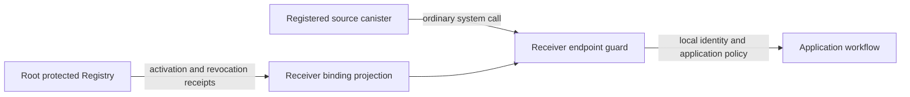

# Canic Authentication Design

Authentication is enforced synchronously at endpoints. Workflow and ops receive
already authenticated input; pure policy decides from supplied values.

## Supported boundaries

Transport and topology guards authorize controllers, Fleet members, parents,
children and exact service authorities. Role-attestation guards verify supplied
Root-signed evidence locally. Neither boundary turns an application account into
infrastructure authority or permission to spend cycles.

Root delegation proof configuration, signing, installation and renewal remain
available. See the [provisioning runbook](../operations/root-proof-provisioning.md).
Proof readiness alone does not establish an application session.

## Portable application authentication — unfinished

The accepted design uses Fleet Root-managed issuer/key enrollment and IC Auth's
portable session engine. IC Auth owns credential verification and session/login
semantics. Canic owns protected enrollment, Fleet/role authority, endpoint
admission and bounded durable storage. Transport caller and represented account
are distinct identities and must remain explicitly bound.

Storage fixtures exercise atomic session/login commits, conflicting-binding
refusal, logout custody and same-release restoration. They do not provide a live
login API. Enrollment delivery, admission wiring, retained clocks/floors and
installed recovery qualification remain open in
[#491](https://github.com/dragginzgame/canic/issues/491).
`authorize_local_application` refuses admission while that integration is
unavailable. Applications must not treat the presence of session storage or an
active Root proof as successful authorization.

## Current portable contract and implementation boundary

The normative library contracts are IC Auth's [Canic adoption](https://github.com/dragginzgame/ic-auth/blob/5d7da698d3e4d297f32445fb88adbc66a79c5520/docs/canic-adoption.md),
[sessions](https://github.com/dragginzgame/ic-auth/blob/5d7da698d3e4d297f32445fb88adbc66a79c5520/docs/sessions.md),
[browser client](https://github.com/dragginzgame/ic-auth/blob/5d7da698d3e4d297f32445fb88adbc66a79c5520/docs/browser-client.md),
[protocol](https://github.com/dragginzgame/ic-auth/blob/5d7da698d3e4d297f32445fb88adbc66a79c5520/docs/design/0.6-auth-protocol.md),
and [issuer custody](https://github.com/dragginzgame/ic-auth/blob/5d7da698d3e4d297f32445fb88adbc66a79c5520/docs/design/0.6-tee-enrollment.md).
This review selects published Auth 0.14.1. The design document's `0.6` name is
historical naming, not a dependency instruction or a second protocol lane.

Auth 0.14 returns bounded typed admission refusals through
`SessionError::admission_refusal()`; future-start, expiry and invalid credentials
remain distinct. Its Wire receiver reply and generated browser client must migrate
together; no text-error fallback is supported. Canic currently selects the engine
and passive types, not `ic-auth-wire` or a production browser adapter. Its shared
backend regressions exercise the typed projection without claiming endpoint coverage.
The upstream private browser coordinator now requires explicit account and browser
identities; that package is not a published Canic browser integration.

The selected application flow is:

1. The issuer authenticates the account. Canic's IC-authenticated path derives
   the subject from the actual authenticated caller; no request supplies a subject.
2. The issuer binds `(issuer, subject)` to a fresh browser Ed25519 public key in
   one portable credential, with protected grants and immutable login deadlines.
3. The browser authenticates as that key's own principal at each permitted receiver.
   An IC delegation preserving the account principal is not portable admission,
   even if the last signing key happens to be that browser key.
4. Each receiver uses the shared complete verifier and session engine to atomically
   admit the caller, session, replay and login reservation under protected authority.
5. Ordinary application calls use authenticated ingress and local scoped sessions;
   they carry no per-call credential and make no remote issuer authorization call.

Standard IC identity delegation may authenticate the account at step 1. It must
not substitute the account caller for the browser caller at step 3. Account linking
and resource authorization are application policy, not implicit principal equality.
Receiver-local topology does not authenticate or classify the represented account.
The issuer authenticates that account, and IC Auth verifies the independently bound
browser caller. Infrastructure guards remain separate endpoint authority checks.
The retired delegated-token endpoints, browser prepare/retrieve client and online
issuer-admission experiment are historical designs, not completion alternatives.

The independent choices must remain independent:

| Choice | Supported shared contract | Canic production status |
| --- | --- | --- |
| Certified proof | Root delegation plus issuer IC signature, complete certified verifier | Verifier selected; portable endpoints/enrollment unfinished |
| Enrolled Ed25519 proof | Protected enrolled issuer key, local verification | Verifier selected; registration/issuer lifecycle/endpoints unfinished |
| Explicitly trusted non-TEE local custody | Heap-only Ed25519 secret; authenticated public-key registration; fresh key/enrollment after upgrade | No implemented custody activation policy or issuer service |
| TEE-required custody | Qualified issuer/subnet/replica/key evidence; refuse missing assurance, never downgrade | Unavailable; software tests are not hardware evidence |
| Existing threshold signing | Retain the separately governed Root chain-key contract | Root proof provisioning exists; no new portable threshold issuer implied |
| Volatile receiver sessions | Trusted reset floors, fresh login and fresh Root enrollment after state loss | Runtime profile and production skew qualification missing |
| Persistent receiver sessions | Atomic sessions/replays/login reservations/tombstones and protected metadata; fresh authority after restore | Backend tests only; production metadata/runtime wiring missing |

Receiver persistence never stores a local issuer secret. Receiver-only artifacts
must not select issuer signing/key-custody capabilities. Local secrets must not
enter stable memory, checkpoints, backups, logs or replies. A restored issuer key
cannot regain enrollment. TEE requirements are not a universal gate on ordinary
non-TEE deployments; explicit governance/custody policy is still required.

Issuer `issue` must retain exact caller/login/request/grants, original credential
and original admission deadline. Lookup-only `reconcile` returns that original
work or unresolved. Missing, expired or pruned evidence is not proof of no effect;
lookup must never reserve, sign, renew or extend a deadline. These operations are
not yet Canic exports; IC Auth's credential envelope is not an issuer endpoint.

The shared browser journal durably invalidates the login generation before logout
fan-out. Only authenticated committed receiver acknowledgements mean local
revocation. Unknown replies remain unknown; another device and another receiver
retain their independent state. No immediate global revocation is promised.
IC Auth's browser package is private/unpublished and Canic has no production
adapter consuming it. Its Node/SDK fixtures are not Canic browser qualification.

Persistent restoration must recover the complete matching protected metadata and
canonical records, restart closed, and obtain a fresh receiver-bound Root snapshot.
It must preserve original leases and retired-key/tombstone denials. Volatile reset
must retain checked login/proof floors based on trusted boot time and a qualified
clock-skew bound. The upstream contract explicitly reports no production bound
qualified yet; controlled local clocks provide test evidence only.
The maintainer confirmed that no production bound is qualified and directed that
production activation remain closed. Controlled-clock fixtures may continue;
their skew values are not deployment configuration or production evidence.

Local application scope and TTL configuration is independent of the retained
proof-support flags. Its own `allowed_scopes` is
the local ceiling; authenticated Root enrollment must independently constrain
issued grants. Configuration does not install enrollment or activate admission.
The current authority binding still tracks Root verification configuration and
registry epoch until the protected portable enrollment owner is connected.

Login reservations and logout tombstones currently have no production pruning
path. Their deletion must use the shared ledger's transactional maintenance and
persist its trusted clock even on empty or failed work. The existing stable Auth
header now retains `observed_at_ns`; session/replay cleanup advances it before
validation, including empty and refused work, and rejects clock rollback. It
rebuilds derived byte accounting after clock changes and invalidates indexes on
corrupt records. Failed cleanup preserves session/replay/login rows, while the
accepted clock observation remains durable. This is a current-contract hard cut,
not a predecessor-state migration.

The same protected clock still needs wiring into production admission, logout,
ledger restoration and retained budgets. Cleanup alone does not complete those
obligations or authorize tombstone deletion. Session/replay cleanup validates the
original snapshot before expiry can remove evidence of a mismatched login binding;
it does not prune login denials.

## Role Attestation

Role attestations use Root canister signatures with an update-then-query
flow. Verification binds the supplied proof to the transport caller.

Data:

```rust
pub struct RoleAttestation {
    pub subject: Principal,
    pub role: CanisterRole,
    pub subnet_id: Option<Principal>,
    pub audience: Principal,
    pub issued_at_ns: u64,
    pub expires_at_ns: u64,
    pub epoch: u64,
}

pub enum RoleAttestationRootProof {
    IcCanisterSignatureV1(IcCanisterSignatureProofV1),
}

pub struct SignedRoleAttestation {
    pub payload: RoleAttestation,
    pub root_proof: RoleAttestationRootProof,
}
```

Root canister-signature role attestations use:

```text
seed   = canic-root-role-attestation
domain = canic-root-role-attestation
```

Issuance flow:

- `canic_root_command::PrepareRoleAttestation` is an update call on an `Active`
  Fleet Subnet Root by an active Component Registry member
- prepare resolves the protected Registry partition and requires its exact
  canister, role and placement Subnet to match the request
- `canic_root_auth_status::RoleAttestation` is a query call by the same still-active caller
- retrieval is caller-bound and returns the embedded root proof

The query retrieval step requires a Root data certificate. It is therefore a
client/direct-query proof path, not a synchronous application-Canister update
path: an inter-Canister call reached from a replicated update does not receive
the Root data certificate needed to assemble the proof. Retrying that call or
substituting a placement value cannot make the certificate available.

Verifier behavior:

- hash the canonical `RoleAttestation` payload
- verify the embedded role-attestation root proof against the configured root
  canister id and raw IC root public key
- enforce subject, audience, subnet, time window, and minimum accepted
  epoch locally; the receiving endpoint separately checks the attested role
  against its allowed roles. `issued_at_ns` may be at most
  `AUTH_TIME_SKEW_ALLOWANCE_NS` ahead of verifier time, while
  `expires_at_ns` remains strict
- make no root, issuer, or management-canister call on the protected path

Current issuance rule:

- `canic_root_command::PrepareRoleAttestation` and
  `canic_root_auth_status::RoleAttestation` are the active Root protocol variants

The current role-attestation request supplies its epoch; issuance validates
the subject, role, placement and TTL but does not derive that epoch from a
membership revocation transaction. A configured minimum epoch is therefore
not, by itself, a membership-removal protocol. Do not rely on it to establish
that a removed member's previously issued proof has been revoked.

### Root-local Membership Boundary

`RootComponentMembershipApi::active_member` is a read-only facade over the
current protected Registry inside Root. It resolves a top-level Component or
registered descendant and preserves the distinction between negative active
membership and Registry/runtime failure. It does not itself authorize access
to a lookup or grant an application permission.

Canonical Root exposes `canic_root_membership` as a guarded read-only update
for controllers and active local managed members. Its response contains an
optional exact binding; admitted lookup failures remain endpoint errors. Normal
Fleet lifecycle fences can reject the call before its handler runs. The public
Directory query still requires the caller to belong to the queried Component.
Cross-Root service calls retain the Fleet-service peer authority boundary.

An online membership endpoint observes Registry state only
at lookup time and introduces an await before receiver work. An operation
requiring exact serialization with revocation needs an explicit lifecycle and
effect boundary, rather than treating the lookup result as a lasting permit.

### Receiver-local Caller Authority — Accepted Contract

This is the accepted contract for cross-Component system calls under
[Canic#38](https://github.com/dragginzgame/canic/issues/38). Integration is underway
in the current checkout; the issue owns complete-batch qualification. Strict
revocation completion remains the default. Bounded proof-expiry revocation
requires an explicit product decision.

The capability distributes registered caller identity to the
receivers that need it. The IC already authenticates the transport Principal.
Root owns the corresponding managed binding and lifecycle; each receiver owns
its application permissions. An ordinary system call should combine those facts
locally, without asking Root to classify the caller on every request.

#### Decision and alternatives

Use durable, receiver-specific projections of Root-issued managed bindings.
Maintain them as part of activation, registration and removal. Keep caller
authentication at endpoints and extend protected Directory distribution with
the required receiver view and lifecycle receipts. Do not create a separately
managed topology or a background synchronization service. The existing Fleet
admission projection supplies a useful prepare/activate/open pattern, but its
operator Principal list is not managed canister membership and must not be
repurposed as that authority.

| Approach | Ordinary call | Removal semantics | Assessment |
| --- | --- | --- | --- |
| Root membership lookup | Remote lookup before work | Observes membership at lookup time; an await still separates lookup from effects | Inspection remains a separate point-in-time observation |
| Root role attestation | Local proof verification | Issued material can survive membership removal until expiry or receiver fencing | Current issuance needs a caller-bound direct query certificate; it is not an autonomous canister update flow |
| New update-delivered signed permit | Local proof verification | Expiry or explicit receiver fencing | Adds issuance, renewal and cryptographic work without removing the strict-revocation distribution requirement |
| Periodically refreshed Directory | Local lookup | Stale entries remain usable until refresh | Insufficient for strict completion |
| Receiver-specific binding projection | Local Principal-to-binding lookup and application policy | Removal commits only after all affected receivers deny new admission | Default for declared same-Root system permissions |

Portable credentials remain useful when the receiver is outside the controlled
deployment graph or a bounded authorization lifetime is the selected contract.
They are not required to establish the identity of an IC transport caller.



#### Authority and state ownership

The selected build declares receiver policies in Canic-owned TOML. A policy
names exact Component Spec/role pairs, same-Root or same-Component scope,
permission direction and receiver operation classes. Endpoint guards select the declared policy;
they never accept a claimed role, source binding or policy from the request.
Unknown roles, ambiguous scopes and undeclared receiver policies reject during
build admission. Preserve permitted Component Spec/role pairs per operation;
independently unioning Specs and roles must not introduce undeclared pairings.
The compiled policy includes capacity and receiver role in its canonical digest.
Selector ordering is normalized. Unknown selectors, unsupported receiver roles,
duplicate selectors and invalid capacity refuse build admission.

```toml
[roles.user_hub.caller_authority]
maximum_entries = 1024
maximum_bytes = 16777216

[roles.user_hub.caller_authority.permissions.notify]
direction = "caller"
scope = "same_root"
sources = [{ component_spec = "users", role = "user_shard" }]

[roles.user_hub.caller_authority.permissions.metrics_target]
direction = "target"
scope = "same_root"
sources = [{ component_spec = "users", role = "user_shard" }]
```

`caller::has_permission("notify")` selects a declared caller-direction permission
in the endpoint access expression. `canic::access::caller_authority::admit` retains
an authenticated caller ticket; `revalidate` checks it before a new effect after
an await. Proxy code uses `select_target` and `revalidate_target` separately from
its incoming subject authentication. Target-direction names cannot be selected
by the endpoint caller guard. Omitting caller authority grants no permission.

Root derives each entry from protected Registry evidence. A projection retains
the exact receiver binding and installation identity, issuing Root/Fleet
authority, source managed binding and source installation identity, policy
digest, monotonic projection generation and content digest. Generation is
authority-owned; a caller cannot select it. No role string supplied by the
source can enlarge its permissions. Dynamic descendants use their own role and
Principal while retaining the owning Component and parent bindings.

Root also retains the exact issuing Root installation, receiver set and
publication progress within the existing lifecycle operation. Every recipient
must match that issuing installation before any publication is sent. Receiver
enrollment and source membership transitions share an
ordering boundary so a new receiver cannot escape an in-progress removal.
New receivers start fenced and obtain a complete current projection before
opening. The source of truth remains the existing Registry; the projection is
a materialized authorization view, not a second independently editable registry.

Ordinary calls rely on this committed authority, not on Root's instantaneous
reachability. A Root outage therefore leaves already granted calls available
while blocking new publication and revocation completion. This intentionally
changes the availability contract of an online lookup that refused whenever
Root could not answer. Local authority failures still fail closed. Planned
Same-release Root/Component deactivation or identity replacement must fence affected
receivers before invalidating the corresponding grant; an unfenced lifecycle
change cannot be declared complete. A receiver cannot locally detect an
unobserved remote lifecycle change or external controller intervention.

Receiver endpoints authenticate publication against protected installation
authority, then delegate to workflow. Model owns records and generation/digest
invariants; ops owns conversion, storage and individual platform effects;
policy owns pure admission/transition decisions; workflow owns publication and
receipt reconciliation. Application endpoint guards perform local admission.
Missing, fenced or inconsistent authority fails closed with a distinct typed
reason; it never becomes an ordinary wrong-role denial or triggers a hidden
remote fallback.

#### Activation and dynamic children

Root registers the exact source identity while application startup remains
fenced. It derives the affected receiver set from declared policy and publishes
the source binding as pending authority. Receivers retain the exact operation,
generation and digest and acknowledge without admitting a not-yet-active source.
Root commits active membership, opens the corresponding receiver entries, and
only then declares publication complete and releases application startup.

Partial publication can temporarily deny a valid newly active source. It must
never admit an unregistered or inactive source. Root serializes conflicting
activation/removal work until this operation is reconciled. A lost reply is
resolved from the receiver's exact durable receipt; retry does not add another
grant. Application readiness includes this publication outcome, including for
dynamically created managed children. It cannot be a best-effort timer after
the child has already been reported ready.

Framework runtime activation and application release are separate. Waiting for
application hooks or fixture import before membership publication would create
a cycle: Root would wait for readiness while the receiver waited for Root.

Separate the existing operation's framework-bootstrap observation from its
application-startup release. Root may observe completed framework bootstrap
while application hooks and ordinary application admission remain fenced. It
then enrolls every new receiver under the membership ordering boundary, commits
and publishes the source binding, reconciles the complete original recipient
census, and issues the exact protected startup release through that operation.
Only this release schedules application hooks and permits application readiness.
An initial empty recipient census still requires the exact issuing installation
and operation evidence. Bootstrap work that needs a prepared parent retains its
existing allocation-scoped authority; it must not gain ordinary active-member
permissions to break the cycle.

The startup release belongs to the existing runtime/lifecycle owner. Retain
application init arguments until that release and bind it to the current source
installation and completed publication. A lost reply reconciles the same
release; an interrupted operation does not become ready through a timer or
upgrade. Synchronous lifecycle participants still run immediately after Canic
restoration. Same-release upgrades restore the committed startup decision,
receiver grants and pending fences before deferred hooks can run. No additional
lifecycle owner or polling loop is introduced.

The integration boundary is concrete and shared by top-level Components and
dynamic children:

| Owner | Maintained behavior | Qualification boundary |
| --- | --- | --- |
| Core activation storage and ops | Retain init arguments after framework activation; persist the exact publication-bound startup release in the existing activation record | Cold restoration before/after release, typed conflict refusal and unchanged replay |
| Facade lifecycle adapter | Schedule framework bootstrap at runtime activation; schedule application hooks only from the retained startup release | No application hook before release, including interrupted same-release upgrades |
| Endpoint admission | Keep application admission closed until startup release, independently of runtime activation and Fleet admission projection | Public and guarded application endpoints refuse while framework status/recovery remain available |
| Control Plane membership journal | Observe framework bootstrap without waiting for application readiness; publish and reconcile every original recipient; release startup and then report application readiness | Top-level and dynamic-child PocketIC journeys, missing receipts, lost replies and enrollment races |

`ConfigureRuntime` opens fresh Fleet admission and starts framework bootstrap.
The separate application gate uses the retained startup decision; runtime
`Active` alone cannot permit application hooks or endpoints. Protected framework
recovery and bootstrap commands remain available under their existing guards.
The reusable native timer claim serializes original initialization, while exact
release retries and same-release restoration can resume interrupted hooks.

Adding a receiver later requires the same complete initialization boundary.
Removing a receiver removes its publication obligation only after its own
retirement proves it cannot resume with stale authority. An unavailable or
temporarily stopped receiver does not satisfy that condition by itself.

#### Strict revocation and in-flight work

Revocation is a distributed lifecycle operation with an explicit completion
point. Root freezes the source identity, receiver set and successor projection
under the transition ordering boundary. It prevents new grant publication for
that source, then asks every affected receiver to retain a durable denial fence.
Only after all exact fence receipts are reconciled may Root commit inactive
membership and report revocation complete. Successor activation retains the
denial; a delayed grant or stale-generation replay cannot reopen it.

Component draining and subtree removal also invalidate descendant authority.
Before `begin_component_draining` commits Active to Draining, its workflow freezes
the complete affected receiver census and reconciles durable denial. Discovery
uses source-installation/receiver indexes, including policies that admit descendant
roles and exclude the parent role. Source membership remains active while this
publication is pending; the retained operation closes conflicting lifecycle work.
The draining or removal Registry transition commits only after denial coverage
is complete. Removal drivers also finish the original denial journal on retry.

For a whole Component, publish an installation-bound Component-wide denial
fence. Local admission and retained tickets check that fence for every descendant,
without walking the full child catalog on each call. Clean up obsolete source
rows in bounded pages while retaining the fence's original authority and replay
ordering; clearing rows must not reopen delayed child grants. A nested subtree
requires an exact bounded source census or an equally authoritative subtree
fence. Do not infer affected receivers only from the removed parent role.
Receiver cleanup visits at most 128 source rows per completion call and retains
the Component installation fence. Root removes terminal recipient/step progress
in pages of at most 64 rows, retaining the original operation scope and census
commitment. Exact terminal replay performs no new publication. Existing uncertain
paid effects remain reconcilable under their issued operation authority.

During preparation the source is revocation-pending, not falsely reported as
fully revoked. Receivers that have acknowledged already deny it; a receiver
that has not acknowledged may still admit it until fenced. There is no claim
of simultaneous cross-canister revocation at command submission. An unavailable
receiver blocks completion while other healthy receivers can deny the source.
This is the availability cost of the strict contract, not a reason to bypass
the missing acknowledgement. No timeout implicitly converts it to TTL revocation.

The default guarantee is no new protected admission after revocation completes.
Previously admitted work is tracked separately. A local admission ticket binds
the exact source, receiver, policy generation and operation class. Workflow
revalidates ticket/fence state before new protected effects after each await;
it does not repeat caller authentication. Already-issued paid effects retain
their original operation authority and reconcile instead of being discarded.
Operations requiring quiescence also wait for applicable admitted work to reach
its defined terminal boundary before deletion or lifecycle completion. Endpoint
admission alone cannot retroactively cancel an issued remote effect.

Receiver upgrade restores and validates the projection and pending denial
synchronously before hooks or deferred application work. Publication/revocation
retries are same-release recovery. Pre-1.0 release replacement is a clean
reinstall: qualify current artifacts, clear framework/application state, install
current authority, and initialize fenced. No predecessor adoption, migration,
mixed-version operation or compatibility endpoint is introduced.

Cross-release reset must not require a predecessor to implement the current
publication protocol or decode its old membership state. The selected current
build, explicit physical inventory and current controllers own that reset.
Replace affected receivers with the qualified current artifact in its fenced
initial state before opening current authority. Keep physical interruption,
cycle conservation and uncertain paid-effect reconciliation under the governed
reset flow; do not use predecessor membership adoption as reset authority.

#### The four reported consumers

| Consumer | Local identity decision | Application responsibility |
| --- | --- | --- |
| User Hub system calls | Admit the observed caller from declared system roles | Bind user/project arguments to the actual operation and caller's permitted scope |
| Notification producer batches | Admit the observed Market or Project Instance caller | Bind producer identity to caller and enforce batch replay, payload and recipient rules |
| Discovery registration | Admit the observed Project Instance caller and its owning tree | Require the registered Project principal to match the caller; constrain registration fields |
| Remote metrics proxy | Validate selected target against a permitted-target projection; target independently admits the calling User Shard | Authenticate the Admin subject at the proxy and preserve caller/target direction |

Target selection is not caller authentication. A subject-bound attestation for
the proxy does not classify an arbitrary metrics target. The proxy needs a
Root-derived target view, scoped to its declared allowed target roles, alongside
the target's own caller policy. Requesting an arbitrary Principal must not turn
the proxy into an unrestricted remote-call facility.

Compiled caller permissions support `same_root` and `same_component`. They reject
foreign-Root bindings even within the same Fleet. Existing cross-Root services
continue to require their exact Coordinator/Registry and Fleet-service peer
authority; a target permission cannot replace that authentication. Cross-Root
caller-projection distribution is not an implicit extension of these scopes.

#### Bounds and recovery evidence

Publish only entries required by a receiver's declared policies, with paged
staging and atomic digest-bound activation. Define limits for retained entries,
receivers, encoded bytes and concurrent operations; refuse capacity before
partial authority is opened. Preflight and reserve the complete affected
recipient set before the first denial fence so a known capacity shortage cannot
strand earlier participants in an unfinished change. Use source-indexed
recipient tracking and changes to affected entries rather than full-Fleet fanout
for every child. Persist recipient progress independently so an acknowledgement
does not rewrite the complete recipient census. Bound retries
and return resumable progress. Generation ordering must survive acknowledged
entry removal so a delayed old grant cannot be mistaken for a fresh operation.

Root publication progress uses an immutable census commitment and independent
recipient rows keyed by the original operation and receiver. Stage changes update
fixed metadata; acknowledgements update one recipient. Starting another operation
must retain earlier unfinished and terminal evidence under its original identity.
The enclosing lifecycle journal remains the operation owner; the index is its
storage, not a replacement Registry or independently driven journal. Recovery
checks the selected operation, current issuing installation, census count and
commitment, exact recipient bindings and legal receipt phases. It never rebuilds
an original census from today's Registry to omit an unavailable receiver.

An activation cost scales with relevant receiver instances, and retained state
scales with authorized source/receiver relationships. Receiver projections are
recommended for this controlled graph, not claimed to have constant lifecycle
cost. Qualification must measure the actual dynamic-instance and receiver-shard
cardinalities. If policy creates an impractically dense graph, review aggregation
or the explicitly bounded credential alternative before expanding limits.

| Evidence | Required property |
| --- | --- |
| Native model/policy tests | Exact caller, Component Spec/role pair, tree, Fleet, installation, generation and digest checks; capacity refusal and unchanged state on conflicts |
| PocketIC lifecycle | New dynamic child calls each admitted receiver after readiness; wrong role, caller and owning tree reject |
| Exact interruption/retry | Lost publication and fence replies, partial activation, unavailable receiver and reordered messages reconcile without widening authority |
| Revocation boundary | Every receiver denies new admission when completion is reported; enrollment races cannot omit a receiver |
| Await/effect boundary | Suspended work cannot issue a newly forbidden effect; uncertain previously issued effects reconcile under original operation identity |
| Same-release upgrade | Two identical-Wasm upgrades retain bindings, fences, receipts and generation ordering before hooks run |
| Metrics direction | Valid Admin plus invalid target rejects; valid target plus unauthorized proxy caller rejects |
| Cost and isolation | After publication, ordinary authorization performs no Root/management call; unrelated source changes do not replace every receiver's full state |

Implementation must be one coherent outcome covering policy/build admission,
Core storage and endpoint guards, Control Plane activation/removal publication,
target projection, bounded recovery, generated Candid/fixtures, documentation
and direct evidence. A guard alone or a successful fresh activation is not
completion. Downstream Toko adoption and its application regression suite remain
separate read-only-repository work until explicitly authorized. Keep the full
current contract at v1 through the pre-1.0 hard cut; do not introduce a second
product protocol generation or a lookup fallback during rollout.

#### Implementation boundary

The maintainer authorized implementation alongside the separate FR1 work. The
current checkout implements compiled policies, protected receiver publication,
local caller/target tickets, Root membership orchestration, startup release and
bounded cleanup under the existing owners. [Canic#38](https://github.com/dragginzgame/canic/issues/38)
owns implementation acceptance tracking; the compact handoff records current-source
qualification. The original isolated draft
was deleted on 2026-10-05; its historical test counts are not current-source evidence.

Receiver budgets count independently indexed source, fence and receipt records.
Each record reserves an 8 KiB encoded-record ceiling plus one 8 KiB header;
the configured entry and byte limits both apply. Root preflights every original
recipient before the first staging or denial effect, under its serial publication
boundary. The Root index has a 262,144-row ceiling with a 4 KiB encoded record
limit. These are retained-record budgets, not a claim about stable-memory tree
overhead or dense-graph performance. Original receiver receipts and denial fences
remain within those limits; capacity refusal preserves the unfinished operation.

Current-source qualification combines native receiver/journal and startup checks,
endpoint macro checks, strict integration lint and targeted PocketIC journeys.
The installed cases cover bootstrap, dynamic children, frozen denial recovery,
enrollment races, lost replies, identical-Wasm upgrades, effect fencing and Root
retirement. Generated Candid and both public managed fixture helpers are qualified.
See the issue and compact handoff for the validation boundary and retained logs.

The general Root membership lookup is tracked separately in
[Canic#39](https://github.com/dragginzgame/canic/issues/39).
`canic_root_membership(RootMembershipRequest { subject })` is a read-only update
so an ordinary inter-canister call can obtain a point-in-time observation.
It requires a Root controller or an active managed member of that Root, in
addition to the normal Fleet update guard. `RootMembershipResponse.member` is
the exact active `ManagedCanisterBinding`, including a descendant's own role,
or `None` for inactive/unregistered subjects. Once admitted, runtime and Registry
failures remain typed errors. A Prepared Root rejects through the normal Fleet
lifecycle fence before lookup admission. Cross-Root callers receive no implicit
discovery access.
This observation is not a permit for later effects. Membership changes still
require protected inter-canister publication; ordinary application admission
then uses receiver-local authority under
[Canic#38](https://github.com/dragginzgame/canic/issues/38).

## Configuration and recovery

Cargo capabilities and role configuration are explicit. The maintained
`auth.delegated_tokens` configuration supplies Root proof authority; its name
does not imply an application credential endpoint. Use the
[configuration reference](../../CONFIG.md#authdelegated_tokens) and exact
qualified artifacts for the selected Fleet.

Same-release retry and restoration preserve authority and paid-effect evidence.
Across releases, rebuild the family and cleanly reinstall under the cycle-safe
release procedure.

## Continue From Here

- [Access contract](../contracts/ACCESS_ARCHITECTURE.md)
- [Root delegation contract](../contracts/AUTH_DELEGATED_SIGNATURES.md)
- [Authentication feature guide](../features/authentication/README.md)
