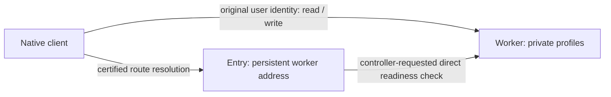

# Persistent profile demo

This Canic-owned application gives the team a small stateful deployment to use.
One worker owns a nonzero user ID, its original caller principal, a private
display name and a revision. It uses IC Storage directly, with one lifecycle and
two named allocations. A separate entry stores one immutable worker address and
checks readiness through a direct inter-canister call. There is no database,
Coordinator, Store or Relay dependency.

## Current mainnet demo

Deployed and checked on 2026-11-13:

| Role | Canister |
| --- | --- |
| Entry | `bisqm-biaaa-aaaas-qhfeq-cai` |
| Worker (`profile-v2`) | `4pkhu-oaaaa-aaaai-ra2ta-cai` |

User 1 belongs to `canic-mainnet`. Its revision 2 profile survived the worker's
v1-to-v2 upgrade with the same owner, name and user ID. Read it from this checkout:

```sh
./target/debug/canic-profile --entry bisqm-biaaa-aaaas-qhfeq-cai get 1
./target/debug/canic-profile --entry bisqm-biaaa-aaaas-qhfeq-cai check
canic fleet show --app profile --fleet mainnet --link bisqm-biaaa-aaaas-qhfeq-cai:4pkhu-oaaaa-aaaai-ra2ta-cai --open
```

The fleet opens in the normal desktop browser at **http://localhost:8787/**.
Keep its terminal running; Ctrl-C stops it. If the viewer is already running,
open that URL or use another `--port`. The snapshot also includes the earlier
Hello World canister. Private profile reads are explicitly uncertified queries;
deployment metadata and update replies use the certified paths described below.

The creation and upgrade receipts are retained in `.canic/` under their original
operation IDs; see [the mainnet evidence](../design/m0-first-journey.md#profile-mainnet-deployment-and-preservation).
The following fresh-deployment instructions create another pair; they are not
needed to use this existing demo.

## Local rehearsal

Build the tools and run the local deployment/preservation rehearsal:

```sh
make profile
make profile-test
```

The test needs the already prepared PocketIC server (`make m0-setup`) and ICP CLI
(`make install-ic-tools`). It deploys through Canic, exercises the profile Wire
endpoints, fills the bounded store, rejects unauthorized calls, rolls back a
failed upgrade, installs a second executable and checks the retained values.
It also deploys the entry, tests controller-only binding and direct readiness
checks, preserves the route across an entry upgrade, and retains the same route
when the worker is unavailable. It exercises the native client and emits a fleet HTML snapshot under
`target/profile/journey-*/fleet.html`. The local replica stops when the test ends.
Serve that retained snapshot with `canic fleet view target/profile/journey-N/fleet.html`
(use the directory from your run), then open **http://localhost:8787/**.
Keep the viewer running; Ctrl-C stops it. No editor HTML preview is required.

## Deploy a fresh mainnet worker

The worker has its own storage format. Create a new canister; it cannot be
installed as an upgrade over the stateless Hello World canister.

```sh
canic artifact build --json --package canic-profile-worker > target/profile-build.json
canic fleet plan --no-config --json \
  --wasm "$(jq -r .wasm target/profile-build.json)" \
  --network ic \
  --controller "$(./.tools/ic/bin/icp identity principal --identity canic-mainnet)" \
  --cycles 1000000000000 > target/profile-plan.json
cat target/profile-plan.json
canic fleet apply --no-config --json "$(jq -r .operation target/profile-plan.json)" \
  --identity canic-mainnet --icp-bin ./.tools/ic/bin/icp \
  > target/profile-receipt.json
```

Review the exact artifact, controller and 1T-cycle ceiling before applying.
Enter the identity password in the terminal prompt. Preserve `.canic/` and the
operation digest for recovery. Approval expires after one hour; an unresolved
submitted attempt must keep its original recovery identity.

## Use your profile

From the repository root:

```sh
profile_canister=$(jq -r .canister target/profile-receipt.json)
./target/debug/canic-profile --canister "$profile_canister" info
./target/debug/canic-profile --canister "$profile_canister" put 1 --name "My profile"
./target/debug/canic-profile --canister "$profile_canister" get 1
./target/debug/canic-profile --canister "$profile_canister" put 1 --revision 1 --name "Updated profile"
canic fleet show --no-config --open
```

The client defaults to identity `canic-mainnet`, network `ic` and the prepared
`./.tools/ic/bin/icp`. Each private operation uses the actual signed IC caller;
another identity cannot read or change your profile. Each caller owns one user ID.
Names are private application data; controller authority still permits code
replacement, so this is not protection against a trusted controller.

Registration starts at revision one. Updates name the current revision and
increase it by one. Exact replay of the last transition returns the same profile
without another revision. A conflicting or older revision is refused. There is
no automatic retry: after an uncertain write, use `get` before issuing a new
revision. Private reads require an authenticated caller; readiness is public.
Both use explicitly uncertified queries. Update replies are obtained through ICP CLI's
normal certified request-status path. Passwords remain in its terminal prompt.

## Preserve the profile across an upgrade

Build the second executable, then use the existing Canic plan/apply path:

```sh
canic artifact build --json --package canic-profile-worker --features profile-v2 \
  > target/profile-v2-build.json
canic fleet plan --no-config --json \
  --wasm "$(jq -r .wasm target/profile-v2-build.json)" \
  --network ic \
  --controller "$(jq -r .controller target/profile-receipt.json)" \
  --target "$profile_canister" \
  --previous-module "$(jq -r .module_hash target/profile-receipt.json)" \
  > target/profile-upgrade-plan.json
cat target/profile-upgrade-plan.json
canic fleet apply --no-config --json "$(jq -r .operation target/profile-upgrade-plan.json)" \
  --identity canic-mainnet --icp-bin ./.tools/ic/bin/icp \
  > target/profile-upgrade-receipt.json
./target/debug/canic-profile --canister "$profile_canister" info
./target/debug/canic-profile --canister "$profile_canister" get 1
```

`info` changes from `profile-v1` to `profile-v2`; the ID, owner, name and revision
remain. The separate `reject-upgrade` feature exists only for the local failure
rehearsal; ordinary deployment selects neither it nor `--all-features`.

## Add the entry and view the pair

Deploy the worker above first, then create the entry using another reviewed
1T-cycle creation ceiling:

```sh
canic artifact build --json --package canic-profile-entry > target/profile-entry-build.json
canic fleet plan --no-config --json \
  --wasm "$(jq -r .wasm target/profile-entry-build.json)" \
  --network ic \
  --controller "$(jq -r .controller target/profile-receipt.json)" \
  --cycles 1000000000000 > target/profile-entry-plan.json
cat target/profile-entry-plan.json
canic fleet apply --no-config --json "$(jq -r .operation target/profile-entry-plan.json)" \
  --identity canic-mainnet --icp-bin ./.tools/ic/bin/icp \
  > target/profile-entry-receipt.json
profile_entry=$(jq -r .canister target/profile-entry-receipt.json)
./target/debug/canic-profile --entry "$profile_entry" bind "$profile_canister"
./target/debug/canic-profile --entry "$profile_entry" route
./target/debug/canic-profile --entry "$profile_entry" check
./target/debug/canic-profile --entry "$profile_entry" get 1
canic fleet show --no-config --link "$profile_entry:$profile_canister" --open
```

The fleet command prints a localhost URL and stays running to serve it. Use
`--serve` instead of `--open` if you want to click the URL yourself. Stop the
viewer with Ctrl-C; use `--port 8788` if the default port is already occupied.

Binding requires the entry's current controller. Repeating the same binding is
idempotent; replacing it is refused. An invalid, anonymous, management or self
principal is refused. Binding records the operator's selection; it does not
prove the selected code is a profile worker. `check` performs that protocol
observation separately, with one outstanding call, a five-second wait, no cycles
attachment and no automatic retry. It is controller-only to bound public fan-out.
An unavailable worker produces an explicit unknown result and keeps the binding.



With `--entry`, the client resolves the worker using a replicated update and ICP
CLI's certified response before sending profile data. The subsequent private
operation is signed by the same user and sent directly to that worker. The entry
does not impersonate the user, own private profile data, or control the worker.
Trust in the entry and its controller is required for discovery, just as trust in
the worker and its controller is required for private data. `--canister` remains
the explicit direct-worker path. Uncertified `route` queries exist for observation,
but the native client uses `resolve` even for its `route` command.

The fleet page shows both certified deployment observations and a separate
**declared** entry-to-worker arrow. `--link` is an operator-supplied visualization;
it is not an on-chain route or readiness claim. Both targets must exist in the
selected journal under one unambiguous network trust binding. Rerun `check` for
a point-in-time readiness observation and regenerate the fleet snapshot to refresh.

The entry has its own single named Storage allocation, a 16-page (1 MiB) stable
ceiling and no timers. Upgrade it using the same Canic plan/apply workflow with
its receipt's principal, controller and previous module hash. Strict restoration
retains the original binding; it does not reset to an unbound entry.

## Limits and remaining work

The worker admits 16 profiles, names of at most 128 UTF-8 bytes, 4 KiB RPC frames
and at most 32 physical stable pages. There are no application timers. Restore
strictly reopens the original allocations and records; it never resets or
silently initializes a missing store. No cross-schema migration is supplied.

This establishes stateful storage plus a separate discovery entry and a real
direct-call observation. The separate [bounded growth demo](growth.md) now
qualifies one autonomous worker locally, with a surviving manager journal.
The existing entry retains its original route; new workers are used directly.
The fleet view observes deployment metadata and
operation evidence, not profile contents or application readiness.
