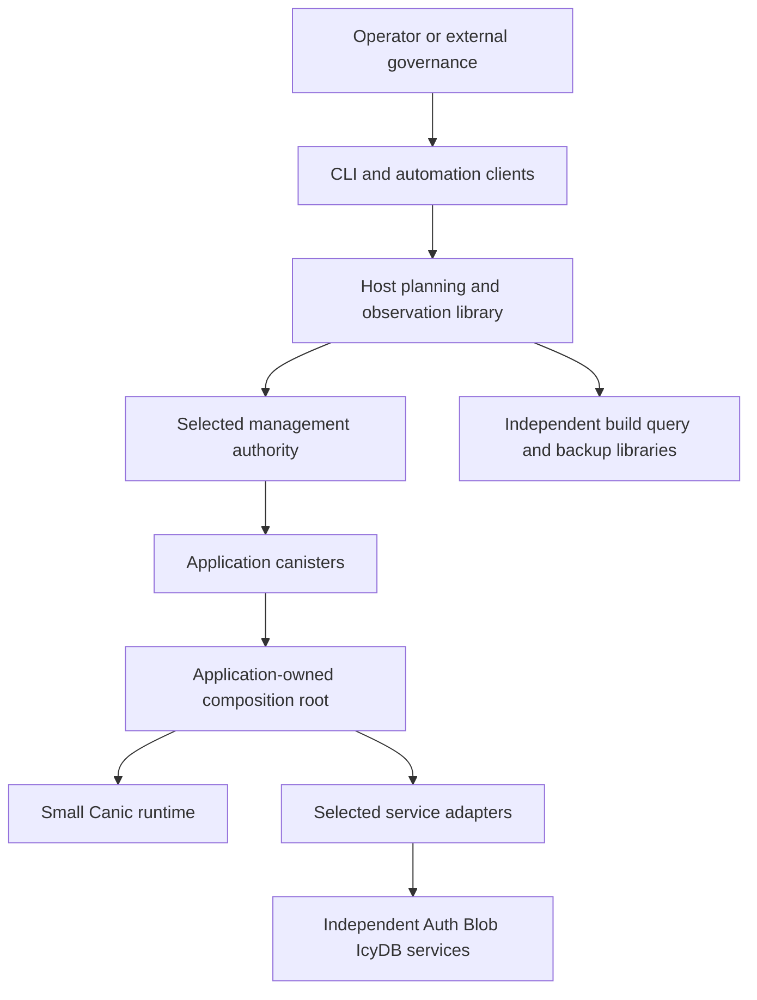
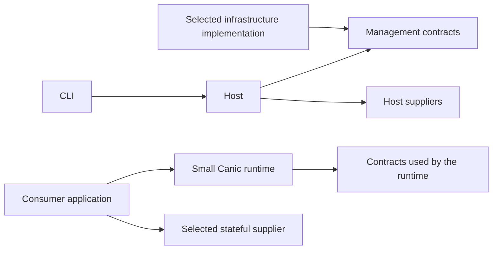

# Canic system design

Status: accepted architectural basis; M0 is underway and the first M1 CLI/demo path is implemented. See the [current evidence record](m0-first-journey.md) for qualified paths and remaining work.
Date: 2026-11-14. Domain/configuration consistency reviewed against the implemented CLI; see the [review evidence](m0-first-journey.md#domain-and-configuration-review).

Naming: Canic is this fresh rewrite. Legacy Canic is the predecessor now hosted
as [canic-legacy](https://github.com/dragginzgame/canic-legacy). Historical package
names and source paths below identify that predecessor as observed, not current
rewrite dependencies.

Canic should let a Rust application team build and operate a multi-canister IC application without writing its own infrastructure management system. It should make the first useful capability inexpensive to adopt, keep application decisions with the application, and remain understandable after years of change.

The maintainer treats old Canic as an intensely iterated design document spanning four years and four generations of LLMs. Its code records experiments, needs, failure modes and accumulated decisions. An existing mechanism has no presumption of inclusion in Canic. This freedom also applies to this design and the proposed crate layout.

Start from user outcomes and derive the smallest coherent system that achieves them. Preserve a safety requirement when its underlying threat, resource obligation or recovery need still exists; rederive its implementation. Historical guards can encode obsolete assumptions as well as important protections. The working direction is a small composable runtime and host planning with explicit effect authority. Physical control-plane topology remains a design decision. Persistent production use is a required destination; a reinstall-only prototype must never be advertised as that destination.

This document covers the whole product surface identified in Canic's current manifests, public modules, CLI catalog, feature guides, active designs and twelve idea topics. Coverage means every identified responsibility receives a reasoned disposition, including removal, delegation or deferral. It does not create a feature-parity backlog. It is not a claim that every historical behavior is desirable, every source line has been audited, or an unbuilt implementation is complete. The coverage register and source record make omissions and disagreements reviewable.

Read by concern: [product contract](#1-product-contract), [architecture](#4-architecture-and-dependency-direction), [durable operations](#7-durable-operations-and-uncertainty), [funding](#9-funding-and-economics), [persistent lifecycle](#13-persistent-releases-checkpoints-and-recovery), [delivery plan](#16-delivery-plan-with-deletion-gates), [capability coverage](#17-complete-capability-disposition-register), [paused ideas](#18-deferred-ideas-and-paused-slices), and [decisions for review](#19-decisions-required-before-implementation).

## 1 Product contract

### Users and outcomes

An application developer should be able to start with an ordinary Rust canister, add one capability, and understand its memory, lifecycle, permissions and cost. An operator should be able to review changes, run them, close the terminal, resume elsewhere with the required custody, and distinguish success from an unknown result. A governance-controlled application should be able to approve the same exact effects without an operator key acquiring additional authority.

The core journeys are:

1. Inspect externally built artifacts without installing a Canic runtime.
2. Build a fresh application and establish a working single-subnet Fleet.
3. Add another subnet and grow shared or dedicated workers within explicit capacity and funding limits.
4. Continue operating during operator absence, subject to finite delegated authority.
5. Diagnose an incomplete operation and resume its original work without paying twice.
6. Compose Auth, IcyDB, Blob or another runtime without duplicate lifecycle or memory ownership.
7. Capture and restore an application-consistent checkpoint when the application supplies the necessary protocol.
8. Eventually change a persistent production installation while preserving explicitly promised identity, state and outstanding obligations.
9. Release disposable capacity, reclaim controlled resources, or destroy an installation under a separately reviewed disposition.

Application identity, tenancy, routing semantics, data schemas, consistency, business transactions, user balances and governance remain application-owned. Canic supplies infrastructure capabilities, not a database replication system, application economy or universal distributed transaction manager.

### Hands-on delivery from the start

The team must be able to use each delivered increment and feed experience into the next one. The first deployment is a Hello World application on the IC mainnet, with a local rehearsal of the same supported path. Mainnet experimentation begins before the stateful consumer, autonomous growth and production lifecycle are complete. Passive inspection is useful as an intermediate increment, but does not complete M1.

The first hands-on loop is: obtain the tool and example, build, review the target/controllers/artifact and finite cycle budget, deploy, call the application, inspect its status, change the greeting, and deploy the changed executable. The second deployment must explicitly state whether it preserves the principal and state or creates a fresh disposable installation. Unsupported upgrades must not become an implicit reinstall. Retained canisters, balances and the next maintenance or disposition action remain visible after the experiment.

Deliver this through the product CLI and documented public interfaces, not a private deployment script. Each increment includes a runnable example, exact setup and usage instructions, supported networks, visible limitations and a repeatable team exercise. Team feedback on setup, errors, deploy time, costs and operation status informs the next scope; record actionable feedback in owning GitHub issues. Keep the previously delivered journey runnable as capabilities grow, and document any explicit experimental breaking change.

M0 resolves only the contracts needed for the first effects and records later decisions at their owning gates. Neither the full governance profile nor adoption by the proposed Toko consumer blocks the operator-controlled Hello World loop. Exact authority, bounded spending and truthful uncertainty still apply to its real effects. Mainnet availability describes where the experiment runs; persistent production support remains the M7 claim. Actual execution selects a concrete signer, target and budget; the design does not supply spending authority or credentials.

### Smallest stateful application journey

The next design witness is a persistent application with one entry canister and a shared worker on one subnet. Build and install it, serve an authenticated application operation, grow to a second worker under a finite budget, interrupt a management call, recover its original outcome, and inspect what happened. M2 must include meaningful application state, one actual stateful supplier such as IcyDB, and explicit endpoint, memory and timer composition. By M3, a second executable must preserve the promised application invariant and an operation awaiting reconciliation. This narrow rehearsal does not claim general migration or production readiness.

The application owns logical user routing and data semantics. Begin with explicit canister declarations. Introduce groups, role catalogs, a global directory, warm pools, cross-subnet coordination or a separate artifact canister only when a concrete journey needs them.

For each mechanism, record the need, failure being prevented, simplest candidate, state/effects introduced and acceptance witness. Compare direct host-controlled installation with a subnet-local executor before selecting the first managed topology. Autonomous growth requires a surviving on-chain effect owner; a permanently running operator process is not an equivalent substitute. Choose one initial topology after this comparison rather than implementing speculative deployment modes.

### Adoption levels

| Level | Useful result | Required commitment |
| --- | --- | --- |
| Passive tools | Artifact comparison, build evidence, diagnostics and cost reports | Host tools and supplied inputs; no controller or runtime changes |
| Composed runtime | Endpoint guards, lifecycle participation and selected service integrations | Explicit local memory, endpoints and runtime participants |
| Managed Fleet | Provisioning, placement, funding, artifact distribution and recovery | Exact governance/controller assignments and durable operations |
| Governed production | Persistent releases, complete recovery and admitted governance integration | Qualified lifecycle and application readiness contracts |

These are documented dependency boundaries, not four parallel implementations. A capability is independently adoptable only after a real consumer proves that its dependency graph and integration obligations match the claim.

## 2 Design decisions and limits

| Decision | Recommendation | Consequence |
| --- | --- | --- |
| Product organization | Organize by responsibility and state owner | Do not recreate a universal core containing every service |
| Fleet topology | Derive physical authorities from custody, autonomous work, placement and resource needs | Coordinator, Root and Store are candidate responsibilities, not mandatory canisters |
| Application runtime | Only explicitly selected endpoint, binding and lifecycle support | A leaf does not link provisioning, estate accounting or host tooling |
| Execution | Domain-specific durable operations sharing small mechanical primitives | No generic workflow interpreter or universal journal schema |
| Authorization | Separate infrastructure authority, optional Fleet admission, application identity and resource permission | Passing one check never implies the others; Fleet filtering is explicitly selected |
| Configuration | Compile a small set of typed inputs into one normalized plan | Defaults and derived capabilities cannot become competing writable authorities |
| Persistence | State belongs to the domain that can explain and repair its invariants | Views and caches cannot silently acquire authority |
| Protocol | Wire for owned contracts initially; fixed external protocols remain external | Transport selection stays out of domain decisions |
| Scheduling | Durable demand, bounded workers and independent recovery wakeups | Quiescence is observable and cannot strand unfinished effects |
| Extensibility | Explicit compile-time composition and narrow adapters | No service locator, runtime plugin registry or blanket capability engine |
| Compatibility | No compatibility layer with the old Canic implementation | Existing Canic adoption is a separate future undertaking |
| Production lifecycle | Design a qualified persistent release boundary before claiming production support | Experimental reinstall remains a distinct operating mode |

The old repository's sequencing and release gates describe its delivery history. They do not dictate Canic's architecture. Toko's adopted engineering baseline still governs this repository. Optional Candid selection for owned endpoints would require an explicit change to the current shared Wire policy before implementation; keeping the design seam does not grant that exception.

### Complexity acceptance

Every proposed subsystem must identify a concrete user journey, its one authoritative state owner, its public contract, its external effects and its recovery proof. Each persistent field must have a writer, reader, invariant and retention rule. Each abstraction needs actual distinct callers. A trait is justified by a real alternate implementation or test boundary, not by possible future extensibility.

A vertical change includes callers, tests, generated interfaces, operator diagnostics, documentation and removal of superseded code. No batch closes with two active implementations, an unused replacement, or a permanent forwarding facade. Package count and line count are evidence, not success criteria.

### Mechanisms excluded from the starting architecture

- A universal Core with mandatory endpoint/workflow/policy/ops/model/storage/view layers.
- A required Coordinator plus Root plus Store installation for the smallest application.
- Independent role, feature, capability and runtime settings that control the same service selection.
- Framework takeover of application lifecycle or hidden initialization when mounting a service.
- Mandatory Fleet-wide whitelist distribution for ordinary application authentication.
- Separate recovery owners for equivalent commands, or a universal workflow interpreter absorbing every domain.
- Executable rebuilds solely to represent changed approval or qualification evidence, without a demonstrated executable-binding requirement.
- Repair of obsolete installation metadata before erasing disposable state when current custody and obligations can be established directly.
- Copies of independent Auth, Blob, Backup, storage or scheduling engines inside Canic.
- Cross-Fleet transfers, alternate codecs and elaborate cache optimizations as prerequisites for the first working application.

Reintroducing one requires a concrete need and a fresh design decision. Important invariants such as bounded spending, explicit authority and truthful uncertainty must be shown directly; the number of historical guards is not evidence of safety.

## 3 Domain model

The hierarchy is **App → Fleets → Canisters**. One logical application may have
multiple fleets, each a deployment on an explicitly trusted network with its own
canister identities and retained operations. Fleet names are scoped to their app;
for example, `profile/mainnet` and `profile/staging` are deployments of `profile`.

An app owns code and application semantics; a fleet owns one deployment's selected
network, canister membership, management policy and bounded effect authority.
Several fleets may use the same network and executable. One fleet may eventually
span several subnets; neither network nor subnet is an app or fleet identity.
Canister roles describe responsibilities inside that deployment, not additional
ownership levels. An external controller or service is a relationship, not an
implicitly owned fleet member. Within a declaration, the same canister under the
same exact network binding cannot belong to two fleets. Shared services require
explicit external references when that consumer need is admitted.

Names select scope; they do not grant controller rights or prove ownership. A
configured principal is a declaration, a certified controller read is an
observation, and an approved operation supplies bounded effect authority. These
must remain distinct even when displayed together. The current CLI has no rename,
fleet-transfer or identity-migration operation: editing a name does not retag an
approved plan, move a journal, renew an allowance or move a deployed canister.

| Concept | Meaning and owner |
| --- | --- |
| Application specification | Logical component types, relationships, service exports, permitted child patterns and readiness contracts; application-owned |
| Fleet | One deployed application instance on one explicitly trusted network |
| Fleet policy | Governance-selected placement, admission, funding, resource bounds and recovery authority |
| Component specification | A reusable artifact/configuration contract; not a deployed canister |
| Component allocation | Logical instance plus a unique allocation generation, physical canister, executor and artifact binding |
| Physical asset | A controlled canister with observed location, controllers, module, balances and custody status |
| Service directory | Derived routing projection of committed component allocations, with freshness and generation |
| Artifact | Exact executable bytes and associated schema, build and capability identities |
| Deployment plan | Immutable proposed effects and bounded authority over exact inputs and observations |
| Operation | One retained business intent and its reconciliation history |
| Funding grant | A finite budget over a named source, destination derivation, purpose and validity policy |
| Observation | Evidence with subject, source, time or generation and confidence; never an implicit instruction |

A principal is insufficient as the identity of a reusable allocation. Every callback, directory binding, shard assignment and removal request that can outlive reuse binds the allocation generation. A late success for an old allocation may settle its accounting but cannot affect a replacement.

Fleet, Component, Root and related names are working vocabulary for discussing the source material. They do not freeze the public API or require a corresponding Rust type. Begin with explicit canisters and their relationships. If repeated structure justifies groups, compile them into the same deployment graph; a group gains no canister, treasury, lifecycle or controller. Roles and capability catalogs likewise require demonstrated classification or compilation needs and never grant caller permission.

Keep desired topology, admitted operations and observed state distinct. A desired count is not a reservation. An observed canister is not an adopted asset. A directory row is not custody. A successful request submission is not completion.

## 4 Architecture and dependency direction



Arrows show interaction and composition, not blanket permission or a fixed canister count. Authenticated commands and retained grants define permission. Subnet execution and global coordination refine the management authority when the workload requires them.

### Logical modules and possible packages

Start with Contracts, Host and CLI for the passive/planning journey; retain `canic` for the small application runtime as the installed journey develops. Pure planning starts inside Host. Separate host and Wasm dependency graphs from the beginning. These are responsibility boundaries, not a requirement for one crate or canister per row:

| Boundary | Owns | Must not own |
| --- | --- | --- |
| Contracts | Bounded IDs, public commands/results, semantic digests and published protocol declarations | Filesystem, timers, storage engines, policy decisions |
| Planning | Pure compilation, placement constraints, effect proposals and validation | Live discovery or paid execution |
| Application runtime | Installed binding, endpoint admission, lifecycle participation and local service discovery | Fleet planning, estate ledgers, host identity keys |
| Coordinator | Global policy generations, membership and grant issuance | Every child continuation, rendering or per-leaf metric history |
| Subnet executor | Physical assets, local allocation, management operations and local budget reservations | Application schemas or arbitrary application routing |
| Artifact service | Content-addressed upload, integrity, chunk access and retention | Deployment approval or application readiness |
| Host | Discovery, build integration, plan review, durable ingress custody, reconciliation and reports | A second authoritative copy of remote domain state |
| CLI | Parsing, help, formatting, exit status and invocation | Hidden business policy or a separate recovery algorithm |
| Adapters | Canic-specific composition around independently owned services | Copies of supplier engines or supplier DTOs |

Use direct functions and domain modules first. A module may contain its transition function, record schema and effects together when that makes its ownership legible. Thin endpoint adapters authenticate and decode; a domain transition validates current state and decides the next action; an effect adapter performs one external attempt; its completion returns to the same domain. Do not force every request through eight directories or mirror every DTO into a view, model and storage type without a representation reason.

### Infrastructure roles

Select infrastructure deployment from actual authority and availability requirements. For one subnet, evaluate one local management owner before adding a global Coordinator. Across subnets, globally scarce budgets and membership changes may justify a coordination owner, while executors retain local custody and finite delegated authority. A Coordinator, when selected, must not be needed for every continuation of previously admitted local work.

Artifact distribution is a responsibility to assign, not a mandatory Store canister. Compare direct reviewed uploads and executor-local storage against a separate service using artifact size, retention, autonomous installation, memory pressure and recurring canister cost. Select the simplest qualified arrangement for the first workload. A separate service earns its place through demonstrated distribution or isolation needs. Artifact possession never supplies approval authority.

External governance retains the controller hierarchy it approves. A governance integration may place the same executor logic inside an existing infrastructure owner only after composition proves one lifecycle and one effect owner. No hidden recovery key or universal operator bypass is acceptable.

Later sections use Coordinator, executor and Store to name these responsibilities in larger deployments. Their contracts apply where selected; the names do not override the topology decision here.

The implemented narrow topology is recorded in M0: the operator directly
controls Hello World, the profile entry/shared worker, and the profile manager;
only the manager's autonomous worker is controlled by that manager. This is not a
fleet-wide executor or a general Root. Its artifact bytes are retained in the
manager; no separate Coordinator or Store has been selected. Generalizing that
owner remains subject to the custody and workload gates below.

### Repository and workspace boundary

Keep one repository and one product workspace initially. CLI depends on Host, Host depends on passive Contracts, and the application runtime depends on Contracts and selected suppliers. Host communicates with deployed roles through contracts without depending on their runtime implementations. Add role crates when the topology requires separately compiled artifacts, and adapter crates with their first complete consumer journey.

The independent qualification workspace isolates test-only graphs. Separate Host into another workspace only for demonstrated dependency/toolchain incompatibility; a separate repository requires an independent ownership or delivery need. Release groups can evolve independently within one repository. Dependency direction, Wasm builds and downstream consumer tests enforce the runtime boundary.

This compilation view is distinct from the interaction diagram; arrows mean dependency:



Contracts are organized by the protocol a consumer actually speaks. A runtime consumer must not import an omnibus provisioning, treasury, backup and administration command surface. Shared identities can remain small shared types. Independent native Host and Wasm consumption justify a package boundary as soon as both exist; they do not require separate repositories.

## 5 Configuration and operator experience

Separate three categories of input by writer; this does not require three files or a large configuration language:

- Application specification: component artifacts, logical dependencies, permitted children, service contracts and optional participants.
- Deployment policy: network trust, topology targets, placement restrictions, budgets, admission and governance.
- Local execution settings: credential references, paths, tool configuration and presentation. Secrets never enter canister configuration or artifact metadata.

The compiler validates the explicit deployment graph, normalizes sets and produces typed desired state. Service selections have one source of truth; any features or capability descriptions are derived from it. Group expansion is added only if reusable groups are selected. Unknown keys, impossible combinations, unavailable services, contradictory placement and unbounded effects are errors before network mutation. Static policy and mutable deployment policy each have one owner; any override must be explicitly modeled as a narrowing operation.

Keep semantic configuration identity separate from source-file identity. Reformatting a file should not change its meaning; exact source bytes still belong to build evidence when a build can consume them. After approval, the exact compiled plan and selected schema are immutable.

The implemented declaration is `apps.APP.fleets.FLEET.canisters.SLOT`, with the
network and optional journal path on each fleet. It deliberately does not yet
implement a reusable component-specification compiler or fleet-wide funding
policy. The default journal is `.canic/apps/APP/fleets/FLEET/` beside the config.
An existing shared journal may remain in place, but observations and operation
selection must distinguish its fleets by exact retained names or known target
and network evidence. Unassigned uncertain records remain visible as such.

Reject ambiguous selections, duplicate JSON names, conflicting physical
membership and upgrades outside the selected fleet before retaining a new plan.
Approval still binds the exact network, target, artifact, controller and budget;
mutable config cannot change those inputs during apply or recovery. These local
selection checks are not an authorization boundary against an operator who
already controls the signing identity. `--no-config` uses explicit retained
plans; it does not bypass signature, controller, deadline or evidence checks.

### Approval and admission contract

One canonical approval record binds its schema, network trust identity, normalized plan digest, approver and authority generation, validity policy, effect graph, artifact/configuration identities and cumulative resource ceilings. An effect names its operation ID, prerequisites, permitted caller, target reference, request commitment and result schema. Preview and execution consume this same representation.

A target reference is either an exact principal/allocation generation or a typed output of a named approved effect. For example, `create_worker_1.result.canister` may become allocation generation G on subnet S with controllers C, within creation budget B, and receive artifact H and configuration K. Admission validates those constraints; the retained creation result resolves the reference exactly once. The principal is recorded as evidence under the original digest. It cannot be substituted by editing the approved plan. An unexpected result is held for reconciliation, not silently installed or published.

| Input | Admission treatment |
| --- | --- |
| Network trust, artifact hash, selected protocol/schema | Exact binding; mismatch requires a new approval |
| Controller set and authority generation | Exact prerequisite or explicitly approved transition with retained evidence |
| Newly created principal | Result of the named approved effect, validated against its constraints |
| Fees, attached cycles and funding | Approved ceilings, cumulative exposure and stated freshness policy; no automatic budget increase |
| Capacity and local inventory | Current authoritative reservation at admission, not the host's earlier observation |
| Diagnostic observations | Evidence only unless explicitly promoted to a safety prerequisite |

The executor validates its current authority and atomically reserves its owned capacity, funding and evidence space before admitting an effect. Competing operators cannot both consume the same resources. Revalidate relevant fences before each later dispatch; remote controller changes still require provider evidence and reconciliation. A last-minute host reread does not remove these races.

An autonomous grant is separate from a deployment plan. It permits bounded future instantiations of an exact component specification under a named parent allocation/generation, policy generation, destination derivation and finite capacity/funding allowances. It is not an informal extension of a completed deployment approval. Activation uses the evidence chain in section 12.

### Current command contract

Keep the shipped vocabulary canonical. `canic app init APP --fleet FLEET --network
NETWORK` adds a new app and its first fleet, creating the config if missing and
preserving other apps if present. Existing app names are refused.
`--app APP --fleet FLEET` selects an existing
deployment; a selector may be omitted only when its choice is unique. See the
[runnable configuration journey](../../README.md#initialize-an-app-and-fleet).

| Journey | Commands |
| --- | --- |
| Initialize and build | `canic app init APP --fleet FLEET --network NETWORK`, `canic artifact build --package PACKAGE`, `canic artifact inspect WASM_FILE` |
| List local declarations | `canic app list`, `canic fleet list`, optionally `--app APP` for fleets |
| Add another deployment declaration | `canic fleet init FLEET --app APP --network NETWORK` adds an empty fleet to an existing app, without creating canisters or journals |
| Declare canister slots | `canic fleet canister add SLOT --app APP --fleet FLEET [--id PRINCIPAL]`, `canic fleet canister list --app APP --fleet FLEET`; local configuration only. An optional existing ID is an observation declaration, not verified existence, controller authority or deployment approval; occupied names and conflicting membership are refused |
| Review and execute one deployment | `canic fleet plan`, `canic fleet apply DIGEST` |
| Investigate or continue the original operation | `canic fleet status DIGEST`, `canic fleet apply DIGEST` |
| Observe | `canic fleet show`, `canic fleet show --watch`, `canic fleet view REPORT` |
| Exercise the greeting or inspect the wallet | `canic fleet call DIGEST`, `canic wallet PRINCIPAL` |

Only structured output (`--json`) is global. App/fleet selection and journal
arguments belong to deployment actions, not artifact inspection, saved-report
viewing or wallet queries. `fleet plan` prepares one canister, not an implicit
whole-fleet rollout: a configured creation names an unbound slot, while an upgrade
names an admitted principal and its previous module hash. `fleet call` currently
exercises the hello demo by its completed operation digest; it does not promise a
generic application call interface. See the [command contexts](../../README.md#command-contexts).

Wider admission, funding, capacity, restore and integration commands have no
reserved spelling or implementation backlog merely because their responsibilities
appear in this design. Admit their consumer need first; do not add aliases or a
parallel command hierarchy speculatively.

Read-only commands must clearly disclose paid observations where applicable; planning is mutation-free, not necessarily cost-free at every remote provider. Automatic discovery has bounded calls and bytes. Preparation never silently installs tools inside validation.

Every mutating operation requires a human-readable preview and a structured JSON form binding the same digest. JSON stdout is machine output; progress uses stderr, and experimental schema changes must be documented. Errors need a typed cause, operation identity, effect certainty, current owner, and admissible next action. Resuming means continuing original authority; it never means inventing a new retry allowance. Broader error/preview contracts remain qualification requirements where the current one-canister CLI does not yet implement them.

Remove synonyms unless they serve genuinely different audiences. Do not retain `ensure`, `deploy`, `apply` and an internal repair command as independent orchestration owners. An eventual shorthand may call the same plan/apply flow.

## 6 Authority and security

### Separate decisions

1. Network trust: identify the intended network and its trust anchor; local discovery cannot silently replace a production key.
2. Infrastructure authority: establish the controller or delegated governance right to perform this exact management action.
3. Optional Fleet ingress admission: where selected, determine whether a caller may enter a protected application surface under the installed policy generation.
4. Application authentication: establish the issuer and subject, distinct from the transport caller.
5. Application authorization: decide whether that identity may act on the specific resource.

Fleet membership never grants resource access. An application session never grants treasury or controller authority. Discovery never grants either. Local endpoint checks remain mandatory even when an early ingress filter exists.

Each managed method declaration supplies access class, payload bounds, protocol identity and an explicit public/protected classification. One declaration generates the endpoint adapter, interface catalog and permissible inspection predicate. Duplicate methods, missing access decisions and incompatible mounted names fail compilation. `inspect_message` is only a cheap early filter; it cannot replace update authorization or reserve resources. Its platform restrictions are defined by the [IC system API](https://docs.internetcomputer.org/references/ic-interface-spec/canister-interface/).

### Policy distribution

Ordinary application authentication and authorization do not require a Fleet-wide whitelist. When a deployment needs an additional infrastructure admission policy, assign it one canonical owner and explicit propagation semantics. A Coordinator can serve that role when present. Local projections remain derived state.

A consumer requiring coordinated revocation may justify bounded fence/prepare/activate/open transitions with fixed participant membership. Activation waits for the required generation; an unavailable participant remains a visible blocker. A consumer accepting bounded staleness needs a documented freshness and expiry contract instead. Choose the needed promise before implementing either mechanism; neither is a compulsory framework-wide default. After each asynchronous effect, validate relevant retained authority and execution fences before advancing.

For fenced revocation, status distinguishes `Requested`, `Fencing`, `Completed` and `NewGenerationOpen`. Completion requires every required participant's acknowledged durable fence plus the selected treatment of already-admitted work. An unreachable participant may still serve the old policy: a blocked transition does not mean revocation has completed. Opening the next generation requires the separate activation acknowledgements. Settling old external effects never reopens revoked discretionary authority.

### Controller and recovery graph

The general managed-topology candidate is an explicitly trusted operator recovery authority R controlling a subnet executor E, which controls managed applications. R is an external principal with retained host custody, not another infrastructure canister required by this design. R performs E's maintenance; its power to replace E is explicit transitive trust. The implemented one-slot manager qualifies only its narrow form of this graph. Generalizing it to an executor requires validation of the management path, surviving custody and artifact availability for the admitted workload. The direct-host comparison establishes bootstrap cost and authority; it cannot satisfy autonomous operation without a surviving on-chain effect owner.

| Role | Controllers and management-effect caller | Upgrade owner and surviving journal | Failed migration, restoration or retirement custody |
| --- | --- | --- | --- |
| Application | E; E performs management effects | E retains the application upgrade operation | E holds allocation identity, grants and receipts outside the application; R can repair E |
| Subnet executor E | R; R performs E maintenance effects | R's authenticated host custody retains E's upgrade operation; E's domain evidence is preserved or exported before stopping | R retains inventory and outstanding exposure; loss of that evidence blocks new effects, not a fresh allowance |
| Coordinator, if selected | R; R performs maintenance | R retains the upgrade journal; executors retain their acknowledged delegation liabilities | R retains reconciliation evidence; unavailable delegations remain encumbered |
| Artifact service, if selected | Its named executor; that executor performs maintenance | Controller retains the operation and immutable artifact references outside the service | Controller preserves or reconstructs exact bytes; missing bytes block installation |

A role is never the sole surviving executor or journal owner for the operation that stops or replaces it. Ingress-result custody and its retention horizon must be demonstrated for R as well as E. An operator cannot resolve missing evidence by declaring an uncertain operation failed.

The proposed governance profile is hierarchical: governance controls infrastructure owners whose approved code controls descendants. For an SNS profile, ordinary registered infrastructure dapps have SNS Root as controller; their descendants are not assumed to be individually registered dapps. Current ordinary dapp registration removes other controllers outside testflight ([SNS Root source](https://raw.githubusercontent.com/dfinity/ic/master/rs/sns/root/src/lib.rs)). Consequently E cannot be assumed to remain co-controller of every registered application.

M0 proves the direct-operator management/recovery path needed for the first deployment. Before implementing a governance integration, demonstrate that its selected approval/execution path can upgrade and recover an infrastructure owner with durable custody outside the affected canister. The direct-operator fixture alone does not prove that. If the consumer requires direct SNS registration of each application, SNS's supported controller path becomes the effect owner and requires a separate architecture decision before that integration. There is no fallback operator bypass. Full SNS lifecycle qualification remains M7; it does not gate the early operator-controlled mainnet experiment.

### Threat model

Qualification must cover unauthorized ingress and canister callers; malicious payloads and oversized replies; compromised application canisters; stale or forged observations; host-file replacement and corrupted journals; concurrent operators; replay; changed controllers; exhausted budgets; and interrupted authority rotation. A compromised controller can replace code or state: Canic cannot promise protection from a party that has that power. Document recovery-controller trust explicitly.

Revocation prevents new authority. It does not erase a possibly issued paid effect. Minimal reconciliation authority must remain available to settle the original effect without permitting new discretionary spending. Recovery access is explicit and narrowly scoped.

## 7 Durable operations and uncertainty

Distributed effects require durable domain records; they do not require a general workflow engine. Use a small shared vocabulary while retaining each domain's actual state machine:

```text
Proposed -> Authorized -> Reserved -> ReadyToIssue -> Issued
Issued -> Confirmed -> Settled
Issued -> Uncertain -> Reconciling -> Confirmed | ProvenNoEffect | Blocked
Proposed/Authorized/Reserved -> Cancelled, only if no effect may have issued
Settled -> retained terminal receipt -> bounded archival/compaction
```

`Issued` means an attempt may have reached its target. A lost callback, timeout, killed process or expired lease is not proof of failure. A local commit cannot atomically commit a remote effect. The adapter must declare what evidence can prove completion, non-execution or continuing uncertainty, consistent with the [IC interface contract](https://docs.internetcomputer.org/references/ic-interface-spec/).

Every external mutation retains, before dispatch, its operation ID, owner, exact request commitment or replay bytes, target/network, authority generation, reservation and provider-specific duplicate identity. Separate:

- business operation identity, which survives retries;
- transport attempt identity, when another attempt is genuinely admissible;
- worker lease generation, which fences late local completions.

A lease permits another worker to reconcile; it does not permit a second debit. If the provider has no usable deduplication or outcome query, the operation remains blocked for a documented resolution instead of pretending to provide exactly-once execution. Expired provider replay windows do not justify changing timestamps and resubmitting a payment.

Store current state and the minimum durable evidence required for reconciliation. Use append-only records where custody demands them, not event sourcing for every field. Terminal receipt retention has explicit replay horizons; compaction must preserve deduplication and financial obligations for those horizons. Unknown effects cannot be garbage-collected as old work.

Host custody and remote authority have different records. The host retains signed ingress and received evidence needed to resume; remote domains retain reservations and accepted effects. They reference one business operation rather than reconstructing independent business decisions. A new host may continue only after custody transfer or sufficient authenticated reconstruction; a copied filename is not that proof.

### First effect contracts

The table specifies required evidence, not provider guarantees already demonstrated. M0 pins the actual provider/API and qualifies the first managed path. Optional Ledger/CMC rows become implementation gates only when those adapters enter scope. Each adapter retains exact request bytes or commitment, caller, network, target, authority, amount and transport identity before dispatch. A Canic operation ID provides no provider deduplication by itself.

| Effect and initial API | Wait and retained identity | Success evidence | Non-execution evidence and permitted recovery |
| --- | --- | --- | --- |
| Creation: management `create_canister` from E | Unbounded response wait candidate; retained attempt and creation constraints; no assumed provider idempotency key | Returned principal durably associated with the approved output; verified custody and placement | Definitive provider refusal before creation permits a new authorized attempt. Lost result remains charged/blocked unless authoritative evidence recovers that exact principal; inventory similarity is insufficient |
| Cycle funding: management `deposit_cycles` | Unbounded response wait candidate; exact destination and attached amount, attempt and refund record | Retained successful completion under the API's credit semantics and cycle accounting | Retained rejection/refund evidence interpreted under the provider contract; balance deltas alone never authorize replay |
| Installation: management `install_code` or selected chunked install API | Unbounded response wait candidate; target generation, mode, exact module/configuration and attempt | Retained completion, verified current module hash and accepted installation binding | Current hash alone does not identify which attempt initialized state. Reconcile the binding and execution evidence; never repeat initialization or reinstall merely after a timeout |
| Controllers: management `update_settings` | Unbounded response wait candidate; exact old/new sets and transition operation | Retained completion and authoritative new-controller evidence available to surviving custody | Reobserve through an authorized controller; losing read authority is not failure proof. Never erase the outgoing sole custodian before the successor is confirmed |
| Ledger transfer: selected ledger's transfer API | Declare selected transport wait; retain exact source/subaccount, destination, amount, fee, memo and provider timestamp/duplicate tuple | Correlated block/transaction receipt or provider duplicate response identifying the original transfer | Replay only the identical request within the provider's qualified duplicate horizon. After expiry, query admissible evidence or remain blocked; never refresh timestamp to manufacture a retry |
| CMC conversion: `notify_top_up` or `notify_mint_cycles` | Declare selected transport wait; retain original payment block, method, destination/subaccount and memo where applicable | Correlated notification result and conversion/credit evidence under the selected method | Reconcile or renotify the same original payment only under qualified provider semantics; never make a replacement payment to resolve notification uncertainty |

Creation result custody is an M0 go/no-go experiment: interrupt dispatch, callback and durable result retention separately. If the chosen API cannot reconstruct a lost principal, either choose a qualified recoverable provider path or explicitly accept bounded blocked exposure. Do not advertise automatic creation recovery without this proof. The early successful recovery witness must name an interruption the selected provider can actually reconcile.

The experiment must identify durable host custody before submission, the executor's local commit of intent/reservations with outgoing-call enqueueing, the separate commit retaining the returned principal, and a later failure that cannot erase it: a queued call acts only after non-trapping return, and a trapping callback discards its own writes ([IC system API](https://docs.internetcomputer.org/references/ic-interface-spec/canister-interface/), [execution properties](https://docs.internetcomputer.org/references/message-execution-properties/)).

Request size, attached-cycle amount, worker concurrency and retry authority are bounded independently of response-wait semantics. IC bounded-wait calls can return `SYS_UNKNOWN` and lose attached cycles, including refunded cycles; unbounded-wait calls have an accepted-plus-refunded conservation guarantee but different liveness costs ([IC execution properties](https://docs.internetcomputer.org/references/message-execution-properties/)). Receiver deduplication does not recover transport-lost cycles. Select and test wait policy per effect, expose possible loss as exposure, and never turn "one attempt" into a universal bounded-wait setting.

### Exhaustion and recovery reserves

Before dispatch reserve the operation record, maximum retained evidence, capacity/funding exposure and enough protected operating resources for the qualified reconciliation path. Unknown effects continue consuming those allowances. When unresolved obligations hit their bound, refuse new discretionary work while retaining original reconciliation authority. Evidence retention is not silently shortened to admit more demand.

Recovery receives protected worker opportunities, storage and operating reserve; ordinary child demand cannot spend the last resources needed to record or settle an issued payment. Define these budgets against the supported outage/reconciliation window. They cannot guarantee progress through indefinite provider failure: report a reserve shortfall before exhaustion and remain truthfully blocked. Qualification fills the uncertainty budget, observes refusal of new work, then proves existing work can still record evidence and settle. A watchdog alone proves only a wakeup.

### First vertical journey

Fresh Fleet creation proceeds in this order:

1. Compile specifications, select exact artifacts and establish network/signing authority.
2. Collect bounded placement, inventory, fee and funding evidence; form an immutable preview.
3. Approve its digest and retain host custody before the first dispatch.
4. Establish management authority and artifact delivery for the selected topology under exact bootstrap operations. Bootstrap a global owner first only when dependent executors require its grants.
5. Reserve capacity and funding before allocating or claiming component assets.
6. Verify artifact bytes and install bindings, initialize participants, then obtain application readiness.
7. Publish the application bindings needed for this journey and satisfy its selected ingress policy. Global directory or Fleet-wide admission transitions apply only where explicitly selected.
8. Return a terminal receipt and verified deployment binding; export a frontend-specific binding only when the consumer needs it. Reapplying the completed plan produces no new effects.

A supplied-canister bootstrap follows the same identity, custody and verification rules. Capacity import cannot implicitly establish infrastructure. Failure at any stage has a status owner and an original operation to reconcile.

## 8 Allocation placement and scale

Applications request capacity with a component specification, parent allocation, placement constraints and an idempotency key. Canic chooses only among admitted capacity. Allocation reserves both logical capacity and the physical resources needed for completion before dispatch; settling or releasing reservations is part of the same owner transition.

Executors own bounded indexed asset tables. Useful states are held, preparing, ready, reserved, installed, draining, uncertain and released; exact variants should follow the implemented operations rather than preserve old names. Counters and reverse indexes update atomically with their authoritative rows. Full scans are bounded repair/diagnostic operations, never the normal allocation path.

Scaling pools add equivalent workers. Sharding assigns application keys under an explicit application policy. Canic preserves assignment identity and capacity accounting, but does not infer data movement, repartition existing keys or invent replication semantics. A removed allocation invalidates its routes. Releasing an old binding must not decrement a replacement's counts. Recheck capacity at assignment commit to handle concurrent completions.

Same-subnet work is the preferred execution path. Protected placement classifies a route as same-subnet, cross-subnet or unknown. Unknown is never assumed local. Directory paging must carry a generation or comparable consistency marker; mixed pages cannot masquerade as one complete inventory. Large dynamic Fleets require indexes by owner, subnet, role and unfinished operation, including children created after initial deployment.

Shared tenancy is a first-class qualification workload. Do not equate one logical user with one canister. Placement policy accepts application capacity signals without requiring Canic to understand user records. Subnet outages, pressure and lack of funding cause bounded queueing or typed refusal; no hidden unbounded backlog.

Multi-Fleet operation initially means isolated Fleets inspected by the same host. Cross-Fleet movement is not required for multi-subnet operation. Controlled cycle disposition between Fleets remains a separate experiment with its own physical proof and budget.

### Delegated capacity and reclamation

For each approved global limit L, keep non-overlapping accounting categories: unallocated capacity U, unused outstanding delegated allowances D, committed/reserved usage C, and uncertain issued usage Q. Maintain `U + sum(D) + C + Q <= L`; moving one unit between categories never counts it twice. Retired usage returns to available capacity only after the corresponding release proof. Coordinator projections may lag, but cannot treat missing reports as available capacity.

Each delegation has a unique identity, executor generation, finite allowance and validity policy. E atomically moves its unused allowance into reserved or uncertain usage when admitting work. Reclaim only after an acknowledged durable fence preventing further admission under that delegation and reconciliation of all issued effects. Return proven unused capacity; retain committed and uncertain liabilities. Expiry can prohibit new issuance but cannot prove earlier non-execution. An unreachable executor's allowance stays encumbered.

For a limit of 100 delegated as 60 to A and 40 to B, losing contact with A creates no new capacity for B. A replacement inherits the predecessor's outstanding exposure and cannot receive a fresh allowance that ignores it. The same principle applies to funding grants. M4 must exercise lost fence acknowledgements, delayed creations and executor replacement.

## 9 Funding and economics

Use distinct types and ledgers for ICP amounts, cycles, fees, grants and observations. Separate operator assets, Coordinator treasury, executor operating reserve, estate creation accounts, canister balances and application/player balances. Reservations are liabilities, not expenditure. Deposited cycles are not all consumed cost.

Funding follows the selected custody graph: external treasury or governance grants finite authority to the owner that actually executes payments. A subnet executor can fund its managed children; an additional Coordinator treasury is justified only by a real global funding need. Creation funding remains distinguishable from operating funds even if both accounts share an owner. Applications may express demand; they cannot select arbitrary infrastructure destinations or mint treasury authority.

A grant specifies source authority, derivable destinations, purpose, maximum cumulative debit, fees, validity policy, per-request bounds and revocation behavior. Reservation occurs before payment. New policy generations do not automatically reset cumulative spending limits. Balance thresholds and rate limits cannot substitute for a lifetime or explicitly renewed exposure bound.

### Autonomous operation

Retain prompt demand-triggered funding for active components plus coarse bounded coverage for idle components. Define the required runway against observation cadence, expected burn, outages and maximum replenishment delay. Observe and expose starvation risk before reserves are exhausted. Idle sweeps are paged and resumable; no global scan is required per child request.

Estate replenishment uses the same grant and transfer owners with a distinct purpose and account. It must not be implemented as a second treasury or queue. Exhausted authority pauses growth and reports the required renewal. A new operator-approved grant may extend future work but cannot overwrite an uncertain old transfer.

ICP conversion is explicit opt-in. Review the exact account, quoted rate source/freshness, separate ICP and cycle ceilings, fees, original ledger request and notification identity. A local rate check is a pre-dispatch guard. The current CMC `NotifyTopUpArg` and `NotifyMintCyclesArg` provide no caller-selected minimum output or locked quote; local freshness cannot guarantee the eventual conversion rate ([CMC interface](https://raw.githubusercontent.com/dfinity/ic/master/rs/nns/cmc/cmc.did)). Claim stronger slippage protection only for a qualified provider that enforces it. Reconcile transfer, conversion and credit separately. A balance increase alone does not prove which conversion credited it. Stale rates or inaccessible receipts produce a bounded refusal, not an alternative payment. The initial journey uses direct cycles and does not depend on conversion.

### Conservation

At each transfer boundary, reconcile opening controlled value plus admitted inflow against closing controlled value, accepted outflow, observed consumption/fees and explicitly permitted discard. Separate currencies and accounting windows. Report uncertainty as a liability with its evidence owner, never as a plug in the arithmetic.

Deletion requires both data-disposition authority and settled financial/external obligations. For retained empty canisters, preserve controlled native cycles and verify custody; evacuation solely to delete and recreate them is unnecessary. A source that must transfer its own cycles requires executable, reviewed machinery and physical qualification. The old capsule proposal supplies constraints, not an already proven primitive.

## 10 Runtime lifecycle memory and scheduling

The application owns one lifecycle composition root. It declares participants, their checked memory grants, restore order, readiness prerequisites and suspend/restore hooks. Endpoint mounting adds endpoints only. Linking a crate cannot start a timer, allocate a private manager, create an issuer or silently grant permissions.

Startup synchronously restores required local state and installs authority fences before scheduling fallible work. Async initialization advances a durable readiness operation with explicit failure and retry. An installed module is not automatically ready for publication. A failed participant cannot be hidden behind an apparently healthy framework status.

Keep lifecycle state distinct from operation progress and scheduler activity. A component may be initializing, ready, draining or suspended while a particular management operation is uncertain. Fleet-wide state changes use a retained target generation and participant acknowledgements; observing the Root in a new state does not prove every descendant has converged. Draining rejects new discretionary work while allowing original-effect reconciliation. Suspension reconstructs explicit participant state on resume rather than treating a restarted timer as application readiness.

Memory ownership uses IC Storage allocations and stable names, not copied hardcoded IDs. Compile and validate one allocation manifest. Optional roles do not open unused stores during startup, diagnostics or sampling. Measure fresh physical allocation as well as logical usage. Reopening state must validate its schema, allocation owner and bounds before granting access.

Use one qualified executor/timer provider instance in a composed canister. The scheduler owns wakeups; the domain owns durable demand. Each recovery-critical task retains its operation and attempt fence. A bounded independently rearmed watchdog can recover abandoned work, but does not create new business authority. Stale callbacks cannot clear successors.

Demand-driven pool maintenance is the baseline direction: activation, allocation, reset and recovery transitions re-arm actionable work. Healthy or unsupported local creation demand becomes observable quiescence. A coarse safety sweep may remain if complete event coverage is unproved. Measure its cost separately from productive work and preserve recovery reliability.

Entropy comes from the independent entropy owner. Security challenges requiring fresh post-intent randomness cannot use buffered seeds or expanded streams. Hosts own readiness, cancellation and bounded retry; snapshot restoration reconstructs volatile generators and prevents old replies from populating a new lifecycle instance. No predictable fallback is permitted.

## 11 Authentication and service composition

IC Auth owns credential, verification, session and replay semantics. Canic owns issuer enrollment under Fleet authority, exact receiver configuration and endpoint/lifecycle integration. An authenticated application identity is `(issuer, subject)`; the browser or calling canister remains a separate transport identity. Do not invent a parallel session store or resurrect removed token modes for convenience.

Declarative profiles compile roles, scopes, issuer selection, expiry and receiver requirements into one normalized manifest. They do not create a new authority system. Clients request profile identities; protected discovery identifies the permitted issuer. Renewal cannot widen grants. Revocation, stale projections, lost replies, device logout and clock behavior are acceptance cases, not fields left for an adapter to guess.

Do not assume synchronized cross-canister clocks. Preserve upstream signed deadlines and explicitly documented local-time refusal semantics. Production readiness is established by actual enrollment, issuance, browser transport, receiver admission and logout journeys—not by compiling an adapter.

| Integration | Supplier owns | Canic owns |
| --- | --- | --- |
| Auth | Credential/session engine and protocol | Fleet enrollment, endpoint guards and runtime composition |
| Blob | Upload/storage/accounting/certification and service semantics | Explicit service mounting, memory grants, lifecycle and funding bindings |
| IcyDB | Data model, database consistency, persistence and database readiness | Host lifecycle, endpoint admission, memory and entropy integration |
| Backup | Snapshot artifacts, transfer/custody machinery and generic capture/restore progression | Fleet membership freeze, controller authority and application acceptance |
| IC Relay (optional) | Durable channels, batching, acknowledgements, bounded request/result primitives and selected worker orchestration | Endpoint composition, admitted peer/route bindings, lifecycle participation and application workload authority |
| Metrics and logging | Shared measurement and log machinery | Bounded labels, role-specific collectors and operator presentation |
| Build/query/host utilities | Generic platform and host mechanics | Product artifact selection, trust, plan and deployment semantics |
| ICRC | Required external standards and representations | Explicitly selected application adapter and guards |

Qualify the selected service arrangement, embedded or separately deployed. If both arrangements are eventually supported, they must use the same independently owned service engine, with each arrangement qualified for its actual composition boundaries. Supplier packages remain usable without Canic. Direct supplier types are preferred where identity is shared; duplicate DTOs require an actual boundary. Pin and qualify type/runtime identities that must agree. Do not force unrelated tools and product packages to advance as one dependency generation.

## 12 Protocols transport and artifact identity

Domain transitions consume logical bounded values. Endpoint adapters own decoding and encoding, and call adapters own a single attempt. Application operations own retry and consistency. A decode failure after a remote mutation must not trigger a second request using another codec.

Separate four identities: logical protocol/schema, transport encoding, canonical signed or hashed bytes, and stable storage representation. Changing one does not silently change the others. Owned Canic contracts use Wire initially; external management, ledgers and standard interfaces retain their required encodings. Optional Candid selection is a contingency requiring policy approval and two complete qualified builds, with no runtime negotiation or fallback.

A call contract declares request/reply limits, wait policy, attached-cycle maximum and effect certainty. Check request size before dispatch and reply size before decoding. An oversized reply may still follow a completed remote effect. Metrics use bounded outcome/route/method classes, not arbitrary principal labels. Generic calls do not acquire mandatory Fleet lookups.

Build records bind exact sources, selected lock graph, toolchain, features, target, relevant environment, generated inputs and final artifacts. Read executable paths from Cargo artifact messages, not guessed filenames. Generated infrastructure entrypoints stay small and output under build storage; applications do not maintain copies of canonical infrastructure source.

### Direct calls and optional IC Relay

Support direct platform `call()` and an optional `ic-relay` adapter as explicit application communication choices. Direct calls remain the starting path. Relay batches logical messages over physical IC calls and adds retained delivery state; it is an embedded supplier library, not a required relay canister or a replacement for the management API. Applications select it for named traffic where batching or durable delivery earns its storage and scheduling cost. Applications using only direct calls must not acquire Relay's dependency graph, queues or timers.

Keep these APIs semantically explicit: a direct call has a reply/reject boundary; Relay submission admits retained work whose delivery, business execution, result readiness and consumption are separate observations. Transport acknowledgement does not prove application completion or exactly-once external effects. Keep bounded Wire contracts and application-owned operation identities. Never silently fall back between paths after a timeout, rejection or decode failure; uncertain effects retain their original recovery contract.

Canic composes the supplier through the application's lifecycle root: one admitted Storage owner, one shared Timers epoch and one physical-call owner. Restore the exact queues, reservations, peer bindings and worker declarations before admitting traffic or starting workers. Inactive applications stay inactive. Authenticate the actual peer at receive and preserve that identity for deferred authorization; recheck current permissions and original deadlines before business effects. Relay does not gain deployment, spending or Fleet authority. Select and qualify one compatible supplier graph; the historical integration guide's version pin is not this rewrite's dependency decision.

The first Relay pilot uses two demo canisters and one bounded application command, alongside an explicit direct-call version. It must preserve the same application invariant and qualify enqueue/journal, business/reply and consumption/progress commit boundaries, stopped peers, lost acknowledgements, duplicate delivery, backpressure, queued revocation and upgrades with retained work. Management creation, installation and funding stay on their existing effect contracts. The pilot extends the fleet view with labelled direct/Relay edges and bounded queue, result and recovery observations.

Compare physical calls per completed logical operation, cycles, instructions, throughput, end-to-end latency, retained bytes and idle cost under declared payload sizes, concurrency, batch limits and subnet placement. Include sparse traffic and failures as well as saturated batches; compare equivalent completion and durability guarantees, identifying any additional direct-path journal cost. Orders-of-magnitude efficiency is a workload hypothesis to measure, not a universal speedup or an existing Canic result.

Relay's [adoption contract](https://github.com/dragginzgame/ic-relay/blob/50ef15f286830f1c03cc85f0804f23a622bd09bc/docs/integration/canic-adoption.md), inspected on 2026-11-13, describes experimental supplier primitives and prior consumer evidence. It explicitly leaves managed integration unqualified; legacy Canic references and historical storage upgrade pairs do not qualify this rewrite. The optional module is admitted to the design now. Implement its narrow pilot when the multi-canister application can exercise it, without making Relay a prerequisite for M0 closure or the direct-call journey.

### Separate code identity from deployment approval

The selected starting model is reusable code artifacts plus an authenticated installation binding committed at initialization and activation. A release approval binds exact module hashes, configuration, protocol and intended installations. Qualification evidence has its own digest bound by approval. Changing evidence alone does not require changing executable bytes. Passive metadata is not executable attestation.

The activation transition is `InstalledUnpublished -> BindingAccepted -> Ready -> Published`. The management-effect owner (E in the first fixture) verifies the current module hash through authoritative management evidence, matches it to approval and retains the install result. The installed runtime admits configuration only from its declared installation authority, binding network, resolved principal, allocation generation, configuration digest, protocol and lifecycle generation. The application then supplies readiness for that binding. The publication owner commits the directory/frontend projection only with the approval, resolved target evidence, module verification, binding acknowledgement and application readiness naming the same generation. Changed controllers, module or generation invalidate pending activation evidence. Continuing integrity assumes the explicitly trusted controllers do not replace code outside this contract.

Structural Wasm finalization is excluded from the initial product. A future executable-binding requirement would require a new design decision and replacement plan; it is not a second deployment mode to implement alongside approval bindings.

Artifact publication is atomic and content-addressed. Verify uploads/chunks before installation and bind retention to unfinished operations. A cache can reproduce known bytes but cannot supply missing approval or qualification. Passive inspection preserves externally supplied bytes and reports unknown provenance honestly.

## 13 Persistent releases checkpoints and recovery

### Experimental and production contracts

Canic starts as an experimental system, with preservation guarantees limited to explicitly qualified paths, including the M3 rehearsal. Cross-release state preservation is not implemented by this document. Legacy Canic state, principals, journals and authority are not imported implicitly. Experimental status does not authorize reinstalling to resolve an uncertain effect or discarding state promised by a qualified path.

Before persistent production use, accept and qualify a new release lifecycle contract with these properties:

- State, identity, controller authority, outstanding effects and application availability have explicit preservation requirements.
- Infrastructure and application schema compatibility are assessed separately.
- The application declares readiness and any data migration; Canic cannot infer either from successful installation.
- In-flight operations either settle under their original authority or have a proven successor reader and execution contract.
- A release fences affected work, checks the exact prerequisite state, performs bounded steps and retains resumable progress.
- Mixed-version communication is supported only for explicitly tested adjacent contracts and transition windows.
- Rollback is allowed only when code, data and external obligations make it safe; otherwise recovery proceeds forward.

The first candidate production strategy is a bounded maintenance-window release with affected mutations quiesced, rather than universal rolling upgrades. It reduces the initial compatibility surface. Required availability may force rolling transitions later; decide that from an actual consumer. New product protocol generations are introduced only after that policy decision, never as speculative pre-1.0 lanes.

### Checkpoint and restore

A checkpoint selects an exact live membership generation, including dynamic children. Freeze topology and relevant external producers; ask every participating application owner to reach its declared consistency boundary. Record checkpoint identity and management-effect custody outside the state that will be restored. Individual snapshots are not proof of a consistent distributed checkpoint.

Capture must prove complete artifact transfer and immutable publication. Physical execution status and application admission are distinct: a stopped canister cannot run ordinary acceptance methods, and snapshot execution metadata includes global-timer state ([IC management interface](https://docs.internetcomputer.org/references/ic-interface-spec/management-canister/)). The restore protocol is:

1. Persist a recovery fence in application state before capturing the checkpoint. It must cover public work, timers, callbacks and every producer of external effects. Record the checkpoint and fence evidence outside the restored state.
2. Validate network, approved code/schema, controllers and complete artifacts; physically stop the target and load the fenced checkpoint.
3. Physically start the canister into that already-fenced state. Restored timer state cannot authorize ordinary effects. A host promise to call recovery immediately after start is insufficient.
4. Permit only narrowly authorized reconciliation, participant reconstruction and application post-load acceptance. Preserve original paid attempts and compare restored claims against surviving authority.
5. Obtain a fresh lifecycle generation from the surviving authority, accept it, then explicitly reopen normal work. Failed acceptance leaves the application fenced.

Outstanding Blob/funding/auth obligations may prevent reopening. Even a checkpoint captured with no unfinished operations may be unsafe: later completed effects still exist after restoration. Source-reference release requires settled effects and an accepted terminal outcome.

### Authority must survive application restoration

The initial restore boundary is application-only while its control plane remains authoritative. Coordinator/executor snapshot rollback and whole-Fleet historical restoration are excluded until a separately qualified procedure identifies authority and evidence outside the entire rollback set. Merely asking a restored Coordinator cannot establish freshness. Forward infrastructure upgrades still require state preservation and surviving upgrade custody; they do not authorize historical rollback.

| Historical state restored | Required surviving authority or reconciliation |
| --- | --- |
| Grant consumption and capacity allowances | Control-plane liabilities and receipts remain current; spent or uncertain allowance never becomes unused |
| Admission generation and revoked identity | Current policy owner must reauthorize the recovered lifecycle; old admission does not reopen work |
| Allocation-generation counters | Control plane issues unique generations outside the application checkpoint; reuse never repeats an identity |
| Operation receipts and duplicate state | Surviving effect records dominate restored claims; replay uses original provider identity or stays blocked |
| Lifecycle and entropy state | Fresh authorized lifecycle invalidates old callbacks/generators; reconstruct qualified entropy before use |

Before checkpoint support, classify each authoritative field by rollback set, surviving witness and retention horizon. If evidence needed to distinguish post-checkpoint completed work has expired, that checkpoint cannot reopen the affected authority. Application-owned external effects require their own surviving reconciliation evidence; Canic cannot infer them from infrastructure records. Retained checkpoint lifetimes and receipt retention must agree.

The legacy Canic live backup CLI was unavailable in the research baseline; the new design must not imply it can be copied as a working baseline. Canic consumes the upstream engine and qualifies its production provider. Backup, release upgrade, destructive reinstall and disaster recovery remain distinct operations with explicit authority.

### Release to reusable capacity

Adopt the paused FR1 outcome as a first-class managed operation. Retain complete inventory and custody outside retiring canisters before clearing any authority owner. Stop new producers, settle uncertain effects, obtain application data-discard approval, transfer controller custody before wiping a sole controller, then reset and verify empty assets. Preserve observed cycles and controlled ledger accounts.

A surviving same-subnet executor may receive ready capacity. Otherwise assets remain explicitly held by the operator until fresh bootstrap. An executor cannot place itself in its own pool. Recommissioning is fresh admission; old receipts or missing historical state are not automatic prerequisites. Bypass only irrelevant historical metadata, never unresolved spending or custody.

Physical deletion is separate, explicit and irreversible. It requires a disposition and conservation proof; whole-Fleet release must not silently substitute deletion for a failed reset.

## 14 Observation diagnostics and developer tools

Keep Observatory, rendering, comparisons and aggregation on the host. Canisters expose bounded facts, counters, operation summaries and paged inventory. Separate public metrics from protected authority, topology, logs and treasury details. Certificate or authenticated-update requirements depend on whether a result is merely displayed or used to authorize an effect.

Every status states observation age/generation and completeness. An unreachable subnet is unknown, not empty or healthy. Dynamic inventory must include autonomous children. A terminal initial deployment plan is not a perpetual inventory source. Correlate plans, local operations, remote effects and readiness with durable operation IDs.

### Demo fleet visualization from the first multi-canister increment

The first runnable multi-canister demo must include a small browser-based fleet view, delivered with that increment and no later than M2. This is an admitted team-feedback requirement. A local host-served, read-only view is sufficient initially; it uses the same inventory and operation evidence as the CLI and requires no additional infrastructure canister.

Show the actual deployed demo fleet: canister names, principals and roles; distinguish controller relationships from application call/routing relationships. Selecting a canister shows observed lifecycle/readiness, installed module identity, cycles where available, and related deployment or recovery operations. Label the network, observation time and evidence source; missing, stale and unreachable observations remain visibly distinct from healthy or failed states. Do not infer routing relationships or successful effects from a diagram layout.

The team exercise deploys the demo, opens the view, invokes the application, and inspects a worker installation or upgrade. The interrupted-effect exercise must expose the pending/uncertain operation and its eventual retained outcome. As M3 adds autonomous workers, refreshing the same view must discover them and preserve visibility of blocked exposure. Document the launch command and repeatable local/mainnet exercise for each supported deployment path; a static mock diagram does not satisfy the gate.

Keep the initial view limited to these observations. Protected observations retain their access boundary, and browser payloads exclude keys and signed requests. Broader dashboards, historical metrics and application frontend bindings remain separately consumer-gated; this view does not acquire deployment or funding authority.

### Measurements and developer projections

Measure per-role total Wasm and code-section size, validator function count, initial and steady stable-memory allocation, instruction cost, idle timer burn, cross-subnet bytes, queue depth and recovery latency. Measure physical canister overhead and retained reserves separately from logical tenants and consumed cycles. Numeric targets are set against a workload before implementation; historical limits and prices are not universal current constants.

Frontend export is a read-only projection from verified deployment bindings. It names network, application, exact endpoints, protocol and artifact identity, excludes secrets, and cannot make an unready component appear published.

Persistent local development uses the same compiled contracts and effect transitions with an explicitly qualified local provider. Starting does not reset data; reset is separate. Model unavailable creation/funding capabilities explicitly. A local fixture standing in for a Ledger or governance canister proves only that fixture boundary, not live-platform support.

## 15 Qualification and operating budgets

Tests should prove user-visible behavior and recovery boundaries, not preserve the old implementation. Use pure transition and property tests for local state/accounting, native tests for host persistence and artifact admission, and PocketIC for installed lifecycle, management effects and inter-canister behavior. Include a bounded mainnet Hello World exercise in M1 and repeat hands-on exercises as the supported surface grows. Live execution uses explicitly selected authority and budgets; normal automated tests do not spend mainnet funds. Additional live qualification targets named platform gaps. A successful mainnet greeting proves that deployment/call path, not all failure recovery or persistent production guarantees.

| Scenario | Required evidence |
| --- | --- |
| First hands-on deployment | A team member follows public instructions to build, review, deploy and call Hello World locally and on mainnet, inspect its receipt/cost exposure, then deploy a changed greeting with explicit identity/state semantics |
| First Fleet | Build, bootstrap, provision, readiness, publication and terminal no-effect replay |
| Lost responses | Interrupt before/after durable intent, dispatch, reply retention and settlement; resume original effect |
| Concurrent actors | Duplicate commands, competing reservations, late callbacks, changed policy/controllers and allocation reuse |
| Resource limits | At limit and first excess for records, bytes, queues, decoding, capacity and debit; full uncertainty budget refuses new work while protected recovery still settles existing obligations |
| Security | Wrong network/caller/subject/audience/scope/generation; malformed input; mounted endpoint bypass |
| Multi-subnet growth | Local execution, protected placement, partial subnet failure, delegated allowance fencing/reclamation and truthful revocation completion |
| Funding | Exhaustion, fee/rate change, duplicate payment, notification loss and nonzero uncertainty |
| Composition | Auth plus database plus Blob with one memory/lifecycle/timer owner; isolated upstream use |
| Runtime recovery | Trap, instruction exhaustion, stale lease, restore, quiescence and demand rearming |
| Reuse | Complete custody inventory, reset interruption, original-obligation settlement and cycle preservation |
| Early persistence | By M3, two actual executables preserve the M2 application's invariant and retained uncertain-operation evidence |
| Persistent production | Broader release/migration cases, interrupted infrastructure upgrade, surviving custody and accepted restart |
| Checkpoints | Multiple participants, dynamic membership, complete transfer, physical stop/load/start into a persisted fence; post-checkpoint spent/revoked authority cannot revive |
| Governance | Real supported approval path, changed artifact/target rejection and no operator bypass |

The OpenChat-class workload is the strategic qualification target, not a chat product to implement. Include shared MultiUser-style workers, user indexes, groups and communities, mixed tenancy, multiple subnets, sustained growth, local funding and governed effects. Exclude the legacy one-User-canister model from this target, following the retained developer feedback. Reported estate sizes and fees in the old idea are historical input, not current benchmark facts.

Use a small synthetic fixture for failure injection and topology, alongside a named application consumer. The maintainer selected the **Canic profile demo** on 2026-11-13: keep the journey within Canic and keep it simple. Its application owns a stable user ID, immutable owner mapping, private profile and revision, with IC Storage as the first stateful supplier. Pin its inputs and measure the standalone baseline before expanding managed composition. The earlier Toko user-shard candidate is deferred research, not an implementation or measurement gate. Passing a synthetic fixture alone does not establish this hands-on application's adoption or complete M2.

Establish the first deployment baseline in M0 and capture the team's actual M1 experience. Establish the stateful consumer baseline before its implementation and compare equivalent guarantees at M2 and each subsequent expansion. Report advantage, parity, gap, tradeoff or unmeasured. Count application infrastructure removed, integration code added, new permissions, extra canisters, operator interventions and ongoing supplier maintenance. M8 validates accumulated broader value; it is not the first adoption measurement. A smaller diff is not automatically lower burden.

For the first composed consumer, retain a reproducible comparison with and without the selected capability: application source and explicit imports/composition; transitive dependency graph; generated endpoint catalogue; incremental total Wasm, code-section size and function count; initial stable-memory allocation; idle background activity; additional infrastructure canisters and operating duties. Hold toolchain, workload and optimization choices constant and explain unavoidable differences. Set budgets from that baseline before implementation. The Wasm graph must exclude Host, provisioning and estate accounting. These artifacts qualify the small-runtime claim independently of the interaction diagram.

Record accepted workload bounds before claiming scale: occupied subnets, physical assets, logical tenants, active operations, directory rows, peak calls, payload distributions, retention, outage window and funding exposure. Exercise increasing sizes and contention to find limits. Synthetic inventory records alone do not prove the same number of running canisters.

## 16 Delivery plan with deletion gates

These are implementation milestones after design acceptance, not a version allocation or authorization to release the old repository. Each is a coherent outcome with its own narrow checks and a team-usable result. Deliver runnable increments within milestones instead of withholding the CLI until the architecture is complete. M0 produces a concrete walkthrough and small executable provider experiments; M1 completes the first product deployment loop. Do not create a package or framework solely to prepare for a later milestone.

The [M0 decision and evidence record](m0-first-journey.md) scopes the initial investigation. Section 17 governs admission: a later milestone names a possible delivery boundary, not permission to implement every integration with a documented owner.

| Milestone | Deliverable | Completion and subtraction gate |
| --- | --- | --- |
| M0 First deployment contract and baseline | Specify the Hello World walkthrough and finite budget; choose its topology/controller graph, approval representation and provider contracts; identify the later stateful consumer and preservation requirements | Exercise the selected operator management path and creation-result custody in small fixtures; classify unavoidable uncertainty; defer unrelated governance/composition decisions to their owning implementation gates |
| M1 Hands-on Hello World | Deliver usable CLI/artifact inspection and a narrow build, plan, apply, call and status journey locally and on mainnet, then deploy a changed greeting | Team follows public instructions; exact approval and retained effect custody, explicit identity/state semantics, bounded spending and truthful status; one parsing/artifact identity and operation path; passive preview alone is insufficient |
| M2 Composed managed application | Single-subnet bootstrap/allocation with real consumer state, IcyDB or another actual stateful participant, endpoint/lifecycle integration, interrupted-effect reconciliation and a runnable demo fleet visualization | Team inspects actual topology and operation evidence in the view from the first multi-canister increment; explicit memory/timer ownership, first adoption/footprint comparison and terminal replay; no second provisioning path; prepare the second-release witness |
| M3 Autonomous bounded operation and early persistence | Finite grants, demand scheduling, protected recovery resources and second executable preserving application state and uncertain-operation evidence | Operator absence, full uncertainty budget, late replies and recovery after upgrade; no duplicate retry/funding owner; live Rust futures need not migrate |
| M4 Multi-subnet scale, when admitted | Consumer-required coordination, dynamic inventory, shared tenancy and explicit delegation reclamation | Admit the consumer's multi-subnet need first; unreachable executor cannot release allowance; fence/reconciliation and selected revocation semantics are proven; no central round trip per local continuation |
| M5 Expanded composition, when admitted | Complete the selected Auth, Blob or frontend journeys building on M2's composition | Admit each integration's consumer need separately and qualify its selected arrangement; supplier independence; no copied engine or second lifecycle owner |
| M6A Reusable capacity | Independently qualify release/reset and retained custody | Original obligations settled, late callbacks fenced and cycles conserved; checkpoint qualification does not gate this outcome |
| M6B Application checkpoint/restore | Independently qualify consistent checkpoint provider and fenced recovery | Surviving control-plane authority, explicit stop/load/start/accept/open and no resurrection of post-checkpoint spent authority; no whole-Fleet rollback claim |
| M7 Production lifecycle and governance | Complete maintenance-window lifecycle and selected governance profile qualification | Broader migration, infrastructure recovery and actual governed effects using early contracts; production claim permitted only here |
| M8 Broader adoption value | Representative additional consumers and accumulated baseline comparisons | Measured net responsibility removed, including suppliers; reject extensions without demonstrated value |

Record M7 preservation requirements during M0 and exercise their narrow persistence path by M3. Complete governance-specific feasibility before implementing that integration, without making it a prerequisite for the direct-operator experiment. M1 implements only the bootstrap/install/status subset required by Hello World using the selected management owner; M2 extends that same path with stateful composition and allocation. A minimal executor is required in M1 if the selected topology uses one; Coordinator, a dedicated Store, Auth and IcyDB are not prerequisites for a public greeting. There is no throwaway second deployment engine.

Every later milestone extends a runnable team journey and updates its example, operator instructions and limitations. M6A and M6B are separately reviewable outcomes; shared custody principles do not couple their completion gates. Expansion depends on preceding hands-on and consumer evidence: if M2 adds burden without a credible reduction, revise the architecture before building the larger management surface. Reorder optional adapters for demonstrated consumer needs while retaining dependency and recovery proofs.

No mechanical port of `canic-core`, `canic-host` or their tests is a milestone. Bring forward behavior requirements and independently author the new implementation. The original repository remains intact as evidence and a separate product until an explicit replacement decision. Migration of existing deployments is not silently included.

### Preventing the next sediment layer

Maintain one current architecture document, current executable examples, generated reference from actual schemas, and a small decision log for consequential alternatives. Historical designs become immutable evidence and lose current authority. Each feature guide names its supported maturity and links to the executable acceptance journey.

For each milestone, review: new durable state, public concepts, recovery branches, generated surface, dependencies, idle cost and code removed from the planned ownership graph. A second writable source of truth is a design defect until justified. A warning suppression, compatibility alias or fallback cannot substitute for completing a cut. Delete abandoned prototypes in the same batch that selects a direction.

Use Toko's tooling and upstream implementations for generic mechanics. Keep targeted validation evidence with the owning change. Do not turn exact prose, directory names or historical task counts into product safety gates. Test structured invariants and actual behavior.

## 17 Complete capability disposition register

Section numbers identify architectural ownership, not a promise to implement every historical capability. The source record identifies the inventory inputs. The initial product starts with the M1 Hello World deployment loop and grows into the M2/M3 stateful consumer path; wider qualification milestones apply only to capabilities admitted for a demonstrated need. Required rows span that sequence and do not all gate the first deployment. Each row has a separate initial disposition:

- **Required**: required for the first consumer; implement only the stated narrow scope.
- **Supplier-owned**: integrate the independent implementation only when the consumer needs it; count its maintenance cost.
- **Consumer-gated**: retain design evidence; implementation requires a demonstrated consumer.
- **Excluded**: no Canic implementation planned under the current design.
- **Historical**: evidence about old deployments, with no new product commitment.

A future architectural home does not move a Consumer-gated row into the backlog. M0 confirms the narrow M1 subset; the stateful consumer confirms the additional M2/M3 requirements before their implementation. Supplier ownership does not itself schedule an integration.

| Existing surface or responsibility | Disposition and destination | Initial product disposition | Acceptance witness |
| --- | --- | --- | --- |
| Facade, start/build macros, endpoint macros | Redesign as thin declaration/composition tooling, sections 4, 10, 12 | Required — thin explicit declarations | Generated exports match explicit declarations |
| Runtime core and universal layers | Replace with owned domain modules, sections 2–4 | Required — small runtime only | Small leaf dependency and Wasm graph |
| Contracts, identifiers and DTOs | Retain bounded semantics; reduce redundant representations, sections 3, 12 | Required — protocols actually spoken | Codec bounds and identity tests |
| App config, roles, capabilities and environment | Replace redundant controls with explicit selections and derived facts, section 5 | Required — minimal input model | Invalid combinations fail before effects |
| Specs, groups and deployments | Begin with explicit canisters; add reusable grouping only for demonstrated repetition, sections 3, 8 | Required — explicit canisters; groups consumer-gated | Exact deterministic desired graph |
| Coordinator and Registry | Conditional global authority with bounded delegation, sections 4, 6, 8 | Consumer-gated — global constraints | Demonstrated global constraint and membership/reservation concurrency |
| Root control plane | Surviving management-effect owner; subnet executor is the preferred candidate, sections 4, 7–9 | Required — effect ownership for admitted autonomous work; physical placement selected in M0 | Installed management journey and custody/artifact availability during operator absence |
| Wasm Store and templates | Preserve artifact integrity; select physical distribution after comparison, sections 4, 12 | Required — integrity; separate Store consumer-gated | Integrity/retention proof and justified deployment overhead |
| Network enrollment and subnet catalog | Retain exact trust and typed evidence, sections 5–6 | Required — selected network and subnet | Wrong network and stale evidence refusal |
| Fleet generation and Ensure | One compiler and plan/apply owner, sections 5, 7 | Required — one plan/apply path | Repeated convergence has no effects |
| Infrastructure bootstrap and supplied IDs | Explicit retained operation, section 7 | Required — bootstrap; supplied-ID breadth consumer-gated | Lost reply and controller mismatch |
| Capacity import, reset and recycling | Rebuild around asset/allocation identity, sections 8, 13 | Consumer-gated — reusable-capacity need | Reuse with late callbacks and exact custody |
| Component lifecycle and application initialization | One provisioning/readiness operation, sections 7, 10 | Required — first stateful consumer | Installed but unready stays unpublished |
| Pools, child trees and scaling | Retain bounded demand-driven allocation, sections 8–10 | Required — bounded child path; general pools consumer-gated | Capacity race, idle quiescence and rearm |
| Sharding and placement indexes | Retain assignment integrity; application owns movement, section 8 | Consumer-gated — actual sharding workload | Old allocation cannot alter replacement |
| Service publication and Group Directory | Generation-bound projections, sections 3, 8 | Required — minimal binding; global directory consumer-gated | Dynamic children and consistent pages |
| Fleet ingress whitelist/admission | Optional deployment policy with selected consistency semantics, section 6 | Consumer-gated — extra Fleet admission | Application access works without it; selected revocation promise is qualified |
| Caller/topology access checks and RPC replay | Retain explicit authority and effect identity, sections 6–7, 12 | Required — selected commands and effects | Wrong caller, stale generation and duplicate |
| Optional IC Relay communication | Independent supplier plus explicit Canic adapter alongside direct calls, sections 11–12 | Supplier-owned — design admitted; narrow multi-canister pilot before adoption | Managed lifecycle/recovery proof and measured direct-call comparison; no automatic fallback |
| Inspect-message and payload limits | One generated endpoint catalog, section 6 | Required — endpoint enforcement and bounds | Bypass still denied at endpoint |
| Root proofs, attestation and issuer enrollment | Retain narrow infrastructure identity; delegate generic Auth, section 11 | Consumer-gated — enrollment requirement | Enrollment/revocation/renewal journey |
| Application login/session/receiver/logout | IC Auth composition, section 11 | Supplier-owned — IC Auth; full journey M5 if selected | Browser, issuer, receiver and device logout |
| Root/Coordinator and child funding | Unified grant mechanics with distinct purposes, section 9 | Required — direct-cycle funding path | Reservation, accepted credit and no duplicate |
| ICP refill, conversion and Ledger receipts | Explicit qualified financial adapters, section 9 | Consumer-gated — conversion not needed initially | Original transfer/notification recovery |
| Funding policy rotation and kill switches | New authority cannot reset old exposure, sections 6, 9 | Required — exposure survives authority changes | Revoke new work; settle original uncertainty |
| Stable memory and allocation manifest | IC Storage ownership, section 10 | Supplier-owned — IC Storage; narrow integration required | No unused-role allocation; schema reopen |
| Lifecycle restoration, readiness and timers | One composition root plus durable demand, section 10 | Required — first consumer and persistence rehearsal | Restore, trap, stale callback and watchdog |
| Entropy and random streams | Independent supplier, explicit fresh/buffered contract, section 10 | Supplier-owned — only selected entropy needs | No fallback or cross-lifecycle reply reuse |
| Metrics, logs, timers and provider observations | Bounded shared providers, section 14 | Supplier-owned — minimum operational evidence | Label/retention limits and truthful cost |
| Public observability and compact diagnostics | Public/protected split and typed errors, section 14 | Required — recovery status and safe errors | No sensitive authority leakage |
| Demo fleet visualization | Small host-served read-only view of actual topology and operation evidence, section 14 | Required — first multi-canister increment, no later than M2 | Runnable team exercise; truthful stale/unknown states; autonomous workers appear when supported |
| Host Observatory, costs and reports | Host-only aggregation, section 14 | Consumer-gated — broader aggregation | Partial results never become complete |
| Blob service and embedded/dedicated adapters | Independent engine and explicit composition, section 11 | Supplier-owned — Blob integration when needed | Real provider/application integration |
| IcyDB integration | Database owns semantics; explicit host composition, section 11 | Supplier-owned — integrate only for a demonstrated database need; profile demo starts with IC Storage | Database readiness and lifecycle recovery |
| Backup/checkpoint/authority snapshots | Future production adapter to IC Backup, section 13 | Consumer-gated — consistent application restoration | Multi-participant consistent restore |
| ICRC standards | Explicit external adapter only, section 11 | Consumer-gated — named standard requirement | Required external schema and guard tests |
| Build tools, generated packages and caches | Delegate mechanics; bind exact artifacts, section 12 | Supplier-owned — build mechanics; artifact binding required | Cold/warm, mutation and concurrent publication |
| Evidence envelopes and policy gates | Passive inspection plus explicit approval, sections 5, 12 | Required — canonical approval and evidence | A report cannot authorize mutation |
| Frontend environment handoff | Verified read-only projection, section 14 | Consumer-gated — frontend journey | Wrong network/protocol and unready targets |
| Local replica and persistent local Fleet | Same semantics, explicit provider capabilities, section 14 | Required — narrow installed fixture provider | Start preserves; reset is explicit |
| Medic, info, inspect, diagnostic, state and list | Consolidated observation/operation vocabulary, sections 5, 14 | Required — status/reconcile; broader commands consumer-gated | Errors identify actual next owner/action |
| Scaffold, local workspace status and toolchain installation | Source templates and explicit preparation, sections 5, 12, 14 | Consumer-gated — packaged scaffolding experience | Generated consumer builds; checks never install tools implicitly |
| Token balance and transfer wrappers | Delegate generic token tools; retain only Fleet-bound financial operations, section 9 | Supplier-owned — no generic Canic wallet | No duplicate generic wallet; exact signer/account boundary |
| Fleet state cascades, suspend and resume | Generation-bound lifecycle transitions, section 10 | Consumer-gated — distributed lifecycle policy | Descendant acknowledgement and original-effect recovery |
| Test support, probes and downstream fixtures | Public consumer journeys in qualification workspace, section 15 | Required — public first-consumer fixtures | No private-core reconstruction |
| CI, releases, packaging, docs and scripts | Toko mechanics plus product acceptance, sections 15–16 | Required — selected graph and current documentation | Reproducible selected graph and complete docs |
| Release, retirement and destruction | Separate reuse, persistent release and deletion, section 13 | Consumer-gated — reuse/destruction; early persistent release required | Custody, application and conservation gates |
| Universal core, hidden lifecycle ownership and structural finalization | Remove from starting architecture, sections 2, 10, 12 | Excluded | Consumer requires no omnibus core or executable rebinding mode |
| Old metadata repair, cancelled migration schemas and obsolete release modes | Preserve rationale in source corpus only, sections 13, 18, 20 | Historical | No repair or migration obligation inferred from historical coverage |

## 18 Deferred ideas and paused slices

All twelve topics are accounted for. Their old release positions are not carried forward. Historical implementation suggestions are inputs, not mandatory designs.

| Source topic | Canic decision | Gate or reason |
| --- | --- | --- |
| Bounded multi-Fleet estates | Retain indexed local estates; defer cross-Fleet disposition | Q0 physical capsule/credit/deletion proof before any production transfer; ordinary multi-subnet operation does not need it |
| Cross-subnet transport groundwork | Adopt resource-bounded single attempts and explicit route evidence; choose response-wait policy per effect | Actual workload and financial recovery proof; bounded resources do not imply universal bounded-wait transport |
| Declarative authentication profiles | Adopt compiler-owned profile direction | Reuse IC Auth identity/session semantics; prove scopes and revocation |
| Demand-driven pool maintenance | Adopt durable-demand scheduling | Prove every rearm path and independent recovery liveness |
| Estate budget replenishment | Include as a bounded funding purpose | Real autonomous growth requirement, exact accounts and finite renewed grants |
| Immutable test checkout lease | Defer optimization | Measure remaining resolution cost; enforce real immutable source before shared reuse |
| Inspect-message admission | Retain implemented direction, rebuild thin catalog integration | Endpoint checks remain authoritative; stale-state and recovery-access tests |
| OpenChat-class support | Adopt strategic acceptance workload and incremental adoption goal | Shared tenancy, governance, persistent lifecycle and measured burden reduction |
| Operator funding conversion | Adopt explicit optional conversion protocol | Exact quote/debit/receipt and uncertainty proof; no automatic account substitution |
| Release-binding finalization | Select separate code and approval identities; exclude structural finalization initially | A new executable-binding requirement needs a fresh decision, not a second implemented deployment mode |
| Role-specific stable initialization | Adopt from first implementation | Physical allocation measurements and observation paths that do not allocate |
| Swappable Wire encoding | Preserve narrow boundary; defer second codec | Current Wire policy remains; explicit policy decision and full two-build proof needed |

| Maintained or paused line | Requirement carried forward | Historical mechanism not inherited |
| --- | --- | --- |
| 0.103 role-owned endpoint surface | Bounded role-specific commands/status | Candid naming and omnibus enum shape |
| 0.104 timer/lifecycle composition | One shared provider and synchronous restoration | Canic-owned timer mechanics |
| 0.105 local authorization | Framework-neutral local application guards | Superseded session/token internals |
| 0.106 platform qualification | Physical creation, costs, controller/placement and throughput evidence | An unrun live qualification reported as complete |
| 0.107 preflight/admission | Input-complete planning and typed catalog failures | Independent per-canister whitelist authority |
| 0.108 Root funding | Replay-safe accepted credit, bounded grant and exact rotation | A separate funding framework for every role |
| 0.109 Fleet ingress | Explicit policy ownership and truthful selected revocation semantics | Mandatory Fleet whitelist, unconditional fencing and historical cadence |
| 0.110 B1/B2 contraction and B3/B4 stops | Small runtime and measured generic/code/storage cost | More blanket codecs, wrappers or hardcoded old size targets |
| 0.110 FI1 bootstrap/import | Explicit prerequisites, custody, bounded reset and exact retry | Implicit infrastructure bootstrap during import |
| 0.110 RD1 repair-before-reset correction | Reset depends on current safety facts | Repairing obsolete metadata just to erase it |
| 0.110 FR1 paused release to capacity | First-class reusable-capacity outcome, section 13 | Deletion-heavy retirement and self-owned pools |
| 0.110 CS1 paused simplification | Single owners for bootstrap, parsing, formatting and persistence mechanics | Porting duplicated old flows before consolidating them |
| 0.110 OP1–OP4 | Component operations, frontend export, host Observatory and local Fleet | Separate journals and orchestration per CLI command |
| 0.110 RF2 and staging import follow-ups | Exact conversion receipts, bounded observation and typed exhaustion | Balance-only proofs and replacement recovery budgets |
| 0.110 CR1 | Canonical infrastructure entrypoints | Application-maintained infrastructure source copies |
| 0.112 Blob/Wire and upstream ownership | Independent services and coherent protocol changes | Embedded service engines and stale Auth/Backup availability claims |
| Cancelled stateful-adoption proposal | Persistent production need reconsidered explicitly in section 13 | Its cancelled schemas, schedule or implied migration authority |
| Older archived designs and post-46 backlog | Historical rationale through the capability register | Automatic resurrection of superseded product modes |

## 19 Decisions required before implementation

The architecture is accepted as the basis for M0. The choices below still require their named evidence before implementation relies on them; architectural acceptance does not establish qualification.

| Decision | Recommended answer | Proof or consequence |
| --- | --- | --- |
| First hands-on workload | Team-operated Hello World locally and on mainnet, through the public product path | M0 resolves first-effect contracts; M1 includes deployment, invocation, inspection and a changed greeting; feedback shapes subsequent increments |
| First stateful consumer | Canic-owned profile demo with IC Storage; Toko integration excluded from current scope | Measure standalone baseline and bounded ownership invariant; M2 measures managed composition; second executable preservation by M3 |
| Production promise | Persistent applications are the target; the initial system is experimental, with preservation guarantees limited to explicitly qualified paths | Define lifecycle preservation requirements in M0; prove the M3 path; require M7 before general production claims |
| First persistent transition | Bounded maintenance-window release | Specify tolerated downtime, schema migration and uncertain-effect custody |
| Governance profile | Direct operator for M1; hierarchical governance over infrastructure owners as proposed in section 6 | M0 proves the operator path; prove governance feasibility before that integration; direct SNS registration of every descendant would require a different effect owner |
| Artifact binding | Separate executable identity from release approval; one activation evidence chain | Structural finalization excluded from initial product |
| Restore boundary | Application rollback with surviving authoritative control plane | Whole-Fleet/control-plane rollback needs a separately qualified external authority/evidence procedure |
| Physical infrastructure | Choose the minimum topology satisfying custody and autonomous operation | Compare direct-host and local-executor paths; add Coordinator/Store only for demonstrated needs |
| Fleet admission | Optional extra deployment policy | Application authentication works independently; select propagation semantics before adding machinery |
| Package and repository boundaries | One product repository/workspace with separate host/runtime graphs | Split further for demonstrated compilation, dependency or ownership needs |
| Application framework ownership | Application owns lifecycle and participant composition | Combined framework fixture before public composability claims |
| Funding autonomy | Finite renewable grants, reactive funding plus coarse idle coverage | Budget exhaustion pauses; no hidden unlimited authority |
| Protocol optionality | Wire initially; keep domain free of codec choices | Alternate owned Candid requires explicit policy decision |
| Application communication | Direct calls plus optional IC Relay adapter | Qualify a bounded multi-canister pilot and workload-specific gains before adoption; no mandatory Relay dependency |
| Capacity reuse versus deletion | Preserve controlled empty capacity by explicit choice | Retained custody and costs must be visible; deletion never a recovery fallback |

No capacity, cost or schedule estimate is invented here. Set measurable budgets before executing the relevant milestone, and record rejected alternatives beside the decision rather than building them all.

## 20 Source record and confidence

The research baseline is the predecessor checkout, then named `canic` and now hosted as `canic-legacy`, at HEAD `fa92d886ef9beee824de3ec900832722fef85bd2`, inspected on 2026-11-13 with substantial uncommitted changes. Its working-tree documents and source declarations were used; this is not a clean-commit implementation audit. [Source inventory](source-inventory.tsv) records file hashes for the research corpus so later readers can detect changed inputs. Inclusion records the corpus, not a claim of exhaustive line-by-line review.

Primary local sources, relative to that legacy checkout:

| Key | Sources and contribution |
| --- | --- |
| S1 | `README.md`, `CONFIG.md`, `Cargo.toml`, `AGENTS.md`, `docs/status/current.md`: product vocabulary, manifests, safeguards and current caveats |
| S2 | `crates/*/src/lib.rs`, Core `src/api/mod.rs`, CLI `src/cli/help/mod.rs`, CLI README: exported responsibility and command inventories |
| S3 | `docs/features/`: runtime, auth, scaling, orchestration, artifacts, backup, Blob and operator journeys |
| S4 | `docs/architecture/independent-package-adapters.md`, architecture and contract indexes: supplier ownership and historical layering |
| S5 | `docs/design/ideas/*/design.md` and ideas index: all twelve deferred concepts, including updated inspection status |
| S6 | `docs/design/0.106-*` through `0.110-*` and `0.112-*`: retained guarantees, paused slices and later amendments |
| S7 | Design index and named archived 0.103–0.105/cancelled adoption references: historical direction, not automatically current requirements |

Examples of conflicting source status matter to the rewrite: the ideas index classifies topics as deferred while the inspection note reports active implementation; the adapter architecture still calls application Auth unimplemented while the newer Auth guide describes installed browser acceptance; the 0.112 plan preserves restoration machinery that the later Backup guide says was removed. Numbered designs also retain superseded release positions. These are reasons to separate current code, qualification evidence and proposed direction—not reasons to assert that every old design is wrong.

The review incorporated on 2026-11-13 also checked the linked primary IC execution properties, management interface, CMC interface and SNS Root registration source. Those platform references are distinct from the frozen historical corpus; moving source documents do not prove a particular deployed canister version. M0 and each provider adapter must pin the interface/implementation evidence relevant to their qualification. The read-only Toko manifest observation identifies a consumer candidate only; it neither expands the historical inventory nor proves consumer approval or compatibility.

This document resolves ownership proposals, not those old release claims. Canic now has a direct-host CLI and narrow profile canister/manager implementations with the qualified paths recorded in M0; it has no general production management framework. No legacy test result establishes a new Canic guarantee. Each implemented responsibility must satisfy its own acceptance witnesses with the selected source, suppliers and installed fixtures.
