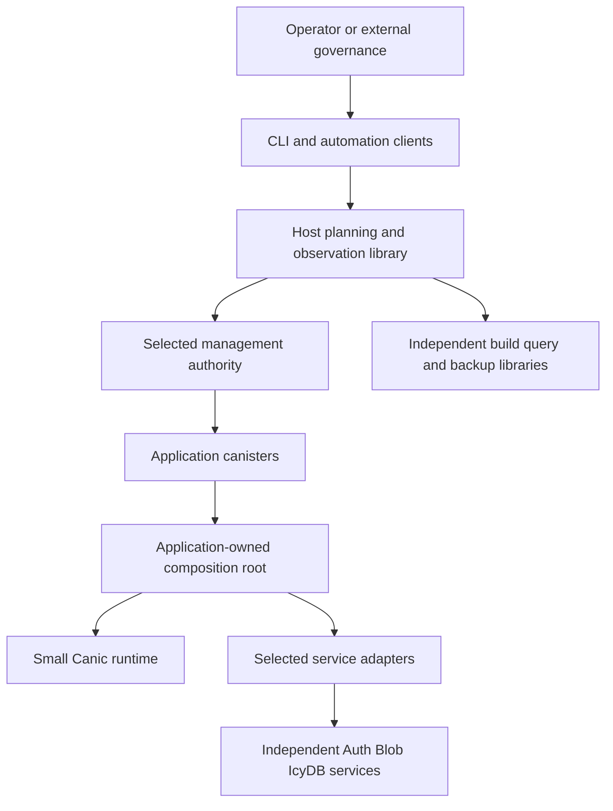
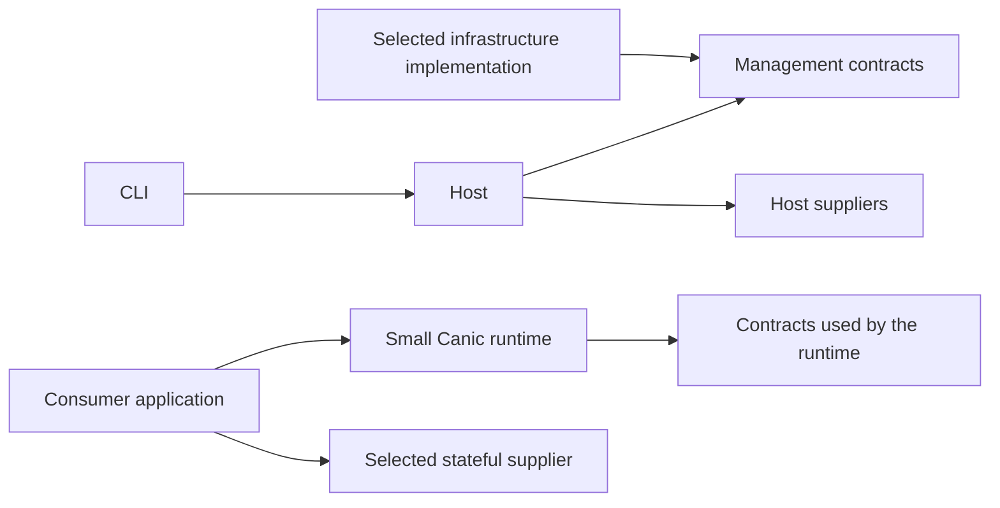

# Canic system design

Status: accepted architectural basis; implementation is working toward M2, with narrow M3 autonomy and preservation paths qualified. See the [current qualification scope](../../qualification/README.md) and [dated evidence](../qualification/history.md). Retiring milestone names from test packages does not declare a milestone gate complete.
Date: 2026-11-14. Domain/configuration consistency reviewed against the implemented CLI; see the [review evidence](../qualification/history.md#domain-and-configuration-review).

Naming: Canic is this fresh rewrite. Legacy Canic is the predecessor now hosted
as [canic-legacy](https://github.com/dragginzgame/canic-legacy). Historical package
names and source paths below identify that predecessor as observed, not current
rewrite dependencies.

Canic should let a Rust application team build and operate a multi-canister IC application without writing its own infrastructure management system. It should make the first useful capability inexpensive to adopt, keep application decisions with the application, and remain understandable after years of change.

The maintainer treats old Canic as an intensely iterated design document spanning four years and four generations of LLMs. Its code records experiments, needs, failure modes and accumulated decisions. An existing mechanism has no presumption of inclusion in Canic. This freedom also applies to this design and the proposed crate layout.

Start from user outcomes and derive the smallest coherent system that achieves them. Preserve a safety requirement when its underlying threat, resource obligation or recovery need still exists; rederive its implementation. Historical guards can encode obsolete assumptions as well as important protections. The working direction is a small composable runtime and host planning with explicit effect authority. Physical control-plane topology remains a design decision. Persistent production use is a required destination; a reinstall-only prototype must never be advertised as that destination.

This document covers the whole product surface identified in Canic's current manifests, public modules, CLI catalog, feature guides, active designs and twelve idea topics. Coverage means every identified responsibility receives a reasoned disposition, including removal, delegation or deferral. It does not create a feature-parity backlog. It is not a claim that every historical behavior is desirable, every source line has been audited, or an unbuilt implementation is complete. The coverage register and source record make omissions and disagreements reviewable.

Read by concern: [product contract](#1-product-contract), [architecture](#4-architecture-and-dependency-direction), [durable operations](#7-durable-operations-and-uncertainty), [funding](#9-funding-and-economics), [persistent lifecycle](#13-persistent-releases-checkpoints-and-recovery), [delivery plan](#16-delivery-plan-with-deletion-gates), [capability coverage](#17-complete-capability-disposition-register), [paused ideas](#18-deferred-ideas-and-paused-slices), and [decisions for review](#19-decisions-required-before-implementation).

## 1 Product contract

### Users and outcomes

An application developer should be able to start with an ordinary Rust canister, add one capability, and understand its memory, lifecycle, permissions and cost. An operator should be able to review changes, run them, close the terminal, resume elsewhere with the required custody, and distinguish success from an unknown result. A governance-controlled application should be able to approve the same exact effects without an operator key acquiring additional authority.

The core journeys are:

1. Inspect externally built artifacts without installing a Canic runtime.
2. Build a fresh application and establish a working single-subnet Fleet.
3. Add another subnet and grow shared or dedicated workers within explicit capacity and funding limits.
4. Continue operating during operator absence, subject to finite delegated authority.
5. Diagnose an incomplete operation and resume its original work without paying twice.
6. Compose Auth, IcyDB, Blob or another runtime without duplicate lifecycle or memory ownership.
7. Capture and restore an application-consistent checkpoint when the application supplies the necessary protocol.
8. Eventually change a persistent production installation while preserving explicitly promised identity, state and outstanding obligations.
9. Release disposable capacity, reclaim controlled resources, or destroy an installation under a separately reviewed disposition.

Application identity, tenancy, routing semantics, data schemas, consistency, business transactions, user balances and governance remain application-owned. Canic supplies infrastructure capabilities, not a database replication system, application economy or universal distributed transaction manager.

### Hands-on delivery from the start

The team must be able to use each delivered increment and feed experience into the next one. The first deployment is a Hello World application on the IC mainnet, with a local rehearsal of the same supported path. Mainnet experimentation begins before the stateful consumer, autonomous growth and production lifecycle are complete. Passive inspection is useful as an intermediate increment, but does not complete M1.

The first hands-on loop is: obtain the tool and example, build, review the target/controllers/artifact and finite cycle budget, deploy, call the application, inspect its status, change the greeting, and deploy the changed executable. The second deployment must explicitly state whether it preserves the principal and state or creates a fresh disposable installation. Unsupported upgrades must not become an implicit reinstall. Retained canisters, balances and the next maintenance or disposition action remain visible after the experiment.

Deliver this through the product CLI and documented public interfaces, not a private deployment script. Each increment includes a runnable example, exact setup and usage instructions, supported networks, visible limitations and a repeatable team exercise. Team feedback on setup, errors, deploy time, costs and operation status informs the next scope; record actionable feedback in owning GitHub issues. Keep the previously delivered journey runnable as capabilities grow, and document any explicit experimental breaking change.

M0 resolves only the contracts needed for the first effects and records later decisions at their owning gates. Neither the full governance profile nor adoption by the proposed Toko consumer blocks the operator-controlled Hello World loop. Exact authority, bounded spending and truthful uncertainty still apply to its real effects. Mainnet availability describes where the experiment runs; persistent production support remains the M7 claim. Actual execution selects a concrete signer, target and budget; the design does not supply spending authority or credentials.

### Smallest stateful application journey

The next design witness is a persistent application with one entry canister and a shared worker on one subnet. Build and install it, serve an authenticated application operation, grow to a second worker under a finite budget, interrupt a management call, recover its original outcome, and inspect what happened. M2 must include meaningful application state, one actual stateful supplier such as IcyDB, and explicit endpoint, memory and timer composition. By M3, a second executable must preserve the promised application invariant and an operation awaiting reconciliation. This narrow rehearsal does not claim general migration or production readiness.

The application owns logical user routing and data semantics. Begin with explicit canister declarations. Introduce groups, role catalogs, a global directory, warm pools or cross-subnet coordination only when a concrete journey needs them. The 2026-11-15 decision selects a separate per-fleet Wasm Store for managed deployments; its contract is in section 12.

For each mechanism, record the need, failure being prevented, simplest candidate, state/effects introduced and acceptance witness. Compare direct host-controlled installation with a subnet-local executor before selecting the first managed topology. Autonomous growth requires a surviving on-chain effect owner; a permanently running operator process is not an equivalent substitute. Choose one initial topology after this comparison rather than implementing speculative deployment modes.

### Accepted developer and operator journeys

The maintainer's 2026-11-14 workflow review admits the following product outcomes.
These refine the destination; they do not claim that today's CLI implements them
or require replacing the existing mainnet demos before their successor qualifies.

- Define the app's artifacts, roles and permitted relationships once. Instantiate
  that definition in several fleets with distinct networks, identities and budgets.
- Generate a small buildable Rust application with one application canister
  controlled by one Root/management owner. Support a persistent local development
  loop and the same reviewed deployment semantics on mainnet. New generated
  starters include a per-fleet Wasm Store controlled by Root. A Coordinator remains
  conditional; existing inline fleets retain their original custody contract.
- Build, review and converge the complete selected fleet through one plan/apply
  path. Repeating a completed convergence has no mutation effects. Individual
  canister changes use the same owners and evidence.
- Preserve cascading discovery and make scaling and sharding optional composable
  building blocks. No particular growth workload is selected yet; the existing
  profile fixture retains earlier bounded-growth evidence; the selected hands-on
  consumer is now the demo counter, not a Toko port.
- Treat a subtree as an operational scope: it could represent an entire project.
  Support reviewed inspection, drain/suspend/resume and persistent upgrade journeys
  without affecting siblings outside that scope. This does not add a new App/Fleet
  ownership level or import Toko-specific data semantics.
- Operators supply cycles manually. Canic may distribute those cycles within
  explicit grants; ICP conversion is excluded, not an optional adapter backlog.
- Keep initial operator handover simple: retain configuration, exact artifacts and
  journals, then provision the receiving operator's signer authority separately.
  This is the working default, not a promise of reconstruction from on-chain data
  after losing the journals. Application frontend integration remains deferred;
  the existing read-only fleet visualization stays in scope.

Deliver these as small usable increments within M2/M3. The existing reusable
app definition and Root-plus-app journey extend to Root/Store/app through the
same whole-fleet convergence owner. Qualify discovery and subtree state propagation
before broadening growth or subtree upgrades. No new command aliases, generic
workflow engine or package catalogue follows merely from this scope decision.

### Adoption levels

| Level | Useful result | Required commitment |
| --- | --- | --- |
| Passive tools | Artifact comparison, build evidence, diagnostics and cost reports | Host tools and supplied inputs; no controller or runtime changes |
| Composed runtime | Endpoint guards, lifecycle participation and selected service integrations | Explicit local memory, endpoints and runtime participants |
| Managed Fleet | Provisioning, placement, funding, artifact distribution and recovery | Exact governance/controller assignments and durable operations |
| Governed production | Persistent releases, complete recovery and admitted governance integration | Qualified lifecycle and application readiness contracts |

These are documented dependency boundaries, not four parallel implementations. A capability is independently adoptable only after a real consumer proves that its dependency graph and integration obligations match the claim.

## 2 Design decisions and limits

| Decision | Recommendation | Consequence |
| --- | --- | --- |
| Product organization | Organize by responsibility and state owner | Do not recreate a universal core containing every service |
| Fleet topology | Managed fleets select Root and a separate versioned Wasm Store; derive further infrastructure from concrete needs | Root owns effects, Store owns artifact bytes; Coordinator remains conditional |
| Application runtime | Only explicitly selected endpoint, binding and lifecycle support | A leaf does not link provisioning, estate accounting or host tooling |
| Execution | Domain-specific durable operations sharing small mechanical primitives | No generic workflow interpreter or universal journal schema |
| Authorization | Separate infrastructure authority, optional Fleet admission, application identity and resource permission | Passing one check never implies the others; Fleet filtering is explicitly selected |
| Configuration | Compile a small set of typed inputs into one normalized plan | Defaults and derived capabilities cannot become competing writable authorities |
| Persistence | State belongs to the domain that can explain and repair its invariants | Views and caches cannot silently acquire authority |
| Protocol | Wire for owned contracts initially; fixed external protocols remain external | Transport selection stays out of domain decisions |
| Scheduling | Durable demand, bounded workers and independent recovery wakeups | Quiescence is observable and cannot strand unfinished effects |
| Extensibility | Explicit compile-time composition and narrow adapters | No service locator, runtime plugin registry or blanket capability engine |
| Compatibility | No compatibility layer with the old Canic implementation | Existing Canic adoption is a separate future undertaking |
| Production lifecycle | Design a qualified persistent release boundary before claiming production support | Experimental reinstall remains a distinct operating mode |

The old repository's sequencing and release gates describe its delivery history. They do not dictate Canic's architecture. Toko's adopted engineering baseline still governs this repository. Optional Candid selection for owned endpoints would require an explicit change to the current shared Wire policy before implementation; keeping the design seam does not grant that exception.

### Complexity acceptance

Every proposed subsystem must identify a concrete user journey, its one authoritative state owner, its public contract, its external effects and its recovery proof. Each persistent field must have a writer, reader, invariant and retention rule. Each abstraction needs actual distinct callers. A trait is justified by a real alternate implementation or test boundary, not by possible future extensibility.

A vertical change includes callers, tests, generated interfaces, operator diagnostics, documentation and removal of superseded code. No batch closes with two active implementations, an unused replacement, or a permanent forwarding facade. Package count and line count are evidence, not success criteria.

### Mechanisms excluded from the starting architecture

- A universal Core with mandatory endpoint/workflow/policy/ops/model/storage/view layers.
- A required Coordinator plus Root plus Store installation for the smallest application.
- Independent role, feature, capability and runtime settings that control the same service selection.
- Framework takeover of application lifecycle or hidden initialization when mounting a service.
- Mandatory Fleet-wide whitelist distribution for ordinary application authentication.
- Separate recovery owners for equivalent commands, or a universal workflow interpreter absorbing every domain.
- Executable rebuilds solely to represent changed approval or qualification evidence, without a demonstrated executable-binding requirement.
- Repair of obsolete installation metadata before erasing disposable state when current custody and obligations can be established directly.
- Copies of independent Auth, Blob, Backup, storage or scheduling engines inside Canic.
- Cross-Fleet transfers, alternate codecs and elaborate cache optimizations as prerequisites for the first working application.

Reintroducing one requires a concrete need and a fresh design decision. Important invariants such as bounded spending, explicit authority and truthful uncertainty must be shown directly; the number of historical guards is not evidence of safety.

## 3 Domain model

The hierarchy is **App → Fleets → Canisters**. One logical application may have
multiple fleets, each a deployment on an explicitly trusted network with its own
canister identities and retained operations. Fleet names are scoped to their app;
for example, `profile/mainnet` and `profile/staging` are deployments of `profile`.

An app owns code and application semantics; a fleet owns one deployment's selected
network, canister membership, management policy and bounded effect authority.
Several fleets may use the same network and executable. One fleet may eventually
span several subnets; neither network nor subnet is an app or fleet identity.
Canister roles describe responsibilities inside that deployment, not additional
ownership levels. An external controller or service is a relationship, not an
implicitly owned fleet member. Within a declaration, the same canister under the
same exact network binding cannot belong to two fleets. Shared services require
explicit external references when that consumer need is admitted.

Preserve the useful legacy distinction between a canister's application role,
its immediate parent in the application tree, and its IC controller set. A
manager remains a manager when it controls children. Routing from an entry to a
worker does not itself establish parentage. Current concrete fleet declarations
may carry optional `role` and `parent` slot references; parents must exist in
the same fleet and the tree must be acyclic. These fields support inspection
before deployment as well as the deployed view. They are descriptive, not
spawn grants or controller policy, and do not modify an existing approved plan.
Applying topology through autonomous management still requires the explicit
admission and custody contracts below.

Canister trees contain only canister nodes. Root appears at the top of that
tree, with its application descendants below it. Show an external operator's
controller relationship separately as metadata, not as an indented ancestor
of Root. This presentation rule applies to terminal output, visualizations and
documentation; the controller relationship remains explicit without mixing
identity principals into the application tree.

Names select scope; they do not grant controller rights or prove ownership. A
configured principal is a declaration, a certified controller read is an
observation, and an approved operation supplies bounded effect authority. These
must remain distinct even when displayed together. The current CLI has no rename,
fleet-transfer or identity-migration operation: editing a name does not retag an
approved plan, move a journal, renew an allowance or move a deployed canister.

| Concept | Meaning and owner |
| --- | --- |
| Application specification | Logical component types, relationships, service exports, permitted child patterns and readiness contracts; application-owned |
| Fleet | One deployed application instance on one explicitly trusted network |
| Fleet policy | Governance-selected placement, admission, funding, resource bounds and recovery authority |
| Component specification | A reusable artifact/configuration contract; not a deployed canister |
| Component allocation | Logical instance plus a unique allocation generation, physical canister, executor and artifact binding |
| Physical asset | A controlled canister with observed location, controllers, module, balances and custody status |
| Service directory | Derived routing projection of committed component allocations, with freshness and generation |
| Artifact | Exact executable bytes and associated schema, build and capability identities |
| Deployment plan | Immutable proposed effects and bounded authority over exact inputs and observations |
| Operation | One retained business intent and its reconciliation history |
| Funding grant | A finite budget over a named source, destination derivation, purpose and validity policy |
| Observation | Evidence with subject, source, time or generation and confidence; never an implicit instruction |

A principal is insufficient as the identity of a reusable allocation. Every callback, directory binding, shard assignment and removal request that can outlive reuse binds the allocation generation. A late success for an old allocation may settle its accounting but cannot affect a replacement.

Fleet, Component, Root and related names are working vocabulary for discussing the source material. They do not freeze the public API or require a corresponding Rust type. Begin with explicit canisters and their relationships. If repeated structure justifies groups, compile them into the same deployment graph; a group gains no canister, treasury, lifecycle or controller. Roles and capability catalogs likewise require demonstrated classification or compilation needs and never grant caller permission.

Keep desired topology, admitted operations and observed state distinct. A desired count is not a reservation. An observed canister is not an adopted asset. A directory row is not custody. A successful request submission is not completion.

## 4 Architecture and dependency direction



Arrows show interaction and composition, not blanket permission or a fixed canister count. Authenticated commands and retained grants define permission. Subnet execution and global coordination refine the management authority when the workload requires them.

### Logical modules and possible packages

Start with Contracts, Host and CLI for the passive/planning journey; retain `canic` for the small application runtime as the installed journey develops. Pure planning starts inside Host. Separate host and Wasm dependency graphs from the beginning. These are responsibility boundaries, not a requirement for one crate or canister per row:

| Boundary | Owns | Must not own |
| --- | --- | --- |
| Contracts | Bounded IDs, public commands/results, semantic digests and published protocol declarations | Filesystem, timers, storage engines, policy decisions |
| Planning | Pure compilation, placement constraints, effect proposals and validation | Live discovery or paid execution |
| Application runtime | Installed binding, endpoint admission, lifecycle participation and local service discovery | Fleet planning, estate ledgers, host identity keys |
| Coordinator | Global policy generations, membership and grant issuance | Every child continuation, rendering or per-leaf metric history |
| Subnet executor | Physical assets, local allocation, management operations and local budget reservations | Application schemas or arbitrary application routing |
| Artifact service | Content-addressed upload, integrity, chunk access and retention | Deployment approval or application readiness |
| Host | Discovery, build integration, plan review, durable ingress custody, reconciliation and reports | A second authoritative copy of remote domain state |
| CLI | Parsing, help, formatting, exit status and invocation | Hidden business policy or a separate recovery algorithm |
| Adapters | Canic-specific composition around independently owned services | Copies of supplier engines or supplier DTOs |

Use direct functions and domain modules first. A module may contain its transition function, record schema and effects together when that makes its ownership legible. Thin endpoint adapters authenticate and decode; a domain transition validates current state and decides the next action; an effect adapter performs one external attempt; its completion returns to the same domain. Do not force every request through eight directories or mirror every DTO into a view, model and storage type without a representation reason.

### Infrastructure roles

The operator bootstraps Root. Root installs every other canister in its managed
fleet, including the Wasm Store, service hubs and dynamically allocated children.
A hub can request a shard and remain its application parent while Root performs
and records the installation.

The generated managed starter has one Root/management owner controlling a Wasm Store and one application canister. The Store is an infrastructure role, separate from application allocation cardinality. Retain an explicit external controller for Root's maintenance and recovery; show that principal as controller metadata outside the canister tree. Qualify the exact graph before deployment. Across subnets, globally scarce budgets and membership changes may justify a coordination owner, while executors retain local custody and finite delegated authority. A Coordinator, when selected, must not be needed for every continuation of previously admitted local work.

Application canisters remain freeform: they own their data model, public methods,
authorization and lifecycle composition. They may opt into Canic's endpoint mounts,
service adapters and management participation without becoming infrastructure
roles. Root and Wasm Store remain separate deployed owners; optional coordination
does not turn application canisters into a prescribed Canic base class. Managed
operations still require the explicit readiness and preservation contracts below.

The experimental `canic-root` now supports up to eight permanent services on a fresh Root,
using the same bounded management engine as the profile manager. Its controller
is the external operator; its created application's sole controller is Root.
Lifecycle mounting and application readiness remain explicit in each canister.
The supplied fresh Root admits the explicit `readiness` contract below; the profile
fixture manager separately admits profile readiness. The profile manager explicitly mounts the same Store
protocols and qualifies a Store-backed profile worker with its existing readiness
decoder. Publication, worker/Store/owner upgrades historically preserved the worker's private
user state and retained artifact custody on their qualified supplier inputs.
Further consumers must qualify their application-owned readiness contract with
the selected owner, including preservation for retained work. Do not substitute a
successful install, accept an undecoded reply or impersonate the greeting protocol
to bypass this boundary.

The maintainer selected an explicit readiness response for the next counter
consumer: `Unavailable` when application prerequisites are not established,
`Fenced` when state is open but writes remain closed, and `Ready` when the
application admits normal writes. The application owns that decision. Canic's
optional mount exposes a bounded replicated observation and never initializes,
repairs or activates the application. This is a point-in-time report, not a
readiness lease, recovery permission or proof of a particular schema/generation.
The management owner must still bind its observation to the approved executable
and target. The selected cutover uses fresh journal schema 2, refusing old
allocator images and schema-1 records approved under greeting readiness. No
feature switch, endpoint fallback or reinterpreted historical completion is added.
The application may keep its independent greeting endpoint; Root calls only
`readiness` and accepts only a strictly decoded `Ready` response.

The demo counter allows public increments; capture, restore and reopening
remain explicitly operator-controlled. Both greeting and counter actors use the
readiness mount. The counter's local installed persistence and fencing rehearsal
uses published Storage 0.78.0. The installed fleet CLI now qualifies Root/Store
creation, value-preserving upgrade and fenced readiness refusal for the counter.
No new lifecycle engine is required.

The counter stores one bounded 256-byte payload in a named stable cell. Its actual nonanonymous installation caller is the immutable
maintenance authority (Root in the managed witness). Public increment
uses checked u64 arithmetic. Fence/activation requests name monotonic nonzero
attempts; only the retained authority may close or reopen writes, and an older
activation cannot reopen a newer fence. A compatible upgrade reopens that exact
record without changing admission. This application-local fence is not a backup
rollback defense by itself: checkpoint recovery still requires the surviving
control-plane evidence in §13. The first installed counter rehearsal uses direct
local control; the subsequent fleet witness qualifies Root's readiness contract
with Store-backed artifacts. Neither qualifies Backup integration or grants a
Root endpoint for arbitrary application calls/fencing/activation.

Fresh Root grants management two named cells, `manager.journal.v2` and
`manager.artifacts.v1`. The optional Backup composition also grants
`manager.snapshot.v1`. Reopen requires the exact selected membership. Keep the
existing payload versions and semantic validation; the physical backing is a
hard cut, not an importer for 0.74 leases. Known old payload decoders remain
codec compatibility evidence, not proof of physical-image migration. Commit
encoded records synchronously at existing mutation sites, before dispatch or
callback completion, and trap on failure; no pre-upgrade flush is introduced.
The CLI now generates a standalone greeting workspace whose artifact passes that
same installed qualification. Managed-child CLI plan/apply now pins Root code,
retains exact admission attempts and recovers completion through replicated
observations. One child upgrade is now locally qualified, including persistent
application state and interrupted callbacks. The runtime now provides eight permanent child slots, each with a bounded history
for eight serial upgrades and independent continuations. Both share finite cycle
and artifact custody budgets. The installed CLI qualifies both children through
creation, independent upgrades, recovery and fleet views. Root maintenance
compares complete custody for all service slots, including Empty. General trees and
subtree operations remain unqualified. See the
[managed-child evidence](../qualification/history.md#managed-child-cli-approval).

The maintainer's 2026-11-15 decision selects a separate, dynamic, versioned Wasm Store per managed fleet. Root must not be the durable artifact repository. Root retains approved immutable references, reservations and effect evidence; the Store retains verified bytes, versions and retention pins. This separates artifact growth and release history from Root's authority journal and maintenance. Section 12 owns the contract and migration gates. Direct host bootstrap and passive artifact tools remain usable without installing a fleet. Artifact possession never supplies deployment approval authority.

External governance retains the controller hierarchy it approves. A governance integration may place the same executor logic inside an existing infrastructure owner only after composition proves one lifecycle and one effect owner. No hidden recovery key or universal operator bypass is acceptable.

Later sections use Coordinator, executor and Store to name these responsibilities. Store is selected for managed fleets; Coordinator remains conditional. Names do not import the legacy implementations.

The existing mainnet topology is recorded in M0: the operator directly
controls Hello World, the profile entry/shared worker, and the profile manager;
only the manager's autonomous worker is controlled by that manager. This is not a
fleet-wide executor or a general Root. Its artifact bytes are retained in the
manager; those deployments predate the separate Store decision. Moving their
custody requires the qualified transition below, not an automatic migration.

### Repository and workspace boundary

Keep Canic's CLI, Host, management contracts and runtime orchestration in one product workspace. CLI depends on Host, Host depends on passive Contracts, and the application runtime depends on Contracts and selected suppliers. Host communicates with deployed roles through contracts without depending on their runtime implementations. Add role crates when the topology requires separately compiled artifacts, and adapter crates with their first complete consumer journey.

For consumer applications, prefer thin canister hosts under
`apps/<app>/<crate>/` backed by an application library under `crates/<app>/`.
For example, Toko's `apps/toko/<hub-crate>/` and `apps/toko/<shard-crate>/`
depend on `crates/toko` (`crates/toko/src/lib.rs`); the hosts do not depend on
one another. Package directories match their Cargo package names. One root
workspace and lockfile build these packages, while `apps/toko/canic.toml`
declares the reusable app and its optional fleets.

The library owns application records, authorization policy and synchronous domain
operations. Each host owns explicit lifecycle composition, captured ingress
context, endpoint mounts and outbound calls. Sharing a library does not imply
shared memory, a shared canister or permission to call another role. Select the
library modules and supplier features each host actually needs. Root and Wasm
Store remain supplied infrastructure; applications do not copy their implementations.
Root is implicit when an app uses managed infrastructure. Selecting
`wasm_store = true` or declaring a child of `root` supplies Root. Fleet policies
select its Auth, placement and role issuer features. The separate Store uses
Root’s locked build workspace. A future Coordinator belongs with supplied
infrastructure if its global responsibility is admitted.
This layout is a recommended composition, not another scaffold generator or a
requirement to split a small single-purpose actor into extra packages.

Platform replacement adoption is a cohort migration, not a version-only update.
Canic 0.218 introduced Runtime 0.23.14 and Timers 0.46.0 with one exact executor
guard. The pending patch adoption selects Runtime/Macros/Guard 0.23.16 and Timers
0.46.3 with the same ownership and stopped-upgrade requirements.
Product and qualification actors use Platform's explicit query, update and lifecycle
macros; codecs remain with Wire. Runtime's completion owns the matching refund.
Submission refusal, remote rejection and unknown outcome remain distinct; no new
retry authority follows a timeout or callback failure. Storage 0.74.1's retained
Runtime 0.22.5 edge supplies raw stable-memory access only, not another executor.
Generated IC exports require a scoped unsafe-code expectation supplied by Platform;
workspace policy denies handwritten unsafe code while permitting those exports.

Runtime's supported upgrade boundary requires the target to be stopped, with
callbacks drained. Host direct/Root upgrades retain stop, stopped-status, install
and start attempts through the existing signer and original deadline. An unfinished
legacy Host install without stop evidence stays blocked. Managed child upgrades
retain stop/start issued phases in their existing journal; reconciliation observes
them and never reissues them. Blob retains its separate explicit admission drain
and activation contract. No endpoint mount implicitly stops or activates anything.
The new phase variants append to the existing codec; older readers refuse pending
new phases instead of discarding them. Older pending uploads cannot install on a
running child and remain blocked if their retained path lacks a stopped target.
Installation evidence retains the observed version before restart. Restart advances
the version, as can subsequent application execution; its observation checks the
approved code/controller and a later version, without rewriting the installation
evidence. See the [IC version contract](https://docs.internetcomputer.org/references/ic-interface-spec/canister-interface/#canister-version).

Blob 0.103.1, the incoming Store 0.3.1 selection and committed Auth and DB inputs use Types 0.21.2 at
actual runtime public boundaries. Optional adapters stay optional. The installed
qualification paths retain predecessor data, interruption and rollback obligations.
The original artifact probe now schedules through Timers rather than a separate
heartbeat execution path; issued effects remain blocked after uncertain callbacks.

Platform replacement is qualified locally under [Canic #14](https://github.com/dragginzgame/canic/issues/14).
Host and runtime engines use Protocol 0.3.5 for management and ledger framing,
including complete management settings, chunked installation and required status
versions. Runtime calls use canonical Types directly; legacy codec/principal
conversion dependencies are removed. Fixed native wire fixtures captured with
independent old encoders prove retained bytes, including absent fields in type tables.
Topology 0.109.2 uses the published Platform/Protocol/Types cohort directly;
Host placement and subnet comparison use canonical Types without conversion.
Host uses Platform 0.34.13's native transport for certified controller/subnet/module
observations, queries and retained dispatch/status, with the existing bounded
polling owner. The legacy Agent and Platform 0.33.7 dependencies are removed.
Preserve exact ICP-signed bytes, request IDs, custody, original deadlines and stored
formats. New local bindings explicitly admit `root_subnet`; never infer it from a
historical routing canister or rewrite an approval. Missing historical trust is
readable but blocked before network access. Mainnet pins its public DER key and
root subnet. Platform authenticates observations; Canic owns the five-minute
staleness limit, existing allowance for certified future time, and finite traversal
and HTTP budgets. No automatic trust migration or re-signing path exists.
Host uses Platform 0.34.13's prepared-packet admission for both signed and explicit
anonymous updates/status reads ([Platform #25](https://github.com/dragginzgame/ic-platform/issues/25)).
The approved controller selects the profile; failed signature checks cannot select
anonymous admission. Platform owns authentication and status-path binding; Canic
owns approved-effect matching and equal original expiries. Retain exact encoded
bytes and the existing local journey without an unsigned dispatcher or fallback.
Do not retain a parallel dispatcher or introduce Canic-owned transport/codec
replacements. Keys stay with ICP CLI.

Testkit 0.108.0 owns bounded server/instance lifecycle and uses Protocol 0.3 for
held-reply fixtures. Product and qualification callers share Protocol 0.3.5;
the old qualification Protocol 0.2 edge is removed. Topology 0.109.2 and Timers 0.46.3 remove the former
Platform/Runtime patch blockers ([Query #2](https://github.com/dragginzgame/ic-query/issues/2),
[Scheduling #3](https://github.com/dragginzgame/ic-scheduling/issues/3)). Both
workspaces resolve the modern cohort through compatible supplier requirements.
Qualification Auth signing/verification selects Platform 0.34.13 Ed25519 and bounded Protocol
raw-rand framing without renewing enrollment or issuer reservations.

The maintainer selected extraction of the versioned Wasm Store into
`dragginzgame/ic-wasm-store`, a separate repository and product/qualification
workspace pair. It owns immutable releases, chunks, quotas, pins, cache preparation,
persistence and exact maintenance admission. Canic owns fleet bindings, publication
approvals, Root-driven effects and end-to-end integration qualification. The supplier
has no Canic dependency. Canic consumes the published passive protocol through
Cargo.lock and builds the matching Store executable from its crates.io archive
and packaged lockfile. Host never links the Store runtime.
Package renaming does not change endpoint identities, Wire records, Storage keys or
retained operation semantics; executable replacement still needs explicit approval.
There is no duplicate in-tree Store, mandatory sibling checkout or new deployment
engine. Standalone supplier qualification moves with its owner; Canic's installed
Root/Store/application witnesses remain here.

The independent qualification workspace isolates test-only graphs. Separate Host into another workspace only for demonstrated dependency/toolchain incompatibility; a separate repository requires an independent ownership or delivery need. Release groups can evolve independently within one repository. Dependency direction, Wasm builds and downstream consumer tests enforce the runtime boundary.

This compilation view is distinct from the interaction diagram; arrows mean dependency:



Contracts are organized by the protocol a consumer actually speaks. A runtime consumer must not import an omnibus provisioning, treasury, backup and administration command surface. Shared identities can remain small shared types. Independent native Host and Wasm consumption justify a package boundary as soon as both exist; they do not require separate repositories.

## 5 Configuration and operator experience

An unbound local fleet can declare `lifetime = "ephemeral"` for installed tests. Canic Host starts a dedicated IC Testkit server and instance. Each run owns a temporary journal and binds fresh identities in memory. Source declarations with an existing journal, network binding or canister identities are refused before startup. The session owner explicitly closes the instance and server. Dropping the owner also releases the process and temporary directory. Omission preserves existing fleet behavior.

### Source format decision — 2026-11-17

The maintainer selected `canic.toml` as the single source configuration format.
The smaller rewrite schema does not justify replacing working legacy TOML with
JSON. Preserve the current App → Fleets → Canisters model, fleetless builds,
relative paths and existing journal bindings. CLI additions preserve comments
and existing values using a TOML document editor under the existing sidecar lock
and atomic publication owner. TOML rejects duplicate keys/tables; unknown fields
and the 32 KiB source limit remain enforced. No JSON fallback or format selector
is provided. Journals, signed attempts, approval digests and structured CLI output
retain their existing JSON codecs.

Legacy review: `canic-legacy` revision
`377fbceb3994c9d1f3033979ef4e4ce9e6b85801`, `CONFIG.md`,
`crates/canic-host/src/config_discovery/{mod.rs,tests.rs}` and
`crates/canic-host/src/release_set/config/{tests.rs,mutation/}` establish TOML
source input, bounded discovery, duplicate identity refusal and validation before
writing. The mutation history includes `0940d5223cf6a0ddc4ded8ff66e6eeea41d49b45`
(0.112.0) and `afc2521ed02744c1e1a376d59dae5e2b80d9dec5` (0.111 hard cut);
TOML remained the source contract through these application-model changes.
Retain the rewrite's smaller discovery scope and typed validation; use the
supplier's syntax-aware editing rather than legacy line-oriented mutation.
Regression coverage preserves malformed-input refusal, existing-source integrity,
duplicate identities, symlink exclusion and unchanged retained authority.

Repository declarations are converted in place beside their former JSON files,
then the JSON source files are removed. Other workspaces must convert their
source declarations before using the new CLI; changing only the suffix is not
conversion. No deployment state or canister migration is involved.

Separate three categories of input by writer; this does not require three files or a large configuration language:

- Application specification: component artifacts, logical dependencies, permitted children, service contracts and optional participants.
- Deployment policy: network trust, topology targets, placement restrictions, budgets, admission and governance.
- Local execution settings: credential references, paths, tool configuration and presentation. Secrets never enter canister configuration or artifact metadata.

The application specification is reusable across fleets: fleets reference its
logical components rather than copying artifact/role/child definitions. Concrete
allocations, network trust, placement, funding and controller assignments remain
fleet-owned. The generated starter and whole-fleet planner consume this same
model. Migration from today's concrete slot declarations must preserve retained
principal bindings and plan digests; editing source configuration cannot amend an
already approved operation. Reusable app definitions do not require a generic
group catalogue or independently deployed group canisters.

An application may have zero fleets. Definition, validation and build require no
network, signer identity or deployment journal. App owns component recipes,
service contracts and logical relationships; builds produce artifacts from
selected source/dependencies; fleets choose deployment policy; deployment state
retains actual identities, installed versions and operation evidence. Component
definitions are reusable types, not a permanent promise of one canister each.
The current named-definition projection remains a bounded implementation; instance
allocation and deployment topology require their own consumer decisions.

Toko's current rewrite has replaced its greeting shell with the application library
at `crates/toko`; `apps/toko` contains the fleetless configuration and planned thin
hub/shard host boundaries. The inspected `toko-new` checkout has no deployable host
packages or build recipes yet. Config initialization preserves workspace manifests
and application source. Explicit `--source` remains the separate greeting-demo
generator, not required application scaffolding. Supplied Root and Store stay
with their owners. [Canic #19](https://github.com/dragginzgame/canic/issues/19)
owns the missing generic shard allocation/lookup contract;
[Canic #20](https://github.com/dragginzgame/canic/issues/20) tracks DB-backed upgrade preservation under the revised Storage contract in §13. Neither library tests nor greeting/probe success establish
installed database/schema admission or authenticated application readiness.

Example apps live in `apps/examples/<name>/`. An app's build recipe may select
Cargo features for the Wasm artifact through `build.features`. For example,
the user directory selects `auth` and `sharding` for Root. The app's fleets
share this build choice. Enrollment and placement require separate approvals.
The native command codec uses its existing package, binary target and the
same selected package features.

App build validates all declared output destinations before invoking Cargo,
including when only one recipe is selected. Outputs cannot overlap the app's
config, any declared workspace manifest or its existing/future Cargo lockfile.
This path comparison is preflight validation, not filesystem confinement against
concurrent changes; publication retains the filesystem supplier's own checks.

The compiler validates the explicit deployment graph, normalizes sets and produces typed desired state. Service selections have one source of truth; any features or capability descriptions are derived from it. Group expansion is added only if reusable groups are selected. Unknown keys, impossible combinations, unavailable services, contradictory placement and unbounded effects are errors before network mutation. Static policy and mutable deployment policy each have one owner; any override must be explicitly modeled as a narrowing operation.

Keep semantic configuration identity separate from source-file identity. Reformatting a file should not change its meaning; exact source bytes still belong to build evidence when a build can consume them. After approval, the exact compiled plan and selected schema are immutable.

The implemented unversioned declaration has reusable definitions at
`apps.APP.canisters.SLOT` (role, parent and optional Wasm input) and existing-ID
bindings at `apps.APP.fleets.FLEET.canisters.SLOT`. Every fleet resolves the shared
definitions; its bindings cannot override topology or artifacts. Network and
journal path remain fleet-owned. Wasm paths resolve beside the config; exact
bytes are retained only when planning. The generated starter now has a bounded
whole-fleet planner for Root, Store and up to eight applications; generation selects
one application. Store-backed upgrades publish new bytes before a separate
installation approval. General spawn policy, larger fleet funding policy and
adoption of existing fleets remain unimplemented.
The default journal is `.canic/apps/APP/fleets/FLEET/` beside the config.
An existing shared journal may remain in place, but observations and operation
selection must distinguish its fleets by exact retained names or known target
and network evidence. Unassigned uncertain records remain visible as such.

Reject ambiguous selections, duplicate configuration names, conflicting physical
membership and upgrades outside the selected fleet before retaining a new plan.
Approval still binds the exact network, target, artifact, controller and budget;
mutable config cannot change those inputs during apply or recovery. These local
selection checks are not an authorization boundary against an operator who
already controls the signing identity. `--no-config` uses explicit retained
plans; it does not bypass signature, controller, deadline or evidence checks.

### Approval and admission contract

One canonical approval record binds its schema, network trust identity, normalized plan digest, approver and authority generation, validity policy, effect graph, artifact/configuration identities and cumulative resource ceilings. An effect names its operation ID, prerequisites, permitted caller, target reference, request commitment and result schema. Preview and execution consume this same representation.

A target reference is either an exact principal/allocation generation or a typed output of a named approved effect. For example, `create_worker_1.result.canister` may become allocation generation G on subnet S with controllers C, within creation budget B, and receive artifact H and configuration K. Admission validates those constraints; the retained creation result resolves the reference exactly once. The principal is recorded as evidence under the original digest. It cannot be substituted by editing the approved plan. An unexpected result is held for reconciliation, not silently installed or published.

| Input | Admission treatment |
| --- | --- |
| Network trust, artifact hash, selected protocol/schema | Exact binding; mismatch requires a new approval |
| Controller set and authority generation | Exact prerequisite or explicitly approved transition with retained evidence |
| Newly created principal | Result of the named approved effect, validated against its constraints |
| Fees, attached cycles and funding | Approved ceilings, cumulative exposure and stated freshness policy; no automatic budget increase |
| Capacity and local inventory | Current authoritative reservation at admission, not the host's earlier observation |
| Diagnostic observations | Evidence only unless explicitly promoted to a safety prerequisite |

The executor validates its current authority and atomically reserves its owned capacity, funding and evidence space before admitting an effect. Competing operators cannot both consume the same resources. Revalidate relevant fences before each later dispatch; remote controller changes still require provider evidence and reconciliation. A last-minute host reread does not remove these races.

An autonomous grant is separate from a deployment plan. It permits bounded future instantiations of an exact component specification under a named parent allocation/generation, policy generation, destination derivation and finite capacity/funding allowances. It is not an informal extension of a completed deployment approval. Activation uses the evidence chain in section 12.

### Current command contract

Keep the shipped vocabulary canonical. `canic app init APP` adds a fleetless app,
creating the config if missing and preserving other apps and source if present.
Existing app names are refused. `canic fleet init FLEET --network NETWORK` is the
separate deployment declaration step. App initialization rejects fleet/network
arguments rather than retaining a combined compatibility path.
`--app APP --fleet FLEET` selects an existing
deployment; a selector may be omitted only when its choice is unique. See the
[runnable configuration journey](../../README.md#initialize-an-app-and-fleet).

| Journey | Commands |
| --- | --- |
| Initialize and build | `canic app init APP`, `canic app build [--canister SLOT]` from declared recipes, [`canic app check-wire`](../wire-ci.md) against the app-owned baseline, `canic artifact build --package PACKAGE`, `canic artifact inspect WASM_FILE` |
| List local declarations | `canic app list`, `canic fleet list`, optionally `--app APP` for fleets |
| Add a deployment declaration | `canic fleet init FLEET --app APP --network NETWORK` resolves the app definitions with no existing-ID bindings, without creating canisters or journals |
| Define reusable canisters | `canic app canister add SLOT --app APP [--role ROLE] [--parent SLOT] [--wasm PATH]`, `canic app canister list --app APP`; app-owned topology and artifact inputs, shared by all fleets |
| Bind and list deployment identities | `canic fleet canister bind SLOT --app APP --fleet FLEET --id PRINCIPAL`, `canic fleet canister list --app APP --fleet FLEET`; observation declarations only, never controller or deployment approval; unknown definitions, occupied bindings and conflicting membership refuse |
| Review and execute a starter fleet or one deployment | `canic fleet plan --controller PRINCIPAL` selects fleet creation, publication or the next installation approval; `--canister SLOT` selects one deployment; `canic fleet apply DIGEST` resumes that exact approval |
| Investigate or continue the original operation | `canic fleet status DIGEST`, `canic fleet apply DIGEST` |
| Observe | `canic fleet show`, `canic fleet show --watch`, `canic fleet view REPORT` |
| Call the application or inspect the wallet | `canic fleet call --canister SLOT --identity USER COMMAND`, `canic wallet PRINCIPAL` |

App build reports combine declared parent slots with the completed recipe's
elapsed time and the exact built Wasm. Canic's DB and Auth macros emit named
custom sections for mount discovery. Build reads those markers from the bytes
it hashes and publishes. Missing markers leave the module list unreported.
Markers describe build composition without establishing readiness or authority.

Only structured output (`--json`) is global. App/fleet selection and journal
arguments belong to deployment actions, not artifact inspection, saved-report
viewing or wallet queries. Without a canister, Wasm override or target,
`fleet plan` consumes the selected fleet's declared Root, optional Store and up to eight
application artifacts. Fresh creation refuses unsupported trees, existing
bindings and competing individual plans rather than deploying a partial fleet.
Its immutable approval names the future Root as the
typed output of its approved creation. Root and child signing/evidence remain
with the same existing effect owners; the journal lock covers their composition.
Replanning identical desired inputs returns original authority, including after
expiry. Existing single-canister planning remains explicit: a configured creation
names an unbound slot, while an upgrade
names an admitted principal and its previous module hash. Named creation uses the
app-defined Wasm input when present and refuses a competing CLI override; otherwise
an explicit `--wasm` remains required. `fleet call` uses the app's optional native
`build.client` codec, built beside its Wasm by `app build`. The app interprets
command names and owns Wire request/reply budgets; Canic admits bounded codec
output, resolves the exact slot identity and signs directly as the selected user.
Neither Root nor controller membership supplies application permission. The first
consumer is the counter's replicated `read` and `increment` commands; generic
schema interpretation, query modes and management proxies are not admitted.

Calls use `PlanAction::Call` (record version 7) and the same journal lock and
signed-attempt owner. The historical `controller` field binds the ingress signer,
not an authority claim; `artifact` binds the exact retained `request.bin` bytes,
not a Wasm copy. Preview and result name the retained digest. A call is dispatched
once, after signed bytes commit. Subsequent `apply`/`reconcile` observe only the
original signed request and deadline; expiry stays blocked. An unresolved call
blocks a new call by that signer to that target on that network. Replies commit
before the app decoder runs; decoding failure cannot repeat the update. Recovery
returns original raw reply bytes without requiring the current app codec. Calls
grant no funding, installation, slot reservation or deployment completion authority.
See the [demo command boundary](../demos/demo.md#accepted-application-command-boundary)
and [command contexts](../../README.md#command-contexts).

Wider admission, funding, capacity, restore and integration commands have no
reserved spelling or implementation backlog merely because their responsibilities
appear in this design. Admit their consumer need first; do not add aliases or a
parallel command hierarchy speculatively.

Read-only commands must clearly disclose paid observations where applicable; planning is mutation-free, not necessarily cost-free at every remote provider. Automatic discovery has bounded calls and bytes. Preparation never silently installs tools inside validation.

Every mutating operation requires a human-readable preview and a structured JSON form binding the same digest. JSON stdout is machine output; progress uses stderr, and experimental schema changes must be documented. Errors need a typed cause, operation identity, effect certainty, current owner, and admissible next action. Resuming means continuing original authority; it never means inventing a new retry allowance. Broader error/preview contracts remain qualification requirements where the current one-canister CLI does not yet implement them.

Remove synonyms unless they serve genuinely different audiences. Do not retain `ensure`, `deploy`, `apply` and an internal repair command as independent orchestration owners. An eventual shorthand may call the same plan/apply flow.

## 6 Authority and security

### Separate decisions

1. Network trust: identify the intended network and its trust anchor; local discovery cannot silently replace a production key.
2. Infrastructure authority: establish the controller or delegated governance right to perform this exact management action.
3. Optional Fleet ingress admission: where selected, determine whether a caller may enter a protected application surface under the installed policy generation.
4. Application authentication: establish the issuer and subject, distinct from the transport caller.
5. Application authorization: decide whether that identity may act on the specific resource.

Fleet membership never grants resource access. An application session never grants treasury or controller authority. Discovery never grants either. Local endpoint checks remain mandatory even when an early ingress filter exists.

Each Canic-owned managed method declaration supplies access class, payload bounds, protocol identity and an explicit public/protected classification. One declaration generates the endpoint adapter, interface catalog and permissible inspection predicate, using Platform's generic IC entrypoint machinery and Wire's codec functions under the [endpoint ownership boundary](#endpoint-ownership-and-actor-composition). Duplicate methods, missing access decisions and incompatible mounted names fail compilation. `inspect_message` is only a cheap early filter; it cannot replace update authorization or reserve resources. Its platform restrictions are defined by the [IC system API](https://docs.internetcomputer.org/references/ic-interface-spec/canister-interface/).

### Policy distribution

Ordinary application authentication and authorization do not require a Fleet-wide whitelist. When a deployment needs an additional infrastructure admission policy, assign it one canonical owner and explicit propagation semantics. A Coordinator can serve that role when present. Local projections remain derived state.

A consumer requiring coordinated revocation may justify bounded fence/prepare/activate/open transitions with fixed participant membership. Activation waits for the required generation; an unavailable participant remains a visible blocker. A consumer accepting bounded staleness needs a documented freshness and expiry contract instead. Choose the needed promise before implementing either mechanism; neither is a compulsory framework-wide default. After each asynchronous effect, validate relevant retained authority and execution fences before advancing.

For fenced revocation, status distinguishes `Requested`, `Fencing`, `Completed` and `NewGenerationOpen`. Completion requires every required participant's acknowledged durable fence plus the selected treatment of already-admitted work. An unreachable participant may still serve the old policy: a blocked transition does not mean revocation has completed. Opening the next generation requires the separate activation acknowledgements. Settling old external effects never reopens revoked discretionary authority.

### Controller and recovery graph

The generated starter has an explicitly trusted operator recovery authority R controlling Root/management owner E, which controls the application and Wasm Store canisters. R is an external principal with retained host custody, not a canister tree node. R performs E's maintenance; its power to replace E is explicit transitive trust. Installed CLI witnesses qualify named Store bootstrap under an existing bound Root, whole-fleet bootstrap before application admission, and one Root-owned Store replacement followed by Root and child upgrades. This is local qualification, not mainnet maintenance evidence. The direct-host comparison establishes bootstrap cost and authority; it cannot satisfy autonomous operation without a surviving on-chain effect owner.

| Role | Controllers and management-effect caller | Upgrade owner and surviving journal | Failed migration, restoration or retirement custody |
| --- | --- | --- | --- |
| Application | E; E performs management effects | E retains the application upgrade operation | E holds allocation identity, grants and receipts outside the application; R can repair E |
| Subnet executor E | R; R performs E maintenance effects | R's authenticated host custody retains E's upgrade operation; E's domain evidence is preserved or exported before stopping | R retains inventory and outstanding exposure; loss of that evidence blocks new effects, not a fresh allowance |
| Coordinator, if selected | R; R performs maintenance | R retains the upgrade journal; executors retain their acknowledged delegation liabilities | R retains reconciliation evidence; unavailable delegations remain encumbered |
| Per-fleet Wasm Store | E; E performs Store maintenance | E retains the maintenance operation and immutable references outside Store; Store preserves catalog, bytes, upload progress and pins | Retained host backup/export permits exact reconstruction; unavailable or missing bytes block dependent effects without losing Root's journal |

A role is never the sole surviving executor or journal owner for the operation that stops or replaces it. Ingress-result custody and its retention horizon must be demonstrated for R as well as E. An operator cannot resolve missing evidence by declaring an uncertain operation failed.

The proposed governance profile is hierarchical: governance controls infrastructure owners whose approved code controls descendants. For an SNS profile, ordinary registered infrastructure dapps have SNS Root as controller; their descendants are not assumed to be individually registered dapps. Current ordinary dapp registration removes other controllers outside testflight ([SNS Root source](https://raw.githubusercontent.com/dfinity/ic/master/rs/sns/root/src/lib.rs)). Consequently E cannot be assumed to remain co-controller of every registered application.

M0 proves the direct-operator management/recovery path needed for the first deployment. Before implementing a governance integration, demonstrate that its selected approval/execution path can upgrade and recover an infrastructure owner with durable custody outside the affected canister. The direct-operator fixture alone does not prove that. If the consumer requires direct SNS registration of each application, SNS's supported controller path becomes the effect owner and requires a separate architecture decision before that integration. There is no fallback operator bypass. Full SNS lifecycle qualification remains M7; it does not gate the early operator-controlled mainnet experiment.

### Threat model

Qualification must cover unauthorized ingress and canister callers; malicious payloads and oversized replies; compromised application canisters; stale or forged observations; host-file replacement and corrupted journals; concurrent operators; replay; changed controllers; exhausted budgets; and interrupted authority rotation. A compromised controller can replace code or state: Canic cannot promise protection from a party that has that power. Document recovery-controller trust explicitly.

Revocation prevents new authority. It does not erase a possibly issued paid effect. Minimal reconciliation authority must remain available to settle the original effect without permitting new discretionary spending. Recovery access is explicit and narrowly scoped.

## 7 Durable operations and uncertainty

Distributed effects require durable domain records; they do not require a general workflow engine. Use a small shared vocabulary while retaining each domain's actual state machine:

```text
Proposed -> Authorized -> Reserved -> ReadyToIssue -> Issued
Issued -> Confirmed -> Settled
Issued -> Uncertain -> Reconciling -> Confirmed | ProvenNoEffect | Blocked
Proposed/Authorized/Reserved -> Cancelled, only if no effect may have issued
Settled -> retained terminal receipt -> bounded archival/compaction
```

`Issued` means an attempt may have reached its target. A lost callback, timeout, killed process or expired lease is not proof of failure. A local commit cannot atomically commit a remote effect. The adapter must declare what evidence can prove completion, non-execution or continuing uncertainty, consistent with the [IC interface contract](https://docs.internetcomputer.org/references/ic-interface-spec/).

Every external mutation retains, before dispatch, its operation ID, owner, exact request commitment or replay bytes, target/network, authority generation, reservation and provider-specific duplicate identity. Separate:

- business operation identity, which survives retries;
- transport attempt identity, when another attempt is genuinely admissible;
- worker lease generation, which fences late local completions.

A lease permits another worker to reconcile; it does not permit a second debit. If the provider has no usable deduplication or outcome query, the operation remains blocked for a documented resolution instead of pretending to provide exactly-once execution. Expired provider replay windows do not justify changing timestamps and resubmitting a payment.

Store current state and the minimum durable evidence required for reconciliation. Use append-only records where custody demands them, not event sourcing for every field. Terminal receipt retention has explicit replay horizons; compaction must preserve deduplication and financial obligations for those horizons. Unknown effects cannot be garbage-collected as old work.

Host custody and remote authority have different records. The host retains signed ingress and received evidence needed to resume; remote domains retain reservations and accepted effects. They reference one business operation rather than reconstructing independent business decisions. A new host may continue only after custody transfer or sufficient authenticated reconstruction; a copied filename is not that proof.

The current Host operation model selects one explicit action with its complete
required authority: direct creation/upgrade, Root-owned child creation/upgrade,
or Root maintenance with the full ordered child custody. Fleet children form one
ordered collection of permanent identities. The selected runtime supports up to eight
direct children; that capacity does not justify separate child/sibling
branches throughout planning, execution and presentation. Retained-format codecs
preserve existing approval digests, journal locations and signed attempts while
the working model changes. Replanning cannot remap names to different slots.
Named replanning must check the complete bounded reservation scope before reusing
a matching approval. Directory order cannot hide competing ownership, corruption
or an exceeded inventory bound. Ambiguous retained approvals remain blocked;
replanning neither chooses one arbitrarily nor removes the others.
Named upgrades and whole-fleet convergence share one read-only reconstruction
of original children, later admissions, child upgrades and Root/Store maintenance.
Explicit named targets and code bindings are checked against that retained
authority before approval; configuration parentage alone cannot authorize an upgrade.
Both paths enforce the same retained-upgrade count, artifact capacity and dispatch
order. Only proven completed predecessors can admit a successor; an exact replay
of the latest approval keeps its original schedule and digest.

### First effect contracts

The table specifies required evidence, not provider guarantees already demonstrated. M0 pins the actual provider/API and qualifies the first managed path. Ledger effects apply only to the selected cycle-funding/creation provider; no ICP conversion adapter is planned. Each adapter retains exact request bytes or commitment, caller, network, target, authority, amount and transport identity before dispatch. A Canic operation ID provides no provider deduplication by itself.

| Effect and initial API | Wait and retained identity | Success evidence | Non-execution evidence and permitted recovery |
| --- | --- | --- | --- |
| Creation: management `create_canister` from E | Unbounded response wait candidate; retained attempt and creation constraints; no assumed provider idempotency key | Returned principal durably associated with the approved output; verified custody and placement | Definitive provider refusal before creation permits a new authorized attempt. Lost result remains charged/blocked unless authoritative evidence recovers that exact principal; inventory similarity is insufficient |
| Cycle funding: management `deposit_cycles` | Unbounded response wait candidate; exact destination and attached amount, attempt and refund record | Retained successful completion under the API's credit semantics and cycle accounting | Retained rejection/refund evidence interpreted under the provider contract; balance deltas alone never authorize replay |
| Installation: management `install_code` or selected chunked install API | Unbounded response wait candidate; target generation, mode, exact module/configuration and attempt | Retained completion, verified current module hash and accepted installation binding | Current hash alone does not identify which attempt initialized state. Reconcile the binding and execution evidence; never repeat initialization or reinstall merely after a timeout |
| Controllers: management `update_settings` | Unbounded response wait candidate; exact old/new sets and transition operation | Retained completion and authoritative new-controller evidence available to surviving custody | Reobserve through an authorized controller; losing read authority is not failure proof. Never erase the outgoing sole custodian before the successor is confirmed |
| Ledger transfer: selected ledger's transfer API | Declare selected transport wait; retain exact source/subaccount, destination, amount, fee, memo and provider timestamp/duplicate tuple | Correlated block/transaction receipt or provider duplicate response identifying the original transfer | Replay only the identical request within the provider's qualified duplicate horizon. After expiry, query admissible evidence or remain blocked; never refresh timestamp to manufacture a retry |

Creation result custody is an M0 go/no-go experiment: interrupt dispatch, callback and durable result retention separately. If the chosen API cannot reconstruct a lost principal, either choose a qualified recoverable provider path or explicitly accept bounded blocked exposure. Do not advertise automatic creation recovery without this proof. The early successful recovery witness must name an interruption the selected provider can actually reconcile.

The experiment must identify durable host custody before submission, the executor's local commit of intent/reservations with outgoing-call enqueueing, the separate commit retaining the returned principal, and a later failure that cannot erase it: a queued call acts only after non-trapping return, and a trapping callback discards its own writes ([IC system API](https://docs.internetcomputer.org/references/ic-interface-spec/canister-interface/), [execution properties](https://docs.internetcomputer.org/references/message-execution-properties/)).

Request size, attached-cycle amount, worker concurrency and retry authority are bounded independently of response-wait semantics. IC bounded-wait calls can return `SYS_UNKNOWN` and lose attached cycles, including refunded cycles; unbounded-wait calls have an accepted-plus-refunded conservation guarantee but different liveness costs ([IC execution properties](https://docs.internetcomputer.org/references/message-execution-properties/)). Receiver deduplication does not recover transport-lost cycles. Select and test wait policy per effect, expose possible loss as exposure, and never turn "one attempt" into a universal bounded-wait setting.

### Exhaustion and recovery reserves

Before dispatch reserve the operation record, maximum retained evidence, capacity/funding exposure and enough protected operating resources for the qualified reconciliation path. Unknown effects continue consuming those allowances. When unresolved obligations hit their bound, refuse new discretionary work while retaining original reconciliation authority. Evidence retention is not silently shortened to admit more demand.

Recovery receives protected worker opportunities, storage and operating reserve; ordinary child demand cannot spend the last resources needed to record or settle an issued payment. Define these budgets against the supported outage/reconciliation window. They cannot guarantee progress through indefinite provider failure: report a reserve shortfall before exhaustion and remain truthfully blocked. Qualification fills the uncertainty budget, observes refusal of new work, then proves existing work can still record evidence and settle. A watchdog alone proves only a wakeup.

### First vertical journey

Fresh Fleet creation proceeds in this order:

1. Compile specifications, select exact artifacts and establish network/signing authority.
2. Collect bounded placement, inventory, fee and funding evidence; form an immutable preview.
3. Approve its digest and retain host custody before the first dispatch.
4. Establish management authority and artifact delivery for the selected topology under exact bootstrap operations. Bootstrap a global owner first only when dependent executors require its grants.
5. Reserve capacity and funding before allocating or claiming component assets.
6. Verify artifact bytes and install bindings, initialize participants, then obtain application readiness.
7. Publish the application bindings needed for this journey and satisfy its selected ingress policy. Global directory or Fleet-wide admission transitions apply only where explicitly selected.
8. Return a terminal receipt and verified deployment binding; export a frontend-specific binding only when the consumer needs it. Reapplying the completed plan produces no new effects.

A supplied-canister bootstrap follows the same identity, custody and verification rules. Capacity import cannot implicitly establish infrastructure. Failure at any stage has a status owner and an original operation to reconcile.

## 8 Allocation placement and scale

Applications request capacity with a component specification, parent allocation, placement constraints and an idempotency key. Canic chooses only among admitted capacity. Allocation reserves both logical capacity and the physical resources needed for completion before dispatch; settling or releasing reservations is part of the same owner transition.

Executors own bounded indexed asset tables. Useful states are held, preparing, ready, reserved, installed, draining, uncertain and released; exact variants should follow the implemented operations rather than preserve old names. Counters and reverse indexes update atomically with their authoritative rows. Full scans are bounded repair/diagnostic operations, never the normal allocation path.

### Application allocation patterns

Retain these four application patterns as admitted product requirements. They
describe cardinality and assignment, independently of physical subnet placement,
application role, immediate parentage and IC controller authority. They are
optional compositions over the same allocation, funding, readiness, discovery
and upgrade owners; their names do not require four runtime engines or preserve
legacy configuration syntax.

| Pattern | Meaning and example | Required identity and maintenance behavior |
| --- | --- | --- |
| Singleton | At most one live allocation of a declared role per concrete parent; for example, a project's settings canister | Concurrent creation resolves the same admitted slot. Upgrade preserves its identity and application state. A singleton under each project is not a Fleet-wide singleton. |
| Scaling workers (legacy `replica`) | Bounded interchangeable workers serving equivalent requests | Retain worker identities and capacity accounting. Qualify bounded rollout, drain and readiness before routing new work. The name grants no data replication, leader election or failover semantics. |
| Shards | Many application keys share each capacity-bounded canister; for example, user records across user shards | Retain each key's exact allocation through growth and upgrades. Application lifecycle preserves shard contents; Canic does not silently move existing keys when capacity changes. |
| Registry (legacy placement index) | Each admitted key selects one dedicated canister within its declared scope; for example, one project canister per project ID | Repeated resolution returns the same allocation. Concurrent creation shares retained pending work. Upgrade preserves the key binding, principal and application state. |

In the registry pattern, a registry assigns one dedicated instance per key.
For Toko, the parent is `project_registry` and each child is a `project`. The fleet directory publishes named services for discovery. A project
child can be allocated by key without becoming a directory entry. Legacy
`377fbce` kept these operations separate in `api/placement/index.rs` and
`protocol/component_directory`. Its index tests cover pending claims, exact
bindings and conflicting provisional children.

Hubs use the same typed Wire call for assignment and lookup across shards,
dedicated instances and workers. Root mounts each method with its pool's caller
guard. A call makes one bounded attempt; recovery uses the original account
key, project key or worker ordinal.

The [Miner Pool](../../apps/examples/miner-pool/DESIGN.md) exercises scaling
under a separate worker grant. The operator approves the release, hub,
creation budget, deadline and count at Root. The hub selects the goal and
requests ordinals. Root retains each allocation once and counts parked workers
against its subnet ceiling. The hub resumes the same identities when load rises.

Worker pools are named by their approved component. A single hub can own
multiple pools. Each request binds the actual hub, component and pool-local
ordinal. Root retains the physical slot in the claim. Per-pool debit and count
ceilings share one subnet backstop and reserve. Fresh Roots use this layout;
a predecessor carrying single-pool worker custody must refuse reopening.
This adapts legacy `377fbce`'s component-scoped scaling pools and the
allocation-generation regression in `ops/storage/placement/scaling/tests`.

Scope singleton and keyed uniqueness by the owning parent allocation and declared
role or assignment policy; keyed instances additionally bind the application key.
For a project's singleton ledger, Root supplies the canister and remains its sole
IC controller. Only Root can install or replace its Wasm. The project requests
its own ledger and manages its application operations. The operator approves
code changes through Root and has no direct controller entry on the ledger.
One registry-wide approval pins the singleton role, Store release, payer, count, creation budget and deadline. The requesting project is identified by its ready registry allocation. For project-funded ledgers it settles its own Root quote. Operating top-ups are a separate direct edge from project to ledger. The registry owes no payment on that edge.
The installed `root_installs_separate_ledgers_for_two_registry_projects` witness
has two real projects quote, pay for and recover their own ledgers. Each project
sees its own ledger in its direct children. A separate exact child-funding approval
lets one project replenish its ledger across an upgrade. The fresh PLS5 placement
ledger retains singleton claims by the parent allocation's generation and refuses
older pool formats.
The same key in a different parent or Fleet is not automatically the same instance.
A Fleet-wide uniqueness promise needs an explicit authoritative owner and cannot
be inferred from a role name or a per-parent limit. Application authentication and
admission precede key allocation; bound key size, retained claims, instance count
and funding exposure. Fresh caller identities must not create unbounded demand.

A pending or uncertain claim remains bound to its original operation; timeout
alone cannot authorize another child. Resolution of an unavailable assignment
reports unavailable until explicit qualified recovery. Generation-bound claims
and callbacks prevent late success or release from modifying a replacement.
A removed allocation invalidates its routes. Releasing an old shard binding must
not decrement a replacement's counts. Recheck capacity at assignment commit to
handle concurrent completions, while replay of an existing key keeps its original
assignment even when the shard is full. Allocation reuse and data movement remain
separate, explicitly qualified operations.

### Toko shard consumer review

[Canic #19](https://github.com/dragginzgame/canic/issues/19) is the consumer gate
for the public assignment/lookup adapter and its installed witness. Inspection on
2026-11-17 used `toko-new` HEAD `9c7ccfe2e9b843f263a19ad76bedc8cbe4d009dc`
plus its uncommitted `crates/toko/src/user/{hub.rs,shard/mod.rs,mod.rs}` changes.
Toko owns identity uniqueness, its user ID reservation, private routing and exact
provisioning confirmation. Canic owns admitted generic capacity and placement.
The current `AdmittedShard` constructor validates principal shape; it is not
evidence of Canic allocation, readiness or lifecycle authority.

Before an allocation call, the application must durably select one opaque key
for the identity reservation. Concurrent registration must reuse that key; a
fresh candidate user ID on every attempt could leak multiple capacity claims.
Bind the returned owner/child/generation before provisioning. Toko's current
reservation already contains a shard principal, so its host integration will
need an explicit allocation-pending step, rather than a speculative allocation
before every call to `begin_registration`. Do not expose account identities in
public allocation diagnostics or let Canic authenticate Toko users.

Legacy evidence at `377fbceb3994c9d1f3033979ef4e4ce9e6b85801`:
`apps/demo/user_hub/src/lib.rs`, `crates/canic-core/src/api/placement/sharding/mod.rs`,
`crates/canic-core/src/ops/storage/placement/sharding/{mod.rs,tests/mod.rs}` and
`crates/canic-core/src/domain/policy/pure/placement/sharding/mod.rs`.
Preserve atomic capacity admission, replay at full capacity, concurrent first
assignment ownership, allocation-generation checks and dangling-assignment
refusal. Legacy history `dfb42aa675b4fa30b4bff7b4c02ba11ef16b13f7` added release
to address abandoned claims exhausting pools; therefore a no-release first
contract must explicitly bound and report exhausted capacity, never reclaim it
on timeout. Do not copy its global registry, implicit startup or full inventory
exports. The installed witness uses an independently installed hub and two Root-managed
shards. Giving the same Root creation authority for all three requires a
separately qualified expansion of its retained child inventory.

The 2026-11-18 consumer check used `toko-new` HEAD
`417ee72c58529490b8e3eaf9a7bb13ff67075af1` plus its working-tree
`apps/toko/canic.toml` and `apps/toko/user_hub/src/lib.rs`. The hub now calls
`registration_before_placement` to distinguish an existing reservation from a
signup needing placement. The latter carries the original verified identity
across the await and rechecks it before reserving a Toko user ID. Toko must
derive the same opaque placement key for that identity on every retry.
The declared parent relationship alone supplies no runtime pool authority.

For Toko acceptance, install a hub and two shards. Concurrent first requests
for one key must consume one slot. Fill the first shard, place the next key on
the second, then retry the first after losing its reply and upgrading the hub.
Lookup must recover the original child and generation. A new key at the pool
limit must get an explicit refusal while existing keys still resolve. Exercise
an unauthorized growth request and a stale generation separately. Internet
Identity integration and private account records stay application-owned.

The maintainer selected Root-owned growth on authenticated demand from the
configured hub. The operator approves the pool, shard capacity, maximum count
and cycle budget. Root retains each original create/install attempt; uncertainty
keeps its slot and funding reserved. An account key keeps its first binding for
the lifetime of the pool, including abandoned signups. Lookup of a replaced
allocation returns unavailable with the original identity and generation.

The hard backstop is 100,000 live placement keys per shard. Toko's intended
fleet policy is 10,000 keys per shard with two shards. Rollover at 10,001
and refusal at 20,001 must preserve lookup and retry for existing assignments.
Fresh sharding Roots index each 32-byte key with the immutable namespace allocated to its pool in a stable B-tree. Each insert
or release commits with its slot count in the same message. Reopen checks index
cardinality against retained counts without scanning every key. The old
inline-ledger storage layout refuses this upgrade. No route is reset or migrated.

Use the frozen legacy highest-random-weight (HRW) selector for **new** keys.
Its two rankings serve different purposes. Among ready shards with spare
capacity, score the partition-key bytes followed by the raw shard principal
bytes. When growth is authorized, score each free slot with the pool name's
UTF-8 bytes, byte `0xff`, partition-key bytes and the little-endian `u32` slot
number. Both take the first eight SHA-256 digest bytes as a big-endian `u64`
and choose the highest score, retaining the first candidate on a tie. Present
candidates in deterministic order. Reuse identical key bytes on retry.
Read the retained binding or pending operation before ranking, and recheck
capacity when committing. This selects placement without rebalancing accounts
when a new shard appears.

Shard assignments are durable from the first reservation. Directory delivery
records acknowledged membership of each named pool and withdrawn generations.
Adding a member admits new capacity. A lookup for an unassigned subject returns
`None`; a write reserves the subject's first destination. Fresh receiver hubs
open the Canic route index as part of their ordinary Storage bootstrap, including
database-backed hubs. Upgrades reopen the same index.

For hub-local routing, the Canic library installed in the parent owns the
indexed account assignments and per-shard occupancy, including pending writes.
The application supplies the authenticated subject and owns its business records. Under the same named grant it requests
the next zero-based capacity ordinal only when all local capacity is reserved.
Root owns one allocation per ordinal and returns the grant’s keys-per-shard
limit. Existing accounts keep their routes across growth. A grant that has
started either form of placement cannot mix Root-owned keys and hub-local
occupancy. Legacy `377fbce` in `domain/policy/pure/placement/sharding` retains
assignments before ranking new candidates. Canic reuses that rule locally and
keeps creation and reserve custody at Root. Applications call
`sharding::routes::assign_shard(pool, subject, authorize)` on registration and
`sharding::routes::get_shard(pool, subject)` on reads. Canic requests and recovers
the original growth ordinal internally. The application can distinguish a reserved
route from a completed business write through its own admission or provisioning state. Root persists this mode in the placement ledger.
Account counts for this mode belong to the hub. A capacity ordinal retained at
Root identifies an installed shard. Releasing an account must never remove that
ordinal. Managed retirement of hub-local routes requires the hub to acknowledge
evacuation of the exact allocation.

During evacuation the hub must durably stop new assignments to the source while
existing accounts keep their routes. The application owns moving each account's
data. It durably fences writes to that account on the source before copying
and confirms the destination is usable. Only then may the hub commit the
new route. An acknowledgement lost after commit must recover the same result.
Root may return the old principal to reserve only after the original hub
acknowledges zero occupancy for that generation and withdrawal completes. The
hub reserves destination capacity with `routes::prepare_move` and commits the
exact source/destination with `routes::confirm_move` after application confirmation.
Both reservations count while the copy is pending. If the pool cannot admit
a destination, the source route stays intact. Fresh hubs use the v2 route
frame. Root retains the hub’s zero acknowledgement in the placement ledger alongside the original
capacity claim. Repeating the operator drain recovers a missing acknowledgement.
Legacy `377fbce` tests in `ops/storage/placement/sharding/tests` cover
release decrementing occupancy and concurrent assignment retaining the first
mapping. The installed acceptance case needs both invariants across evacuation.

The local installed witness exercises this contract on a fresh Root with the
`sharding` feature. It starts with a two-shard grant and an independently installed hub.
Root uses the approved pool count to select eligible shard identities in stable HRW order.
A controller-approved count increase admits more identities under the shared subnet ceiling.
Toko owns login, account identity, user ID generation, payload validation and
the private user record. In the User Directory example the authenticated hub calls
`place` with its pending shard, if any. After placement it reloads the unique
account row, inserts only on a miss, and sends the winning reservation. Canic
checks session authority, the account, the original allocation and the returned
binding. An admitted shard can return its application-defined refusal. The hub
rechecks write authority and the original allocation before propagating it. A
transport rejection or undecodable reply leaves the reservation pending. Before updating, the application reloads and compares the exact row.
The shard checks its installed parent and target before synchronously inserting or
acknowledging the immutable identity. Mutable profile fields do not identify a
reservation. These ordinary application branches replace the row mapping traits.
The optional bounded IC DB account lookup remains independent of this protocol.
This reuses the frozen HRW and capacity evidence above.

Root already retains the immutable allocation generation for each placement key
and reports a replaced generation as unavailable. For a pending predecessor row,
use lookup only and require the original principal; never assign on a miss.
Compare the full allocation before confirming across the shard call. A ready
route can acknowledge an existing registration locally. It grants no new effect
or shard access. A lost Auth session after upgrade cannot resume private work
until the application's receiver admits it. This reuses the frozen HRW and
capacity evidence above; provisioning adds no selector or stable directory.

In `canic.toml`, configure deployment-specific bounds alongside the network.
The selected app already declares `user_hub` as the parent of `user_shard`.
A local simulator fleet may declare `network = { kind = "Local" }` and its pool
capacity before the simulator starts. App builds and fleet listings read that
declaration. Selecting a deployment requires the complete local network binding.
The Toko signup witness binds its fresh simulator, Root, Store, hub and approval
deadline in memory. Its checked-in policy admits one key per shard and two shards.

For example, with existing fleet bindings for Root, Store and hub:

```toml
[[apps.toko.fleets.mainnet.shard_pools]]
component = "user_shard"
root = "root"
store = "store"
release = { name = "user_shard", version = "v1" }
install_args = "shard-init.bin"
max_shards = 2
keys_per_shard = 32
creation_budget = 2000000000000
expires_at_ns = 1800000000000000000
```

Supply Root and Store IDs through `fleets.<fleet>.canisters`. Only the two
infrastructure names selected by the pool may come from outside the app.
The hub stays an explicitly bound app component and the shard component remains
unbound. Whole-fleet `canic fleet plan` previews the exact pool grant offline,
hashing the declared Wasm and reading the optional binary init argument relative
to the config. It does not create an apply operation or verify publication.
Choose a real deadline and immutable shard release for each approval. The
operator obtains a `stored::ShardPool` through
`FleetConfig::shard_pool_approval(component, manifest, arguments)` and sends it once to the bound
Root's controller-only `configure_shards` update. Encode the request with
`stored::CONFIGURE_SHARDS`, Wire request framing and `stored::LIMITS`.
The application supplies its bounded installation bytes, for example an encoded
trusted hub principal. Root retains them in its existing application creation
journal and binds them to the generation and Store pin. An empty argument
uses the existing Store-only path. Replaying the exact grant is idempotent.
One Root can authorize several named shard pools, named worker pools and a registry. Multiple shard pools share an explicit subnet child limit. Each
shard admits 1–100,000 live keys. Without an explicit subnet ceiling each pool
is limited to two children. A controller-approved subnet ceiling allows up to eight
children in total, including permanent children created by that Root. Each creation reserves the engine's fixed creation attachment.
The deadline restricts new child effects. Existing capacity and lookup persist.

After Toko authenticates a user and derives a stable 32-byte key, its hub can call:

```rust
let placement = canic::sharding::assign(root, account_key).await?;
```

Only `Assigned` supplies a usable shard. Persist the allocation generation and
principal in the application reservation. After a lost reply or `Pending`, use
`canic::sharding::lookup(root, account_key)`. `Unknown` means Root has no such
claim. `Busy` reserves nothing for the new key, `Full` exhausts lifetime capacity,
and `GrowthRefused` denies new creation. `Unavailable` preserves the original
allocation and its known principal. The configured hub alone can read these
private results. A controller can observe a child or reconcile its exact
Store-bound approval; older custody endpoints refuse once pool work is admitted.
Compatible Root upgrades reopen the pool lease. Existing Root images need a
separately qualified migration before enabling this feature.

For Toko signup, retain the existing pending payload and generate a native IC DB
ULID only on insertion. Use the same write scope on the endpoint and assignment.
The checked-in User Directory actors show the application-owned transitions.

### Physical placement

The eventual placement choices are same subnet as a named parent or dependency,
a selected admitted subnet, and bounded distribution across admitted subnets.
Keep hard locality requirements distinct from preferences: an unsatisfied hard
constraint produces a typed refusal, never silent remote placement. Distribution
needs explicit count, per-subnet density and spread bounds. Spreading canisters
does not itself replicate application data or provide failover. Qualify each
selected arrangement with its actual effect owner and provider before supporting
it; this design does not claim all combinations currently work.

Elastic pools may change their desired count as demand changes. New creation
must fit both the pool's approved growth allowance and an operator-approved
hard ceiling on managed child canisters on the target subnet. All participating
pools share that ceiling. Assigning another account to an existing shard consumes
a key slot in that shard and zero additional subnet slots.

Reserve one subnet slot before issuing a create. A pending or uncertain create
keeps its reservation across retries and upgrades. Drained or stopped children
still occupy slots until their release is proven. At the ceiling, refuse new
creation and continue serving existing assignments. If multiple Roots share a
subnet budget, give them non-overlapping allowances under the rules for
[delegated capacity and reclamation](#delegated-capacity-and-reclamation). This bounds the managed population within that authority's scope.
The numeric ceiling and changes to it require operator approval. Qualification
must race two pools for the final slot and retain the winner's reservation after
reply loss. The first implementation scopes the allowance to one Root per managed subnet.
An operator may raise a live pool's child count under an approval bound to its
current grant. The change carries forward reserved slots, spent cycles, and the
original deadline. Changes to funding or expiry require separate authority.

Same-subnet work is the preferred execution path. Protected placement classifies a route as same-subnet, cross-subnet or unknown. Unknown is never assumed local. Directory paging must carry a generation or comparable consistency marker; mixed pages cannot masquerade as one complete inventory. Large dynamic Fleets require indexes by owner, subnet, role and unfinished operation, including children created after initial deployment.

Shared tenancy is a first-class qualification workload. Do not equate one logical user with one canister. Placement policy accepts application capacity signals without requiring Canic to understand user records. Subnet outages, pressure and lack of funding cause bounded queueing or typed refusal; no hidden unbounded backlog.

### Delivery and upgrade qualification

The four patterns are the intended product scope; their implementations enter
incrementally with a named consumer and bounded fixture. Fresh Roots support up to
eight permanent services. The controller’s subnet ceiling bounds the combined
reservations of those services and their placement pools.

For [Canic #75](https://github.com/dragginzgame/canic/issues/75), service names
retain their first approved slots even while creation is pending. Later additions
take free service slots. Sorting declarations only orders names still awaiting
their first approval. Root uses separate physical identities for services, shared
shards and dedicated instances/workers. Each Store pin and upgrade approval
continues to bind one slot. Shared-shard selection retains its legacy scoring inputs.
This follows legacy revision `377fbce`, whose
[activation regression](https://github.com/dragginzgame/canic-legacy/blob/377fbceb3994c9d1f3033979ef4e4ce9e6b85801/crates/canic-control-plane/src/ops/component_registry/tests/activation_children/mod.rs)
retains an unfinished child operation under its original owner.

The CUJE journal is a fresh-layout hard cut. A Root using CUJD or earlier keeps its
original executable. On a fresh Root, adding a service preserves the existing
canister principals, signed attempts, funding approvals and upgrade targets.

Host projects the historical complete Root response formats into one identity-keyed
view, shared by child recovery and Root maintenance. The projection retains empty
slots and all supplied Store history; it does not choose or probe a contract.
The approved operation selects the exact response format, with old array positions
mapped only at that decoding boundary. Current Root observations cover every permanent slot.

Each pattern's useful journey includes creation, resolution, bounded growth where
applicable, upgrade and interrupted-operation recovery. Before extending to many
children, qualify repeatable maintenance without resetting spent or uncertain
authority. An approved rollout binds its target allocations and artifact versions,
finite concurrency and failure policy; concurrent growth cannot silently add
unapproved upgrade targets. Ordering and mixed-version protocol compatibility
come from the application. Partial completion retains per-target evidence and
resumes exact operations; it is not an atomic subtree upgrade or automatic rollback.
Singletons, registry instances and shards preserve bindings and application invariants;
interchangeable workers still require the application's drain/readiness contract.
Unlimited recursive spawning, automatic rebalancing and data replication remain
outside these four patterns.

Multi-Fleet operation initially means isolated Fleets inspected by the same host. Cross-Fleet movement is not required for multi-subnet operation. Controlled cycle disposition between Fleets remains a separate experiment with its own physical proof and budget.

### Delegated capacity and reclamation

For each approved global limit L, keep non-overlapping accounting categories: unallocated capacity U, unused outstanding delegated allowances D, committed/reserved usage C, and uncertain issued usage Q. Maintain `U + sum(D) + C + Q <= L`; moving one unit between categories never counts it twice. Retired usage returns to available capacity only after the corresponding release proof. Coordinator projections may lag, but cannot treat missing reports as available capacity.

Each delegation has a unique identity, executor generation, finite allowance and validity policy. E atomically moves its unused allowance into reserved or uncertain usage when admitting work. Reclaim only after an acknowledged durable fence preventing further admission under that delegation and reconciliation of all issued effects. Return proven unused capacity; retain committed and uncertain liabilities. Expiry can prohibit new issuance but cannot prove earlier non-execution. An unreachable executor's allowance stays encumbered.

For a limit of 100 delegated as 60 to A and 40 to B, losing contact with A creates no new capacity for B. A replacement inherits the predecessor's outstanding exposure and cannot receive a fresh allowance that ignores it. The same principle applies to funding grants. M4 must exercise lost fence acknowledgements, delayed creations and executor replacement.

## 9 Funding and economics

Use distinct types and ledgers for cycles, fees, grants and observations. Separate operator assets, Coordinator treasury when selected, executor operating reserve, estate creation accounts, canister balances and application/player balances. Reservations are liabilities, not expenditure. Deposited cycles are not all consumed cost. Read-only public ICP balance/address inspection does not introduce an ICP spending or conversion owner.

Funding follows the selected custody graph: external treasury or governance grants finite authority to the owner that actually executes payments. A subnet executor can fund its managed children; an additional Coordinator treasury is justified only by a real global funding need. Creation funding remains distinguishable from operating funds even if both accounts share an owner. Applications may express demand; they cannot select arbitrary infrastructure destinations or mint treasury authority.

A grant specifies source authority, derivable destinations, purpose, maximum cumulative debit, fees, validity policy, per-request bounds and revocation behavior. Reservation occurs before payment. New policy generations do not automatically reset cumulative spending limits. Balance thresholds and rate limits cannot substitute for a lifetime or explicitly renewed exposure bound.

### Autonomous operation

Retain prompt demand-triggered funding for active components plus coarse bounded coverage for idle components. Define the required runway against observation cadence, expected burn, outages and maximum replenishment delay. Observe and expose starvation risk before reserves are exhausted. Idle sweeps are paged and resumable; no global scan is required per child request.

Estate replenishment uses the same grant and transfer owners with a distinct purpose and account. It must not be implemented as a second treasury or queue. Exhausted authority pauses growth and reports the required renewal. A new operator-approved grant may extend future work but cannot overwrite an uncertain old transfer.

ICP conversion is excluded by the maintainer's 2026-11-14 decision. Operators
manually supply cycles to the explicitly identified ledger account or native
canister balance required by the selected path; these are different balances.
Canic reports the destination and shortfall and pauses when funded authority is
exhausted. It never purchases cycles, converts ICP or falls back to another
account. Bounded parent-to-child cycle distribution remains in scope. Previously
recorded external conversions remain historical evidence, not a Canic feature.

### Conservation

At each transfer boundary, reconcile opening controlled value plus admitted inflow against closing controlled value, accepted outflow, observed consumption/fees and explicitly permitted discard. Separate currencies and accounting windows. Report uncertainty as a liability with its evidence owner, never as a plug in the arithmetic.

Deletion requires both data-disposition authority and settled financial/external obligations. For retained empty canisters, preserve controlled native cycles and verify custody; evacuation solely to delete and recreate them is unnecessary. A source that must transfer its own cycles requires executable, reviewed machinery and physical qualification. The old capsule proposal supplies constraints, not an already proven primitive.

## 10 Runtime lifecycle memory and scheduling

The application owns one lifecycle composition root. It declares participants, their checked memory grants, restore order, readiness prerequisites and suspend/restore hooks. Endpoint mounting adds endpoints only. Linking a crate cannot start a timer, allocate a private manager, create an issuer or silently grant permissions.

The optional catalog/profile witness now exercises this boundary with real Blob
and profile state. Profile contributes stable requests and opens through the
application's admitted Storage runtime; its standalone bootstrap is a separate
application policy. The actor creates or strictly reopens all selected owners and
uses Blob's exact maintenance state to gate its profile endpoints. It does not
copy an admission flag or infer activation from successful reopening. Adding or
removing a durable participant is a migration, not a feature-switch shortcut.
This establishes a concrete composition pattern without a universal plugin trait,
new allocator or generic lifecycle engine. Auth+DB+Blob composition and shared
timer participation still require their own installed evidence.

Startup synchronously restores required local state and installs authority fences before scheduling fallible work. Async initialization advances a durable readiness operation with explicit failure and retry. An installed module is not automatically ready for publication. A failed participant cannot be hidden behind an apparently healthy framework status.

Keep lifecycle state distinct from operation progress and scheduler activity. A component may be initializing, ready, draining or suspended while a particular management operation is uncertain. Fleet-wide state changes use a retained target generation and participant acknowledgements; observing the Root in a new state does not prove every descendant has converged. Draining rejects new discretionary work while allowing original-effect reconciliation. Suspension reconstructs explicit participant state on resume rather than treating a restarted timer as application readiness.

### Cascading discovery and subtree operations

Adapt the legacy behavior as three narrow responsibilities: authenticated
topology/direct-child projection, locally readable role/service discovery, and
operational-state propagation. They share committed allocation identities, not
one universal mutable snapshot. Directory lookup returns all exact role matches
in deterministic path order within its explicit scope; a unique-target request
refuses ambiguity. Discovery neither grants access nor proves live readiness.

Propagate validated bindings to affected descendants after admission/activation;
do not require applications to wire every principal manually. Preserve exact
parent, receiver, role, allocation generation, revision and content commitments.
Exact replay is harmless; conflicting or stale projections refuse. Dynamic
children join through the same publication owner. Global directories, Coordinator
and legacy Store-specific topology transport are not prerequisites.

The first managed fleet has one service directory. Root publishes a named
service from its own retained successful installation and the service's admitted
role and readiness evidence. A configured principal or a placement grant alone
cannot publish a service. A child can receive the directory without becoming a service: adding a
shard, project instance or worker leaves the shared index unchanged. Each parent
owns its direct-child records. Avoid copying a pool's potentially thousands of
children to every canister. Local reads return the last committed revision,
including while a recipient is behind; before first delivery they are unavailable.
Root tracks delivery separately. No local lookup establishes current permission.

The first one-hop publisher reads the named service and role from the exact
Store-backed installation arguments. Only ordinary permanent slots with committed
readiness contribute. For this append-only set the number of published services
is a monotonic revision. Root reconstructs it on reopen. A published hub keeps its service name, role and principal for the life of the fleet.
Code upgrades use that principal. Legacy `377fbce` explicitly refuses authority
replacement and removal during scale-out in
`crates/canic-core/src/ops/fleet_registry/tests.rs`
(`scale_out_service_append_rejects_authority_replacement_and_removal`).
The corresponding Root install checks preserve the occupied slot and the published
name. An exact creation retry returns the recorded canister. First readiness schedules one pass over the ready
named services. Each delivery has a bounded wait and checks the selected
revision before sending. Reopening Root schedules a pass from the retained ready
records. A failed recipient keeps its previous revision while other recipients
can advance. The operator can replay the current expected revision to a named
recipient after recovery. When an unnamed child becomes ready, Root delivers the current revision only along the path to that child. Sibling branches receive updates on directory changes, Root reopen or an explicit replay. Root builds each branch
from its ready installation records; each addressed hop carries the principal,
app role and creation operation. A recipient verifies the actual sender against
its retained publisher, checks its own identity, and forwards the remaining path.
Before awaiting the child it records the child binding. Only a successful reply
for the same installation and current revision advances its acknowledgement.
Replaying the branch after a missed reply is safe. A pass makes no fleet-wide completion claim.

Legacy `377fbce` validates the receiver, its immediate parent and its role, then
forwards only the remaining path to the next declared child. Its topology
validation regressions reject missing child rows, conflicting ownership and
role mismatches. State fanout visits all direct children and records unconfirmed
outcomes separately. The approved directory cascade keeps child membership
with the hub: Root supplies installed, ready child identities and the hub owns
their directory acknowledgements. Fresh child install frames bind Root, parent and application role. The recipient
retains its role in stable storage and checks the addressed principal and role
on each directory delivery, including for unnamed children. This is a hard cut
for the child install frame and local topology cells. No predecessor migration
or role inference from directory membership is admitted.
A new permanent creation that supplies a child topology frame must name the
actual installing Root and a parent with a ready creation record in that Root’s
journal before Root reserves the slot. Controller status alone cannot establish
parentage.
[Legacy topology validation](https://github.com/dragginzgame/canic-legacy/blob/377fbce/crates/canic-core/src/ops/cascade/tests/mod.rs)
and [state fanout](https://github.com/dragginzgame/canic-legacy/blob/377fbce/crates/canic-core/src/workflow/cascade/state.rs).

Qualify the stored directory and topology cascade in a Canic fleet before
adding Toko peer admission. Exercise a lookup inside the installed application:
a Host inventory reconstructed from Root's public child reports proves only
operator discovery. The installed recipient uses `Directory::unique_by_role`
when an application needs one target. This adapts the missing/ambiguous-role
regression from legacy `377fbce`,
`crates/canic-host/src/protocol_binding/installed/tests.rs`, to a local,
revision-labelled service directory. A reopened hub can still resolve its
previous revision until Root replays the current one.
The historical profile entry preserves one immutable worker
binding; it cannot demonstrate directory updates. Publish a newly installed named service while
one branch is unavailable, retain that branch's unconfirmed result, and replay
the original delivery after recovery. After upgrading a recipient, verify its
local lookup, its own parent and direct children, and refusal of an older or
conflicting revision. Repeated roles must remain individually discoverable.

A subtree operation binds its selected root, tree revision, complete bounded
target set, action and operation generation. Authorize the request at its owner
and authenticate each propagation hop; neither a role nor an IC controller edge
substitutes for application parentage. Fence overlapping transitions and new child
admission while capturing the target set. Later children must inherit the active
restrictions before publication; they cannot silently enlarge an approved upgrade
plan. Sibling subtrees outside the selection remain unaffected.

Retain per-target pending/applied/unconfirmed outcomes and reconciliation failures.
Bound fanout, payloads and report detail without reporting omitted targets as
complete. Retry the original operation; recheck its generation after awaits so an
older pause cannot overwrite a later resume, even if a state value repeats.
Recovery/control endpoints remain usable during application suspension. IC-level
stop/start is a separate management effect, not a synonym for logical suspension.
Subtree upgrades use section 13's persistent release and management-effect custody;
a state cascade cannot install code or imply an atomic distributed upgrade.

First qualify two sibling branches, a grandchild, repeated roles, a failed/lost
reply and retry, stale delivery, upgrade recovery and concurrent child admission.
The [legacy evaluation](../qualification/history.md#cascading-and-workflow-scope-review)
records source/history evidence and the differences needing new qualification.

### Memory and scheduling

Memory ownership uses IC Storage allocations and stable names, not copied hardcoded IDs. Compile and validate one allocation manifest. Optional roles do not open unused stores during startup, diagnostics or sampling. Measure fresh physical allocation as well as logical usage. Reopening state must validate its schema, allocation owner and bounds before granting access.

Storage 0.78 supplies named allocations and stable cells for fresh counter and
Root installations; the requirements above concern ownership
and admission, not compatibility with 0.74 type names or directory geometry.
[Storage #5](https://github.com/dragginzgame/ic-storage/issues/5) records broader
composition requirements. The selected records use fresh fixtures; preserve
old retained images under their qualified owner until an explicit transition is
selected. Canic must not grow a substitute allocator or copy private supplier
qualification runtime code to bridge the gap.

Use one qualified executor/timer provider instance in a composed canister. The scheduler owns wakeups; the domain owns durable demand. Each recovery-critical task retains its operation and attempt fence. A bounded independently rearmed watchdog can recover abandoned work, but does not create new business authority. Stale callbacks cannot clear successors.

Heap exclusion belongs to the executing task and must release when the executor
cleans up a trapped callback. Releasing it permits observation of the retained
operation; it never resets durable effect intent or proves that a remote effect
did not occur. Qualify callback recovery without replacing the management owner,
so a heap reset cannot conceal a stranded execution guard.

Demand-driven pool maintenance is the baseline direction: activation, allocation, reset and recovery transitions re-arm actionable work. Healthy or unsupported local creation demand becomes observable quiescence. A coarse safety sweep may remain if complete event coverage is unproved. Measure its cost separately from productive work and preserve recovery reliability.

Entropy comes from the independent entropy owner. Security challenges requiring fresh post-intent randomness cannot use buffered seeds or expanded streams. Hosts own readiness, cancellation and bounded retry; snapshot restoration reconstructs volatile generators and prevents old replies from populating a new lifecycle instance. No predictable fallback is permitted.

## 11 Authentication and service composition

IC Auth owns credential, verification, session and replay semantics. Canic owns issuer enrollment under Fleet authority, exact receiver configuration and endpoint/lifecycle integration. An authenticated application identity is `(issuer, subject)`; the browser or calling canister remains a separate transport identity. Do not invent a parallel session store or resurrect removed token modes for convenience.

Declarative profiles compile roles, scopes, issuer selection, expiry and receiver requirements into one normalized manifest. They do not create a new authority system. Clients request profile identities; protected discovery identifies the permitted issuer. Renewal cannot widen grants. Revocation, stale projections, lost replies, device logout and clock behavior are acceptance cases, not fields left for an adapter to guess.

Do not assume synchronized cross-canister clocks. Preserve upstream signed deadlines and explicitly documented local-time refusal semantics. Production readiness is established by actual enrollment, issuance, browser transport, receiver admission and logout journeys—not by compiling an adapter.

| Integration | Supplier owns | Canic owns |
| --- | --- | --- |
| Auth | Credential/session engine and protocol | Fleet enrollment, endpoint guards and runtime composition |
| Blob | Upload/storage/accounting/certification and service semantics | Explicit service mounting, memory grants, lifecycle and funding bindings |
| IcyDB | Data model, database consistency, persistence and database readiness | Host lifecycle, endpoint admission, memory and entropy integration |
| Backup | Snapshot artifacts, transfer/custody machinery and generic capture/restore progression | Fleet membership freeze, controller authority and application acceptance |
| IC Relay (optional) | Durable channels, batching, acknowledgements, bounded request/result primitives and selected worker orchestration | Endpoint composition, admitted peer/route bindings, lifecycle participation and application workload authority |
| Metrics and logging | Shared measurement and log machinery | Bounded labels, role-specific collectors and operator presentation |
| Build/query/host utilities | Generic platform and host mechanics | Product artifact selection, trust, plan and deployment semantics |
| ICRC | Required external standards and representations | Explicitly selected application adapter and guards |

Root and its management engine share one heap-backed `ic-logging` log per
installed incarnation. Root records successful install/reopen and management
records child outcomes. The controller reads up to eight entries at a time
through `logs`. The log retains up to 128 entries and 8 KiB of text.
Upgrade starts a new log. Durable operation evidence stays in the journal.
The legacy managed lifecycle probe at `377fbce`
(`qualification/canisters/test/managed_lifecycle_probe/src/logging/mod.rs`)
checked that reading logs did not add entries or rearm timers. The reader
preserves that property and reports the initialization version for pagination.

Supplier diagnostics are composed per canister package. Selecting `metrics` with
`db-store` or `jobs` attaches the supplier’s typed recorder to
Canic’s metrics store. Selecting `logging` with either DB integration forwards
DB failures to the canister’s bounded log. The Canic lifecycle mount does this
before install/reopen application code. A custom lifecycle calls
`canic::lifecycle::initialize_diagnostics()` once at the same boundary.
Select `timers` for standalone timers or `jobs` for a job runtime that uses them.
Both use `canic::lifecycle::initialize_timers()` before binding timers or
restoring jobs. With `metrics`, this attaches the timer recorder. Initializing
diagnostics alone leaves timers stopped. Each producer retains its own counters.
Packages selecting `entropy` can call `canic::entropy::supplier::fresh_seed()`.
With `metrics` or `logging`, the lifecycle attaches the supplier's recorder or
sink. Its fresh source admits one pending request per canister with a fixed
300-second wait. Root key preparation and Auth keep independent Platform
requests and their existing deadlines. These bypass the supplier recorder. Endpoint instruction measurements are selected
independently with `endpoint-metrics`.

Qualify the selected service arrangement, embedded or separately deployed. If both arrangements are eventually supported, they must use the same independently owned service engine, with each arrangement qualified for its actual composition boundaries. Supplier packages remain usable without Canic. Direct supplier types are preferred where identity is shared; duplicate DTOs require an actual boundary. Pin and qualify type/runtime identities that must agree. Do not force unrelated tools and product packages to advance as one dependency generation.

### Optional Auth receiver composition

The `canic::auth` module, behind the optional `auth` feature, mounts
`establish_portable_session`, `portable_session_read` and
`logout_portable_session`. Passive IC Auth Wire contracts own numeric IDs,
layouts and separate request/response byte, allocation, node and depth limits.
Canic captures actual caller/time and uses Platform hooks to admit raw size/header
before copying, then invokes one synchronous application handler. Wire encoding
failure traps the same transaction. Ordinary refusals retain applicable charges.
The data-only credential envelope is not an endpoint; no legacy export aliases
or automatic enrollment, storage, timer or activation hooks are selected.

The installed qualification application uses the real volatile `MemoryReceiver`
and pulls a protected grant from an actual Root. Root's optional `auth` feature
admits up to 32 receiver principals under its existing controller boundary, matching
the fleet slot limit. Each receiver owns one immutable audience/issuer/Ed25519-key/role/scope
grant and its own snapshot history. Revocation retains that slot. Configuration
retries cannot clear it. A controller may ask Root to trigger a registered receiver's
fixed refresh endpoint. The receiver checks its actual controller and pulls its
own snapshot directly from Root.

The optional `auth-enrollment` integration reserves a 30-second local receipt
window before obtaining IC `raw_rand` entropy. A consuming ticket performs one
direct call to the configured Root; no response principal or relayed snapshot
can manufacture its provenance. An unexpired pending attempt stays busy after
transport failure or a callback trap. A new attempt after expiry fences the old
callback and gets fresh entropy. Complete validation and canonical commitments
precede atomic supplier metadata/host-entry publication. Snapshot freshness is
at most 60 seconds and bounded by the original grant deadline. Refresh does not
extend a captured session lease. Clock disagreement may cause conservative
refusal; it never permits extending a deadline or assuming synchronized clocks.

After either owner upgrades, lost volatile state remains closed; reenrollment or
an exact configuration retry cannot reconstruct it. A surviving receiver cannot
instantly detect Root loss: its last accepted snapshot remains usable only within
its original freshness window. Failed refreshes extend neither that window nor
captured session leases. Root's existing management
journal still reopens independently. Its generic maintenance receipt does not
prove Auth preservation or readiness. Host's optional fleet `auth` declaration
now compiles into v5 configure/revoke plans in the existing journal. The exact
grant, network trust, controller, Root code and receiver code are retained; apply
checks certified code and both controller sets. The operator controls Root and
an independently installed hub. Root controls each managed shard.
`fleet auth plan` sends nothing; ordinary apply/status/reconcile own execution
and exact signed-attempt custody. Revocation derives from a configuration's
successful retained reply, never an edited config or an unknown outcome.
Canonical network/application identities are explicit, not display names or the
Host transport digest. Auth approvals are not deployment-slot reservations or
deployment receipts. Known Auth grants fence preservation upgrades of the authoritative Root in that
journal, including after revocation. A receiver grant permits ordinary upgrades of
the application. Volatile receivers lose their sessions and stay closed; stable
receivers need a fresh authenticated Root pull. An admitted Root upgrade blocks
new grant configuration. The managed Auth lifecycle remains unfinished;
do not enable the feature in a
default fleet recipe or represent this local witness as an upgrade-safe login.
This is [#8 — Mount Auth receiver contracts](https://github.com/dragginzgame/canic/issues/8),
not production login readiness. The [Auth guide](../demos/auth.md) links the
separate admitted enrollment, issuance and profile/browser work. A fresh application with IC Auth 0.48.6 can select governed receiver and issuer
checkpoints. A receiver must refresh its enrollment after every reopen. Root upgrades
with retained grants remain an intended delivery path. Before admitting one, qualify
preservation of each grant, snapshot revision, original challenge and terminal
revocation across a stopped, exact-code Root transition. Until then the Host keeps
its upgrade restriction, including for a Root with only revoked grants.

### Optional issuer transport

`canic::auth::issuer` adds bounded passive Issue, Renew, Lookup, Status and Logout contracts
under the existing optional `auth` feature. `mount_auth_issuer_endpoints!` captures
actual caller/time, applies pre-copy guards and delegates to application handlers.
Issue and renewal may await; reconciliation is synchronous and lookup-only. Browser
logout synchronously delegates to Auth's retained browser/login binding, preserving
original results and deadlines and fencing late completion. Wire
owns the codec and Auth owns canonical signed bytes. No issuer engine, signer,
store or lifecycle starts when mounting. The original account and the retained
browser binding are different authorities; request account fields select a login
but never authenticate it. Complete results retain their original deadlines;
missing, pruned, pending and unknown evidence remain unresolved.

The installed witness supplies a bounded volatile `MemoryIssuer`, one explicit
application account independent of its controller, and a public local Ed25519
test key. It reserves before real IC entropy, rechecks application permission on
the callback, and commits local signing/result publication with reply encoding.
A callback trap preserves the earlier unresolved reservation. Renewal uses Auth's
retained login and sequence owner; no Canic operation database is introduced.
This implements a narrow portion of [Canic #10](https://github.com/dragginzgame/canic/issues/10).
Production key custody, Root-governed issuer lifecycle, external signing effects,
certified publication and the full installed browser journey remain unqualified.
The optional browser adapter generates codecs from these contracts and implements
Auth's existing issuer/cleanup transport, with original signer roles, captured
selectors and explicit clock conversion. It owns no journal, scheduler or wallet;
Auth's coordinator still owns readiness and guarded calls. Receiver logout remains
unit-input and separate from issuer login revocation.

The optional installed profile witness reuses the existing profile engine within
its package, with standalone exports disabled only for that embedding. A protected
single-issuer namespace supplies the authenticated subject; browser principals,
controller membership and request fields cannot choose profile ownership. Two
independently Root-enrolled receivers exercise real HTTP/IndexedDB recovery and
logout. Profile bytes reopen on upgrade, but missing volatile Auth state remains
closed. This is a qualified local composition path, not Auth-enabled default
deployment, production key custody or managed Auth preservation. The broader
[Canic #11](https://github.com/dragginzgame/canic/issues/11) remains separate.

### Optional DB inspection

Canic mounts a caller-authorized status query for an application-selected database.
Its bounded v1 status reply carries the executable schema fingerprint and ordinary storage
admission, including the incarnation when readable. IC DB owns detailed schema
descriptions, indexes and maintained counts. The application owns authorization
and opens its database through its ordinary path. See the
[installed DB witness](../../qualification/README.md#typed-database-composition).

### Embedded Blob composition witness

The first optional adapter is a module in `canic`, behind its `blob` feature.
It mounts three bounded Platform/Wire endpoints with captured caller identity,
using the independent supplier's Command, Inspection and management contracts.
The application explicitly grants Blob's declared Storage lease alongside its
catalog, creates with its actual principal, reopens with `Service::open`, and
calls the service synchronously. Mounting contributes no storage bootstrap,
timers, manager selection or activation.

The installed asset-catalog witness in Canic's qualification workspace owns two
users, four lifetime catalog slots and publication policy. Checked user paths may
invoke local application authority; public uploader paths preserve the actual
caller. Conflicts/capacity precede Blob mutation. Later persistence or reply
encoding failure traps, preserving atomic rollback of both owners. Blob retains
all reference/accounting and maintenance decisions. Closed admission survives
upgrade until activation of the exact attempt; readiness never activates it.

Configured Store-backed children bind bounded application arguments into their
existing plan, Store pin and Root artifact lease. Versioned complete custody
includes those arguments; older observations refuse rather than omit them.
Root's optional `blob` feature extends the existing child upgrade owner with
the exact supplier attempt and drain/stop/start/activation request commitments.
The actual Root principal must be the child's explicitly configured Blob manager.
Drain inspection commits before stop; stopped execution precedes ordinary upgrade;
verified code/version precedes start and replicated closed-state inspection.
`fleet activate OPERATION` separately authorizes the original target, deadline
and supplier attempt. Neither timers nor readiness activate admission. Callback
loss retains issued custody; reconciliation observes without replacement effects.
Host Root/Store preservation remains refused until its complete custody contract
includes these application records. No parallel Blob deployment engine, supplier
admission ledger or generic workflow engine is selected. See the
[current witness and input evidence](../demos/blob.md). This does not close the
provider journey, certificate, settlement or sustained-history gates.

## 12 Protocols transport and artifact identity

Domain transitions consume logical bounded values. Endpoint adapters select and invoke supplier-owned codecs, and call adapters own a single attempt. Application operations own retry and consistency. A decode failure after a remote mutation must not trigger a second request using another codec.

### Approved shard parent binding

A pool may opt into `install_topology = true`. Host resolves the declared
hub and Root in the selected fleet and binds them into the original shard
installation arguments together with the child role from the app definition. With a receiver policy, those arguments sit inside
the receiver envelope; both Root bindings must agree. The installing Root is
the management caller for this flow. Fresh shards persist the parent and role together and reopen both on upgrade.
The hub reopens its existing routing Root. Parent admission compares the actual
caller before argument copying. Topology grants no controller or Auth authority.
Planning an unselected pool preserves its application argument bytes. Topology-enabled pools require a fresh approval with the v2 install frame.
This preserves the immediate-parent check from the frozen legacy user hub/shard
journey at `377fbceb3994c9d1f3033979ef4e4ce9e6b85801` without its role catalogue.

### Legacy placement and peer authority for Toko (#52 and #53)

The predecessor fixture already declares both kinds of placement needed by
Toko. Its user hub shares shards by capacity. Its index hub resolves a named
key to a dedicated instance. Both declare child roles and separate per-parent
spawn grants. Use the sharding behavior for accounts and the index behavior
for project creation requests. A project key identifies one child for its
lifetime. A shard capacity setting describes how many keys may share a child.
[Legacy fleet fixture, pinned revision](https://github.com/dragginzgame/canic-legacy/blob/377fbceb3994c9d1f3033979ef4e4ce9e6b85801/qualification/apps/test/test-configs/managed-component-group.toml)

For #52, carry over exact pending-claim replay, binding only a matching direct
child of the approved role, and refusing late completion for a recycled
principal. Keep the rewrite's existing HRW selection for shared shards and
Root's retained creation evidence for both flows. Elapsed time alone cannot
release an uncertain creation budget. The predecessor tests exercise both
placement families; the installed two-hub witness exercises the transition from a full
two-slot Root to concurrent shared and dedicated placement.
[Index regressions and history](https://github.com/dragginzgame/canic-legacy/blame/377fbceb3994c9d1f3033979ef4e4ce9e6b85801/crates/canic-core/src/workflow/placement/index/tests.rs)
and [sharding regressions](https://github.com/dragginzgame/canic-legacy/blob/377fbceb3994c9d1f3033979ef4e4ce9e6b85801/crates/canic-core/src/workflow/placement/sharding/tests.rs).

Root allocates shared shards from a dedicated list of child identities. The first
two entries retain the original HRW scoring inputs. Permanent service reservations
use a separate list. A count increase preserves existing assignments, HRW inputs and
retained claim identities. A readiness result belongs to a shard claim only when
the slot and retained creation generation match. Dedicated project slots need
their own approval and a custody format that accounts for every issued child.

The Root controller can retain an `InstancePool` grant alongside the shared
pool. Each approval binds its hub, child component, Store release, creation
budget and deadline. For projects, Root verifies that the exact installation
frame names itself as installer and the approved project registry as parent.
The first project approval changes the placement record format in the existing
lease. Shared-only fleets retain the predecessor encoding. An exact approval
retry acknowledges the original terms, including the original deadline.
The project registry calls `canic::sharding::assign_instance(root, key)` with a stable
application request key. `lookup_instance(root, key)` observes the same claim
after a lost reply. First admission retains the key and Store-backed creation
together. The initial two dedicated child identities (2 and 3) share the engine's existing
storage leases and timers. The first accepted creation writes the extended
artifact and placement formats. Ordinary two-slot request decoding
continues to reject these identities. The installed witness recovers both
projects and the full shared pool after a Root upgrade.

Declare the project component and its parent in the app. The fleet can then
select registry placement alone or alongside its existing shard pool. Both pools
use the same Root and Store with independent parents and creation budgets.

```toml
[apps.toko.fleets.local.registry]
component = "project"
root = "root"
store = "store"
release = { name = "project", version = "v1" }
max_instances = 2
creation_budget = 2000000000000
# Set expires_at_ns to the agreed future Unix deadline in nanoseconds before planning.
# Set install_args to a config-relative file if the project requires application bytes.
```

For a bound fleet with built artifacts, `canic --json fleet plan` with
`--controller PRINCIPAL` returns each decoded approval and Wire request.
The `placement_pools` result carries `instances.request` for
`configure_instances` and, when configured, `shards.request` for
`configure_shards`. Planning is local. Root checks the submitting controller.

For one Root serving one managed subnet, set `subnet_child_limit` in the fleet
table (1–8). Set `max_shards` or `max_instances` in each pool. A fresh fleet
submits the planned `capacity.request` to `configure_capacity` before its pool
grants. The subnet ceiling is fixed once admitted. Each pool still consumes its
own approved cycle budget and observes its own deadline.

For a fleet combining permanent canisters and elastic placement, the approved
`subnet_child_limit` is the absolute backstop for every child this Root creates
on its managed subnet. Permanent hubs and a Root-created Store consume it too.
Each placement system also enforces its own count ceiling. Pool ceilings can
sum to more than the backstop: they grant permission to grow subject to remaining
subnet capacity. Root must reserve new capacity before dispatch, in the same
local commit as the creation intent. An unresolved create keeps its reservation.
Returning an existing assignment or placing another key on an existing shard
consumes no additional child capacity. A pool count increase cannot raise the
subnet backstop.

Root counts ordinary reservations already present when the ceiling is admitted.
Its mixed-fleet ledger records which ordinary slots belong to permanent children.
Shard selection skips these slots. On reopen Root checks total reservations
against its creation journal. Pool-only ledgers retain their historical encoding
and allocation identities. The installed directory suite races both placement
systems for the last slot and recovers the winning assignment after Root upgrade.

To raise a live pool from two to six, keep its original release, install bytes,
cycle budget and deadline. Set its count to six and `increase_from = 2` in the
same pool table. Submit its `increases[].request` to `increase_pool` as the
Root controller. Replaying an exact increase acknowledges the retained change.
A stale count cannot authorize a different change. An unresolved creation still
occupies capacity. The 0.239.0 two-slot whole-fleet approval and custody APIs
retain their original scope.

For #53 the receiver declares the permitted service with
`guard = canic::guard::require_canister("project_hub")` on its endpoint. The application opens
the retained `DIRECTORY` during install or upgrade. The guard
checks the actual IC caller against the exact service name in the local directory
admitted from the retained publisher. Missing names deny access. Fixed published
bindings survive upgrades and directory growth. The sender resolves its destination
by name. The receiver owns policy changes through its executable. Mutable
application conditions must be rechecked after an await before another protected
effect, using the original caller. Guards compose with Rust's short-circuiting
`Result::and_then` and `Result::or_else`.

Legacy at `377fbce` checked the transport caller locally and revalidated at
effect boundaries. Keep those properties. The fixed-hub flow needs no independent
operator grant, generation or per-method delivery ledger. This is a hard cut for
the experimental peer-enabled installation layout; use a fresh installation.
[Legacy admission API](https://github.com/dragginzgame/canic-legacy/blob/377fbceb3994c9d1f3033979ef4e4ce9e6b85801/crates/canic-core/src/access/caller_authority/mod.rs).

#### Role admission for dynamic children

A named directory guard covers fixed services. The next consumer is a receiver
whose method admits any installed `user_shard` of its fleet. Keep individual
shards out of the shared directory. Issuance must derive membership from Root's
installation records. At legacy revision `377fbce` the prepare-admission
workflow matched the member's role and authority epoch before signing. In the
rewrite the generation comes from the creation operation. Root cross-checks each
claimed pool slot with its creation journal, Store release, initial arguments and
ready principal on reopen. A direct topology frame in a shared-shard grant must
name the same Root and hub as the grant itself. An opaque initialization payload
or a pool label alone cannot establish a caller's role. The Host can also place
topology inside an Auth install envelope; that path needs explicit qualification
before using it as issuer evidence. Verification must bind the trusted fleet Root, actual
transport caller, expected role, receiver and validity window.

At legacy revision `377fbce`, Root prepared a canister-signature claim in an
update and returned the proof in a caller-bound certified query. The installed
regression called PocketIC's query API with the member's principal supplied by
the harness. It covered claim verification but did not demonstrate that an
installed shard can fetch or renew a proof while the operator is absent.
The rewrite's installed directory witness queried the same method two ways.
A direct PocketIC query returned a data certificate; a normal bounded Canic call
from the installed project hub reached the accounts hub and returned no certificate.
Copying the legacy retrieval endpoint cannot supply a proof on that call path.
An opted-in Root generates one Ed25519 key from IC entropy. Its stable issuer
record retains the seed and closed assignment generations. Controller retries return
the same public key, including after a same-layout Root upgrade. The installed
receiver pins that public key and the installing Root. Renewal takes one bounded
update from a ready shared shard, dedicated instance or permanent named service.
Root binds the transport caller and receiver to the role and generation of the
original approved installation. An unsettled or failed managed upgrade pauses
issuance. Shared shards retain their existing drain and retirement contract;
dedicated instances and named services require a separately approved retirement
path before managed recycling. Workers do not participate in role issuance.
The receiver verifies the signature locally.
At fresh Store-backed fleet bootstrap, `role_receivers` names the permanent
services whose install frames must contain the prepared key. The approved
fleet digest covers the Root executable, receiver names and service roles.
After Store publication, Host checks Root control and module hash, signs
`prepare_role_key` once using the existing attempt journal, and resolves the
retained reply into each selected child's exact install frame. Apply resumes
from that result. The role-enabled child observation covers installation
evidence only. Legacy whole-Root maintenance observations stay fenced.

For a Root that already exists, a DB hub can select both the Auth receiver policy
and `role_receivers`. The operator calls `prepare-role-key` on the resolved Root.
Host verifies the retained signed attempt for this fleet, Root and controller.
The named child approval embeds its 16-byte database nonce and that 32-byte issuer
key in the named service frame inside the Auth install envelope. Root checks its
current signer before admitting the effect. The database incarnation depends on
the nonce. Role attestation belongs to topology. A worker can select
`role-attestation`, attach its trusted Root during install or reopen, mount
directory delivery, and call `canic::topology::call_service` without IC DB.
For a DB-backed hub or shard, the separately selected `mount_receiver_lifecycle!` supplies
that wiring and includes the directory in the actor's one Storage bootstrap.
A standalone `db-store` consumer declares its schema, attaches its store and
uses `db!()` without enabling topology or Auth. Existing DB layouts
require a separately qualified migration to enable this feature. A placed shard
uses its retained Root and a locally resolved service name for a role-bound call.

A role receiver decodes its `ServiceInstall` and uses
`RoleVerifier::new(installing_root, &install.application)?.attach()?` during
install or strict reopen. A query or update may declare its role list on the
handler, for example `#[canic::update(roles = &[PROJECT, PROJECT_REGISTRY])]`.
The ordinary endpoint rules derive its name, Wire ID, request and reply types
and budgets. Use `limits` and `reply_limits` for an application’s directional
budgets. An empty list denies everyone. Each caller presents one proof of its
installed role. Roles sharing a method must have the same authority over its input.

An explicit shared `RoleMethod` can still own a fixed Wire ID and both budgets
through `attested_method = M`. Both declarations decode the effective request as
`(Proof, M::Input)` and verify the proof before invoking the application handler
under the contract's existing method ID and byte budget. An async update has a
handler-local `attestation` bound to that invocation’s verified proof. Call
`attestation.reauthorize()?` immediately before protected work after an await.
For a durable shard reservation, pass `|| attestation.reauthorize()` or
`|| auth.reauthorize()`. The hub receives the original refusal in
`routes::ReservationError::Authorization` before any local capacity or route write.
Check again before a later outbound effect if another await intervenes.
The receiver checks the original proof’s time window locally. The pinned key,
signed caller, audience, generation and admitted role stay fixed for that call.

The sender uses
`RoleCalls::new(retained_root)` once at attach time. Its update call checks
application authority, renews on a cache miss, rechecks authority after the
await, and submits one application request. Cached-only calls return a renewal
error before dispatch if the proof is missing or expired. Each client holds
one volatile audience entry and schedules no background work.
Issuer loss requires explicit approval to change receiver trust.
Each proof lasts two hours. Closing issuance binds the principal and original
creation generation and retains a conservative two-hour deadline. Replaying
closure returns that deadline. A signature committed before closure keeps its
original expiration. Older custody endpoints refuse a prepared issuer until
Host can verify its complete maintenance evidence.
The controller uses the supplied Root command codec with `fleet call`.
`inspect-shard PRINCIPAL` reads the slot, generation and live placements in a
signed replicated call. `drain-shard PRINCIPAL SLOT GENERATION` starts drain
for the reviewed allocation. This fences new
placements while allowing the shard to renew proofs for its existing accounts.
For a pool with Root-owned routes, after committing a route migration or
removal the approved hub may release one exact key, principal and allocation
generation. A hub with local routes instead commits the exact move locally.
The controller repeats the drain so Root retains the hub’s zero acknowledgement. Repeating that release
leaves other keys and generations untouched. Managed closure of role issuance
requires the drained generation to have zero live placements. The role-enabled
Root command codec exposes `close-role-issuance PRINCIPAL GENERATION` and
returns the original proof deadline in nanoseconds as a decimal string.
Returning keys keep their original route during drain. Root reports the closed
generation's proof deadline and live placement count separately. The count
describes routing records. Only the application knows what data the shard holds.

Legacy `377fbce` tests recycled shard assignments and worker registrations against
their original allocation. For local directory routing the former hub must durably
withdraw the exact installation before Root can reinstall it. Missing acknowledgement
blocks retirement. A returned worker frees live capacity under the same pool grant;
a new request uses a fresh ordinal and prior creation spending remains charged.
Managed shard grants use their child component as a pool name on assignment and
lookup. A hub may own more than one grant, including both worker and shard grants.
The single-pool Root layout may be hard-cut on fresh installations.

Managed retirement requires a drained shard with zero live placements. While
assignments remain, the shard stays available on its existing routes. The
application owns migration or release of its records and any corresponding
updates to hub references. Root checks placement counts for the exact allocation
generation. A lookup retry must never route an old key to a reused principal.

Legacy `377fbce`, `crates/canic-core/src/workflow/placement/sharding/release`
and its tests (history `e8605c4`), validates pool ownership before removing a
partition key and decreasing its count. The rewrite retains the creation generation
and validates counts against actual claims on reopen. A closed issuer by itself
cannot release a single application key.

After drain, use dormancy only while outstanding role proofs require a wait.
Root retains the original generation, closure deadline and retirement evidence
outside the child. Its issuer records closure time plus the full two-hour proof
lifetime for that principal and generation. This bounds every previous proof
without a stable write on each renewal. Replaying closure returns the original
deadline. The dormant child has no renewal timer or outgoing work.
When Root can establish that no old proof remains usable and the release
conditions below hold, it uninstalls the code and verifies the result before
admitting the principal to the [standby pool](#release-to-reusable-capacity).
A retired child with no outstanding exposure can go directly through uninstall
and verification. A missing proof record leaves eligibility unresolved.

For a managed shared shard, the controller submits one `retire-shard`
approval binding Root, principal, slot, original generation, minimum remaining
cycles, absolute deadline and an immutable dormant release in the pool’s Store.
Installing that release erases the application state. Root requires an empty
draining allocation with issuance already closed. It pins the release, checks
the installed module and sole controller, then verifies the dormant receipt.
At or after proof expiry it can stop and uninstall the canister, verify empty
code and snapshot state, and restart it. Only the final running, funded observation
admits the principal to standby. The approval must outlast proof expiry and may
extend at most ten minutes beyond the later of expiry and initial approval.
Retry with the same approval. An expired dispatch window leaves unresolved work
in Root custody. Reassignment keeps the original physical slot and issues a
fresh allocation generation.

The supplied `canic-dormant` Wasm is built independently like Root. It accepts
one installation binding with the original generation and deadline, checks its own
principal and installing controller, and retains that receipt across upgrades.
Its only replicated endpoint reads that receipt. Legacy reset selection at
`377fbce` (`canic-host/.../operation_selection/retirement/reset`, history
`e2e35cec`) bound the replacement artifact before retiring old custody and
blocked reset on an unresolved paid effect. Keep those requirements on the
effect owner when driving the dormant installation.

Provide a separately approved early re-adoption decision binding the original
fleet, principal and assignment, the intended destination and the outstanding
deadline. Retain that decision and the remaining exposure through retries and
Root upgrades. Early re-adoption does not invalidate proofs that receivers
already trust. The operator may choose the same or a different fleet and role,
including changing both at once. Each approval names one exact destination and
a fresh allocation generation. The operator accepts that this principal can
present a saved proof to its previous receiver until the original expiry.
Early approval skips only the proof wait. Drain, clean storage, destination
admission and controller custody still require evidence. Retry resumes the
approved handover to that same destination.
The first acceptance test must distinguish the actual shard from a canister
presenting a copied proof and reject a proof issued for a different receiver.
[Legacy installed role-attestation regression](https://github.com/dragginzgame/canic-legacy/blob/377fbceb3994c9d1f3033979ef4e4ce9e6b85801/qualification/canic-tests/src/pic/fleet_registry/role_attestation/mod.rs).

### Stateful hub and shard setup

A stateful role may select the Auth-enrolled hub or child layout in one setup
declaration. The application selects its private IC DB schema, retained keys,
Storage authority and role settings. IC DB generates the schema; Canic binds it
for native use and composes install and strict reopen on Wasm. Preserve the
hub configuration payload and routing Root, the child's bounded parent cell
and actual-installer check, both original directory policies and the original
database incarnation derivation. Readiness reports successful storage attachment
only. An upgrade reopens application data and leaves the volatile receiver
closed. This extends the retained-store predecessor review and the qualified
parent binding without introducing a new allocation or recovery authority.
The child mount derives the parent allocation key by appending `hub.v1` to the
declared storage prefix. A predecessor with another allocation name supplies
that exact `parent_storage_key`. The approved install context supplies the
parent principal and role. Upgrades between role-aware executables strictly reopen the same cell.

### Endpoint ownership and actor composition

A hub without a database can mount the retained role and Auth receiver lifecycle
directly. Canic restores the topology and receiver before optional application
post-upgrade work. Install and reinstall call init with the fresh envelope.
Pre-upgrade work and receiver sealing share the upgrade transaction. Issuer-only
callbacks compare the real caller with the receiver’s installed issuer.

Native inspection is opt-in. Endpoint declarations own the effective name, mode,
Wire ID and Rust request and reply roots. The native tool collects the linked
actor's declarations and uses Wire's named schema graph or explicit typed
consumer evidence. A missing schema reports the method and direction. Legacy
revision `377fbce` emitted name and mode in `canic-macros/src/adapter`; those
fields alone cannot detect nested payload changes. The Wasm request path has no
schema inventory.

The agreed application interface is a Rust function with `#[canic::query]` or
`#[canic::update]` and Canic's `method` feature. Public functions use standard
Wire defaults. A private function selects `scope = "write"` (or its required
scope). Its Rust parameters describe only the Wire request. The attribute binds
`auth` locally to the verified caller's issuer, subject, optional issuer-attested application ID and required scope.
The application interprets `auth.user_id()` and chooses its routing key. Reauthorization also checks the original ID.
An async invocation retains its own binding and rechecks before further effects. An existing shared protocol selects
`contract = path::Type` to retain its original ID, directional budgets and
types. Both declarations use the same Canic codec and Platform entrypoint.
The attributes support synchronous queries and synchronous or asynchronous updates. The Rust function supplies its export name and request/reply types. New methods
default to the Wire hash of that name, a unit request for an empty argument list,
and a 16 KiB frame in each direction. Each direction also allows 384 KiB of
Wire allocation accounting, 4,096 node visits and depth 16. The frame limit
includes the header. `limits` sets both directions and `reply_limits` can
select a separate reply budget. An existing protocol supplies
its fixed method ID once through `Contract::ID` and can specify different limits. The default permits ingress;
a selected `guard` runs before argument copy. On scoped endpoints a synchronous
`scope_guard` may check application ownership using the same admitted
`Authorization` as the handler. Its refusal returns the endpoint’s typed error
before the handler starts. The handler owns
checks on decoded data and must recheck affected authority or state after a
suspension. A synchronous reply-encoding trap rolls back that message;
an async callback cannot undo work committed before its await.

For #51, reuse the predecessor's native schema producer pattern. The host
executable links the actual actor, obtains typed endpoint declarations and
checks their identities against the finalized Wasm. Supplier-owned raw methods
can contribute their payload schemas. The legacy typed path requires Wire
schema support on both roots. Toko also has Serde-only and recursive roots;
their schema coverage needs its own qualification.
[Legacy schema producer](https://github.com/dragginzgame/canic-legacy/blob/377fbceb3994c9d1f3033979ef4e4ce9e6b85801/crates/canic/src/endpoint/schema/producer/mod.rs)
and [typed declaration regression](https://github.com/dragginzgame/canic-legacy/blob/377fbceb3994c9d1f3033979ef4e4ce9e6b85801/crates/canic/tests/wire_schema/mod.rs).

For a direct call the application protocol can implement `canic::method::Contract`.
It supplies the export, Wire ID, both shapes and both budgets. The receiving
function uses `#[canic::update(contract = ProtocolType)]`; the sender selects an admitted
principal and calls `method::call::<ProtocolType>(target, wait_seconds, &input)`
or explicitly selects `method::call_unbounded::<ProtocolType>(target, &input)`.
Both use the same request frame, directional limits and result handling. With
an unbounded wait, the caller can remain suspended until the callee responds.
One attempt returns a typed reply, dispatch refusal, rejection, unknown outcome
or codec failure. The application owns its original ticket and reconciliation.
Platform captures the transport reply before Wire enforces the declared budget.

Applications may select the `entropy` feature and call `canic::entropy::fresh(10).await`
for one bounded management request. Platform owns the raw_rand codecs and
transport. Enrollment retains its original freshness and challenge checks.
The application owns its identifiers and authorization after suspension.

The legacy `crates/canic-macros/src/endpoint/typed_tests.rs` at
`fa92d886ef9beee824de3ec900832722fef85bd2` required bounded Wire
codecs on owned endpoints. The rewrite preserves that contract through
Platform entrypoints and Wire frames, with an installed byte-compatibility
and rollback witness. Application mounts contribute no storage or lifecycle.

For a retained single-owner directory, `storage::bootstrap_with_prefix` takes
the original authority, dot-terminated prefix, complete key set and
`ic_storage::StorageConfig`. Use `StorageConfig::default()` for a prior
`MemoryRuntime::new` layout, or supply the original explicit budgets.
Every retained name must be declared, including currently unused names.
A directory with extra owners needs its composed grants. Applications reopen
their cells and validate payload schemas after Storage admits the directory.

The stateless example and generated starter own their greeting handlers and Wire
contract. Canic supplies the ordinary query/update attributes and the readiness
mount. The managed counter demonstrates application-owned persistent state.
See the [demo guide](../demos/demo.md) for its current runnable boundary.

The explicitly started local demo session lives in qualification. Testkit owns
its bounded simulator/instance lifetime; the existing CLI creates a fresh local
actor declaration and owns all application build/deployment operations. Its
single unparented actor is a direct Host rehearsal, not an alternate managed
fleet topology or an override of the mainnet app's parent relationships. Stop
on input, interruption or the one-hour limit; never attach a new instance to an
old journal. No background daemon, automatic window or production CLI dependency
on Testkit is introduced.

The optional `db` adapter now mounts application-owned typed inspection, query
and write handlers through Platform hooks. Applications supply passive Wire
contracts and synchronous caller authorization before request decoding; IC DB
remains an independent library with its own durable codec and fluent semantics.
The adapter owns no schema, query planner, authority store or lifecycle hooks.
`make db-test` qualifies the actual library through sparse pages, batch refusal,
reply rollback, upgrades and maintenance closure. The v1 status diagnostic reports the schema fingerprint and admission status. Native application CLI access remains IC DB's separate consumer work;
query/write DTOs and exposure policy stay application-owned.

This follows the existing Blob mount pattern and retains IcyDB
`6d421e3601a3d71e42af23ea5fe6b168cb6ef2ac`
`crates/icydb/src/guards/mod.rs` authorization-before-request behavior. It does
not import generated SQL endpoints or session execution into Canic. The earlier
IC DB integration experiment is promoted here, not a second endpoint owner.

Accepted direction, 2026-11-14: Canic owns endpoint composition for explicitly
mounted actor capabilities. Platform owns generic IC entrypoint macros. Wire
owns message encoding and validation without knowledge of deployed endpoints.
This is the implementation destination, not a claim that the migration has shipped.

| Owner | Responsibility | Boundary |
| --- | --- | --- |
| IC Wire | Bounded framing, serialization, decoding and validation of caller-supplied protocol identities | No exported-method catalogue, endpoint mounting, IC entrypoint macros, authorization or lifecycle |
| IC Platform / Runtime | Generic IC entrypoint macros, exports, execution context, argument handling, guard invocation and reply machinery | Explicit codec/guard hooks; no Wire-specific endpoint policy or Canic actor model |
| Canic | Compose selected actor adapters; bind exported names, protocol contracts, access rules and readiness requirements; derive the managed endpoint catalogue | Delegate codecs to Wire and IC execution to Platform; no copied codec, executor or universal Core |
| IC Testkit Wire | Optional native encode/call/decode convenience over Testkit's simulator client | Test-only; no Canic runtime, endpoint catalogue, installation, lifecycle or retry policy |

Suppliers expose ordinary typed capabilities and remain usable without Canic.
The application explicitly mounts a Canic adapter for a selected capability;
Canic binds its handler to an exported name, passive protocol contract and access
decision. Platform generates the actual IC entrypoint and invokes the selected
hooks. Wire encodes and validates bytes. Endpoint mounting adds no implicit
timers, storage allocations, lifecycle participants or management authority;
those remain explicit at the application's composition root.

Keep protocol types, stable method IDs and directional limits passive and usable
by hosts and tests without a runtime dependency. An exported method name and a
Wire method ID are distinct: multiple exports may intentionally use one protocol
contract. Wire may check that supplied ID without knowing any exported function.
Canic derives endpoint views from the mounted declarations rather than maintaining
a second authoritative catalogue. Any Canic-specific declaration macro belongs
in Canic and emits Platform hooks; it must not implement IC execution itself.
Use the smallest declaration mechanism demonstrated by the selected actor adapters.

Retire the separate `ic-wire-endpoint` and endpoint-macro implementation after
inventorying and migrating its supported consumers. Canic consumes Wire's codec
API directly through its composition path, rather than adding a guard hook to
Wire Endpoint as the long-term solution. Non-Canic consumers can compose
Platform's explicit codec hooks directly. Preserve Wire's independent codec and
value-schema functionality; removing endpoint ownership is not a frame-format change.

The first Canic migration covers the shared management endpoints mounted by Root
and the profile manager, including creation and upgrade. Remove superseded
handwritten codec wrappers while preserving export names, exact bytes, explicit
IDs/limits, authorization-before-copy ordering, rejection versus trap behaviour,
one dispatch/reply path and synchronous/async callback rollback boundaries.
Qualify valid and malformed calls, wrong identity/direction, oversized frames,
unauthorized callers and relevant reply-encoding failures through installed
endpoints. Supplier retirement follows migrated caller evidence; no package
rename, compatibility facade or replacement generic adapter framework is required.

Track the implementation in [Canic #2](https://github.com/dragginzgame/canic/issues/2),
supplier retirement in [Wire #61](https://github.com/dragginzgame/ic-wire/issues/61),
generic hooks in [Platform #164](https://github.com/dragginzgame/ic-platform/issues/164),
and test adapter alignment in [IC Tooling #359](https://github.com/dragginzgame/ic-tooling/issues/359).

The first local Canic implementation now explicitly mounts Root and profile-manager
management methods through `canic_management::mount_endpoints!`, using the existing
Platform hooks and Wire codec API. Its [installed evidence](../qualification/history.md#endpoint-composition-ownership-decision)
covers admission and reply rollback. This fixed management adapter does not yet
supply general actor declarations or catalogue generation; supplier retirement
remains separate work.

### Protocol and artifact contracts

Separate four identities: logical protocol/schema, transport encoding, canonical signed or hashed bytes, and stable storage representation. Changing one does not silently change the others. Owned Canic contracts use Wire initially; external management, ledgers and standard interfaces retain their required encodings. Optional Candid selection is a contingency requiring policy approval and two complete qualified builds, with no runtime negotiation or fallback.

A call contract declares request/reply limits, wait policy, attached-cycle maximum and effect certainty. Check request size before dispatch and reply size before decoding. An oversized reply may still follow a completed remote effect. Metrics use bounded outcome/route/method classes, not arbitrary principal labels. Generic calls do not acquire mandatory Fleet lookups.

Build records bind exact sources, selected lock graph, toolchain, features, target, relevant environment, generated inputs and final artifacts. Read executable paths from Cargo artifact messages, not guessed filenames. Generated infrastructure entrypoints stay small and output under build storage; applications do not maintain copies of canonical infrastructure source.

### Per-fleet versioned Wasm Store

The Root controlling the fleet Store may publish immutable releases for any
application descendant in its declared tree, including a ledger beneath a project.
An occupied placement pool or a full child allowance permits publication and
read-only Store observations. Publication consumes no child slot and leaves
install authority, pool artifact pins, and maintenance admission in their existing owners.
Legacy `377fbce` distinguished per-project singleton ledgers from globally indexed
Root services in `docs/design/archive/0.64-service-singleton-topology/0.64-design.md`.
The descendant's logical parent determines its singleton scope; publication binds
the common Root and Store independently of the depth of that parent.

A fleet with an approved child ceiling can upgrade an ordinary Store-backed
permanent service in its existing slot. New Host plans use the child-deployment
evidence contract to verify the exact upgrade approval, successor reference and
retained pin. The same report cannot authorize maintenance of Root: it does
not enumerate placement holdings. An upgrade does not reserve another child.

Selected on 2026-11-15. Store implements versioned publication, chunk custody,
quota changes, durable pins and bounded management-cache preparation. Root
qualifies reference-backed effects/custody, controller-mediated publication and
replicated Store observation after handover. Fleet Host/CLI publication works
with an already-bound Store; named Store bootstrap now combines direct creation,
installation, controller handover and replicated readiness in the same retained
operation. Creation selects the approved Root's certified subnet, retained before
signing; changed placement blocks recovery. Store observation establishes
initialized state through Root's actual call path, alongside separate certified
code and sole-controller checks. No application child slot is reserved.
Whole-fleet planning now includes an optional declared Store, bound to the same
Root creation output and completed before application admission. Its separate 1T
creation debit appears in the total approval; no app slot is consumed. Retained
Store slots cannot be added or removed through replan; a changed executable selects
a separate maintenance approval after completed work.
Fresh fleets with a declared Store publish both selected application artifacts
before either child admission. The immutable release label is the application
canister name plus the complete content hash; manifests and future Store creation
output are bound by the original fleet approval. Changed child artifacts first
produce an independent publication approval through existing plan/apply; after
publication completes, replan approves installation separately. A completed
release remains reusable after reviewed Root maintenance; this does not renew
unfinished publication authority under different Root code. The existing
bounded serial upgrade chain retains target, code, source and slot authority.
Retained inline fleets do not migrate implicitly. Host Root maintenance binds the
Store identity/code and every child's original creation and historical upgrade
delivery, including retention pins and cache deadlines. Replicated full-custody
observations must match before and after the original direct install attempt;
legacy inline observations cannot substitute. Store authority/code/placement and
child identity/code/controllers are independently checked. Only completed
maintenance advances Root code authority for subsequent work. Two Host-driven
Store upgrades followed by Root and child upgrades now have an installed CLI witness; inline-to-Store migration remains
unqualified. See the
[current scope](../demos/wasm-store.md). The full contract below still requires
pin release, reclamation and fleet integration. Each managed
fleet owns a separate Store with a persistent, dynamically extensible catalog.
Adding artifacts or versions must not require rebuilding or reinstalling Root or
Store. The first implementation serves one subnet. Its canister tree is:

```text
Root
├─ wasm-store
└─ app
```

The external operator controls Root and is displayed separately. Root owns
management effects and deployment approval. Store owns artifact publication,
storage and delivery; it cannot authorize an application upgrade. Root's durable
records contain references and evidence, not Wasm payloads or a mirrored catalog.
Bounded transient transfer buffers are allowed; they are not a second repository.
Root's explicit publication endpoint forwards one typed prepare/chunk/publish/observe
command under actual controller authority and a bounded dispatch deadline. Store
independently checks Root control and retains immutable publication outcomes. Root
keeps no publication catalog or retry journal. A failed Root reply after dispatch
cannot roll back Store; the operator retains the exact command and reconstructs
progress by replicated Store observation. Publication never grants install authority.

| Concern | Required contract |
| --- | --- |
| Artifact identity | Immutable content digest, exact length, encoding, ordered chunk hashes and build/protocol metadata. Specify stored-byte and installed-module hashes separately where encoding changes them. |
| Release versions | A logical artifact name plus an explicit version resolves to one immutable manifest. Repeating identical publication is idempotent; assigning different bytes to that version is refused. Paginated history survives selection of a newer release. |
| Selected release | A mutable, authenticated selection points to a published version. Selection changes are retained and do not deploy anything. Plan review resolves it once to the exact manifest/hash and Store binding; apply never resolves a moving “latest” again. |
| Upload | Authenticated, bounded, resumable chunk staging with reserved capacity. Verify each chunk and the complete ordered payload before atomic publication. Interrupted uploads remain incomplete and cannot be installed; identical committed chunks can be reused. |
| Dynamic capacity | Store owns explicit byte, artifact, version, staging and request/work limits with visible usage/headroom. Authorized limit changes preserve data and require no reinstall; platform ceilings still apply. No fixed two-version array, whole-catalog payload rewrite or inherited 512 KiB child/approximately 1 MiB fleet product ceiling. |
| Retention | Root obtains an idempotent durable pin for the exact approved operation before relying on availability. Pin acquisition and release have retained outcomes. Pending, uncertain and recovery-required artifacts cannot be evicted; rollback candidates have an explicit retention policy. Expiry or a lost release reply alone does not prove that a pin can be removed. |
| Deletion | Reject deletion of pinned content. Removing a selection does not delete its release. Explicit bounded reclamation removes eligible bytes while retaining version/hash history and an availability/tombstone record; it cannot permit reuse of a version for different bytes. |
| Observation | Show versions, selected and deployed hashes separately, upload progress, pins/blockers, bytes/headroom and delivery-cache readiness. Catalog listings read metadata rather than scanning artifact payloads. |

Stable Store bytes are authoritative; the IC management chunk store is a
rebuildable installation cache. Verify cached chunk presence and restore only
missing chunks from the exact pinned artifact. Root remains the caller of
`install_chunked_code`. The IC requires its chunk-store canister to share the
target's subnet, and the caller to control that store or be the store itself.
Root controlling both Store and application satisfies the selected graph. See the
[management-canister specification](https://docs.internetcomputer.org/references/ic-interface-spec/management-canister/#ic-method-install_chunked_code).
Multi-subnet fleets retain one logical version authority but must qualify
subnet-local delivery and its controller graph before use; a remote Store is not
automatically a usable management chunk source. Do not duplicate release policy
or make Root the durable cross-subnet payload repository.

Bootstrap uses the existing reviewed host/effect path to establish Root and Store
under exact hashes, typed creation outputs and bounded budgets, then verifies
Store readiness before admitting dependent application effects. Store bootstrap
and replacement must not depend on fetching their only recovery executable from
that same unavailable Store. Host retains the exact infrastructure executables
and the selected recovery export. Store maintenance preserves catalog, payloads,
staged uploads and pins across two executables; Root retains the maintenance
journal outside Store. A Store outage blocks dependent installation, not normal
application calls or access to Root's retained operation status.

The first preservation observation is a bounded replicated read of one release's
progress and all retention obligations on its shared artifact. It uses existing
Store metadata and Root's typed controller/deadline route; former pin owners and
other labels remain visible. This adds no mirror catalog or maintenance owner.
Separate reads are not an atomic catalog snapshot. Store's persistent admission
gate closes publication, quota, pin and fresh cache work while retaining read
access. It binds a monotonic sequence, operation and actual controller; only the
same attempt/owner can activate it. Reopening storage during upgrade leaves the
gate unchanged. Delayed closure cannot re-close an activated attempt, and stale
activation cannot reopen a successor. Cache continuations retain their admission
generation and cannot continue through a close/reopen cycle. Already-dispatched
remote cache work may still finish: closed admission is not proof of drained calls.
Root forwards this fixed contract without an installation effect or catalog copy.
Its explicit maintenance mounts now retain one immutable approval outside Store,
fence new child/publication mutations and raw gate changes, close Store and issue
stop once. Intent and call enqueue share the local dispatch commit; separate
callback faults qualify recovery through observation without repeating stop.
Root replacement preserves that record. Stopped status under the approved old
code and sole Root control establishes the drain boundary, even when observed
after the dispatch deadline. This does not rely on canister-version arithmetic.
The CUJE journal retains current and completed attempts in the original checked
allocation. Existing child-only reads refuse Store custody; after a second
attempt, full-history observation is required so Root maintenance cannot omit any
predecessor. Older executables reject the new journal rather than losing history.

Before issuing stop, Root captures a bounded ordered metadata commitment over
the closed Store catalog, one release per continuation. Every page checks the
same closed attempt and captured owner. Root retains quota/counters, a digest,
cursor and count; it never mirrors the catalog. Aliases, incomplete-upload
progress and shared pins participate. Strict key progression, unchanged counters,
matching release count and an explicit end page prevent incomplete enumeration.
Concurrent responses to one cursor can commit only once, and Root replacement
preserves progress. This is a metadata preservation boundary, not payload hashing
or a cache snapshot. The current Root refuses CUJ5 journals. Already-stopped
records and Stores without the new observation cannot acquire it by assumption.

New attempts select Store 0.8’s explicit active/removed entry and defined
`(name, removed, version)` order. The selected scan contract survives before the
first page; its cursor retains the removed flag, and its digest has a separate
domain including the entry kind. Historical attempts retain method 113, their
original digest and name/version ordering, including an existing refusal. Their
Wire discriminants and Host JSON encodings stay exact. Versioned evidence uses a
new discriminant rejected by historical readers; CUJE preserves that evidence across supported Root
upgrades. Fresh attempts require method 117; missing support blocks before
stop without falling back.

Root's separate `store_removal` contract forwards one exact deletion or cancellation
under captured controller authority and the original dispatch deadline. Store
still owns pin refusal, immutable tombstones and quota. The call uses unbounded
wait so a successful reply follows the actual Store response, rather than a
best-effort timeout; a stalled or lost outcome remains blocked. See the IC's
[message-execution guarantees](https://docs.internetcomputer.org/references/message-execution-properties/).
Root adds no removal catalog or retry journal. Its caller must retain the exact
signed attempt, settle every removal for the label, and let all original dispatch
deadlines expire before restoration. Expiry alone does not settle an already-issued
call; a catalog observation cannot replace a missing receipt. Store requests have
content identity, not restoration generations, so a newly signed repeat is a new
mutation. Host now enforces these obligations under its existing journal lock.
Removal is a v4 PlanAction derived from an independent publication, with the exact
manifest reconstructed from retained bytes. Before removal, every known matching
publication mutation must have a retained successful reply and an expired dispatch
window. All publication paths, including nested fleet work, consult removal fences.
Restoration is a new v3 publication approval carrying an optional exact predecessor
removal digest; omission preserves historical approval bytes. Every known removal
must be a successfully settled, expired ancestor before restoration can sign.
Existing publication receipts cannot stand in for new authority. The CLI exposes
artifact plan-removal/plan-restoration and uses the existing apply/status/reconcile
owner. Reconcile cannot create a first removal signature. Current selection is
limited to independent publications and unchanged reviewed Root/Store identities
and code; nested source selection and repair after a retained refusal/unknown
outcome remain unqualified. These guarantees cover one canonical Host journal,
not independent journals or privileged manual calls.

The explicit installation request supplies the approved replacement bytes, bounded
to one 1 MiB management-cache chunk for this first infrastructure path. Host keeps
their durable copy. Root records one upload and one exact chunked-install request,
including the original sender version, without persisting Wasm. Lost upload replies
recover through cache observation; installation recovery verifies the approved
replacement under sole Root control. Issued upload/install/start/activation effects
are never replayed. All fresh dispatch retains the original deadline and operator
authority; post-deadline observations cannot grant fresh restart authority.

Root starts the replacement with admission still closed and repeats the same
bounded scan. Complete matching metadata is required before Verified. Explicit
activation then opens only the exact Store attempt. The installed two-executable
witness additionally compares all stable bytes, including payloads and pending
uploads; runtime metadata comparison is not a full payload integrity scan.
Completion releases mutation fences but retains the operation as historical
evidence. Child-only custody must refuse even this completed record. An explicit
controller-only Root custody read returns both child slots, complete artifact
references and the Store operation synchronously, without effects or a Store call.
Host Root-maintenance approvals can select that operation and require exact
preflight/postflight equality through the existing direct installation path.
The operation's captured owner, deadlines, catalog commitments and uncertain
requests survive unchanged; maintaining Root does not renew Store authority.
Older approvals keep their existing read contract and cannot omit a new operation.
Whole-fleet planning selects this richer approval from authenticated retained
Store-workflow completion; public diagnostics cannot supply it. Subsequent child
artifact sources bind the completed Store attempt and new module. Their complete
Root observation must retain that exact attempt, operator, Store code and Ready
preservation evidence; no old-method probe or fallback is allowed.
No drain observation alone authorizes installation.

Existing fleet plan/apply/status/reconcile now qualify this installed path locally.
A changed Store artifact requires completed child and publication work, with no
other artifact change in the same approval. Host retains one original signed
admission and bounded continuations; Root remains the sole management-effect owner.
Completion points to an admitted signed Ready observation rather than duplicating
the runtime journal. Apply permits at most 32 continuations per invocation and
4096 observations per operation. Reaching a bound retains blocked exposure.
Up to eight attempts are retained. Only a completed predecessor admits the next
sequence and exact code transition; replay addresses the original approval and
callbacks match both approval and phase. There is no reset, cancellation or history
eviction. Live use, larger infrastructure replacements and explicit repair of
blocked attempts need their own admitted consumer paths.

The public Root maintenance query is a diagnostic projection of that same journal,
not another evidence owner. Host selects it from retained Store bootstrap authority
and a known Store identity, preserving the exact network binding. Missing endpoints
and foreign Store reports remain unknown. Fleet views never advance the operation;
an uncertified completed report establishes neither completion custody nor current
Store admission or readiness.

Host reconciliation must not call the effectful generic maintenance advance.
The separate typed recovery contract captures the admitted phase and observes
only already-issued outcomes or the post-install catalog. It may retain evidence
after dispatch expiry, but cannot issue a fresh close, stop, upload, install,
start or activation. Reuse the same Root journal and observation implementation;
do not create a second workflow or renew operation authority.

Deploying an older retained version is a new approved upgrade subject to the
application's schema and lifecycle compatibility checks. Artifact availability
does not make application-state rollback safe.

### Deployment latency and Store transition

Upload each distinct artifact once per fleet, reuse it across children and
upgrades, and rebuild only missing management-cache chunks. Keep bounded transfer
work separate from management-effect concurrency; faster publication must not
introduce competing installs. Measure cold bootstrap, cold upload, warm reuse,
upgrade and interrupted-resume paths separately: wall time, bytes transferred,
management calls, cycles, build time, scheduled waiting and readiness observation.
The acceptance witness includes an unchanged artifact reused by a second child
with no payload re-upload while the verified cache remains available.

The installed publication witness records cold interrupted-upload and warm
version-reuse command timings plus retained chunk payload totals. Its unique-chunk
accounting includes deduplication within a single Wasm. This is a local publication
baseline, not a full deployment or mainnet benchmark; build, bootstrap, scheduled
waiting, installation and cycles still need separate measurements. See the
[qualification guide](../../qualification/README.md) for the existing runner and
report location.

New fleet and individual managed plans dispatch once approved prerequisites are
ready. They bind earliest dispatch to plan creation and expire ten minutes later;
bootstrap, publication and admission consume that same immutable window. Host has
one admission-cutoff calculation: equality with plan creation uses expiry, while
an explicit future timestamp retains pre-dispatch admission. Historical approvals
already have future timestamps and keep that original behavior. No new serialized
mode, field or workflow is required. Deliberate future scheduling remains explicit.
Root accepts an elapsed earliest-dispatch timestamp before original expiry through
the same approval, pin, journal and timer. Creation retains its ten-minute interval
bound; runtime upgrade retains its one-hour bound while Host plans select ten minutes.
Installed local witnesses cover runtime boundaries and the public CLI's default
fleet bootstrap and later child upgrade across Store recovery and Root maintenance.
Older Root executables may reject the new timing: select an explicit future schedule
or separately reviewed Root maintenance first. No endpoint probing, fallback or
deadline renewal is authorized. Existing plans keep exact timestamps, digests and signed attempts;
no performance change silently extends authority. Report phase timings before
claiming a speedup; an extra canister can increase cold-bootstrap cost.

Inline Root deployments retain their 512 KiB per-artifact and 1,048,512-byte
combined custody limits. The Store-backed engine qualifies immutable
references, pin/callback recovery and preserved upgrade history through the same
effect owner. Fleet Host/CLI can publish an explicit immutable release through
an already-bound Root-owned Store using the existing plan/apply/status/reconcile
owners; this grants no installation authority. The approval binds both modules,
principals and exact bytes, with separately retained read-only recovery. Named
child planning now selects a completed publication operation, freezes its immutable
manifest and Store code, and reuses the existing Store-backed creation/upgrade
contracts. Observations validate complete source and pin custody. Fresh whole
fleets publish content-hash releases, converge serial child upgrades and preserve
full Store custody during Root maintenance. Bounded repeat Store replacement
qualifies subsequent Root and child upgrades. Root retains at most eight attempts
inside its original allocation, with exact replay and approval/phase callback
fencing. Every successor binds the next sequence and predecessor code; incomplete
or uncertain work cannot be replaced. Complete history survives Root maintenance
and is never evicted. Inline-to-Store migration remains pending. See the
[current implementation scope](../demos/wasm-store.md). First prove fresh
Root/Store/app creation, multiple coexisting versions, interrupted upload/resume,
hash/version conflicts, quota exhaustion, cache reconstruction, pin/deletion
races, operator-absent installation and independent Root/Store maintenance.
Adapt the applicable legacy regression cases recorded in the
[Store decision evidence](../qualification/history.md#versioned-wasm-store-decision-2026-11-15).
Integrate through the existing fleet plan/apply/status owners, not a second
deployment engine or an unqualified set of parallel CLI commands.

Existing Root-held artifacts move only through an explicitly qualified custody
transition: verify exact Store bytes and pins, preserve every operation's original
authority and evidence, then prove the upgraded owner uses those references
before retiring its payload storage. Unfinished/uncertain old work blocks a
transition unless that exact state has a preservation proof. Never rewrite old
approvals, reset storage or reinstall to bypass migration. Fresh fleets can use
the new contract before existing-fleet migration is supported.

### Direct calls and optional IC Relay

Relay implementation is deferred at the maintainer's request (2026-11-17).
The optional contract below remains a future consumer choice, not current work.

Support direct platform `call()` and an optional `ic-relay` adapter as explicit application communication choices. Direct calls remain the starting path. Relay batches logical messages over physical IC calls and adds retained delivery state; it is an embedded supplier library, not a required relay canister or a replacement for the management API. Applications select it for named traffic where batching or durable delivery earns its storage and scheduling cost. Applications using only direct calls must not acquire Relay's dependency graph, queues or timers.

Keep these APIs semantically explicit: a direct call has a reply/reject boundary; Relay submission admits retained work whose delivery, business execution, result readiness and consumption are separate observations. Transport acknowledgement does not prove application completion or exactly-once external effects. Keep bounded Wire contracts and application-owned operation identities. Never silently fall back between paths after a timeout, rejection or decode failure; uncertain effects retain their original recovery contract.

Canic composes the supplier through the application's lifecycle root: one admitted Storage owner, one shared Timers epoch and one physical-call owner. Restore the exact queues, reservations, peer bindings and worker declarations before admitting traffic or starting workers. Inactive applications stay inactive. Authenticate the actual peer at receive and preserve that identity for deferred authorization; recheck current permissions and original deadlines before business effects. Relay does not gain deployment, spending or Fleet authority. Select and qualify one compatible supplier graph; the historical integration guide's version pin is not this rewrite's dependency decision.

The first Relay pilot uses two demo canisters and one bounded application command, alongside an explicit direct-call version. It must preserve the same application invariant and qualify enqueue/journal, business/reply and consumption/progress commit boundaries, stopped peers, lost acknowledgements, duplicate delivery, backpressure, queued revocation and upgrades with retained work. Management creation, installation and funding stay on their existing effect contracts. The pilot extends the fleet view with labelled direct/Relay edges and bounded queue, result and recovery observations.

Compare physical calls per completed logical operation, cycles, instructions, throughput, end-to-end latency, retained bytes and idle cost under declared payload sizes, concurrency, batch limits and subnet placement. Include sparse traffic and failures as well as saturated batches; compare equivalent completion and durability guarantees, identifying any additional direct-path journal cost. Orders-of-magnitude efficiency is a workload hypothesis to measure, not a universal speedup or an existing Canic result.

Relay's [adoption contract](https://github.com/dragginzgame/ic-relay/blob/50ef15f286830f1c03cc85f0804f23a622bd09bc/docs/integration/canic-adoption.md), inspected on 2026-11-13, describes experimental supplier primitives and prior consumer evidence. It explicitly leaves managed integration unqualified; legacy Canic references and historical storage upgrade pairs do not qualify this rewrite. The optional module is admitted to the design now. Implement its narrow pilot when the multi-canister application can exercise it, without making Relay a prerequisite for M0 closure or the direct-call journey.

### Separate code identity from deployment approval

The selected starting model is reusable code artifacts plus an authenticated installation binding committed at initialization and activation. A release approval binds exact module hashes, configuration, protocol and intended installations. Qualification evidence has its own digest bound by approval. Changing evidence alone does not require changing executable bytes. Passive metadata is not executable attestation.

The activation transition is `InstalledUnpublished -> BindingAccepted -> Ready -> Published`. The management-effect owner (E in the first fixture) verifies the current module hash through authoritative management evidence, matches it to approval and retains the install result. The installed runtime admits configuration only from its declared installation authority, binding network, resolved principal, allocation generation, configuration digest, protocol and lifecycle generation. The application then supplies readiness for that binding. The publication owner commits the directory/frontend projection only with the approval, resolved target evidence, module verification, binding acknowledgement and application readiness naming the same generation. Changed controllers, module or generation invalidate pending activation evidence. Continuing integrity assumes the explicitly trusted controllers do not replace code outside this contract.

Structural Wasm finalization is excluded from the initial product. A future executable-binding requirement would require a new design decision and replacement plan; it is not a second deployment mode to implement alongside approval bindings.

Artifact publication is atomic and content-addressed. Verify uploads/chunks before installation and bind retention to unfinished operations. A cache can reproduce known bytes but cannot supply missing approval or qualification. Passive inspection preserves externally supplied bytes and reports unknown provenance honestly.

## 13 Persistent releases checkpoints and recovery

### Application persistence across ordinary upgrades

Applications persist data in stable memory and reopen their declared schema after
an ordinary heap-replacing upgrade. Canic approves the exact Wasm bytes and
retains install and reconciliation evidence. Storage owns named allocations,
namespace grants and exclusive leases. The application owns its record format,
validation and decision to reopen writes. Wasm Store continues to own versioned
artifacts and pins.

An actor selects its IC DB canister schema with `mount_db!(schema = …)`.
Its lifecycle supplies the admitted directory and calls `database::attach`. IC DB supplies the compiled store roster,
stable keys, schemas and entity routing. Canic admits all store leases and role cells
in one Storage bootstrap. Install derives a distinct incarnation per key from the
approved nonce and installed principal. Upgrade strictly reopens every allocation.
Only the complete `CanisterSession` becomes available through `db!()`. Batches
are scoped to one store. Changing the retained store roster requires an explicit
layout migration. Existing roles keep their original authority, namespace, cell
keys and budgets through the receiver lifecycle’s explicit policy arguments.

Storage 0.77 restores named allocations over upstream stable collections and
retires the retained-heap build path. The `Keep` and Wasm transformation proposal
in [Canic #20](https://github.com/dragginzgame/canic/issues/20) is superseded for
this journey. Its consumer acceptance criterion is a populated application that
survives an ordinary upgrade, rolls back a failed upgrade, and retains the
original operation when the result is uncertain. The installed DB witness qualifies populated upgrades and failed-upgrade rollback
with IC DB. Its managed fleet additionally qualifies the lost install callback
through CLI, Root and Store. See the [qualification guide](../../qualification/README.md).

Fresh counter and Root fixtures use the Storage 0.78 directory and collection
format. Existing Storage 0.76 records have a different physical layout. Moving an existing deployment requires
an explicit migration that preserves application state, every child journal,
artifact custody and any admitted snapshot ledger. A failed open must trap.
Supplier adoption and installed preservation evidence are recorded separately.

### Experimental and production contracts

Canic starts as an experimental system, with preservation guarantees limited to explicitly qualified paths, including the M3 rehearsal. Cross-release state preservation is not implemented by this document. Legacy Canic state, principals, journals and authority are not imported implicitly. Experimental status does not authorize reinstalling to resolve an uncertain effect or discarding state promised by a qualified path.

Before persistent production use, accept and qualify a new release lifecycle contract with these properties:

- State, identity, controller authority, outstanding effects and application availability have explicit preservation requirements.
- Infrastructure and application schema compatibility are assessed separately.
- The application declares readiness and any data migration; Canic cannot infer either from successful installation.
- In-flight operations either settle under their original authority or have a proven successor reader and execution contract.
- A release fences affected work, checks the exact prerequisite state, performs bounded steps and retains resumable progress.
- Mixed-version communication is supported only for explicitly tested adjacent contracts and transition windows.
- Rollback is allowed only when code, data and external obligations make it safe; otherwise recovery proceeds forward.

The first candidate production strategy is a bounded maintenance-window release with affected mutations quiesced, rather than universal rolling upgrades. It reduces the initial compatibility surface. Required availability may force rolling transitions later; decide that from an actual consumer. New product protocol generations are introduced only after that policy decision, never as speculative pre-1.0 lanes.

### Checkpoint and restore

A checkpoint selects an exact live membership generation, including dynamic children. Freeze topology and relevant external producers; ask every participating application owner to reach its declared consistency boundary. Record checkpoint identity and management-effect custody outside the state that will be restored. Individual snapshots are not proof of a consistent distributed checkpoint.

Capture must prove complete artifact transfer and immutable publication. Physical execution status and application admission are distinct: a stopped canister cannot run ordinary acceptance methods, and snapshot execution metadata includes global-timer state ([IC management interface](https://docs.internetcomputer.org/references/ic-interface-spec/management-canister/)). The restore protocol is:

1. Persist a recovery fence in application state before capturing the checkpoint. It must cover public work, timers, callbacks and every producer of external effects. Record the checkpoint and fence evidence outside the restored state.
2. Validate network, approved code/schema, controllers and complete artifacts; physically stop the target and load the fenced checkpoint.
3. Physically start the canister into that already-fenced state. Restored timer state cannot authorize ordinary effects. A host promise to call recovery immediately after start is insufficient.
4. Permit only narrowly authorized reconciliation, participant reconstruction and application post-load acceptance. Preserve original paid attempts and compare restored claims against surviving authority.
5. Obtain a fresh lifecycle generation from the surviving authority, accept it, then explicitly reopen normal work. Failed acceptance leaves the application fenced.

Outstanding Blob/funding/auth obligations may prevent reopening. Even a checkpoint captured with no unfinished operations may be unsafe: later completed effects still exist after restoration. Source-reference release requires settled effects and an accepted terminal outcome.

### Authority must survive application restoration

The initial restore boundary is application-only while its control plane remains authoritative. Coordinator/executor snapshot rollback and whole-Fleet historical restoration are excluded until a separately qualified procedure identifies authority and evidence outside the entire rollback set. Merely asking a restored Coordinator cannot establish freshness. Forward infrastructure upgrades still require state preservation and surviving upgrade custody; they do not authorize historical rollback.

| Historical state restored | Required surviving authority or reconciliation |
| --- | --- |
| Grant consumption and capacity allowances | Control-plane liabilities and receipts remain current; spent or uncertain allowance never becomes unused |
| Admission generation and revoked identity | Current policy owner must reauthorize the recovered lifecycle; old admission does not reopen work |
| Allocation-generation counters | Control plane issues unique generations outside the application checkpoint; reuse never repeats an identity |
| Operation receipts and duplicate state | Surviving effect records dominate restored claims; replay uses original provider identity or stays blocked |
| Lifecycle and entropy state | Fresh authorized lifecycle invalidates old callbacks/generators; reconstruct qualified entropy before use |

Before checkpoint support, classify each authoritative field by rollback set, surviving witness and retention horizon. If evidence needed to distinguish post-checkpoint completed work has expired, that checkpoint cannot reopen the affected authority. Application-owned external effects require their own surviving reconciliation evidence; Canic cannot infer them from infrastructure records. Retained checkpoint lifetimes and receipt retention must agree.

The legacy Canic live backup CLI was unavailable in the research baseline; the new design must not imply it can be copied as a working baseline. Canic consumes the upstream engine and qualifies its production provider. Backup, release upgrade, destructive reinstall and disaster recovery remain distinct operations with explicit authority.

#### Backup signing and execution ownership

The maintainer selected the demo's persistent counter as the first managed
recovery consumer. Capture and restore require explicit operator initiation;
restoration stays fenced until explicit acceptance/reopening. No automatic
reopening policy or profile application migration is part of this first slice.

For the counter, the maintainer selected its installing Root as surviving
recovery authority. The single-use capture and restore each retain their own
fence and stop. The operator admits allocation and load separately. Starting
the restored counter leaves the captured fence intact. Root mediates a fresh
acceptance generation and a separate explicit reopen call. Original slots are
lookup-only on replay. Reuse the legacy failed-callback and checkpoint research
in qualification history at revision `377fbceb3994c9d1f3033979ef4e4ce9e6b85801`.
This profile covers one counter with no external producers.

The first signer integration is a direct-controller local qualification, not a
manager-route fallback. [Canic #5](https://github.com/dragginzgame/canic/issues/5)
owns a small adapter in Host; [Canic #1](https://github.com/dragginzgame/canic/issues/1)
retains the complete managed recovery acceptance. Platform supplies exact offline
update and original-request status envelopes; IC Tooling supplies the external
signer and bounded credential/process lifecycle. Private keys stay outside Canic.
Backup owns the approved operation, finite signing/transport allowances, retained
signed bytes, submission and explicit original-result observation. Do not wrap
Canic's complete deployment signing/submission workflow or introduce another
Backup journal, key store or generic executor.

The adapter preserves the approved sender and signer configuration, management
recipient versus effective target, original method/argument bytes or request ID,
exact nanosecond expiry, signing deadline and complete-envelope/network ceilings.
An observation signs only the original request-status path. Rounded expiry,
additional paths, anonymous fallback and replacement signatures after uncertain
output do not satisfy this contract. Platform/Tooling qualification must cover
the actual selected identity algorithm and provider, not just a fixture key.

Backup can drop the signing future at its preparation deadline. Tooling therefore
retains process/group cleanup custody across future cancellation; dropping a
completion observer does not establish termination or successful reaping. Canic
consumes the supplier's explicit cleanup outcome and cannot infer permission for
another invocation from a timeout. No detached worker or consumer-owned process
supervisor is introduced to bypass that boundary.

The independent manager route remains with
[Canic #6](https://github.com/dragginzgame/canic/issues/6) and
[Backup #1](https://github.com/dragginzgame/ic-backup/issues/1): authenticate the
outer host call and retained inner management outcome separately, preserve both
hops' liabilities, and never replace an unresolved effect. A host operator is not
implicitly a controller of Root's child. Application fencing and explicit reopening
remain [Canic #7](https://github.com/dragginzgame/canic/issues/7); neither a valid
signature nor a stopped restore receipt proves application recovery.

On 2026-11-17 the maintainer accepted Backup 0.105.4's bounded execute-once /
original-result lookup proposal for Canic #6 and limited source changes to Canic.
Root owns the surviving inner-effect ledger; Backup owns the host journal,
fixed capture/restore procedure and authentication of outer evidence. Use the
existing passive management protocol and an optional `backup` Root feature,
not a new executor package or a runtime dependency in Backup. Backup 0.105.5 supplies the Host route. Canic’s optional Host codec binds its fixed steps to this executor.

The initial executor is a finite qualification profile: two operations, 64 total
effect slots, 1 MiB extents plus framing and 16 MiB reserved result custody.
Operation ID and kind select the original operation; approval, target, caller,
manager and authority generation are immutable values, never replacement keys.
Each fixed step/ordinal permits one inner call. Keep original argument commitment,
absolute dispatch deadline, cycle liability and exact bounded reply/rejection.
The call liability separately names attachment and an upper bound for Platform's
system call cost plus attachment (at most 1T per slot). Root checks both the bound
and its surviving reserve before enqueue; no refund restores a consumed slot.
This does not bound snapshot storage charges against the child; the Backup
consumer's admitted resource/target funding policy must cover those charges.
Lookup and duplicate execution return retained evidence without issuing another
call. Unretained outcomes remain pending. The operator approves each step; Backup
still owns deriving steps, snapshot identity and geometry from its fixed procedure.

The optional ledger joins Root's one Storage bootstrap with an explicit fresh
layout; existing Root images are not implicitly migrated. A forward upgrade must
retain that layout and all records. Once snapshot work is admitted, ordinary
management mutation is fenced in this first profile; the existing Host Root
maintenance contract cannot yet represent this custody. No slot recycling,
Root rollback, application reopening or live Backup CLI is introduced. Reuse the
legacy intent-before-dispatch, original-byte and failed-callback/upgrade research
recorded under **First Root-owned child upgrade** in qualification history;
legacy's retired live backup path is not a snapshot executor to transplant.

The implemented optional mounts are `snapshot_execute` (Wire method 80) and
`snapshot_lookup` (81), with passive types in `canic-management-protocol::backup`.
Execution receives Platform's portable typed arguments plus the approved raw
argument hash and length. Root re-encodes and compares them before dispatch;
the Host keeps the original raw bytes. This avoids duplicating a one-MiB upload
inside the outer envelope. The response binds the whole request and retains its
exact inner bytes, including a distinct management rejection. Lookup is an
authenticated update, not an uncertified diagnostic query. Current controllers
may look up old evidence; new effects also require the original operator.
The initial authority generation is fixed at 1; rotation/reuse is unsupported.
After Backup verifies a successful outer ingress, its Canic adapter can call
`Exchange::decode_response` with the locally derived original binding and the
authenticated response bytes. It checks the response frame, every binding field
and the original result reservation. Only a retained inner reply or rejection
can settle the management result. Backup retains original host evidence and
checks that later observations preserve previously retained terminal outcomes.
Backup owns certificate replay and finite host observations. Its normal capture and restore consumer uses the same Canic codec for live dispatch and offline verification.

### Release to reusable capacity

Adopt the paused FR1 outcome as a first-class managed operation. Retain complete inventory and custody outside retiring canisters before clearing any authority owner. Stop new producers, settle uncertain effects, obtain application data-discard approval, transfer controller custody before wiping a sole controller, then reset and verify empty assets. Preserve observed cycles and controlled ledger accounts.

A surviving same-subnet executor may receive ready capacity. Otherwise assets remain explicitly held by the operator until fresh bootstrap. An executor cannot place itself in its own pool. Recommissioning is fresh admission; old receipts or missing historical state are not automatic prerequisites. Bypass only irrelevant historical metadata, never unresolved spending or custody.

The standby pool is a retained inventory of **uninstalled canisters** on the
managed subnet. It can contain freshly created empty canisters as well as
verified returns. Parked application workers keep their code and allocation.
Dormant canisters awaiting proof expiry remain in retirement custody. Neither
is available for a pool claim.

Before marking a return available, the surviving owner retains the release
decision and original generation, resolves outstanding effects and proof
exposure, and verifies the target's absent module hash and expected controllers
through management status. A lost uninstall reply leaves the return pending
until observation establishes the result. An inventory entry still counts
toward physical subnet capacity. Claiming one reserves that exact principal
for a single approved destination and fresh generation, including across a
retry or owner upgrade. A destination-bound early handover cannot make the
principal generally available while old proofs are usable.

Legacy at `377fbce` retained pool asset records and handoff receipts by
principal in [stable pool storage](https://github.com/dragginzgame/canic-legacy/blob/377fbceb3994c9d1f3033979ef4e4ce9e6b85801/crates/canic-control-plane/src/storage/stable/canister_pool/mod.rs).
Its [release regressions](https://github.com/dragginzgame/canic-legacy/blob/377fbceb3994c9d1f3033979ef4e4ce9e6b85801/crates/canic-control-plane/src/ops/canister_pool/tests/release/mod.rs)
preserve pending handoffs and uncertain creation. Carry those cases into M6A:
interrupt uninstall, reopen the owner, verify one available entry, and race two
claims for it. Only the winning destination may install.

For [#76](https://github.com/dragginzgame/canic/issues/76), use the legacy
managed-child flow. The hub owns placement in its named pool. It reserves the
request locally and asks its fleet Root for a child. Root checks the caller,
grant, subnet ceiling and funding authority. It claims an available reserve
principal first and issues a paid create only after confirming the reserve is
empty for that allocation. Root installs the pinned Store release, verifies
controllers, module and readiness, and returns the original allocation. The hub
registers the child and routes work to it. Existing ready routes serve locally
during a Root outage. A pending request keeps its identity across retries.

Legacy `377fbce` used `CreateCanisterParent::ThisCanister` in the
[hub allocation workflow](https://github.com/dragginzgame/canic-legacy/blob/377fbce/crates/canic-core/src/workflow/placement/allocation/mod.rs#L128-L159).
Root bound that parent into the [installed topology](https://github.com/dragginzgame/canic-legacy/blob/377fbce/crates/canic-control-plane/src/workflow/component_registry/component_installation/mod.rs#L518-L554).
Legacy verified Root plus the fleet's configured recovery controllers. The
current single-Root fixture verifies Root as the sole IC controller of both
hub and child. Root retains installation, upgrades and retirement authority.

The legacy [child allocation path](https://github.com/dragginzgame/canic-legacy/blob/377fbce/crates/canic-control-plane/src/workflow/component_registry/component_installation/mod.rs#L103-L137)
returned `CAPACITY_INSUFFICIENT` on a miss. The rewrite deliberately allows
Root to issue a bounded create in that case. A timeout at the hub cannot
authorize another create. A ready reserve entry is uninstalled, so both paths
use install mode. Store prepares its IC chunk cache and Root passes hashes to
`install_chunked_code`. Root retains the approval and receipt without copying
Store-backed Wasm through its journal.

[Canic #78](https://github.com/dragginzgame/canic/issues/78) determines
who pays. Root attaches the creation cycles. Requester-funded work must cover
its approved cost before Root spends or releases a spare. For a requester-funded
spare, retain the current same-subnet creation fee with the allocation and
recover the same payment on retry. Account separately for the spare's operating
balance. A requester's attached cycles set a maximum debit. For example, a
5T attachment authorizes a debit up to 5T. Root must bind the payer, ceiling,
fee and operating balance to the allocation and commit accepted cycles and
the receipt in the same execution. A quote may hold a spare temporarily. An
insufficient attachment cannot transfer it or dispatch a create. Leave excess cycles unaccepted. A replay recovers
the original result and accepts zero additional cycles, including after an
upgrade or a lost reply. An uncertain install retains the original charge and
allocation for observation. If the verified operating balance plus the quoted
fee exceeds the requester's maximum debit, leave the spare available. Root may
create fresh only if the same approval covers the create and its initial funding.
Otherwise refuse before spending. If installation fails after Root has spent
the creation fee or delivered a funded spare, retain the charge and principal
with that allocation for recovery. Any refund requires separate operator
approval. An install retry cannot charge for a second principal.

New grants default to Root-sponsored work. Set `creation_payer = "requester"` on the pool to require reimbursement. The PLS5 ledger requires a fresh Root. Platform Runtime 0.23.25 supplies
`cost_create_canister`, `msg_cycles_available` and `msg_cycles_accept` for
requester-funded admission. Root currently records a fresh spare's principal
without observing its working balance. A reimbursement quote requires an actual
balance observation. The retained zero creation attachment on a reserve hit
measures the cost of Root’s create dispatch alone.
The operator chooses one creation payer per pool grant. All allocations under
that grant are either Root-sponsored or requester-funded. For a requester-funded
reserve hit, Root reserves the exact spare for the original request before
observing its balance. The hub settles the quote with an unbounded-wait call to
its retained Root. Retain the attachment and refund against the same request.
A bounded-wait call can lose unaccepted cycles on `SYS_UNKNOWN`. [IC message execution properties 10 and 11](https://docs.internetcomputer.org/references/message-execution-properties/#property-10)

At the grant deadline an unpaid reservation releases the spare and refuses late
settlement. A charged allocation retains its principal and receipt for recovery.

A fleet may declare an ongoing funding edge with
`top_up_children = [{ child = "project_registry", below_cycles = "10.3T", amount_cycles = "0.1B" }]`.
Both fields accept whole-cycle integers and the exact, case-sensitive quoted B, T and Q
quantities used by legacy `377fbce` in `crates/canic-contracts/src/cycles`.
Legacy `377fbce` checked the remaining child budget including unresolved grants
before granting more cycles. [Legacy funding policy and regressions](https://github.com/dragginzgame/canic-legacy/tree/377fbce/crates/canic-core/src/domain/policy/pure/cycles_funding)

The amounts here are examples. When the observed child balance is strictly below
the threshold, the parent pays the fixed amount. A balance at the threshold
requires no payment. Eligibility applies only to that direct edge. The original
payer and allocation source have no bearing on later top-ups. Name-only entries
from older configs declare eligibility without specifying an automated payment.
Root can pay its directly installed named services. The operator binds the
configured amounts, child principal, lifetime budget and deadline with
`fleet canister plan-funding`, then submits that approval to Root. An exact
retry preserves spent budget. Uncertain deposits close the grant and retain
their exposure. For an application parent the approved path follows legacy
`377fbce` (`workflow/runtime/cycles` and `workflow/rpc/request/handler/nonroot_cycles.rs`).
An opted-in child observes its own balance. Below the threshold it requests its
fixed payment from its parent, retaining the same operation on retry. The parent
checks the actual caller against its current direct child and funding grant,
charges its own finite budget before dispatch and retains the result. Removing
the edge requires revoking the live grant. An unresolved deposit retains its
debit. Each parent retains at most the supported subnet child count in immutable
grants. A new configuration file alone cannot replace a live budget. The
installed witness checks payment replay, parent and child upgrades, external
funding above the threshold, and revocation through Root.
[Funding qualification](../../qualification/canic-qualification/tests/store_root_tests/directory_tests/funding.rs)

Keep Root as the management owner unless measured dispatch delay across
independent pools warrants delegation. Measure time from approval to Root
dispatch separately from Store preparation, subnet creation, installation
and application readiness. Installed correctness tests alone do not establish
a throughput limit.

#### Fleet standby pool implementation review

Legacy reset (revision `377fbce`, history `ccca2a1b3`) exposed a gap in the
return check above: uninstall can leave management snapshots behind. Its
[reset workflow](https://github.com/dragginzgame/canic-legacy/blob/377fbceb3994c9d1f3033979ef4e4ce9e6b85801/crates/canic-control-plane/src/workflow/canister_pool/mod.rs#L720-L789)
stops the target, checks the recycling claim across awaits, removes observed
snapshots and verifies the final module, controllers, snapshot usage and cycles.
For the rewrite, keep a return pending while any Backup obligation or unresolved
management effect remains. Record which snapshots can be discarded before
cleanup. A missing module alone cannot make a return claimable.
Protocol 0.3.8 projects the cycle balance and snapshot memory usage from the
same bounded status response as the lifecycle, module hash and controllers.
Root requires an empty snapshot inventory and zero snapshot bytes. The exact
worker grant binds a positive `minimum_reuse_cycles`. A grant without a floor
has no recycling authority. The miner receives only its allocation generation.

Root retains stop, uninstall and start dispatch under one controller approval.
The original deadline limits new effects, and an issued effect is reconciled
by observation. An underfunded empty worker stays quarantined. After observing
the running empty principal at or above the approved floor, Root records the return
balance and retires the old allocation. The next claim uses the original
principal and a new generation. The floor applies at return observation.
Among measured returns Root chooses the smallest balance with a principal
tie-break before using fresh refills whose current balance has not been measured.
Archive slots continue to identify their original receipts across upgrades.
Live topology and capacity exclude the retired generation. Exact worker grants
remain bounded by their lifetime ordinal ceiling.

The legacy [claim regressions](https://github.com/dragginzgame/canic-legacy/blob/377fbceb3994c9d1f3033979ef4e4ce9e6b85801/crates/canic-control-plane/src/ops/canister_pool/tests/mod.rs#L304-L414)
exercise exact retry and the smallest sufficiently funded ready asset, with a
stable tie-break. Retain both outcomes. A claim binds an approved placement to
one physical principal and its new allocation generation before install dispatch.
Root's current child engine pins the release, creates the target, then uploads,
installs and checks readiness. Extend acquisition there: record whether the
target came from creation or inventory and use the same subsequent installation.
Keep the archived source allocation and debit evidence distinct from the new
one. Reserve physical capacity on creation; reusing a held principal still
requires a role grant but consumes no second physical slot or creation debit.

A worker can return to the reserve whether its original installation claimed an
empty canister or spent the hub’s creation allowance. A directly created worker
gets its inventory row on confirmed release. Only a verified reset makes it
claimable. Its original paid creation remains charged after reuse.

The Miner Pool hub may release its trailing, parked worker by exact allocation
after outstanding work settles. It keeps the release receipt through upgrades.
Root checks the receipt against its original grant and observes it directly
from that hub. Both confirmation and reset recheck the initiating controller
after observation and before changing custody or dispatching the next effect. Mining requests carry the generation delivered at install. Even
a delayed request from the same parent to the same principal must fail on a new
generation. Release alone leaves the asset charged to the subnet in quarantine.

The installed Miner Pool journey uses one fleet, one Root, one Store and one spare.
Claim it for a worker, install the approved release, drain and release it, then
install another approved release on the same principal with a fresh generation.
Root reopens before and after reuse. Two concurrent calls for the same
growth request resolve the fresh generation under a zero creation budget.
A protected snapshot blocks reset. The installed reset fixture traps Root’s
uninstall callback, observes the empty module and reopens Root with the
original issued intent. Finishing and replaying reset leaves one available
principal. Two distinct worker ordinals queued for the sole spare under one
grant yield one installation. Worker admission requires sequential ordinals.
Qualify cross-fleet custody transfer separately. Any automatic refill
must wake on retained demand and quiesce at target. The
[legacy maintenance study](https://github.com/dragginzgame/canic-legacy/blob/377fbceb3994c9d1f3033979ef4e4ce9e6b85801/docs/design/ideas/demand-driven-canister-pool-maintenance/design.md)
documents the cost of polling a healthy pool.

#### Standby minimum, replenishment and surplus imports

The fleet operator needs three flows: establish a minimum available inventory,
replenish it after allocations, and contribute specific surplus principals.
Use one fleet-level `min_available_spares` for both initial fill and replenishment.
All newly admitted Root-managed child installs share this inventory, including permanent children, keyed instances, shards and workers. Retain the exact spare before scheduling install. If there is no spare, only the placement’s original paid creation authority may fund a new canister. Root exposes aggregate counts and refill status for unsigned fleet observation. Individual inventory records remain protected.
The target is a refill threshold. Installs may claim every ready canister. All install paths ask the same pool for one principal. On a miss Root logs the fallback and schedules the originally approved creation. Inventory above target remains available for installs or explicit operator action. Root logs surplus admissions and leaves refill idle.

Count claimable entries against that target. An issued creation reserves its
debit and slot, and covers one outstanding deficit until its outcome is known.
The subnet limit still counts held, allocated and uncertain capacity together.
Declaring a target alone cannot spend cycles. Exact imported principals and
returned assets can satisfy demand without a creation debit.

Legacy `377fbce` retained Root and sequence for every creation and tested that
an unresolved expiry never authorizes a retry
(`canic-control-plane/src/workflow/canister_pool/refill/tests`). Its
`canister_pool/capacity_import` workflow reserved exact candidates before
controller handoff and checked destination and eligibility again across awaits.
Keep both protections. In the rewrite a fleet has one managed subnet Root;
the existing management create journal owns paid dispatch. The legacy
maintenance study measured 312 no-work checks on a healthy pool. Reconstruct
demand on Root reopen and rearm on inventory changes; a healthy fleet should
leave its refill timer idle.

A configured sharding Root accepts the minimum, lifetime `maximum_creations`,
absolute `expires_at_ns`, `minimum_import_cycles` and exact `imports` through
the controller’s `configure_standby` approval. Each paid creation spends one
count at the fixed Canic creation debit before dispatch. A lost creation reply
remains issued. Replaying the approval can wake a funded deficit after a manual
cycles deposit. The operator may append principals with the original terms,
including after the spending deadline. Prior approvals cannot remove candidates
or refresh the spending allowance. Each pending import occupies a physical slot.
Only a claimable asset or an issued creation covers the refill target.

In `canic.toml`, each standby import group names its network and lists its
canister principals in order. Host rejects a missing or mismatched network
before planning, then expands the groups into the existing Root approval.
An operator who knows the previous fleet declares its `previous_root` on the group.
That actual Root must call `import_standby(principal)` on the destination to
release the candidate. The operator owns the provenance declaration; Canic
cannot discover all prior fleets from current canister status. For a managed export the source controller names one claimable spare and one
destination Root on the same subnet. The source retains that pair, excludes the
spare from claims, and continues counting it while transfer is pending. Only
after the destination acknowledges its named reservation may the source issue
the controller change once. The destination controller verifies custody through
the existing import operation. Quarantine or later evidence of its admission
lets the source release its slot. Missing replies permit observation only after
dispatch. A retained export receipt prevents local reuse or a second export. For surplus
of unknown origin, the existing controller transfers the empty canister to the
destination Root after the reservation. The destination never erases a candidate.
It reads placement for both principals from the fixed NNS Registry, then checks
snapshot inventory, snapshot bytes, sole controller, empty module, running state
and balance. This first successful observation starts a two-hour proof window.
Calling again after the cutoff repeats the observations and admits the principal
exactly once. The cutoff and spent allowance survive Root upgrade.

For assets with outstanding role proofs, the default wait and optional
destination-bound early approval follow the [role admission contract](#role-admission-for-dynamic-children).

Physical deletion is separate, explicit and irreversible. It requires a disposition and conservation proof; whole-Fleet release must not silently substitute deletion for a failed reset.

## 14 Observation diagnostics and developer tools

Keep Observatory, rendering, comparisons and aggregation on the host. Canisters expose bounded facts, counters, operation summaries and paged inventory. Separate public metrics from protected authority, topology, logs and treasury details. Certificate or authenticated-update requirements depend on whether a result is merely displayed or used to authorize an effect.

Each canister selecting metrics exports one bounded query named `metrics`.
A typed request selects timers, Blob command outcomes or a page of synchronous
endpoint performance. One application-selected guard covers all sources and
runs before decoding. The default checks the actual IC controller. The app
may install a different guard during install and reopen. A source selector
confers no additional permission. Root's child observation forwards a request
as the child's actual controller and rechecks its operator after the await.

Canic coordinates one heap store per canister. Producers own their counters,
units and overflow semantics. Timer totals include the initialization window.
Host requests them once per selected management owner within its observation
budget. A refused query leaves the report unknown. Applications
should eventually be able to opt into retaining metric aggregates across upgrades.
The candidate layout is one stable B-tree per canister, shared by its enabled
sources and keyed by source and metric identity. Each source defines what its
observations mean. A future IC Storage integration would obtain its memory
through the application's existing bootstrap. The storage layout and integration
remain open until an installed upgrade demonstrates preservation.

Historical time series and additional provider families need their own admitted
consumer. Mounting a reader starts no sampler or storage lifecycle work.

The [metrics fleet](../../apps/examples/metrics/DESIGN.md) also admits per-handler instruction summaries for synchronous Canic updates. The application build recipe selects volatile instrumentation through the Cargo dependency feature `canic/endpoint-metrics`. Canic supplies the reader and its guard. Host checks the module marker and query export in the finished Wasm before publishing the artifact. Supplier callbacks and authority checks remain typed Rust. Only its actual controller reads the paged report. A Root controller can request one page for a ready managed child slot through the fixed child metrics method.

Every status states observation age/generation and completeness. An unreachable subnet is unknown, not empty or healthy. Dynamic inventory must include autonomous children. A terminal initial deployment plan is not a perpetual inventory source. Correlate plans, local operations, remote effects and readiness with durable operation IDs.

### Demo fleet visualization from the first multi-canister increment

The first runnable multi-canister demo must include a small browser-based fleet view, delivered with that increment and no later than M2. This is an admitted team-feedback requirement. A local host-served, read-only view is sufficient initially; it uses the same inventory and operation evidence as the CLI and requires no additional infrastructure canister.

Show the actual deployed demo fleet: canister names, principals and roles; distinguish controller relationships from application call/routing relationships. Selecting a canister shows observed lifecycle/readiness, installed module identity, cycles where available, and related deployment or recovery operations. Label the network, observation time and evidence source; missing, stale and unreachable observations remain visibly distinct from healthy or failed states. Do not infer routing relationships or successful effects from a diagram layout.

The team exercise deploys the demo, opens the view, invokes the application, and inspects a worker installation or upgrade. The interrupted-effect exercise must expose the pending/uncertain operation and its eventual retained outcome. As M3 adds autonomous workers, refreshing the same view must discover them and preserve visibility of blocked exposure. Document the launch command and repeatable local/mainnet exercise for each supported deployment path; a static mock diagram does not satisfy the gate.

Keep the initial view limited to these observations. Protected observations retain their access boundary, and browser payloads exclude keys and signed requests. Broader dashboards, historical metrics and application frontend bindings remain separately consumer-gated; this view does not acquire deployment or funding authority.

### Measurements and developer projections

Host returns typed local operation evidence to inventory and CLI consumers; JSON
serialization belongs at the output boundary. Preserve the existing JSON field
shapes and the distinction between absent, uncertain and completed evidence.
Reuse validated plan/artifact inputs within the journal lock, without introducing
a cache or another receipt owner. Host classifies Store continuations for both
execution and operator guidance; CLI supplies wording, while canisters retain
their independent authority checks.

Measure per-role total Wasm and code-section size, validator function count, initial and steady stable-memory allocation, instruction cost, idle timer burn, cross-subnet bytes, queue depth and recovery latency. Measure physical canister overhead and retained reserves separately from logical tenants and consumed cycles. Numeric targets are set against a workload before implementation; historical limits and prices are not universal current constants.

Frontend export is a read-only projection from verified deployment bindings. It names network, application, exact endpoints, protocol and artifact identity, excludes secrets, and cannot make an unready component appear published.

Persistent local development uses the same compiled contracts and effect transitions with an explicitly qualified local provider. Starting does not reset data; reset is separate. Model unavailable creation/funding capabilities explicitly. A local fixture standing in for a Ledger or governance canister proves only that fixture boundary, not live-platform support.

## 15 Qualification and operating budgets

Tests should prove user-visible behavior and recovery boundaries, not preserve the old implementation. Use pure transition and property tests for local state/accounting, native tests for host persistence and artifact admission, and PocketIC for installed lifecycle, management effects and inter-canister behavior. Include a bounded mainnet Hello World exercise in M1 and repeat hands-on exercises as the supported surface grows. Live execution uses explicitly selected authority and budgets; normal automated tests do not spend mainnet funds. Additional live qualification targets named platform gaps. A successful mainnet greeting proves that deployment/call path, not all failure recovery or persistent production guarantees.

| Scenario | Required evidence |
| --- | --- |
| First hands-on deployment | A team member follows public instructions to build, review, deploy and call Hello World locally and on mainnet, inspect its receipt/cost exposure, then deploy a changed greeting with explicit identity/state semantics |
| First Fleet | Build, bootstrap, provision, readiness, publication and terminal no-effect replay |
| Lost responses | Interrupt before/after durable intent, dispatch, reply retention and settlement; resume original effect |
| Concurrent actors | Duplicate commands, competing reservations, late callbacks, changed policy/controllers and allocation reuse |
| Resource limits | At limit and first excess for records, bytes, queues, decoding, capacity and debit; full uncertainty budget refuses new work while protected recovery still settles existing obligations |
| Security | Wrong network/caller/subject/audience/scope/generation; malformed input; mounted endpoint bypass |
| Multi-subnet growth | Local execution, protected placement, partial subnet failure, delegated allowance fencing/reclamation and truthful revocation completion |
| Funding | Exhaustion, fee/rate change, duplicate payment, notification loss and nonzero uncertainty |
| Composition | Auth plus database plus Blob with one memory/lifecycle/timer owner; isolated upstream use |
| Runtime recovery | Trap, instruction exhaustion, stale lease, restore, quiescence and demand rearming |
| Reuse | Complete custody inventory, reset interruption, original-obligation settlement and cycle preservation |
| Early persistence | By M3, two actual executables preserve the M2 application's invariant and retained uncertain-operation evidence |
| Persistent production | Broader release/migration cases, interrupted infrastructure upgrade, surviving custody and accepted restart |
| Checkpoints | Multiple participants, dynamic membership, complete transfer, physical stop/load/start into a persisted fence; post-checkpoint spent/revoked authority cannot revive |
| Governance | Real supported approval path, changed artifact/target rejection and no operator bypass |

The OpenChat-class workload is the strategic qualification target, not a chat product to implement. Include shared MultiUser-style workers, user indexes, groups and communities, mixed tenancy, multiple subnets, sustained growth, local funding and governed effects. Exclude the legacy one-User-canister model from this target, following the retained developer feedback. Reported estate sizes and fees in the old idea are historical input, not current benchmark facts.

Use a small synthetic fixture for failure injection and topology, alongside a named application consumer. On 2026-11-17 the maintainer selected a **persistent counter in the fresh Canic demo**, replacing the profile app because the latter obscured the hands-on journey. The counter owns its value and recovery admission; Storage owns retained records. Capture and restore are explicit operator maintenance operations. Restore leaves writes fenced until the operator explicitly accepts and reopens the application. Pin the real inputs and measure the standalone baseline before expanding managed composition. The counter now has an installed Storage 0.78.0 preservation and fencing witness. Managed creation/upgrade and named counter calls now have a Root/Store CLI witness; the interactive local session prepares that managed counter fleet. The Backup witness restores a stopped Root-controlled counter. Its installed recovery path starts fenced and requires separate operator acceptance and opening through Root. Toko deployment remains deferred. Passing a synthetic fixture alone does not establish the hands-on application's adoption or complete M2.

The retired profile packages are private fixtures in the separate qualification workspace, preserving the existing ownership, discovery, Auth/Blob composition and management regressions until those cases have qualified replacement owners. They are not the new demo or an additional product requirement. Their recorded mainnet identities and original journal stay available for explicit historical inspection; retirement grants no deletion, controller change or state reset.

Establish the first deployment baseline in M0 and capture the team's actual M1 experience. Establish the stateful consumer baseline before its implementation and compare equivalent guarantees at M2 and each subsequent expansion. Report advantage, parity, gap, tradeoff or unmeasured. Count application infrastructure removed, integration code added, new permissions, extra canisters, operator interventions and ongoing supplier maintenance. M8 validates accumulated broader value; it is not the first adoption measurement. A smaller diff is not automatically lower burden.

For the first composed consumer, retain a reproducible comparison with and without the selected capability: application source and explicit imports/composition; transitive dependency graph; generated endpoint catalogue; incremental total Wasm, code-section size and function count; initial stable-memory allocation; idle background activity; additional infrastructure canisters and operating duties. Hold toolchain, workload and optimization choices constant and explain unavoidable differences. Set budgets from that baseline before implementation. The Wasm graph must exclude Host, provisioning and estate accounting. These artifacts qualify the small-runtime claim independently of the interaction diagram.

Record accepted workload bounds before claiming scale: occupied subnets, physical assets, logical tenants, active operations, directory rows, peak calls, payload distributions, retention, outage window and funding exposure. Exercise increasing sizes and contention to find limits. Synthetic inventory records alone do not prove the same number of running canisters.

## 16 Delivery plan with deletion gates

These are implementation milestones after design acceptance, not a version allocation or authorization to release the old repository. Each is a coherent outcome with its own narrow checks and a team-usable result. Deliver runnable increments within milestones instead of withholding the CLI until the architecture is complete. M0 produces a concrete walkthrough and small executable provider experiments; M1 completes the first product deployment loop. Do not create a package or framework solely to prepare for a later milestone.

The [M0 decision and evidence record](../qualification/history.md) scopes the initial investigation. Section 17 governs admission: a later milestone names a possible delivery boundary, not permission to implement every integration with a documented owner.

The first fleet CLI finish line is M2: initialize an app/fleet, build and review
one plan for its declared tree, apply it, repeat with no unnecessary effects,
inspect progress and recover supported interruptions through CLI commands,
then upgrade while preserving the application's invariant. The same definition
must serve a second isolated fleet. The initial whole-fleet path now deploys a
new Root with permanent children, resumes the same authority, and derives its next child
upgrade from retained completion, retaining at most eight upgrades per child. Matching
artifacts report no change against
retained completion, not freshly observed network state. A separate Root-only
maintenance plan now preserves the full completed journal through the direct
installation owner, then advances the Root binding for future child plans.
The replacement must support the controller-only full-custody observation.
One retained single-upgrade predecessor is admitted by exact module hash with
separate authenticated creation/upgrade preflight reads and the same full-custody
postflight. Unknown older owners, unfinished work and combined Root/child changes
are refused; a missing endpoint never authorizes a fallback.
Unbounded upgrade history, existing-fleet adoption and larger trees remain open. `fleet reconcile`
requests recovery of an exact retained creation/upgrade approval on a compatible
Root, retaining original effect limits and ordered signed-attempt custody.
Maintenance of active/uncertain work, other old-owner transitions and Root replacement
still require separately qualified controller paths. These are remaining
implementation requirements, not claims made by the existing command names.
Subtree administration and the optional allocation patterns in section 8 extend
this boundary in M3; each selected pattern includes its maintenance proof.

| Milestone | Deliverable | Completion and subtraction gate |
| --- | --- | --- |
| M0 First deployment contract and baseline | Specify the Hello World walkthrough and finite budget; choose its topology/controller graph, approval representation and provider contracts; identify the later stateful consumer and preservation requirements | Exercise the selected operator management path and creation-result custody in small fixtures; classify unavoidable uncertainty; defer unrelated governance/composition decisions to their owning implementation gates |
| M1 Hands-on Hello World | Deliver usable CLI/artifact inspection and a narrow build, plan, apply, call and status journey locally and on mainnet, then deploy a changed greeting | Team follows public instructions; exact approval and retained effect custody, explicit identity/state semantics, bounded spending and truthful status; one parsing/artifact identity and operation path; passive preview alone is insufficient |
| M2 Composed managed application | Reusable app definition, generated Root/Store/app starter and persistent local loop; versioned artifact custody; whole-fleet convergence; real consumer state, stateful supplier composition, cascading discovery and runnable fleet visualization | Same app definition serves two fleets; repeated convergence has no mutations; Store publication, retention, maintenance and warm-reuse evidence from section 12; exact authority and interrupted-effect recovery; explicit memory/timer ownership and first adoption comparison; no second provisioning path |
| M3 Autonomous bounded operation and early persistence | Finite grants, composable growth, subtree drain/suspend/resume and narrow persistent subtree upgrade with surviving operation evidence | Sibling isolation, descendant acknowledgements, concurrent growth fencing, operator absence, late replies and recovery after upgrade; no duplicate retry/funding owner; live Rust futures need not migrate |
| M4 Multi-subnet scale, when admitted | Consumer-required coordination, dynamic inventory, shared tenancy and explicit delegation reclamation | Admit the consumer's multi-subnet need first; unreachable executor cannot release allowance; fence/reconciliation and selected revocation semantics are proven; no central round trip per local continuation |
| M5 Expanded composition, when admitted | Complete the selected Auth, Blob or frontend journeys building on M2's composition | Admit each integration's consumer need separately and qualify its selected arrangement; supplier independence; no copied engine or second lifecycle owner |
| M6A Reusable capacity | Independently qualify release/reset and retained custody | Original obligations settled, late callbacks fenced and cycles conserved; checkpoint qualification does not gate this outcome |
| M6B Application checkpoint/restore | Independently qualify consistent checkpoint provider and fenced recovery | Surviving control-plane authority, explicit stop/load/start/accept/open and no resurrection of post-checkpoint spent authority; no whole-Fleet rollback claim |
| M7 Production lifecycle and governance | Complete maintenance-window lifecycle and selected governance profile qualification | Broader migration, infrastructure recovery and actual governed effects using early contracts; production claim permitted only here |
| M8 Broader adoption value | Representative additional consumers and accumulated baseline comparisons | Measured net responsibility removed, including suppliers; reject extensions without demonstrated value |

Record M7 preservation requirements during M0 and exercise their narrow persistence path by M3. Complete governance-specific feasibility before implementing that integration, without making it a prerequisite for the direct-operator experiment. M1's direct public greeting does not require Store, Coordinator, Auth or IcyDB. M2 extends the existing effect path with the selected per-fleet Store and stateful composition; the Store decision does not retroactively invalidate historical M0/M1 evidence. There is no throwaway second deployment engine.

Every later milestone extends a runnable team journey and updates its example, operator instructions and limitations. M6A and M6B are separately reviewable outcomes; shared custody principles do not couple their completion gates. Expansion depends on preceding hands-on and consumer evidence: if M2 adds burden without a credible reduction, revise the architecture before building the larger management surface. Reorder optional adapters for demonstrated consumer needs while retaining dependency and recovery proofs.

No mechanical port of `canic-core`, `canic-host` or their tests is a milestone. Bring forward behavior requirements and independently author the new implementation. The original repository remains intact as evidence and a separate product until an explicit replacement decision. Migration of existing deployments is not silently included.

### Preventing the next sediment layer

Maintain one current architecture document, current executable examples, generated reference from actual schemas, and a small decision log for consequential alternatives. Historical designs become immutable evidence and lose current authority. Each feature guide names its supported maturity and links to the executable acceptance journey.

For each milestone, review: new durable state, public concepts, recovery branches, generated surface, dependencies, idle cost and code removed from the planned ownership graph. A second writable source of truth is a design defect until justified. A warning suppression, compatibility alias or fallback cannot substitute for completing a cut. Delete abandoned prototypes in the same batch that selects a direction.

Use Toko's tooling and upstream implementations for generic mechanics. Keep targeted validation evidence with the owning change. Do not turn exact prose, directory names or historical task counts into product safety gates. Test structured invariants and actual behavior.

## 17 Complete capability disposition register

Section numbers identify architectural ownership, not a promise to implement every historical capability. The source record identifies the inventory inputs. The initial product starts with the M1 Hello World deployment loop and grows into the M2/M3 stateful consumer path; wider qualification milestones apply only to capabilities admitted for a demonstrated need. Required rows span that sequence and do not all gate the first deployment. Each row has a separate initial disposition:

- **Required**: required for the first consumer; implement only the stated narrow scope.
- **Supplier-owned**: integrate the independent implementation only when the consumer needs it; count its maintenance cost.
- **Consumer-gated**: retain design evidence; implementation requires a demonstrated consumer.
- **Excluded**: no Canic implementation planned under the current design.
- **Historical**: evidence about old deployments, with no new product commitment.

A future architectural home does not move a Consumer-gated row into the backlog. M0 confirms the narrow M1 subset; the stateful consumer confirms the additional M2/M3 requirements before their implementation. Supplier ownership does not itself schedule an integration.

| Existing surface or responsibility | Disposition and destination | Initial product disposition | Acceptance witness |
| --- | --- | --- | --- |
| Facade, start/build macros, endpoint macros | Canic owns actor/endpoint declarations; Platform owns generic IC entrypoint macros; Wire owns codecs, sections 4, 10, 12 | Required — thin explicit composition | Generated exports match declarations; one Platform execution path; no separate Wire endpoint owner |
| Runtime core and universal layers | Replace with owned domain modules, sections 2–4 | Required — small runtime only | Small leaf dependency and Wasm graph |
| Contracts, identifiers and DTOs | Retain bounded semantics; reduce redundant representations, sections 3, 12 | Required — protocols actually spoken | Codec bounds and identity tests |
| App config, roles, capabilities and environment | Replace redundant controls with explicit selections and derived facts, section 5 | Required — minimal input model | Invalid combinations fail before effects |
| Specs, groups and deployments | Reusable app definition instantiated by fleets, sections 3, 5, 8 | Required — app blueprint and explicit instances; generic groups remain consumer-gated | Two fleets share definitions without sharing identities, journals or budgets |
| Coordinator and Registry | Conditional global authority with bounded delegation, sections 4, 6, 8 | Consumer-gated — global constraints | Demonstrated global constraint and membership/reservation concurrency |
| Root control plane | One surviving Root/management owner controls the generated starter's app, sections 4, 7–9 | Required — selected starter topology; general executor behavior still needs qualification | Installed management journey and custody/artifact availability during operator absence |
| Wasm Store and versioned artifacts | Separate dynamic per-fleet Store; immutable releases, selected-version references and retention, sections 4, 12 | Required — selected managed-fleet architecture; generic template engines remain consumer-gated | Resumable publication, coexisting versions, pins, cache reconstruction, maintenance and measured cold/warm deployment costs |
| Network enrollment and subnet catalog | Retain exact trust and typed evidence, sections 5–6 | Required — selected network and subnet | Wrong network and stale evidence refusal |
| Fleet generation and Ensure | One compiler and plan/apply owner, sections 5, 7 | Required — whole selected fleet; installed CLI qualification covers growth from two permanent services to three | Repeated convergence has no effects; interrupted apply retains exact targets |
| Infrastructure bootstrap and supplied IDs | Explicit retained operation, section 7 | Required — bootstrap; supplied-ID breadth consumer-gated | Lost reply and controller mismatch |
| Capacity import, reset and recycling | Rebuild around asset/allocation identity, sections 8, 13 | Consumer-gated — reusable-capacity need | Reuse with late callbacks and exact custody |
| Component lifecycle and application initialization | One provisioning/readiness operation, sections 7, 10 | Required — first stateful consumer | Installed but unready stays unpublished |
| Singleton slots and child trees | Explicit per-parent cardinality over shared allocation, sections 8–10 | Required — fixed child path now; general singleton admission qualifies with its consumer | Concurrent requests cannot create a second live slot; upgrade retains identity |
| Scaling workers | Bounded interchangeable workers over shared allocation, sections 8–10 | Required — optional building block; general pools consumer-gated | Capacity race, idle quiescence, drain/readiness and bounded rollout; no implied data replication |
| Sharding | Composable shared-capacity assignment; application owns data movement, section 8 | Required — optional building block qualified with a selected consumer; general policies consumer-gated | Commit-time capacity, stable assignments across upgrade, old release cannot alter replacement |
| Registry | One dedicated allocation per scoped key, section 8 | Required — optional building block qualified with a selected consumer | Same-key concurrency, exact pending recovery, wrong-parent refusal and binding/data preservation across upgrade |
| Service publication and Group Directory | Cascading generation-bound projections and scoped local lookup, sections 3, 8, 10 | Required — tree discovery; global directory consumer-gated | Dynamic children, repeated roles, exact replay and stale/conflicting projection refusal |
| Fleet ingress whitelist/admission | Optional deployment policy with selected consistency semantics, section 6 | Consumer-gated — extra Fleet admission | Application access works without it; selected revocation promise is qualified |
| Caller/topology access checks and RPC replay | Retain explicit authority and effect identity, sections 6–7, 12 | Required — selected commands and effects | Wrong caller, stale generation and duplicate |
| Optional IC Relay communication | Independent supplier plus explicit Canic adapter alongside direct calls, sections 11–12 | Supplier-owned — design admitted; narrow multi-canister pilot before adoption | Managed lifecycle/recovery proof and measured direct-call comparison; no automatic fallback |
| Inspect-message and payload limits | One generated endpoint catalog, section 6 | Required — endpoint enforcement and bounds | Bypass still denied at endpoint |
| Root proofs, attestation and issuer enrollment | Retain narrow infrastructure identity; delegate generic Auth, section 11 | Consumer-gated — enrollment requirement | Enrollment/revocation/renewal journey |
| Application login/session/receiver/logout | IC Auth composition, section 11 | Supplier-owned — IC Auth; full journey M5 if selected | Browser, issuer, receiver and device logout |
| Root/Coordinator and child funding | Unified grant mechanics with distinct purposes, section 9 | Required — direct-cycle funding path | Reservation, accepted credit and no duplicate |
| ICP refill and conversion | Removed from product scope, section 9 | Excluded — operators supply cycles manually | No conversion or alternate-account fallback; cycle-provider receipts remain required |
| Funding policy rotation and kill switches | New authority cannot reset old exposure, sections 6, 9 | Required — exposure survives authority changes | Revoke new work; settle original uncertainty |
| Stable memory and allocation manifest | IC Storage ownership, section 10 | Supplier-owned — IC Storage; narrow integration required | No unused-role allocation; schema reopen |
| Lifecycle restoration, readiness and timers | One composition root plus durable demand, section 10 | Required — first consumer and persistence rehearsal | Restore, trap, stale callback and watchdog |
| Entropy and random streams | Independent supplier, explicit fresh/buffered contract, section 10 | Supplier-owned — only selected entropy needs | No fallback or cross-lifecycle reply reuse |
| Metrics, logs, timers and provider observations | Bounded shared providers, section 14 | Supplier-owned — minimum operational evidence | Label/retention limits and truthful cost |
| Public observability and compact diagnostics | Public/protected split and typed errors, section 14 | Required — recovery status and safe errors | No sensitive authority leakage |
| Demo fleet visualization | Small host-served read-only view of actual topology and operation evidence, section 14 | Required — first multi-canister increment, no later than M2 | Runnable team exercise; truthful stale/unknown states; autonomous workers appear when supported |
| Host Observatory, costs and reports | Host-only aggregation, section 14 | Consumer-gated — broader aggregation | Partial results never become complete |
| Blob service and embedded/dedicated adapters | Independent engine and explicit composition, section 11 | Supplier-owned — Blob integration when needed | Real provider/application integration |
| IcyDB integration | Database owns semantics; explicit host composition, section 11 | Supplier-owned — integrate only for a demonstrated database need; the demo counter uses IC Storage | Database readiness and lifecycle recovery |
| Backup/checkpoint/authority snapshots | Future production adapter to IC Backup, section 13 | Consumer-gated — consistent application restoration | Multi-participant consistent restore |
| ICRC standards | Explicit external adapter only, section 11 | Consumer-gated — named standard requirement | Required external schema and guard tests |
| Build tools, generated packages and caches | Delegate mechanics; bind exact artifacts, section 12 | Supplier-owned — build mechanics; artifact binding required | Cold/warm, mutation and concurrent publication |
| Evidence envelopes and policy gates | Passive inspection plus explicit approval, sections 5, 12 | Required — canonical approval and evidence | A report cannot authorize mutation |
| Frontend environment handoff | Verified read-only projection, section 14 | Consumer-gated — explicitly deferred by maintainer; no current frontend work | Wrong network/protocol and unready targets if later admitted |
| Local replica and persistent local Fleet | Same semantics, explicit provider capabilities, section 14 | Required — narrow installed fixture provider | Start preserves; reset is explicit |
| Medic, info, inspect, diagnostic, state and list | Consolidated observation/operation vocabulary, sections 5, 14 | Required — status/reconcile; broader commands consumer-gated | Errors identify actual next owner/action |
| Scaffold, local workspace status and toolchain installation | Small Root-controlled app template and explicit preparation, sections 1, 5, 12, 14 | Required — generated Rust starter and persistent local loop; broader templates remain gated | Generated consumer builds and deploys; restart preserves state; checks never install tools implicitly |
| Token balance and transfer wrappers | Delegate generic token tools; retain only Fleet-bound financial operations, section 9 | Supplier-owned — no generic Canic wallet | No duplicate generic wallet; exact signer/account boundary |
| Fleet/subtree state cascades, suspend and resume | Generation-bound scoped lifecycle transitions, section 10 | Required — project-subtree operation journey | Sibling isolation, descendant acknowledgement, stale-command refusal and original-effect recovery |
| Test support, probes and downstream fixtures | Public consumer journeys in qualification workspace, section 15 | Required — public first-consumer fixtures | No private-core reconstruction |
| CI, releases, packaging, docs and scripts | Toko mechanics plus product acceptance, sections 15–16 | Required — selected graph and current documentation | Reproducible selected graph and complete docs |
| Release, retirement and destruction | Separate reuse, persistent release and deletion, section 13 | Consumer-gated — reuse/destruction; early persistent release required | Custody, application and conservation gates |
| Universal core, hidden lifecycle ownership and structural finalization | Remove from starting architecture, sections 2, 10, 12 | Excluded | Consumer requires no omnibus core or executable rebinding mode |
| Old metadata repair, cancelled migration schemas and obsolete release modes | Preserve rationale in source corpus only, sections 13, 18, 20 | Historical | No repair or migration obligation inferred from historical coverage |

## 18 Deferred ideas and paused slices

All twelve topics are accounted for. Their old release positions are not carried forward. Historical implementation suggestions are inputs, not mandatory designs.

| Source topic | Canic decision | Gate or reason |
| --- | --- | --- |
| Bounded multi-Fleet estates | Retain indexed local estates; defer cross-Fleet disposition | Q0 physical capsule/credit/deletion proof before any production transfer; ordinary multi-subnet operation does not need it |
| Cross-subnet transport groundwork | Adopt resource-bounded single attempts and explicit route evidence; choose response-wait policy per effect | Actual workload and financial recovery proof; bounded resources do not imply universal bounded-wait transport |
| Declarative authentication profiles | Adopt compiler-owned profile direction | Reuse IC Auth identity/session semantics; prove scopes and revocation |
| Demand-driven pool maintenance | Adopt durable-demand scheduling | Prove every rearm path and independent recovery liveness |
| Estate budget replenishment | Include as a bounded funding purpose | Real autonomous growth requirement, exact accounts and finite renewed grants |
| Immutable test checkout lease | Defer optimization | Measure remaining resolution cost; enforce real immutable source before shared reuse |
| Inspect-message admission | Retain implemented direction, rebuild thin catalog integration | Endpoint checks remain authoritative; stale-state and recovery-access tests |
| OpenChat-class support | Adopt strategic acceptance workload and incremental adoption goal | Shared tenancy, governance, persistent lifecycle and measured burden reduction |
| Operator funding conversion | Excluded; operators supply cycles manually | Maintainer decision 2026-11-14; no conversion adapter or fallback |
| Release-binding finalization | Select separate code and approval identities; exclude structural finalization initially | A new executable-binding requirement needs a fresh decision, not a second implemented deployment mode |
| Role-specific stable initialization | Adopt from first implementation | Physical allocation measurements and observation paths that do not allocate |
| Swappable Wire encoding | Preserve narrow boundary; defer second codec | Current Wire policy remains; explicit policy decision and full two-build proof needed |

| Maintained or paused line | Requirement carried forward | Historical mechanism not inherited |
| --- | --- | --- |
| 0.103 role-owned endpoint surface | Bounded role-specific commands/status | Candid naming and omnibus enum shape |
| 0.104 timer/lifecycle composition | One shared provider and synchronous restoration | Canic-owned timer mechanics |
| 0.105 local authorization | Framework-neutral local application guards | Superseded session/token internals |
| 0.106 platform qualification | Physical creation, costs, controller/placement and throughput evidence | An unrun live qualification reported as complete |
| 0.107 preflight/admission | Input-complete planning and typed catalog failures | Independent per-canister whitelist authority |
| 0.108 Root funding | Replay-safe accepted credit, bounded grant and exact rotation | A separate funding framework for every role |
| 0.109 Fleet ingress | Explicit policy ownership and truthful selected revocation semantics | Mandatory Fleet whitelist, unconditional fencing and historical cadence |
| 0.110 B1/B2 contraction and B3/B4 stops | Small runtime and measured generic/code/storage cost | More blanket codecs, wrappers or hardcoded old size targets |
| 0.110 FI1 bootstrap/import | Explicit prerequisites, custody, bounded reset and exact retry | Implicit infrastructure bootstrap during import |
| 0.110 RD1 repair-before-reset correction | Reset depends on current safety facts | Repairing obsolete metadata just to erase it |
| 0.110 FR1 paused release to capacity | First-class reusable-capacity outcome, section 13 | Deletion-heavy retirement and self-owned pools |
| 0.110 CS1 paused simplification | Single owners for bootstrap, parsing, formatting and persistence mechanics | Porting duplicated old flows before consolidating them |
| 0.110 OP1–OP4 | Component operations, frontend export, host Observatory and local Fleet | Separate journals and orchestration per CLI command |
| 0.110 RF2 and staging import follow-ups | Bounded observation and typed exhaustion; conversion receipts remain historical | Conversion implementation, balance-only proofs and replacement recovery budgets |
| 0.110 CR1 | Canonical infrastructure entrypoints | Application-maintained infrastructure source copies |
| 0.112 Blob/Wire and upstream ownership | Independent services and coherent protocol changes | Embedded service engines and stale Auth/Backup availability claims |
| Cancelled stateful-adoption proposal | Persistent production need reconsidered explicitly in section 13 | Its cancelled schemas, schedule or implied migration authority |
| Older archived designs and post-46 backlog | Historical rationale through the capability register | Automatic resurrection of superseded product modes |

## 19 Decisions required before implementation

The architecture is accepted as the basis for M0. The choices below still require their named evidence before implementation relies on them; architectural acceptance does not establish qualification.

| Decision | Recommended answer | Proof or consequence |
| --- | --- | --- |
| First hands-on workload | Team-operated Hello World locally and on mainnet, through the public product path | M0 resolves first-effect contracts; M1 includes deployment, invocation, inspection and a changed greeting; feedback shapes subsequent increments |
| First stateful consumer | Persistent counter in the fresh Canic demo with IC Storage; profile retired to qualification; Toko deployment excluded | Measure standalone baseline, bounded counter/fence invariants and managed composition; preserve state across executables |
| Production promise | Persistent applications are the target; the initial system is experimental, with preservation guarantees limited to explicitly qualified paths | Define lifecycle preservation requirements in M0; prove the M3 path; require M7 before general production claims |
| First persistent transition | Bounded maintenance-window release | Specify tolerated downtime, schema migration and uncertain-effect custody |
| Governance profile | Direct operator for M1; hierarchical governance over infrastructure owners as proposed in section 6 | M0 proves the operator path; prove governance feasibility before that integration; direct SNS registration of every descendant would require a different effect owner |
| Artifact binding | Separate executable identity from release approval; one activation evidence chain | Structural finalization excluded from initial product |
| Restore boundary | Application rollback with surviving authoritative control plane | Whole-Fleet/control-plane rollback needs a separately qualified external authority/evidence procedure |
| Physical infrastructure | Root controls a per-fleet Wasm Store and application canister; external operator controls Root | Qualify Store bootstrap, versioned custody and maintenance through the existing effect path; Coordinator remains conditional; current Root-held payloads require qualified migration |
| Fleet admission | Optional extra deployment policy | Application authentication works independently; select propagation semantics before adding machinery |
| Package and repository boundaries | Canic workspace with separate host/runtime graphs; standalone Wasm Store supplier repository | Store has independent ownership and qualification; orchestration and consumer integration stay in Canic |
| Application framework ownership | Application owns lifecycle and participant composition | Combined framework fixture before public composability claims |
| Endpoint ownership | Canic composes actor endpoints; Platform owns generic IC entrypoint macros; Wire owns codecs | Migrate existing consumers before retiring Wire Endpoint; preserve protocol, authorization, admission and reply semantics; optional Testkit Wire remains test-only |
| Funding autonomy | Manually supplied cycles with finite distribution grants, reactive funding plus coarse idle coverage | Budget exhaustion pauses; no ICP conversion or hidden unlimited authority |
| Protocol optionality | Wire initially; keep domain free of codec choices | Alternate owned Candid requires explicit policy decision |
| Application communication | Direct calls plus optional IC Relay adapter | Qualify a bounded multi-canister pilot and workload-specific gains before adoption; no mandatory Relay dependency |
| Capacity reuse versus deletion | Preserve controlled empty capacity by explicit choice | Retained custody and costs must be visible; deletion never a recovery fallback |

No capacity, cost or schedule estimate is invented here. Set measurable budgets before executing the relevant milestone, and record rejected alternatives beside the decision rather than building them all.

## 20 Source record and confidence

The research baseline is the predecessor checkout, then named `canic` and now hosted as `canic-legacy`, at HEAD `fa92d886ef9beee824de3ec900832722fef85bd2`, inspected on 2026-11-13 with substantial uncommitted changes. Its working-tree documents and source declarations were used; this is not a clean-commit implementation audit. [Source inventory](source-inventory.tsv) records file hashes for the research corpus so later readers can detect changed inputs. Inclusion records the corpus, not a claim of exhaustive line-by-line review.

Primary local sources, relative to that legacy checkout:

| Key | Sources and contribution |
| --- | --- |
| S1 | `README.md`, `CONFIG.md`, `Cargo.toml`, `AGENTS.md`, `docs/status/current.md`: product vocabulary, manifests, safeguards and current caveats |
| S2 | `crates/*/src/lib.rs`, Core `src/api/mod.rs`, CLI `src/cli/help/mod.rs`, CLI README: exported responsibility and command inventories |
| S3 | `docs/features/`: runtime, auth, scaling, orchestration, artifacts, backup, Blob and operator journeys |
| S4 | `docs/architecture/independent-package-adapters.md`, architecture and contract indexes: supplier ownership and historical layering |
| S5 | `docs/design/ideas/*/design.md` and ideas index: all twelve deferred concepts, including updated inspection status |
| S6 | `docs/design/0.106-*` through `0.110-*` and `0.112-*`: retained guarantees, paused slices and later amendments |
| S7 | Design index and named archived 0.103–0.105/cancelled adoption references: historical direction, not automatically current requirements |

Examples of conflicting source status matter to the rewrite: the ideas index classifies topics as deferred while the inspection note reports active implementation; the adapter architecture still calls application Auth unimplemented while the newer Auth guide describes installed browser acceptance; the 0.112 plan preserves restoration machinery that the later Backup guide says was removed. Numbered designs also retain superseded release positions. These are reasons to separate current code, qualification evidence and proposed direction—not reasons to assert that every old design is wrong.

The review incorporated on 2026-11-13 also checked the linked primary IC execution properties, management interface, CMC interface and SNS Root registration source. Those platform references are distinct from the frozen historical corpus; moving source documents do not prove a particular deployed canister version. M0 and each provider adapter must pin the interface/implementation evidence relevant to their qualification. The read-only Toko manifest observation identifies a consumer candidate only; it neither expands the historical inventory nor proves consumer approval or compatibility.

This document resolves ownership proposals, not those old release claims. Canic now has a direct-host CLI and narrow profile canister/manager implementations with the qualified paths recorded in M0; it has no general production management framework. No legacy test result establishes a new Canic guarantee. Each implemented responsibility must satisfy its own acceptance witnesses with the selected source, suppliers and installed fixtures.
