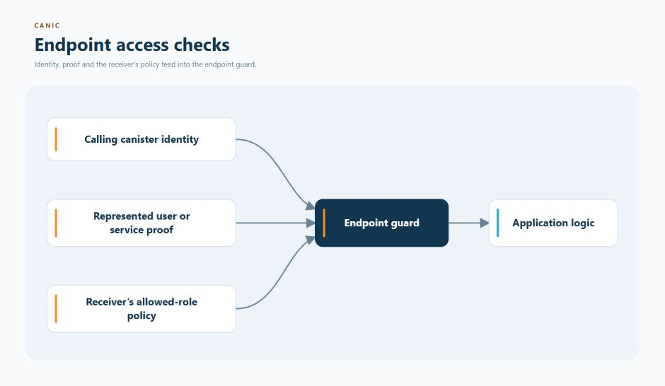

# Authentication

Authentication answers two questions: **who is making this request, and are
they allowed to make it?** Canic checks those answers before application logic
runs.

The IC also needs to distinguish the canister that made a call from the user or
service it may represent. Canic keeps those identities separate so an
application login cannot accidentally become permission to manage canisters or
spend their cycles.

  

Management methods use the calling canister's infrastructure authority. An
application token never becomes controller or Fleet authority.

## What It Provides

- synchronous caller, topology and infrastructure-authority guards
- Root-managed chain-key delegation proof provisioning and renewal
- Root-signed role attestations with local verification

Portable application authentication uses Fleet Root-managed enrollment and
IC Auth's session engine. Its endpoint integration is unfinished; application
session admission is unavailable. The internal persistent receiver component and
its native storage proofs are implementation evidence, not a live login service.
Track completion in
[#491](https://github.com/dragginzgame/canic/issues/491).

Application account identity is the pair (issuer, subject). The
AuthorizedApplicationSubject result retains both fields; applications must not
key accounts by subject alone or substitute the browser's transport caller.
Session and replay capacity are accounted by browser caller, within receiver-wide
bounds. Logout targets that browser caller; it does not log out another device
or merge accounts that share a subject.

Custom guards implement synchronous `canic::access::AccessCheck`. Admission uses
local state and supplied proofs; issuance and renewal may perform asynchronous
calls outside admission.

## Persistent receiver component

With `auth-local-application-authorization`, the internal
`shared_support::application_receiver` surface provides one host-retained
`PersistentReceiverState`. Restore it synchronously after the stable generation,
then retain that owner across callers and proof mechanisms. Protected host policy
supplies Fleet identity, deployment-qualified clock skew and separate proof and
unknown-logout budget rates. No production skew/rate selection or configuration
stanza is supplied here.

The owner reconstructs the entire physical logout ledger, including expired
reservations and denials, from canonical records, occupancy and the checkpoint's
clock. Its serialized `run` boundary retains clock advancement and work charges
on returned errors. Admission and authorization contexts still require freshly
validated, receiver-bound enrollment; records cannot install trust. Logout uses
the authenticated runtime caller and restored state even after enrollment expires.
Use owner-mediated `cleanup_sessions` and `prune_logins` for bounded maintenance.
External maintenance, another restoration, clock rollback or failed pruning
fences the old owner; restore before using it again.

This is an internal host component, not a production endpoint or supported
application-level authorization escape hatch. The current public facade remains
closed. Root enrollment distribution, lifecycle/endpoint wiring and real installed
upgrade acceptance remain with [#491](https://github.com/dragginzgame/canic/issues/491).
Persistent receiver records do not imply persistent issuer keys or TEE custody.

## Boundary

Delegated subject identity is for application endpoints. Framework-owned
creation, placement, upgrade, recycling, and cycles operations continue to use
the raw transport caller and protected topology authority. Canic does not turn
an application token into controller or Fleet authority.

## Continue From Here

- [Authentication architecture](../../architecture/authentication.md)
- [Receiver-local caller authority](../../architecture/authentication.md#receiver-local-caller-authority--accepted-contract)
- [Delegated-signature contract](../../contracts/AUTH_DELEGATED_SIGNATURES.md)
- [Access architecture](../../contracts/ACCESS_ARCHITECTURE.md)
- [Authentication configuration](../../../CONFIG.md#authdelegated_tokens)
- [Root proof provisioning](../../operations/root-proof-provisioning.md)
- [Choose another feature](../README.md)
- [Browse all documentation](../../README.md)
- [Back to the main README](../../../README.md)

## Root proof administration transport

Root proof administration uses separate typed Wire methods:
`canic_root_configure_issuer`, `canic_root_chain_key_public_key`,
`canic_root_delegation_proof`, `canic_root_issuer_renewal`,
`canic_root_prepare_role_attestation` and `canic_root_role_attestation`.
Configuration, key discovery and renewal reporting require a controller;
proof retrieval and attestation preparation require an active Component member.
Attestation retrieval is public. Existing restore and Prepared-state fences apply.
The renewal CLI checks the installed release's exact schema before querying Root.

These transport changes preserve canonical signed payloads and the existing proof
mechanisms. They do not qualify issuer custody, TEE hardware, session persistence
or the production clock-skew bound. Current source changes await the deferred
native, Wasm and installed acceptance checks recorded in the handoff.
