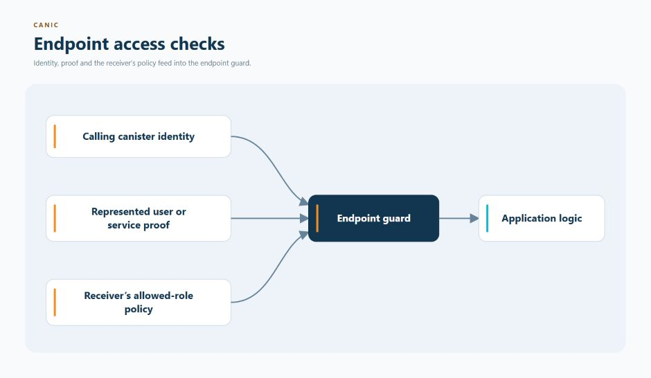

# Authentication

Authentication answers two questions: **who is making this request, and are
they allowed to make it?** Canic checks those answers before application logic
runs.

The IC also needs to distinguish the canister that made a call from the user or
service it may represent. Canic keeps those identities separate so an
application login cannot accidentally become permission to manage canisters or
spend their cycles.

<p align="center">
  <a href="../../../assets/endpoint-access-checks.jpg">
    
  </a>
</p>

Management methods use the calling canister's infrastructure authority. An
application token never becomes controller or Fleet authority.

## What It Provides

- synchronous caller, topology and infrastructure-authority guards
- Root-managed chain-key delegation proof provisioning and renewal
- Root-signed role attestations with local verification

Portable application authentication uses Fleet Root-managed enrollment and
IC Auth's session engine. Receiver-capable roles now export admission, read and
logout through Auth Wire 0.33, and the local application guard uses the same
complete engine. An explicit receiver policy selects controlled local qualification;
production activation remains refused until the clock-skew bound is qualified.
The Root registration core retains explicit governance intent, verifies key
possession and supports lookup/revocation through guarded Wire endpoints. The
signing contract, retained-state regressions and controlled-local installed journey
pass. An explicitly selected issuer now prepares a heap-only key and registers
it with Root. Controlled-local account issuance and lookup-only reconciliation
now use that key owner and IC Auth's credential envelope. Browser delivery and
production qualification remain unfinished. Track completion in
[#491](https://github.com/dragginzgame/canic/issues/491).

Application account identity is the pair (issuer, subject). The
AuthorizedApplicationSubject result retains both fields; applications must not
key accounts by subject alone or substitute the browser's transport caller.
Session and replay capacity are accounted by browser caller, within receiver-wide
bounds. Logout targets that browser caller; it does not log out another device
or merge accounts that share a subject.

Custom guards implement synchronous `canic::access::AccessCheck`. Admission uses
local state and supplied proofs; issuance and renewal may perform asynchronous
calls outside admission.

## Progress

The active priorities are Canic's lifecycle/authority adapter, actual storage
acceptance and issuer/browser integration. Capacity tuning
is outside this separation work.

| Area | Status | Completion condition |
| --- | --- | --- |
| Reusable Auth engine | Complete upstream | IC Auth owns credential verification, sessions, replay/login semantics and bounded Wire contracts. |
| Previous application-auth flow | Removed | The placeholder package, old login endpoints and synthetic denial adapter are gone. Session admission uses Auth's scope rules; intent cleanup no longer writes Auth state. |
| B1 — Production clock and restore safety | Retirement survives scoped Root and issuer snapshot tests; production activation refuses | Loading a pre-retirement sealed Root snapshot cannot reopen authority. Loading an issuer's pre-retirement heap cannot override retirement retained by Root. Production clock bounds and restoring arbitrary unsealed authority state remain unqualified. Ordinary lifecycle restoration clears the signer. |
| B2 — Complete issuer support | Controlled-local Ed25519 qualified on Auth 0.33 | Canic delivers certified issuance alongside Ed25519 and qualifies approval, renewal, retirement and exact-result recovery under the production lifecycle. |
| B3 — Browser integration | Controlled-local Chromium issuer-to-logout journey qualified | The retained client signs calls against two receivers for two devices. Chromium IndexedDB preserves committed logout across page reopening; upstream cleanup retries lost replies and confirms both receivers while retaining the other device. Account-signed issuer HTTP and reconciliation after page reopen now drive admission through the upstream client. Production activation, account-login UI and key custody remain. |
| B4 — Storage and endpoint acceptance | Actual-adapter contract and controlled-local receiver qualified | The actual guarded endpoints preserve original work through capacity refusal, cleanup and renewal. Auth 0.33.1's delivered backend contract now passes against Canic's stable adapter, including reopen, authorization and maximum shapes. Complete the remaining production denial/recovery matrix, storage-profile choices and production costs. |
| B5 — Current dependency family | Scoped Auth 0.33.1/Testkit 0.84.1 proofs pass; production journey remains | Twelve installed Auth cases now pass in the main checkout, including Root and issuer snapshot loading after retirement. Earlier native checks and their exact inputs remain recorded below and in the adoption receipt. Concurrent Control Plane work is not fully qualified by this Auth run. Bind B1–B4's final production evidence to the delivered graph. |
| B6 — Contract and documentation gaps | Protected operator inspection qualified; final reconciliation remains | Receiver inspection, controller-to-Root relay, CLI access and declared-policy/current-authority reporting pass their focused checks. Reconcile final issue/docs status alongside B1–B5. Canic records final consumer acceptance in [#491](https://github.com/dragginzgame/canic/issues/491); [#720](https://github.com/dragginzgame/canic/issues/720)'s shared admission/capacity helpers are already used. |

Root delegation, certification composition and role attestations remain supported
Canic authority adapters. Their proof/configuration flags do not implement the
removed application-token flow. The full Auth batch remains open under #491.

## Persistent receiver composition

Canic delegates retained login replacement to Auth's `LoginRevocationChange::check_replacement`,
using the protected observed clock. Canic owns atomic row writes, pool occupancy and
byte accounting; expired reservations may change pools without prior cleanup.
Enrollment refresh, receiver execution and startup use one Canic storage clock
operation. Observations update encoded-byte accounting even when an operation refuses;
rollback closes access without rewriting retained state, and later clock progress
alone does not reopen it. The current 47 storage and 17 enrollment/Root tests plus
strict lint pass; see `auth_clock_owner_20261103` and `target/auth-clock-owner/`.
The 45 focused actual-storage cases and strict Core Auth lint pass; source-bound
evidence is under `auth_login_transitions_20261103` in the adoption receipt and
`target/auth-login-transitions/`. This is native storage evidence, not production
clock-bound or snapshot anti-resurrection qualification.

Core's `shared_support::application_receiver` supplies `PersistentReceiverState`
under `auth-local-application-authorization`. One retained owner restores the
complete login ledger and keeps proof-verification and unknown-logout budgets
independent across calls. Its policy requires explicit clock-skew and rate limits;
there is no production default. Clock or stale-owner failures remain typed and
close access. Logout retains replay evidence and does not require fresh enrollment.

Receiver storage reconstruction runs in Canic's Auth startup phase, after the
canister's role and managed identity are installed, and before authority reconciliation
or receiver activation. General memory/index initialization does not read the
receiver's role-specific configuration. This preserves one Canic lifecycle owner
while IC Auth continues to own session decisions.
The corrected ordering passes strict Core Auth lint and all nine governed
`native_agent_delegation` installed cases on the published Auth 0.33 graph, including
managed activation, issuer lifecycle, session restoration and durable logout.
Evidence is retained in `target/auth-lifecycle/` and the adoption receipt under
`auth_lifecycle_20261103`. The separate Host timer lost-response case and complete
production acceptance are not qualified by this result.

`shared_support::portable_enrollment` supplies bounded Root snapshots and the
receiver gate. A direct Root pull binds the installed Root, receiver, Fleet and
fresh boot challenge. Checkpoints enforce monotonic revisions/generations and
terminal retirements. Canic restoration closes retained gates; stored checkpoints
never establish readiness. Refresh preparation and completion retain no mutable
receiver borrow across the IC call.

The Root bundle exports the update `canic_root_portable_enrollment` for active
Component members under the existing Fleet and Root fences. Its lease comes from
`auth.portable_enrollment_freshness_ns`; absent policy keeps it unavailable.
It publishes only the already approved registry. The export does not supply issuer
registration, key possession or custody approval.

Root-side registration is selected by `auth-root-delegation-state` and the
Root role's delegation capability. The Root bundle mounts controller-only
`canic_root_prepare_portable_issuer` and `canic_root_retire_portable_issuer`,
plus approved-issuer-only `canic_root_register_portable_issuer` and
`canic_root_portable_issuer_registration`. All four use independent bounded Wire
method identities and typed registration refusals. Lookup is a read-only update
so the issuer can reconcile through authenticated inter-canister transport.
Governance must explicitly select trusted volatile local custody and finite grants/
validity. TEE-required custody refuses without a fallback. The retained public intent
precedes randomness; the first matching nonce completion wins and superseded callbacks
refuse. The possession message uses domain-separated native Wire over Root, Fleet,
issuer, key, operation, approval digest, nonce and the original challenge deadline.
Completion verifies the actual IC caller and Ed25519 possession before approval.
Lookup performs no mutation or renewal. Revocation cancels pending work and
terminally retires issued keys. No issuer secret is stored by this Root component.
The current v1 Root checkpoint gains these records through a clean-reinstall hard
cut. The runtime-free contracts crate owns the shared signing bytes; the Root
verifier and issuer fixture use that same producer contract. The native golden
message digest/signature and field-substitution tests pass, alongside retained
recovery, revocation, maximum-grant budgets and all request/reply schemas. The
whole-registry bootstrap API and test endpoint are removed. The installed test
uses actual issuer-to-Root completion/retry/lookup, restores Root without changing
the retained challenge/deadline, and verifies controller-only retirement, refused
key re-enrollment and receiver denial after retirement. These cases also pass in
the seven-case frozen Auth target described below. Earlier Root receipts retain
their original native pins and exact source graphs.

Receiver runtime policy is explicitly selected in
`auth.local_application_authorization.receiver` on the Component or child role.
Restoration retains checked reset floors, original leases and logout records,
then closes the gate. Runtime activation schedules randomness acquisition and
the direct Root pull through native Timers and Canic's existing durable attempt
recovery. Prepared canisters do not start this work. Refresh also performs bounded
session/replay cleanup before the shared ledger can prune expired login rows.
This retained receiver is the sole live Auth cleanup owner. Generic intent cleanup
reclaims only intent receipts and reservations, so its success, failure or retry
cannot invalidate the receiver's retained ledger and work budgets. Cleanup metrics
and checkpoints are recorded at the Auth owner.

Receiver exports are `canic_establish_portable_session` (update),
`canic_portable_session_read` (query) and `canic_logout_portable_session` (update).
Their IDs, DTOs, finite codec limits and typed refusals come from Auth Wire.
Reads never publish a stable clock write; replicated authorization retains the
trusted observation. Logout requires the retained receiver and actual caller,
independently of fresh enrollment. These local integration paths do not establish
production login, browser delivery, issuer custody or certified-proof acceptance.
The controlled-local PocketIC journey passes direct Root pulls, two receivers/two
browser caller identities, successful scoped guards below one million instructions,
exact retries, restoration with original leases and durable logout. The
[source-bound receipt](../../audits/working/0.112-push-readiness/upstream-adoption.json)
records its exact graph, source and remaining qualification.

## Issuer key preparation

An issuer role may explicitly select `auth-portable-issuer`. Receiver-only roles
cannot select this signing capability. The feature exposes
`canic::api::auth::portable_issuer::{prepare, register, lookup}` for application-owned
Root-guarded preparation endpoints; mounting remains application-owned. These APIs
check the actual caller against the installed Root and use the protected Fleet
and issuer identity. `prepare` requires an explicit `TrustedVolatileLocal` custody
request; `TeeRequired` refuses without a fallback.

Preparation retains its operation before management randomness. The Ed25519 key
stays in one heap owner, with no serializable secret or generic signing API. A
bounded public journal retains up to 64 preparation operations; exhausted capacity
refuses before replacing the current key. Exact retries preserve the first key.
Superseded callbacks cannot replace it, and a new operation cannot reuse a previous
public key. The journal admits both encoding and decoding before committing.

Normal initialization and same-release post-upgrade restoration synchronously
clear the signer before application hooks and deferred work. Old operation IDs
remain consumed; public history cannot regenerate their secret. A fresh operation
needs a fresh key and Root approval. Register signs only Root's exact domain-bound
challenge and retains the original challenge/result. Registration lookup calls
Root without signing, writing intent or extending its original deadline.

An [IC heap snapshot](https://docs.internetcomputer.org/guides/canister-management/snapshots/)
also captures a heap key and does not run post-upgrade hooks when loaded. Heap-only
custody therefore does not qualify snapshot-safe activation.
Planned replacement must retire old Root authority first; production activation
still needs independently qualified restore fencing. The preparation APIs do not
themselves authorize an account or grant application permissions.

Eight native custody/retry cases, the role/contract checks and strict main/caller/
fixture lint pass. The governed Auth target now has eight passing installed cases,
including genuine management randomness, Root registration, ordinary-update reuse,
retirement before restoration, refused old-operation reuse and fresh approval.
The earlier capacity receipt uses the consolidated `canic-tests` package and the
previously qualified Host Tools 0.79/Query 0.89 graph and Host source snapshot.
Earlier receipts retain their original selections. Auth 0.33 now resolves in the
current family; its installed qualification is active without source or lock substitutions.

## Account issuance and reconciliation

`canic::api::auth::portable_issuer::issue(request, authorize)` derives the subject
from the actual authenticated IC caller. The request selects a browser public key,
login ID, operation ID, their epochs and requested grants; it supplies no subject, audience,
issuer key or timestamps. The synchronous application callback must authorize
every requested role/scope for that account and return explicit login, proof and
receipt and reconciliation-retention limits. It runs before intent and again after the asynchronous Root work.
Changed permission or policy prevents signing. Root grants constrain the issuer;
they do not grant every caller an application permission.

The journal retains exact caller/login/request/policy/key bindings and original
login, issuance, admission and receipt deadlines before management randomness or
Root calls. Renewing under another explicit operation preserves the login's
original start/deadline and browser binding. An exact completed retry returns its
original Auth Wire credential, including after proof expiry or key loss. Pending
work cannot acquire another key after restoration or extend its original times.

Fresh Root snapshots use the existing bounded authenticated transport and shared
grant/retirement validation. Root progress is retained before application permission
is rechecked, including a subsequently refused issuance, so an older callback
cannot erase an observed retirement. IC Auth checks the current authority, grants
and time windows and produces canonical signed claims. The heap owner signs their
Auth hash; Canic does not add a second credential encoding.
If an authenticated Root observation exceeds the retained journal's bounds,
the issuer drops its heap signer before returning the refusal. A buffered older
reply cannot then sign under authority that could not be retained. Original
completed credentials remain available through reconciliation.

`reconcile(request)` reads only the actual account's original operation. It returns
the original credential/deadline or `Unresolved`; missing evidence never means
that issuance had no effect. It performs no signing, reservation, Root refresh,
pruning, clock write or deadline extension. Expired retained results remain historical
material; receivers enforce current admission and authority independently.

Before dispatch, the caller reads `context()` and saves its epoch with the complete
new request. Retry and reconciliation retain that original epoch; discovering a
new epoch never authorizes retagging uncertain old work. A known operation returns
its original result. An absent operation from a closed epoch returns `EpochClosed`,
including after its history has been reclaimed. Callback tickets include the
original epoch so they cannot complete a later operation with the same opaque ID.

The journal retains at most 32 issuance rows and 64 live or referenced login rows
within its byte/decoder bounds. Each issuance fixes its removal time before effects:
the later of admission and receipt expiry plus the application-selected retention.
New admissions reclaim eligible history in the same atomic commit; installed Root
can explicitly call `reclaim()`. Removing current-epoch history first closes that
epoch in the same commit. Already closed history needs no further epoch advance.
Checked epoch exhaustion refuses before deleting history. Lookup remains read-only.

Key registration retains an exact domain-bound result commitment and its original
activation window; fresh authenticated Root snapshots supply current grants.
This removes a duplicate full grant set from each public key row. Before storing
new intent, and again before signing, the issuer checks that all unfinished rows
can retain their canonical completed credentials within the journal's byte,
allocation, node and depth limits. The sizing projection never enters storage or
responses. A refused request preserves retained operations and login authority;
later Root growth can still require a typed refusal before signing.

Root retains the original approval and current authority; registration completion
and lookup derive the exact result from those records. There is no additional
completion-result copy or repair writer. The Root journal retains its 128-KiB byte
bound with an independent 4-MiB decoder allocation bound, and commits prove the
stored representation readable before writing. External response budgets retain
their separate limits. Byte-capacity refusal preserves current authority and the
original pending challenge.

Login records survive issuance cleanup with their original browser key, start and
deadline. Renewal names the original `login_epoch`; a missing login from a closed
epoch cannot be recreated. Expired logins remain while retained issuance references
them, then become reclaimable. Live capacity is never evicted to admit another
login. Normal lifecycle restoration advances the operation epoch and clears the
signer without extending login windows.

This current v1 checkpoint extension is a clean-reinstall cut. Production full-state
cost, clock and snapshot-fencing qualification remain open. Production `build_network =
"ic"` issuance refuses under the same unqualified-clock policy as receivers.
The installed fixture now authenticates a separate account and uses this issuer
for receiver credentials; its deterministic signing module and host-built credential
path are removed. Browser transport/distribution remains separate qualification.

The current Auth 0.33 proof passes nine installed cases using genuine issuer
credentials for both devices and receivers, exact retry, permission refusal,
expiry, restored lookup, Root-only reclamation and maximum-grant renewal. Native
checks pass 28 issuer, 17 enrollment/Root, 42 session-storage, seven receiver and
eight portable contract/schema cases. Strict owning Core/Contracts/fixture/caller
lint, issuer-only lint and native schema lint pass.

The latest source snapshot captures the main catalog and lock without dependency
substitutions: Platform 0.20, Wire 0.16.1, Runtime/Guard 0.19, Storage 0.66.1,
Metrics 0.28.2/0.67, Timers 0.39.1, Testkit 0.84 and Host Tools 0.80. Auth runtime,
contracts and issuer/Root fixture sources match the main checkout at comparison;
concurrent Control Plane failure/provisioning-retry changes are separately
recorded. This is scoped Auth qualification on the selected dependency family,
not a complete main-checkout or release gate. Earlier frozen receipts retain
their original Platform 0.18/Storage 0.65.5/Testkit 0.80.2 inputs. Exact source,
lock, logs and production limits are in the source-bound adoption receipt and
`.tmp/auth-testkit084-20261103/`. The earlier 0.83/0.39.0 proof remains separately
retained in `.tmp/auth-current-family-20261103/`.

### Installed count-capacity profile

Receiver capacity is configurable with `max_sessions` in the existing
`auth.local_application_authorization.receiver` table. The Canic adapter
derives replay, retained-login and byte budgets from that count and refuses
restoration when retained state exceeds the selected profile; it never evicts
sessions or logout denials to fit. The isolated configuration/storage checks are
retained under `target/auth-capacity/`, with the isolated source at
`/tmp/canic-auth-capacity/`.

The higher-capacity implementation is locally qualified: the isolated upstream
checkout `/home/adam/projects/ic-auth-capacity` removes fixed deployment ceilings
from `SessionLimits`, retaining positive host-selected budgets and per-write
enforcement. Against its normalized local package, Canic passes 44 storage cases,
including **100,000 signed browser sessions**, full-capacity refusal, reconstruction,
authorization, exact retries, durable logout and slot reuse. Configuration round-trip
and strict owning Clippy also pass. This is native proof, not installed Wasm
instruction/cycle costing or a registry-only dependency qualification.

The [prepared adoption patch](../../audits/working/0.112-push-readiness/auth-capacity-adoption.patch)
sets the default to **100,000** and permits `max_sessions` from 1 to 250,000.
Replay and retained-login budgets are twice that count; byte/index budgets scale
with it. Byte capacity can bind before the session count for larger record shapes.
The 250,000 configuration ceiling is not a claim of a tested full store at that size.
The [adoption receipt](../../audits/working/0.112-push-readiness/upstream-adoption.json)
records the exact source, local package, graph and logs. Until a supplying Auth
release is selected, normal Canic still uses published Auth 0.33's 2,048 ceiling
and default; the local package override is confined to the qualification copy.

The observed in-flight Engine 0.33.1 release is frozen at `f8d693c` and still
contains the old ceiling. It cannot supply this adoption by itself. The focused
[upstream patch](../../audits/working/0.112-push-readiness/auth-upstream-capacity.patch)
contains the tested engine, regression and contract-documentation changes and
passes an application check against that source. Apply it after the active release
finishes, maintain the next Engine changelog draft and publish a supplying release
before applying Canic's adoption patch. No running release inputs were changed.

The separate native receiver-capacity case fills the actual stable adapter's
2,048-session limit, rebuilds its indexes and login ledger, and exercises
authorization and exact retry at saturation. Logout survives reconstruction,
retains consumed proofs, refuses both authorization and credential readmission
for the revoked browser, and leaves another device authorized. A new browser can
then occupy the freed session slot without removing the logout tombstone.
This is native adapter evidence, not installed receiver instruction/cycle costing
or completion of the packaged backend-conformance driver.

The real APIs fill all 64 key-preparation slots, 64 live login slots and 32
completed issuance slots. Refusal preserves the selected key and original
credentials. Cleanup removes elapsed issuance history without evicting live
logins; renewal preserves the original login window and admits at the receiver.
No extra endpoint or injected issuer state supplies this evidence.

Existing protected metrics provide exact deltas for exclusive endpoint work,
using local instruction counter 1 across awaits. Representative observations are:

| Operation | Recorded local instructions |
| --- | ---: |
| Fresh issuance into the last slot, 64 live logins | 185,324,318 |
| Original-result lookup with full history | 18,083,677 |
| Cleanup with no elapsed history | 35,026,069 |
| Prune 32 credentials while retaining 64 live logins | 26,351,353 |
| Renew an original login after cleanup | 72,998,944 |
| Fresh issuance with maximum grant/scope counts | 83,143,709 |
| Retained maximum-grant result lookup | 9,713,878 |
| Journal byte-capacity refusal | 20,694,265 |
| Maximum-grant renewal under the original login window | 99,923,772 |

The fixed grant/profile uses a 300-million regression ceiling for last-slot fresh
issuance and 100 million for the other measured paths. The installed large-grant
profile uses all 16 grants, 32 maximum-length scopes per grant and 15 maximum-length
roles alongside the receiver's real `issuer` role. Native issuer and Root cases
also use 64-byte labels for every role. The separate large-grant regression
ceilings are 600 million for issuance/renewal and 300 million for retained paths.
Both Root and issuer journals exercise atomic capacity refusal without losing
authority or original results. Cleanup and renewal preserve the original login
window and the renewed credential admits at the receiver.

These are controlled-local observations of exclusive endpoint work. Remote
instructions, cycle charges, certified proofs and production cost acceptance
remain open; the profiles do not qualify their maximum shapes simultaneously
with every count capacity.

## Boundary

Delegated subject identity is for application endpoints. Framework-owned
creation, placement, upgrade, recycling, and cycles operations continue to use
the raw transport caller and protected topology authority. Canic does not turn
an application token into controller or Fleet authority.

## Continue From Here

- [Authentication architecture](../../architecture/authentication.md)
- [Receiver-local caller authority](../../architecture/authentication.md#receiver-local-caller-authority--accepted-contract)
- [Delegated-signature contract](../../contracts/AUTH_DELEGATED_SIGNATURES.md)
- [Access architecture](../../contracts/ACCESS_ARCHITECTURE.md)
- [Authentication configuration](../../../CONFIG.md#authdelegated_tokens)
- [Root proof provisioning](../../operations/root-proof-provisioning.md)
- [Choose another feature](../README.md)
- [Browse all documentation](../../README.md)
- [Back to the main README](../../../README.md)

## Root proof administration transport

Root proof administration uses separate typed Wire methods:
`canic_root_configure_issuer`, `canic_root_chain_key_public_key`,
`canic_root_delegation_proof`, `canic_root_issuer_renewal`,
`canic_root_prepare_role_attestation` and `canic_root_role_attestation`.
Configuration, key discovery and renewal reporting require a controller;
proof retrieval and attestation preparation require an active Component member.
Attestation retrieval is public. Existing restore and Prepared-state fences apply.
The renewal CLI checks the installed release's exact schema before querying Root.

These transport changes preserve canonical signed payloads and the existing proof
mechanisms. They do not qualify issuer custody, TEE hardware, session persistence
or the production clock-skew bound. Native, Wasm and installed evidence retains
the exact graph and source recorded in the handoff.

## Protected Auth inspection

Receiver-capable roles expose the owned Wire update `canic_portable_sessions_inspect`
to their installed Fleet Root. The caller-self Auth read endpoint remains separate.
The request supplies an exclusive `after` caller cursor and a `limit` from 1 to 32.
Each reply carries the observed time, current authority generation, retained session
summaries and an optional continuation cursor. Each page is a fresh observation;
admission or logout between pages can change the retained set.

Summaries contain caller, issuer, subject, canonical scopes, establishment/expiry
timestamps and generation. Expired and stale-generation rows are marked explicitly.
Credentials, proof fingerprints and replay records are not returned. An unexpired
row is not proof of current enrollment or authorization: application access still
runs Auth's complete decision path. Inspection neither renews nor deletes sessions.
Closed storage and backward-clock observations refuse inspection.

The operator commands resolve the target in the current Fleet and route through its
owning Root. Root authenticates its controller, checks the target and forwards one
bounded observation; the receiver independently authenticates its installed Root.
The host verifies the exact Root method identity and limits against the selected
release schema. Root and Store roles refuse receiver inspection.

```sh
canic auth policy <fleet> --canister <principal> --json
canic auth sessions <fleet> --canister <principal> --limit 16 --json
canic auth sessions <fleet> --canister <principal> --after <caller> --limit 16
```

`policy` separates declared Fleet/role, scopes and time bounds from the current
receiver state: disabled, unavailable, unqualified clock, waiting for enrollment
or ready. Ready reports include the current Root, revision, generation, expiry
and enrolled issuers with their grants. Configuration alone never reports readiness.
Session rows remain observations rather than permission to call application methods.
Both commands preserve receiver refusals separately from Root transport failures.

Inspection qualification passes 50 actual-storage tests, the owned Wire identity test
with schema support, strict Core Auth lint and all nine installed Auth cases. Root
can read the page; browser, anonymous and unrelated issuer calls are rejected.
Evidence: `target/auth-session-inspection/` and the adoption receipt's
`auth_session_inspection_20261103`. These results do not qualify production
clock bounds, snapshot anti-resurrection or the complete browser journey.

Operator relay qualification additionally passes all nine installed Auth cases on
Auth 0.33.1/Testkit 0.84.1, including controller and receiver denial, typed invalid-page
refusal, fresh enrollment reporting and Root self-target refusal. Current-family
Core/Host/CLI and fixture strict lint passes. CLI parsing (14), Host routing (3),
help (2) and Wire (2) tests retain their preceding Auth 0.33.0 graph. Evidence is
in `target/auth-operator/` and `auth_operator_20261103` in the adoption receipt.
This qualifies the inspection slice, not the full production Auth journey.

The delivered backend conformance driver runs Auth 0.33.1's complete contract against
Canic's actual stable session adapter. All 51 focused storage tests and strict Core
Auth lint pass. Reopen imports through the stable owner and rebuilds indexes from
stored records; injected failures occur before delegation to a commit. This is
native adapter qualification, not IC trap atomicity, heap snapshot anti-resurrection
or production cost evidence. The exact supplier package is a development-only
dependency under the retained [Auth inputs](../../../crates/canic-tests/test-support/auth/README.md).
Evidence: `target/auth-backend-contract/` and `auth_backend_contract_20261103` in
the adoption receipt.

Native feature-boundary qualification also passes for Core with defaults disabled:
`auth-local-application-authorization` and `auth-portable-issuer` each pass strict
library/test lint independently. Receiver-only helpers and metrics, issuer call
wiring and Root registration context follow their owning features. The 28 issuer
and eight registration tests pass with the issuer feature alone; exact completed
preparation and issuance replay compare the original challenge and credential.
Evidence is in `target/auth-feature-boundaries/` and the adoption receipt's
`auth_feature_boundaries_20261104`. These native checks do not replace installed
production, certified-issuance or browser qualification.

Installed issuance also qualifies the application's post-await permission boundary.
The fixture accepts the initial account policy, then revokes permission or changes
its login lifetime on the second check after actual randomness and Root calls.
The API returns typed `Denied` or `Conflict`; reconciliation remains unresolved,
and retargeting the retained operation to a different browser still conflicts.
All ten installed Auth cases pass in the isolated Auth checkout. The main checkout's
run stopped before tests on unrelated `operation_retry` protocol references, so this
is not a qualification of its complete current tree. Evidence:
`target/auth-permission-recheck/`, receipt `auth_permission_recheck_20261104`.

Interrupted issuance now reuses an already committed nonce instead of requesting
fresh randomness that would be discarded. Reading it is effect-free and still
requires a live key, original deadlines and a non-regressing clock; Root authority
is fetched again and application policy is rechecked before signing. The installed
fixture temporarily denies the first completion, then permits the same operation:
the recovered credential retains its original issuance timestamp and proof expiry,
and reconciliation returns that exact result. Qualification passes 29 issuer tests,
strict Core/fixture/integration lint and ten installed Auth cases in the isolated
checkout. Evidence: `target/auth-issuance-retry/`, receipt
`auth_issuance_retry_20261104`. Production clock/restore and certified issuance
remain unqualified.

The pending-issuance recovery matrix now also exercises expiry on the installed
path: after application denial and the original proof deadline, exact retry returns
`Expired`, reconciliation remains unresolved and browser retargeting still conflicts.
All ten Auth cases pass on the current checkout with Shared Tooling 0.29.3. Earlier
missing `operation_retry` compiler errors came from stale contracts artifacts in a
target directory reused across source copies; rebuilding contracts resolved them
without a protocol source change. Keep compilation outputs distinct per checkout.
Evidence: `target/auth-expired-retry/`, receipt `auth_expired_retry_20261104`.

The installed Root restore case first issues a credential successfully, seals Root,
then stops, snapshots, loads and restarts it through PocketIC. Changed management
history prevents resume; the retained seal rejects issuer registration and fresh
issuance, whose reconciliation remains unresolved. All eleven installed Auth cases
pass. This uses the existing authority fence rather than introducing another
restore owner. It does not qualify snapshots of the issuer's own heap, arbitrary
unsealed Root snapshots or the production clock. The run also exposed and corrected
a Coordinator-only funding-policy feature gate in the Root Wasm graph. Evidence:
`target/auth-root-restore/`, receipt `auth_root_restore_20261104`.

The retirement follow-up strengthens this proof: the original live Root resumes
successfully after snapshot capture, retires the issuer, and is then replaced by
its older sealed snapshot. The restored authority still cannot resume or issue.
A separate case restores the issuer's own pre-retirement heap while Root retains
the retirement. Its restored signing key cannot issue a new credential: fresh Root
authority yields `Unavailable`, and reconciliation remains unresolved. All twelve
installed cases pass. These are controlled-local operational proofs; simultaneous
rollback from arbitrary unsealed authority snapshots and production clock bounds
remain unqualified. Evidence: `target/auth-retirement-restore/`, receipt
`auth_retirement_restore_20261104`.

The retained browser package is now selected by npm integrity in the existing
frontend consumer. Its public `httpAdmissionTransport` and `httpLogoutTransport`
sign real ingress against PocketIC's HTTP gateway with the explicit NNS root key;
reply certificate verification stays enabled. Two browser identities admit on
both receivers. Logging out one identity on both leaves the second admitted.
The fixture waits for observable receiver enrollment before issuing its proofs.
Run this opt-in Node test with `bash scripts/dev/qualify-auth-browser.sh` after
preparing the consumer's locked npm dependencies. This is transport acceptance,
not browser storage/UI, issuer HTTP or durable client recovery qualification.
Evidence: `target/auth-browser-transport/`, receipt `auth_browser_transport_20261104`.

The transport proof now drops responses only after the gateway accepts signed
admission/logout ingress. Every attempt dispatches once and reports failure rather
than pretending the effect was rolled back. Receiver observations establish that
the effects completed. A new Node process retries the original credentials;
every session field, including expiry, matches the original. After lost logout
responses, both receivers report `MissingOrExpired` for that device. Retried logout
confirms revocation while the second device's full session records remain intact.
This qualifies transport retry, not a persisted browser journal or automatic
`PortableLogoutClient` recovery. Evidence: `target/auth-browser-recovery/`, receipt
`auth_browser_recovery_20261104`.

The separate durable browser case passes in Chromium 156.0.8078.4 using real
IndexedDB and the retained package's `PortableLogoutClient`. Destination intent
is committed before signed admission. Logout is committed before page closure;
reopening preserves its phase and original deadline, and the guarded identity
refuses new signing. Upstream cleanup loses each receiver's first accepted reply,
then retries and confirms revocation. A further page reopen retains the finished
journal and signing refusal. The other device's journal and installed sessions
remain active. The fixture observes the disposal callback; deterministic test
keys do not qualify production custody. Issuance remains Rust-fixture driven.
Run `CANIC_AUTH_BROWSER_EXECUTABLE=/absolute/path/to/chrome bash scripts/dev/qualify-auth-browser.sh durable`
after preparing the locked npm dependencies and browser executable. This creates
an isolated browser context, uses an exact local trust root, and does not install
a browser. Evidence: `target/auth-browser-durable/`, receipt
`auth_browser_durable_20261104`.

The `issuer` browser case now passes the controlled-local issuance-to-logout
journey. A separate account identity signs actual issuer HTTP calls using codecs
generated from the Rust Wire method schemas. Exact issuance/reconciliation intent
is persisted in browser localStorage before dispatch; Auth's journal remains in
IndexedDB. The harness discards each completed issuance reply before the admission
client retains its credential, closes the page, then reopens and reconciles the
original result once per device without reissuing or extending its deadline.
The upstream admission client admits both devices on both receivers. Installed
sessions retain the account subject and distinct browser caller. The same run
proves durable logout, lost-reply cleanup and device isolation.
Run `CANIC_AUTH_BROWSER_EXECUTABLE=/absolute/path/to/chrome bash scripts/dev/qualify-auth-browser.sh issuer`.
This uses deterministic fixture keys and controlled-local issuance; it does not
qualify production clock/restore safety, certified issuance, UI or secret custody.
The injected issuance loss occurs after a completed authenticated HTTP response,
not during network dispatch. Evidence: `target/auth-browser-issuer/`, receipt
`auth_browser_issuer_20261104`. Concurrent dependency adoption after the installed
run means that passing result is not acceptance of the newer lockfile.
The concurrent adoption corrected the Metrics call. Focused strict lint for the
Auth integration target and issuer fixture now passes on the newer graph. The
browser harness additionally checks that browser keys, unrelated accounts and
anonymous callers cannot retrieve the original account credential or issue with
its request bytes. The extended installed case passes: after these probes, the
original account retrieves the exact credential fingerprint and original deadline.
Run unauthorized probes after admission so their round trips do not consume the
six-second admission window. Durable logout and device isolation also pass. The
initial probe-order expiry and an input-change cache rejection are retained in
the evidence directory. The lock changed after the pre-run capture, so this proof
does not establish acceptance of every current lock selection. Syntax and
frontend boundary checks pass. Evidence: `target/auth-browser-isolation/`.
The complete Auth batch and
its proposed release drafts remain unready for publication.
