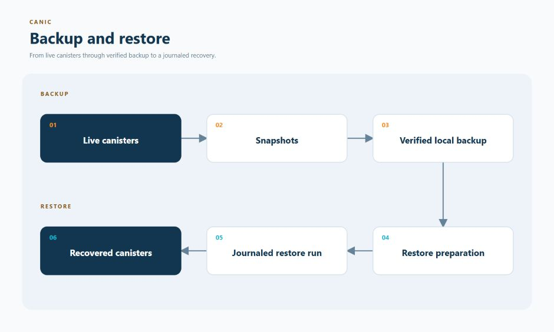

# Backup And Restore

A canister snapshot is a saved copy of a canister's state. Canic's backup tools
plan captures and verify retained snapshots on the operator's computer. Its restore tools
check those files, map them to the intended canisters, and record progress so an
interrupted recovery can safely continue.

Backups are for recovery within the same Canic release. They are not a way to
carry application state across the clean reinstall required between pre-1.0
releases.

<p align="center">
  <a href="../../../assets/backup-and-restore.jpg">
    
  </a>
</p>

## Current Availability

**Creating a new backup is currently unavailable.** `canic backup create
<fleet>` returns the typed `LiveCreateUnavailable` error before resolving the
workspace, creating a layout or invoking ICP. The live topology and authority
adapter is not yet implemented. `--dry-run` can prepare local planning files for a
supported inventory, but it does not prove the live layout or permissions and
does not create a backup. Current selection requires exactly one Fleet Subnet
Root.

This gap dates from the 0.100.80 removal of the public Subnet Registry query and
is tracked in [Canic #394](https://github.com/dragginzgame/canic/issues/394).
The accepted independent-package direction keeps Fleet coordination in Canic
and moves generic backup/restore mechanisms to `ic-backup`. Completion needs
authoritative live membership, controller/read authority, application consistency,
topology-change handling and interruption recovery, together with usable upstream
runners. The [adapter contract](../../architecture/independent-package-adapters.md#backup-adapter-contract)
defines those boundaries; it does not establish live backup availability.

Verification and restore of existing valid same-release backups retain their
own artifact, identity and journal checks. Canic no longer exposes an injected
capture executor. New live capture must compose IC Backup’s execution and recovery
owner with Canic’s Fleet authority and coordinated checkpoint policy. The active
restore runner and its same-operation recovery remain maintained.

Root now retains checkpoint identity and the complete active local participant
catalogue in its own stable storage. Controller-authenticated Wire operations
`canic_root_checkpoint_begin`, `canic_root_checkpoint_status`,
`canic_root_checkpoint_advance` and `canic_root_checkpoint_release` reserve,
inspect, advance one participant and retain release intent. Begin requires the
current Root installation and expected prior sequence; retries keep the original
unit. Catalogue mutations remain excluded until every release is acknowledged.

Every selected application must implement the Wire `canic_application_checkpoint`
hook and authenticate it with `ApplicationCheckpointCommandPredicate`. Resolve
the request with `binding_from_command`, commit application-owned preparation or
release, and return the exact command with its acknowledged phase. The authority
digest commits canonical CBOR receiver authority with the
`canic.application-checkpoint.authority.v1` NUL-terminated domain; Root commits
the sorted authority digests under `canic.application-checkpoint.unit.v1`.
Preparation must cover business timers, mutations and external obligations. An
unavailable or unsupported hook leaves the original checkpoint fenced for
recovery; it never counts as released. Applications must qualify both hooks
before beginning a unit checkpoint. The framework does not supply a business
freeze automatically.

These commands do not issue snapshot effects or authorize backup publication.
The host checkpoint adapter now binds BEGIN/ADVANCE to IC Backup's original
workflow, stage and finite attempt records. Its installed Root/two-participant
fixture covers a lost ingress reply, original observation recovery and cold replay,
then separate fixture-authorized same-ID snapshot/load and release. Production
Root-paid capture/restore, current live provider admission, full application
acceptance and whole-operation terminal settlement remain required before live capture.

Artifact SHA-256 verification accepts uppercase and lowercase hex as the same
digest. Malformed hashes and different artifact bytes still reject.

IC Host owns no-follow artifact traversal and deterministic directory checksum
framing. Canic maps those identities into IC Backup’s checksum records and retains
manifest/journal binding checks. This artifact support does not enable live capture.

Layout verification resolves the selected backup directory before deriving
verification paths. Relative paths and directory links selected by
the operator are supported; links inside artifact trees remain rejected.
CLI layout creation retains the execution-journal lock and shares a layout
lifetime lock with restore preparation, execution and
prune. That lock lives beside the backup directory so deletion cannot replace
its identity while another process still holds it.

Backup metadata records have a 64 MiB acquisition limit, including standalone
`canic backup manifest validate --manifest <file>`. Non-regular descriptors and
oversized records refuse before JSON decoding. Explicit manifest path aliases
remain supported; streamed snapshot artifacts have separate bounds.

Retained plans, journals and manifests remain readable for inspection and restore
admission. Removing the capture executor does not delete retained layouts, settle
an uncertain paid effect, or make a dry-run plan into a completed backup.

## Maintained Primitives

- topology-aware full-Fleet and subtree backup selection
- snapshot download journals with durable artifact paths and hashes
- manifest validation and byte-integrity verification
- restore-readiness checks and explicit principal mapping
- parent-before-child restore planning
- resumable, bounded restore execution with operator-attention states
- local pruning kept separate from live snapshot deletion

For an existing backup, the operator path is:

```bash
canic backup verify <backup>
canic restore prepare <backup> --require-verified --require-restore-ready
```

## Local Retention

`canic backup prune --keep N` retains the newest N verified complete backups.
It verifies artifact checksums before counting a copy toward retention and keeps
those retained copies locked while deleting older eligible copies. `--dry-run`
uses the same eligibility checks. `--keep 0` explicitly selects no ordinary
retained copies.

Prepared restores retain a durable reference to their source backup, including
when `--journal-out` selects an external path. Paused, failed and interrupted
restores keep that reference. Removing or moving an unfinished journal does not
release its artifacts. Resume using its original journal location. Once the
restore completes and its external commands have exited, the runner releases its
reference. If interrupted at terminal publication, rerun the same journal to
finish that release without repeating completed effects.

Execution journals retain the original command-custody identity before dispatch.
Retry and terminal release require that exact sidecar; a missing or replaced
sidecar refuses without recreating custody. IC Backup owns descriptor inheritance,
one spawn and quiescence. Host owns bounded output capture and child cleanup.
Terminal reference release freshly validates the original journal and receipts
while holding the original journal and command guards.

An interrupted snapshot load, or a load command that exits unsuccessfully, is
unsettled: neither process exit nor observing a stopped canister proves that the
load did not commit. The runner preserves the journal and source retention and
refuses another load, including `--retry-failed`. A recorded read-only precondition
failure remains retryable because the load was never dispatched. The current
subprocess adapter has no settlement proof for uncertain loads; recovery remains
an engine-convergence requirement. Do not clear the journal or create a fresh
restore to bypass this refusal.

Prune reports busy, restore-referenced and invalid layouts as skipped. A deletion
failure is reported alongside any directories already removed and makes the
command fail. Failed backup journals remain recovery evidence and are retained.

## Boundary

Canisters do not read or write backup files. Filesystem access, ICP CLI calls,
credentials, manifests, journals, and restore runners remain on the operator
host. Current releases use backup and restore for same-release recovery rather
than cross-release state migration. No active pre-1.0 design grants backup,
copied-state dry-run or restore-manifest authority to preserve application
state across releases.

Backup selection deliberately uses the last converged Fleet Ensure inventory.
An unapplied successor plan does not replace that snapshot. Once apply starts,
its nonterminal journal blocks backup until the successor state is fully
validated and published as converged. Other operator commands bind the exact
current plan and journal instead.

The ordering contract has these crash boundaries:

| Crash point | Journal visible to backup | Backup result |
| --- | --- | --- |
| before successor apply | prior `Converged` | prior converged topology; planning may refresh only backup-inert observation and prior journal-proven reinstall evidence |
| after apply publishes its journal, before or during effects | `InProgress` or `ReplanRequired` | refused as nonterminal |
| after validated terminal state is written, before terminal journal publication | nonterminal | refused as nonterminal |
| after terminal journal publication | successor `Converged` | successor validated topology |

This safety claim depends on Fleet Ensure retaining that write order: publish a
nonterminal journal before any effect-owned state and publish validated terminal
state before the matching `Converged` journal.

Remote snapshot archival is outside the current local backup contract.
Application blob storage belongs to the independent service and its adapter.

## Continue From Here

- [CLI backup and restore guide](../../../crates/canic-cli/README.md)
- [Backup domain crate](../../../crates/canic-backup/README.md)
- [Recovery and retry runbooks](../../operations/recovery-retry-runbooks.md)
- [Fleet recovery and cycle safety](../operations/fleet-ensure-recovery-and-cycle-safety.md)
- [Choose another feature](../README.md)
- [Browse all documentation](../../README.md)
- [Back to the main README](../../../README.md)
