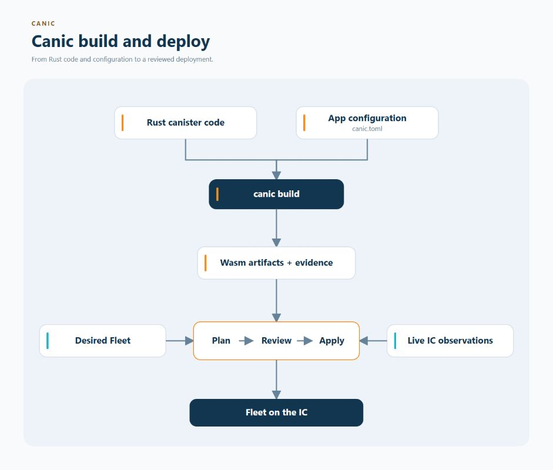

# Builds, Provenance, And Evidence

IC canisters are deployed as **WebAssembly (Wasm)** files. Canic builds those
files and records **provenance**: evidence about the source, configuration,
tools, and dependencies that produced them. Operators and automated checks can
compare that evidence before deciding to deploy anything.

Building, inspecting evidence, and deploying are deliberately separate actions.
An evidence check can report a problem, but it cannot modify a Fleet.

  

`canic build <app> --json` writes one schema-1 result to stdout; progress and
tool diagnostics stay on stderr. Read `release_build_id` and `release_manifest`
for a complete App build. A cache hit returns the same identity with `reused: true`.
For a selected role, `artifact` contains the Wasm, compressed Wasm and Candid paths,
and the release fields are `null`. `role`, `artifact` and both release fields are
always present. Automation should use these fields instead of parsing build
headings or artifact tables. A failing build returns a nonzero exit status.

Application workspaces use Cargo's resolver selection and defaults. Canic validates
the resolved dependencies and role features without requiring an explicit resolver
declaration or a particular resolver version. Canic's own workspace and generated
Fleet packages select `resolver = "3"`.

## What It Provides

- role-aware Wasm and Candid artifact construction
- deterministic artifact identities and checked configuration inputs
- optional build-provenance output for CI and release pipelines
- generic evidence envelopes and policy manifests
- passive policy gates over previously captured evidence

Evidence envelopes are designed for transport and comparison in CI. They
preserve the underlying report and its input fingerprints without claiming
that a deployment mutation happened.

The host generates thin Cargo packages for Root, Coordinator and Store under
`target/canic-packages/<configuration-path-sha256>/` under the owning workspace.
The identity hashes the workspace-relative configuration path. Generated packages
remain outside application source trees; only selected generated inputs join
their build evidence. Sibling
configurations have independent manifests and lockfiles. All three bind the exact
Canic dependency and use unpublished build packages. Root selects configured
capabilities, Store compiles its configuration, and Coordinator remains
independent of App configuration. Cargo graphs are validated before artifact
finalization. Canonical Coordinator/Store Candid ships in `canic/candid`; Root
Candid follows its configured capabilities.

`target/` is a disposable aggregate, not a compiler output root. Repository Cargo
and Make use `target/cargo/`; Host's unset-output default remains
`target/canic-wasm/`. Generated source stays in the sibling `canic-packages/`
tree, preserving inherited Cargo configuration. Selected generated source is
admitted and fingerprinted normally; application source scans exclude their
`target/` tree. Explicit `CARGO_TARGET_DIR` overrides remain effective, but may
not enclose or enter the generated-source tree (including through symlinks).
Use `target/cargo/`, `target/custom/`, or a separate external output directory;
an override to workspace `target/` is rejected before generation. `make clean-wasm`
owns removal of generated packages; no cache is removed during an active build.
Generated manifests remain unpublished and the ignored `target/` tree is not
release source or package content. Existing output in `target/debug/` is historical
cache, not the new default executable location; no automatic migration is performed.

Generated locks are derived from the selected workspace's current `Cargo.lock`.
A change to that lock or the generated manifest atomically refreshes the seed;
Cargo then resolves the generated package's graph. Unchanged inputs preserve that
resolved graph. The `lock-seed.json` record identifies the derivation, while cache
and provenance evidence fingerprint the actual resolved lock. Complete-build reuse
prepares these inputs before taking its snapshot.

Build commands and cache fingerprints share Host's captured build environment.
Owned execution plumbing (temporary directories, Make flags and test-runner
controls) is withheld from both. Shared release delivery context (the `RELEASE_*`
source, destination, version/date and phase selections passed by the release
runner) is also withheld: changing delivery context alone cannot invalidate Wasm
artifacts. Artifact identity remains bound through `CANIC_RELEASE_BUILD_ID`, the
selected package versions, source, configuration and compiler inputs. This is
artifact reuse, not qualification-result reuse; release checks and PocketIC cases
still execute. Per-call Codex IDs and verified editor/sandbox-only PATH entries
under its temporary helper root are removed from both children and fingerprints.
Normal tool directories, unknown entries and symlinked directories remain bound;
this does not discard compiler selection through PATH. Unknown variables, compiler options and Cargo
offline policy remain effective inputs; normalization cannot hide an input that
a child build receives. The default PocketIC runner uses the stable verified
managed ICP directory in PATH; explicit native binary overrides retain private
single-tool aliases and can therefore prevent reuse across invocations.

Application and Root builds select the Wasm named in Cargo's compiler-artifact
messages for the exact package manifest. Custom library names are supported.
Each declaration batch's Candid is extracted, and each runtime batch's bytes are
captured, before another workspace can overwrite a shared Cargo output filename.
An unreported stale file never becomes the selected artifact.

Every final artifact, including a Local build, must fit Canic's supported
12 MiB code-section and 50,000 defined-function ceilings before the Wasm,
Candid and gzip outputs are published. Rejection preserves any previous output
set and reports the offending artifact and measured limit. These are build
admission checks, not a substitute for replica validation of the whole module.
The code-section ceiling follows the
[IC resource limits](https://docs.internetcomputer.org/references/resource-limits/);
it is distinct from the IC's 100 MiB total-module limit. The size warning starts
with 768 KiB of remaining code-section headroom.

Host persistence and protocol documents use bounded no-follow readers from
`ic-host-fs`: the general document envelope is 16 MiB and the artifact read
envelope is 128 MiB. Smaller format limits still apply. These are local read
budgets, separate from replica installation limits. Oversized or unsafe inputs
are refused without replacing the selected file; native I/O and typed admission
causes remain available to callers. Canic retains path confinement, artifact
identity, publication ordering and same-operation recovery.

## Boundary

Build provenance is not runtime attestation. Evidence and policy commands do
not install canisters, change controllers, sign artifacts, import registries,
or adopt discovered resources. Ordinary deployment convergence belongs to the
reviewed `canic fleet ensure` workflow; bootstrap, capacity import and other
explicit control operations retain their own reviewed authority.

## Continue From Here

- [Build artifact architecture](../../architecture/build-artifacts.md)
- [Evidence envelopes](../../architecture/evidence-envelopes.md)
- [CI policy gates](../../architecture/ci-policy-gates.md)
- [Managed-App qualification](managed-app-qualification.md)
- [Fixture build artifacts](fixture-artifacts.md)
- [Operator walkthrough](../../architecture/v1-operator-walkthrough.md)
- [Choose another feature](../README.md)
- [Browse all documentation](../../README.md)
- [Back to the main README](../../../README.md)
